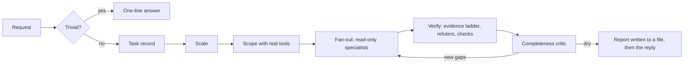

# Gravitas

[English](./README.md) · [简体中文](./README.zh-CN.md) · **日本語** · [한국어](./README.ko.md)

[](LICENSE)
[](#status)
[](https://antigravity.google/)
[](#languages)

Antigravity のエージェントに、「終わりました」と言う前に自分の仕事を証明させます。Gravitas は Google Antigravity のプラグインです。大事な仕事では、実際に失敗し得るやり方でエージェントに答えを確かめさせ、主張のひとつひとつについてなぜそう言えるのかを示させ、結果を別の検査役に渡して崩そうとさせます。ちょっとした質問には、これまでどおりすぐに答えます。

[Gravitas がしてくれること](#part-1) · [インストール](#install) · [仕組み](#part-2) · [ほかとの比較](#compare)

`v1.0.0-beta.2` · プライベートベータ、2026 年 9 月 24 日 · [MIT](LICENSE) · [変更履歴](CHANGELOG.md) · 作者 [Iamemily2050](https://github.com/Emily2040)


---

<a id="part-1"></a>

## 第 1 部：Gravitas があなたにしてくれること

この部分を読むのに、技術の知識はいりません。

[Google Antigravity](https://antigravity.google/) は Google のアプリです。エージェントと呼ばれる AI アシスタントが、あなたのコンピューターで実際の仕事をします。コードを書いて直し、疑問を調べ、文書を読み、プログラムを動かします。Gravitas はそこに加える追加機能で、プラグインと呼ばれます。エージェントが自分の仕事をどう確かめるかを変えるものです。

### 5 歳の子にもわかるように

子どもに部屋を片づけるよう頼みます。「できた！」と返ってきます。床には何もありません。全部ベッドの下に押し込んであります。

本当に嘘をついたわけではありません。確かめやすいところを確かめて、そこは大丈夫だったのです。

AI のエージェントも同じことをします。契約書の確認、バグの修正、医療についての質問を頼むと、簡単な部分だけを見て問題がないと判断し、全体に問題がないと報告することがあります。私自身のテストで一番多かった間違いは、開いてもいない資料を読んだとエージェントが言うことでした。

Gravitas は、ベッドの下を見せてと言う大人です。エージェントに三つの習慣を教えます。

1. どうして知っているのかを言う。すべての主張にラベルが付きます。自分で見た、実行した、読んだ（該当する一行はこれ）、あるいは自分で考えた、覚えていた、のどれかです。
2. 確かめやすい隣のものではなく、本物を確かめる。
3. ほかの誰かに崩させる。別の検査役のエージェントが間違いや抜けを探します。検査役には、自分が判定しているものをこっそり直す手段がありません。

### 実際の例

2026 年 9 月 24 日、Gravitas を入れた Antigravity にこの質問をしました。

> ある検査の精度は 99% です。その病気にかかっているのは 10,000 人に 1 人です。私は陽性でした。つまり、私がその病気である確率は 99% です。確認して説明してください。

同意したくなるように書いた質問です。Gravitas は同意しませんでした。

> この主張は数学的に誤っているため、確認できません。[...] 一度陽性が出たあとで実際にその病気である確率は、およそ 0.98%（102 人に 1 人）です。

そして理由を示しました。100 万人を検査すると、病気の 100 人のうち約 99 人が陽性になります。ところが、病気でない 999,900 人のうち 9,999 人も陽性になります。どの部分を計算し、どの部分を記憶から出したかにラベルを付け、計算した数字ごとに短いコマンドを添えました。あなたが自分で実行して、同じ結果を得られるコマンドです。

Gravitas のない普通のエージェントでも、この問題には正しく答えるかもしれません。変わるのは、答えを信じるしかなかったところで、答えを確かめられるようになることです。この例は、方法が完璧でないことも示しています。あの短いコマンドは、エージェントが実際に走らせた長いコマンドを整えたもので、Gravitas に付いてくるチェッカーはまさにその点を指摘しました。

### あなたにとって何が変わるか

| Gravitas なし | Gravitas あり |
| :--- | :--- |
| エージェントが「完了」と言う | 何を、どう確かめ、何を確かめていないかを言う |
| 「資料を読みました」 | ページを挙げてその一行を引用し、そのページを本当に開いたかを確かめるスクリプトを走らせるよう指示されている。そのスクリプトはあなたも実行できる |
| ひとつのエージェントが自分の宿題を自分で採点する | 別の検査役が間違いや抜けを探す |
| 報告が機械の書いた文章に聞こえる | 報告は、スクリプトで測る文章の基準に従って書かれる |

### いつ働くか

Gravitas が働くのは、答えを間違えると代償があるときです。監査、デバッグ、多くのファイルにまたがる変更、ウェブサイトやデザイン、調査、法律、医学、数学、お金、歴史、そしてほかの人が頼りにするものすべてです。

72 °F を摂氏に換算してと頼めば、返ってくるのは 22.2 °C の一行だけです。

### かかるもの

時間と使用量です。確かめた答えは、すぐに出す答えより時間がかかります。検査の質問への答えには約 100 秒、小さなプロジェクトの完全な監査には、いくつもの検査役を同時に走らせて約 6 分かかりました。どちらも、すぐに出す答えより Antigravity のプランを多く使います。ちょっとした質問には、余分なツールも検査役も使わず一行で答えます。

### 触れられる範囲

Gravitas そのものは、指示の集まりと、8 つの検査役エージェントと、4 つの小さなスクリプトです。Gravitas が導くエージェントは、Antigravity がいつも許しているとおり、ウェブを検索し、ファイルを読み、コマンドを実行できます。既定の範囲を超えることには、Antigravity があなたの許可を求めます。検査役はファイルを編集できません。そのうちのひとつ、チェッカーはコマンドを実行できますが、確かめている仕事を決して変えないよう指示されています。インストーラーが書き込むのは、Antigravity 自身の設定フォルダだけです。

### できないこと

モデルを賢くすることはできませんし、誰にも確かめられないものを確かめることもできません。照らし合わせるテストも資料もファイルもないときは、そう言って、その主張に推論というラベルを付けます。だから、それを事実ではなく判断として受け取ればよいとわかります。これはプライベートベータで、Windows 11 と Google の Gemini モデルでテストしました。Gravitas なしの Antigravity とのきれいな比較は、まだしていません。その比較が次の仕事です。

<a id="install"></a>

## インストール

### 始める前に

- Google Antigravity：デスクトップアプリ、`agy` コマンドラインツール、またはその両方。[antigravity.google](https://antigravity.google/) から入手できます。
- Python 3.8 以降。インストーラーを動かすための無料のプログラムです。[python.org/downloads](https://www.python.org/downloads/) から入手できます。Windows では、セットアップ中に「Add python.exe to PATH」にチェックを入れてください。
- このリポジトリへのアクセス。ベータの間は非公開です。アクセスを希望するときは、[作者](#author) にあるリンクのどれかを使ってください。

Gravitas は Windows 11 でテストしました。macOS と Linux でも同じように動くはずですが、テストはしていません。

### 手順

1. このリポジトリをダウンロードします。緑色の Code ボタンから Download ZIP を選び、展開してください。git を使うなら、`git clone https://github.com/Emily2040/gravitas.git` でも同じです。
2. 展開したフォルダでターミナルを開きます（フォルダ名は `gravitas` か `gravitas-main` かもしれません）。Windows 11 では、エクスプローラーでフォルダを開き、何もないところを右クリックして「ターミナルで開く」を選びます。macOS では、ターミナルのアプリを開き、`cd ` と入力して後ろに空白をひとつ入れ、フォルダをウィンドウにドラッグして Return キーを押します。
3. インストーラーを実行します。

   ```bash
   python scripts/install.py
   ```

   macOS や Linux で `python` が見つからないときは、代わりに `python3` と入力してください。スキルをほかの言語で入れるには、最後に言語のコードを付けます。簡体字中国語は `zh-CN`、日本語は `ja`、韓国語は `ko` で、たとえば `python scripts/install.py ja` です。
4. Antigravity を再起動するか、新しい `agy` セッションを始めます。
5. 動いているかを確かめます。新しい会話で「名前に gravitas を含むスキルとエージェントをすべて挙げてください」と尋ねてください。答えには、スキルがひとつとエージェントが 8 つ挙がるはずです。

更新するには、新しい版をダウンロードして、インストーラーをもう一度実行します。インストール済みのものが置き換わります。削除せずに Gravitas を止めるには、`agy plugin disable gravitas` を実行します。Antigravity がドキュメントに載せている、プラグイン用のコマンドです。削除するには `python scripts/install.py --uninstall` を実行します。プラグインは日付付きのバックアップフォルダに移されます。

### 困ったときは

問題の報告や質問には、[作者](#author) にあるリンクを使ってください。うまく動かないときは、次を見てください。

- 手順 5 の確認で Gravitas が出てこない：Antigravity を完全に再起動してから、`python plugin/skills/gravitas/scripts/check_skills.py` を実行してください。スキルやエージェントの読み込みを妨げているものを挙げてくれます。
- `python` が見つからない：上の説明どおりに Python を入れて新しいターミナルを開くか、`python3` や `py` を試してください。
- インストーラーがリポジトリの検証に通らないと言う：`python plugin/skills/gravitas/scripts/check_skills.py --repo` を実行して何が問題かを確かめ、報告してください。

<details>
<summary>インストーラーがすること</summary>

`scripts/install.py` はまずリポジトリを検証し、検証に失敗すれば何もインストールしません。`plugin/` を `~/.gemini/config/plugins/gravitas/` にコピーします。翻訳版のインストールでは、翻訳したスキル、ルール、プラグインの README、プラグインの説明に差し替えます。そのあと、`~/.gemini/config` の下にインストールされたものをすべて検証します。以前にスキル単体として `~/.gemini/config/skills/gravitas` に入れたものとそのフックスクリプトは、タイムスタンプ付きのバックアップフォルダに移されます。`hooks.json` の `gravitas-always-on` の項目は、そこにコピーを保存したうえで削除されます。`scripts/install.sh` と `scripts/install.ps1`（PowerShell 7）は、これを呼び出す薄いラッパーです。

グローバルにインストールしてください。CLI がリポジトリ自身の `.agents/` にあるフック、スキル、エージェントを読み込むのは、そのリポジトリを `--add-dir` で渡したときだけで、ルールはまったく読み込みませんでした（agy 1.2.9 でテスト。[#1052](https://github.com/google-antigravity/antigravity-cli/issues/1052) を参照。フックについては [#1036](https://github.com/google-antigravity/antigravity-cli/issues/1036) も参照）。そのため、どのディレクトリからでも動く場所はグローバルなプラグインです。

</details>

---

<a id="part-2"></a>

## 第 2 部：仕組みのすべて

この部分は、エージェントを使って何かを作り、その設計と裏にある証拠、ほかのスキルとの比較を自分で判断したい人のためのものです。以下のテスト結果はすべて記録された実行から来ています。それぞれの仕組みを持つファイルの名前を挙げているので、確かめられます。

<a id="status"></a>

状況：プライベートベータ 2、2026 年 9 月 24 日リリース。プラットフォームについての発見はその日に agy CLI 1.2.9 でテストし直し、`13-platform.md` の各項目には確認したバージョンを刻印しています。テストが求めればスキルは今も変わります。固定の版が必要なら [v1.0.0-beta.2 リリース](https://github.com/Emily2040/gravitas/releases/tag/v1.0.0-beta.2) を指定し、更新の前に [CHANGELOG.md](CHANGELOG.md) を読んでください。

### 問題

分野を問わず、エージェントの悪い出力には三つの失敗が繰り返し現れます。

| 失敗 | どう見えるか | Gravitas がどう対処するか |
| :--- | :--- | :--- |
| もっともらしい不完全さ | エージェントが問題の一部を調べ、本物の何かを見つけて止まる。発見は正しく、カバレッジは正しくない。 | ファンアウトの前に実際のツールで作業リストを作り、報告の前に網羅性の批評役を走らせる |
| 合意による幻覚 | 複数のエージェントが同じ資料を読み、同じ間違った結論に至る。誤りが相関しているからだ。 | すべての主張を、それを確かめるために何をしたかで順位付けし、一致を決して証拠と数えない |
| 機械的な文体 | 仕事は正しいのに生成されたように読め、誰かが確かめる前に捨てられる。 | 人が読むすべての成果物を、スクリプトで測る文章の基準に合わせる |

関連する失敗には、測れる症状があります。22 件のテストケース（餌を仕込んだものが 21 件、対照が 1 件）で最も多かった欠陥は、誰も取得していないものに付いた `read` や `observed` のラベルでした。この欠陥はほとんどのケースに現れ、しかもそれを禁じる規則がすでにコンテキストにある状態でのことでした。この結果が、以下の証拠の設計を形づくりました。

Gravitas はコーディングのスキルではありません。同じ規律が、法律、数学、物理、医学、統計、金融、歴史、デザイン、執筆に当てはまります。分野によって変わるのはどんな独立した検証があるかで、ほぼどの分野にも少なくともひとつはあります。

### 構成

```text
plugin/                                  installed as ~/.gemini/config/plugins/gravitas/
├── plugin.json                          name and description Antigravity lists
├── README.md                            a shorter copy of this explanation, for the installed folder
├── rules/AGENTS.md                      always-on rule: when to load the skill, three core rules
├── agents/                              eight verifier agents, generated by scripts/build_agents.py
└── skills/gravitas/
    ├── SKILL.md                         router, 359-character description, loads the orchestrator
    ├── references/00-13                 fourteen modules, each 100 lines or fewer
    ├── schemas/                         finding and verdict records
    ├── scripts/                         ledger.py, provenance_check.py, check_skills.py, slopcheck.py
    └── examples/gates.example.js        a gate suite that goes red on the scene it was built from
locales/{zh-CN,ja,ko}/                   the translated skill, rule, plugin README and description
tests/                                   the audit case and the script tests
```

`rules/AGENTS.md` のルールは常に読み込まれます。いつスキルを読み込むかを述べ、スキルを使っている間に守る三つの規則を示します。すべての主張に層を付けて出所を示すこと、すべての検証を代理指標でないか試すこと、すべての報告にカバーしなかったものを書くことです。条件に合うタスクでは、ルールがエージェントを `SKILL.md` に送り、`SKILL.md` が `references/00-orchestrator.md` に振り分けます。オーケストレーターには、10 の基本の規則、トリアージのゲート、タスクの記録、規模の表、そして残り 13 のモジュールのどれを読み込むかを示す表があります。

各モジュールが 100 行以下なのは、Antigravity の `view_file` が 1 回の呼び出しで 100 行を返すからです。agy 1.2.9 でのテストでは、エージェントが 114 行のファイルの最初の 100 行を読んで先に進みました。

説明が短いのも似た理由からです。133 個のスキルを入れた状態で、Antigravity はカスタマイズの予算から 3 個を落としました。3 個とも、インストール済みで説明の長い上位 5 個（1,001〜1,028 文字）に含まれていました。

ここでは二種類の強制が働いており、どちらがどちらかが大事です。8 つのエージェントのツールリスト、台帳、出所チェッカー、検証スクリプト、文章のスキャンは機械的です。8 つのうち 7 つのエージェントはファイルを変えられるツールを持たないので、批評役が誤診したものをこっそり修理することはできません。チェッカーはコマンドを実行でき、審査中の仕事を変えないという約束は指示によるものです。それ以外のすべて、トリアージから代理指標のテストまでは、モデルが従うよう求められている原則です。機械的な部分のいくつか、とりわけ出所チェッカーは、原則だけでは守られない場所がテストでわかってから加えました。

### 実行の流れ、段階ごとに



| 段階 | 生み出すもの |
| :--- | :--- |
| トリアージ | 単一の計算、検索、定義への平易な答え。ラベルもサブエージェントも付かない |
| タスクの記録 | 求められる成果、結果の重さ、分野、手元にある成果物、確かめられる表面、欠けている入力、使えると確認したツール |
| 規模 | 四つのうちひとつ。難しさではなく結果の重さで選び、理由とともに示す |
| 範囲 | 実際のツールで作った作業リスト。推測したリストでのファンアウトは、自信に満ちた系統的な死角を生む |
| ファンアウト | 項目か観点ごとに読み取り専用の専門役ひとり。絶対パスと、埋め込んだ返却スキーマを渡す |
| 検証 | 結論を支える主張をそれぞれ、層を上げられる独立した検証に送る。委任した主張で結論を支えるものは、サブエージェント自身のトランスクリプトで確かめる |
| 批評 | 一度も探されなかった角度と、一度も検証されなかった主張を挙げる、新しいエージェント |
| 報告 | 深刻度順の発見。層、欠落、上限、失敗したすべてのサブエージェントを添え、最終の返答の前にファイルに書く |

報告を先にファイルに書くのは、作業が終わったあとでも最終ターンが失われることがあるからです。7 つのサブエージェントを使った 13 分のセキュリティ監査では、返答がコンテンツフィルターのメッセージに置き換わり、残ったのは台帳ファイルだけでした。

| 規模 | 使う場面 | ファンアウト | 検証 | 停止 |
| :--- | :--- | :--- | :--- | :--- |
| quick | 答えが会話の中にとどまる | なし | 1 分以内で済むなら独立した検証をひとつ | 検証のあと |
| standard | 誰かがその答えに頼る | 探索役か読み取り役を 2〜4 | 結論を支える主張ごとに反証役 1、加えて走らせられる検証 | 枯れたラウンド 1 回のあと |
| full | 監査、移行、そして訴状、診断、論文、契約、公開のトラッカーに向かうもの | それぞれ異なる角度の探索役を 4〜8 | 発見ごとに反証役 3 か観点の異なる検証役 3、過半数で成立 | 枯れたラウンド 2 回のあと、最大 5 ラウンド |
| exhaustive | ユーザーがすべてを求める、または安全に関わる | 見つけた作業リストの項目ごとに探索役 1 | 観点の異なる審査団と走らせられるすべての検証、そして最後の審査 | 枯れたラウンド 2 回のあと、上限を最初に宣言 |

### 証拠の層と出所

| 層 | 必ず起きていなければならないこと | ラベルに書くもの | 該当しないもの |
| :--- | :--- | :--- | :--- |
| `observed` | このセッションで成果物そのものを調べた | 成果物のパスか名前 | 計算。調べる対象が何も提供されていないときのすべて |
| `executed` | ツールが実行されて値を返した | 走ったコマンドまたはクエリと、その戻り値 | モデルの頭の中での算術。仮定した入力での本物の算術 |
| `read` | このセッションで出典を取得した | URL またはパスと、依拠した一行の引用 | モデルが知っている出典。出典について書かれたページ。検索の要約 |
| `inferred` | 推論または記憶 | なし、または `(recalled)` | |

欄を埋められないラベルは `inferred` で、結論はそれを支える最も弱い手順で評価されます。この規則の以前の版は単なる禁止で、22 件のテストケースを通して、誰も取得していないものに付いた `read` や `observed` のラベルが最も多い欠陥のままでした。ラベルに URL、コマンド、ファイル名を入れるよう求めたことで、これは一部変わりました。取得が実際に起きていなければ、その欄を誠実に埋めることはできないからです。

完全には変わりませんでした。所在の規則を加えたあとも、あるエージェントはインデックスファンドが "historically yielded 7% to 10%"（過去に 7〜10% のリターンを上げた）と書き、何も取得しないまま `read` を付けました。別のエージェントは `search_web` の要約から統計を引用し、出典の URL を添えましたが、ページは一度も開いていませんでした。そこでベータ 2 では、二か所で欄を機械的に確かめます。

`scripts/provenance_check.py` は会話自身のトランスクリプトを読み、ツールの呼び出しをそれぞれ自分の結果と対にします。`read` ラベルが不合格になるのは、そのページが一度も開かれていないとき、検索の要約でしか見ていないとき、読み込みに失敗したとき、そして引用が挙げた出典の中にないときです。`executed` ラベルが不合格になるのは、それらしいコマンドが走っていないとき、またはコマンドが拒否されたときです。ベータ 2 のテストで得た 7 つの回答に対して、出典を開いていた法律の回答では 6 つのラベルすべてを通し、金融の回答の検索だけに基づく引用と、歴史の回答の三つのラベルを不合格にしました。三つのうちひとつは検索の要約でしか見ていないページを挙げ、二つは URL もパスもまったく示していませんでした。`scripts/ledger.py` は、これより軽い版をファンアウトの中で適用します。`observed`、`executed`、`read` と付いているのに出所のない発見や票、あるいは内容を引用していない `read` の出所は `inferred` に格下げされ、格下げされた票は集計に数えません。

出所チェッカーは、捏造より見えにくいものも捕まえます。第 1 部の検査の質問をしたとき、エージェントはラベルを付けた 8 つの数字のうち 6 つを複数行の Python スクリプトで計算し、残りの 2 つを生む処理は何も走らせず、8 つすべてのラベルに整った一行のコマンドを示しました。8 つの一行コマンドはどれも、実行すれば同じ数字を再現します。そして、どれも実際に走ったものではありません。出所チェッカーは 8 つすべてを言い換えと判定しました。これは正しい判定です。ラベルが言うのは実際に起きたことで、起き得たことではありません。

### 代理指標の罠

本当の問いは確かめにくく、隣の問いは確かめやすいとき、確かめやすいほうが代わりに確かめられます。それが通り、仕事は検証済みとして報告されます。

| 大事な問い | 代わりに確かめられる代理指標 |
| :--- | :--- |
| このシーンはチョコレート工場に見えるか？ | キャリアが 10 個、ローラーが 6 個あるか？ |
| この契約は、私が主張する義務を生むか？ | *indemnify*（補償する）という語を含むか？ |
| この証明は正しいか？ | どの行も形式が整っているか？ |
| この研究は主張を支えるか？ | 引用された論文は存在するか？ |
| このページはアクセシブルか？ | Lighthouse のスコアは 100 か？ |
| このプラットフォームの機能は動くか？ | ドキュメントに説明があるか？ |

試すべきは、大事なことが偽であってもその検証が通り得るかどうかです。通り得るなら、それは代理指標です。残したうえで、隣に本当の検証を加えます。`03-domain-checks.md` は、分野ごとに使える独立した検証を挙げています。医学なら臨床試験の対象集団と効果量を確かめること、法律なら効力のある条文そのものを取ってくること、といった具合です。

### 検証エージェント

| エージェント | 役割 | ツール | モデル |
| :--- | :--- | :--- | :--- |
| `gravitas-scout` | ファイル、ルート、シンボル、出典の場所を探す | `list_dir`、`find_by_name`、`grep_search`、`view_file` | flash |
| `gravitas-reader` | 名指しされたファイルや URL について具体的な問いに答え、行を引用する | `view_file`、`grep_search`、`find_by_name`、`list_dir`、`read_url_content` | flash |
| `gravitas-finder` | 作業リストを対象に、ひとつの観点の欠陥を探す | 読み取り役のツールと `search_web` | flash |
| `gravitas-checker` | 独立した検証をひとつ走らせる：計算、テスト、クエリ | `view_file`、`run_command` | flash |
| `gravitas-refuter` | ひとつの主張の反証を試み、確信がなければ反証済みとする | `view_file`、`grep_search`、`read_url_content`、`search_web` | pro |
| `gravitas-visual-critic` | ソースを見ていない閲覧者として取得画像を判断する | `view_file` | pro |
| `gravitas-completeness-critic` | 探されず、開かれず、走らされず、検証されなかったものを挙げる | `view_file`、`list_dir`、`grep_search`、`find_by_name` | pro |
| `gravitas-prose-editor` | 草稿を文章の基準に合わせて直し、その文章を返す | `view_file` | pro |

どのエージェントも `inheritCustomizations: false` と `inheritMcp: false` を設定し、返却形式を本文に持ち、相対パスを受け付けません。文章の編集役を除くすべてが、コンテキストを求めてマシンを探し回らないよう指示されています。これらの設定はそれぞれ、テストで見た失敗に応えたものです。

- 3 ステップで答えを見つけた読み取り役が、このスキルの読み込みにさらに 35 秒を費やしました。`inheritCustomizations: false` にすると、同じタスクは 63 秒ではなく 40 秒で終わりました。
- ツールリストに `view_file` しかないエージェントも、`inheritMcp: false` で外すまでは `call_mcp_tool` を持っていました。これは接続中のすべての MCP サーバーに届くツールです。
- 「Gravitas の発見のスキーマ」に合わせるよう言われた探索役は、127 ステップの大半を、ユーザーのフォルダでそれを探すことに費やしました。スキーマを埋め込むと、すべての探索役と反証役が 4〜8 ステップで終わり、担当範囲の外は何も開きませんでした。
- 「現在のワークスペースの」`draft.md` を編集するよう言われたサブエージェントは、5 日前のテストで残った古いファイルを開きました。すべての CLI の会話が共有する作業用フォルダにあったものです。

反証役は、作成するよう言われたファイルを作れませんでした。視覚批評役はテスト画像を渡されると、赤い四角と青い円を正しく報告し、三角形について尋ねられると、ないと答えました。セキュリティ上の欠陥を実演するとき、チェッカーは、実在するシステムやユーザーのファイルではなく、一時ディレクトリに自分で作った無害なファイルを使うよう指示されています。

### 台帳

`scripts/ledger.py` は、長いファンアウトでエージェントが間違える帳簿付けを受け持ちます。これまでに見たすべての発見との重複排除、票の集計、枯れたラウンドの数え上げ、出所のないレコードの格下げです。重複の閾値は、22 件の発見があった実際の監査で調整しました。本当の重複は語の重なりで 0.13〜0.69、同じ行にある別の欠陥は 0.02〜0.15 でした。0.25 で統合し、0.10 から重複の可能性として示します。その監査では、自動統合で 22 件のレコードが 15 件になり、誤った統合はありませんでした。

| 規模 | 最大ラウンド数 | 停止に必要な枯れたラウンド | 発見ごとの票 |
| :--- | :--- | :--- | :--- |
| quick | 1 | 1 | 0 |
| standard | 3 | 1 | 1 |
| full | 5 | 2 | 3 |
| exhaustive | 8 | 2 | 3 |

### 知覚ゲート

このスキルは、ある失敗から始まりました。あるエージェントが Three.js でチョコレート工場を作り、スクリーンショットを 8 枚撮り、ゲートが 8 つある検証報告を書いて、`ALL TEST GATES PASSED SUCCESSFULLY` と出力しました。どのゲートの `PASS` も、テンプレートに打ち込まれた文字列リテラルでした。報告された 8 つの判定のどれにも、比較も閾値も分岐もなく、スイートの唯一の `process.exit(1)` はクラッシュハンドラーの中にありました。コンソールのエラーは集めていたのに、一度も読んでいませんでした。

幾何の事実は正しいものでした。ID が保たれるチョコレートのメッシュがひとつ、キャリアとローラーの数も正しく、型から外したあとのグリッパーの持ち上がりも測られていました。描画結果だけを渡された新しい閲覧者は、チョコレートがない、照明が平板だ、シーンはつや消しのおもちゃのプラスチックのようだ、と言いました。

`examples/gates.example.js` は、失敗できるように書き直したスイートです。同じシーンに対して 6 つのゲートのうち 4 つが通り、終了コード 1 で終わります。失敗するのは、コンソールがずっと出していた非推奨の警告と、そのせいでレンダラーが切り替えた影の種類です。`06-perceptual-gates.md` は、計画自身の仕様を閲覧者が答えられる問いに変え、コードを見ていない批評役に送ります。

### 反復

反復で出力が確実に良くなるわけではありません。モデルは自分の仕事より他者の仕事の誤りのほうを見つけやすく、外からのシグナルのない自己修正は答えを悪くすることもあります。そこで `10-iteration.md` はループを三種類に分けます。収束型のループには正解があり、どのパスも、誤りの場所を示す新しい外部シグナルを消費しなければなりません。失敗したテスト、コンパイルエラー、ある数字について食い違う二つの独立した方法などです。新しいシグナルをもたらさないパスが来たら止まります。勾配型のループには「より良い」しかなく、文章やレイアウトがそうです。既定で 3 パス、最大でも 5 パス走らせ、二回続けて見た目だけの変更しかなければ早めに止まります。外部シグナルがまったくない判断もあります。アーキテクチャが正しいかどうか、などです。それには独立した意見をひとつだけ求めて仮説とラベルを付け、ループはしません。

- Huang ら、*Large Language Models Cannot Self-Correct Reasoning Yet*、ICLR 2024。https://arxiv.org/abs/2310.01798
- *The Self-Correction Illusion: LLMs Correct Others but Not Themselves*。https://arxiv.org/pdf/2606.05976
- Shinn ら、*Reflexion*。https://arxiv.org/abs/2303.11366
- Madaan ら、*Self-Refine*。https://dl.acm.org/doi/10.5555/3666122.3668141

### 文章の基準

生成されたように読める正しい仕事は、誰かが確かめる前に捨てられます。禁止語リストでは、それを捕まえられません。このプロジェクト自身のバグ報告の初稿には、1,000 語あたり 14〜21 個の em-dash があり、6 つの報告が同じテンプレートで書かれ、禁止語は 0 件でした。特徴は構造にあるので、`12-prose.md` はそれを構造で記述します。癖になった対比の型、書き手が自分で答える修辞疑問、長さのそろった文、太字で始まる箇条書き、同じ形に切りそろえた段落です。

`scripts/slopcheck.py` は、すべての em-dash、文の長さのばらつき、短い文、太字の書き出し、対比の型、ぼかし語、結論の決まり文句、禁止語、修辞疑問を報告します。コードフェンス、インラインコード、表、引用ブロックは飛ばし、引用符の中の問いも無視します。`--strict` を付けるとビルドを失敗させます。スクリプトに見えないものは `gravitas-prose-editor` が直します。

### プラットフォームについての発見と、上流への報告

Antigravity は動きが速いプラットフォームです。2026 年 9 月 18 日から 23 日の間に、デスクトップ版が 4 回、CLI が 3 回リリースされ、CLI はテストの途中で自分自身を更新しました。`13-platform.md` は実験で確かめた振る舞いを記録し、各項目に確認したバージョンと日付を刻印しています。見つけたものは報告し、すでに issue があるときは証拠を加えました。

| 振る舞い | Issue |
| :--- | :--- |
| ワークスペースの `.agents/` フォルダのフック、スキル、エージェントは、リポジトリを `--add-dir` で渡したときだけ読み込まれ、ルールはどちらの場合も読み込まれない | [#1052](https://github.com/google-antigravity/antigravity-cli/issues/1052)。フックについては [#1036](https://github.com/google-antigravity/antigravity-cli/issues/1036) で最初に報告されていた |
| `allow` を返す `PreToolUse` フックが、その呼び出しを許可しない | [#1053](https://github.com/google-antigravity/antigravity-cli/issues/1053) |
| ヘッドレスの権限は CLI 自身の設定から来ており、デスクトップの AUTO は無視される | [#1054](https://github.com/google-antigravity/antigravity-cli/issues/1054) |
| `force_continue` に上限がない | [#1055](https://github.com/google-antigravity/antigravity-cli/issues/1055) |
| 解析に失敗したスキルが、何のメッセージもなく読み飛ばされる | [#1056](https://github.com/google-antigravity/antigravity-cli/issues/1056) |
| CLI が WinGet のパッケージフォルダの中で自分自身を更新する | [#1057](https://github.com/google-antigravity/antigravity-cli/issues/1057) |
| `--json-schema` が、一部の不正な引数を文字列のスキーマに変えてしまう | [#1064](https://github.com/google-antigravity/antigravity-cli/issues/1064) |
| 拒否されたツールがターンを捨て、`SUCCESS` を報告する | [#794](https://github.com/google-antigravity/antigravity-cli/issues/794)、証拠を追加 |
| 親がターンを終えていると、サブエージェントの結果がその親に届かない | [#1044](https://github.com/google-antigravity/antigravity-cli/issues/1044)、証拠を追加 |

agy 1.2.9 での再テストでは、スキルと報告の中にあった私自身の以前の主張もいくつか訂正し、その訂正は各 issue に投稿しました。スキルはこれらの欠陥の大半を回避します。直すことはできません。

<a id="compare"></a>

### ほかとの比較

どのスキルについても、新しいものなのか、すでにあるものの写しなのかは、問われて当然のことです。私は思い込まずに確かめました。2026 年 9 月 24 日、GitHub を六つの方向から検索しました。Claude Code と Anthropic のスキル、Antigravity と Gemini CLI、証拠と引用のツール、複数エージェントによるレビュー、文章の品質のツール、視覚的な検証です。候補は 63 件見つかり、そのうち 18 件を、同じ 15 の機能に照らして詳しく読みました。下の表は 15 のうち 10 を示しています。[docs/comparison.md](docs/comparison.md)（英語）には、15 すべて、各セルの裏付け、63 件の完全な一覧、各反証役が見つけたものがあります。そのうえで、私が主張したかった新しさのひとつひとつについて、別のエージェントに先行例を探させました。私の間違いが証明されたところは、下の主張にそう書いてあります。

#### Antigravity の中では

Antigravity にある Google 自身のスキルは、製品や分野のガイドです。CLI に組み込まれた 6 つと、テスト用のマシンに入っていた Google のプラグインで、Android、Chrome DevTools、Data Agent Kit、Firebase、Flutter、Gemini API、Antigravity SDK、Maps、Modern Web Guidance、Science 向けのものです。どれも汎用の検証の規律ではありません。最も近い組み込み機能は有料プラン向けの二つのスラッシュコマンドで、どちらも自分の役目をよく果たします。

| | `/boost` | `/teamwork-preview` | Gravitas |
| :--- | :--- | :--- | :--- |
| 動くとき | `/boost` と入力したとき | `/teamwork-preview` と入力したとき。範囲を決める聞き取りのあと | すべての会話で、懸かっているものの大きさに合わせて |
| 向いている仕事 | 難しいソフトウェアエンジニアリングのタスク | 大規模なソフトウェア、システムの研究、数学、文書のレビュー | どの分野でも：コード、法律、医学、金融、歴史、デザイン、執筆 |
| 検証の方法 | 読み取り専用の調査、ローカルでのビルドとテスト、回帰チェック | Critic、Challenger、Auditor のゲート。Auditor はテストの証拠を実際のコマンド出力と照合する | すべての主張にどう確かめたかのラベルを付け、そのラベルをトランスクリプトと照合する。投票する反証役、網羅性の批評役、視覚のゲート |
| 出典と引用 | ドキュメントに記載なし | ドキュメントに記載なし | `read` ラベルは依拠する一行を引用し、そのページが開かれたことをスクリプトが確かめる |
| 些細な質問 | 担当外 | 担当外 | 一、二行で答え、仕組みは何も使わない |

何日もかかるソフトウェアの移行なら、`/teamwork-preview` のほうが重量級の道具で、Gravitas はその代わりにはなりません。Gravitas は、それ以外のすべてのための規律です。大事だとわかった日常の質問、契約の条項、薬の用量、統計、あなたが署名する報告書です。

#### ほかの公開スキル

✓ は Gravitas の定義どおりに実装されている、◐ は部分的または近い、✗ は見つからなかった、を表します。各セルは、そのプロジェクトのファイルを開いたエージェントによるもので、スター数は 2026 年 9 月 24 日に GitHub で読み取りました。

| プロジェクト | スター | 証拠ラベル | トランスクリプト監査 | 代理指標のテスト | コード以外の分野 | 読み取り専用の検証役 | 投票の台帳 | 停止の規則 | 視覚のゲート | 文章のスクリプト | プラットフォームの発見 |
| :--- | ---: | :---: | :---: | :---: | :---: | :---: | :---: | :---: | :---: | :---: | :---: |
| **Gravitas** | 非公開 | ✓ | ✓ | ✓ | ✓ | ✓ | ✓ | ✓ | ✓ | ✓ | ✓ |
| [obra/superpowers](https://github.com/obra/superpowers) | 291k | ◐ | ✗ | ◐ | ✗ | ◐ | ✗ | ◐ | ✗ | ✗ | ◐ |
| [nousresearch/hermes-agent](https://github.com/nousresearch/hermes-agent)（リサーチスキル） | 249k | ◐ | ◐ | ✗ | ◐ | ✗ | ✗ | ✗ | ✗ | ✗ | ✗ |
| [garrytan/gstack](https://github.com/garrytan/gstack) | 134k | ◐ | ✗ | ✗ | ✗ | ✗ | ◐ | ◐ | ◐ | ◐ | ✗ |
| [blader/humanizer](https://github.com/blader/humanizer) | 52k | ✗ | ✗ | ✗ | ✗ | ✗ | ✗ | ✗ | ✗ | ◐ | ✗ |
| [imbad0202/academic-research-skills](https://github.com/imbad0202/academic-research-skills) | 49k | ◐ | ◐ | ✗ | ◐ | ✗ | ◐ | ✗ | ◐ | ◐ | ◐ |
| [anthropics/claude-plugins-official](https://github.com/anthropics/claude-plugins-official) | 37k | ✗ | ✗ | ◐ | ✗ | ◐ | ◐ | ◐ | ✗ | ✗ | ✗ |
| [everyinc/compound-engineering-plugin](https://github.com/everyinc/compound-engineering-plugin) | 25k | ◐ | ✗ | ◐ | ✗ | ◐ | ◐ | ◐ | ✗ | ✗ | ◐ |
| [conorbronsdon/avoid-ai-writing](https://github.com/conorbronsdon/avoid-ai-writing) | 4.7k | ◐ | ✗ | ✗ | ✗ | ✗ | ✗ | ◐ | ✗ | ✓ | ✗ |
| [pedrohcgs/claude-code-my-workflow](https://github.com/pedrohcgs/claude-code-my-workflow) | 1.6k | ◐ | ✗ | ◐ | ◐ | ◐ | ◐ | ◐ | ◐ | ◐ | ◐ |
| [socialpranker/deepdive](https://github.com/socialpranker/deepdive) | 377 | ◐ | ◐ | ◐ | ◐ | ✗ | ◐ | ◐ | ✗ | ✗ | ✗ |
| [udaysharmadev/gravitas](https://github.com/udaysharmadev/gravitas)（同じ名前の別プロジェクト） | 9 | ◐ | ◐ | ✗ | ✗ | ◐ | ✗ | ✗ | ✗ | ✗ | ◐ |
| [vnmoorthy/groundtruth](https://github.com/vnmoorthy/groundtruth) | 7 | ✗ | ◐ | ✗ | ✗ | ✗ | ✗ | ✗ | ✗ | ✗ | ◐ |

Gravitas の行は、私が自分のファイルについて下した自己評価で、この文書の中で最も弱い種類の証拠です。ファイルは上の各節で名前を挙げてあるので、確かめられます。ひとつ限定を付けます。8 つのうち 7 つのエージェントはツールリストによって読み取り専用で、チェッカーはコマンドを実行しなければならないので、指示によって読み取り専用です。

#### 新しいもの、新しくないもの

反証役は、私が最初に書いた四つの主張のうち三つを反証しました。その三つは下で範囲を狭めてあります。四つ目の、組み合わせについての主張は生き残りました。ただし、その部品はどれもどこか別の場所にあります。

| 主張したかったこと | 検索で見つかったもの | 残ったもの |
| :--- | :--- | :--- |
| エージェント自身のトランスクリプトに照らして証拠ラベルを監査しているのは、ほかに誰もいない | [GroundCheck](https://github.com/frizfealer/grounding-attribution)、[receipts](https://github.com/sudhanshu1402/receipts)、[backcheck](https://github.com/VectorInstitute/backcheck)、[claimcheck](https://github.com/ablanchard-dev/claimcheck) は、ファイルとコマンドについて、主張を Claude Code のトランスクリプトと照合する。GroundCheck はラベル付きの引用を監査し、ほかの三つは「tests pass」のような自由記述の主張を確かめる | ウェブページが一度も取得されていないか、検索の要約でしか見ていない `read` ラベルを、`executed` ラベルと同じ監査の中で不合格にするものとして、私が見つけた最初のもの。そして Antigravity で私が見つけた最初のもの |
| Antigravity に投票する検証役を持ち込んだのは、ほかに誰もいない | [Open Dynamic Workflows](https://github.com/Suraj1235/open-dynamic-workflows) は、独自のデーモンを通じて、定足数の投票で決める批評役を Antigravity に与えている。`/teamwork-preview` には、投票のない批評役がいる | Antigravity 自身のサブエージェントを、ツールリストで読み取り専用にした検証役として使い、その判定を投票で数えるものとして、私が見つけた唯一のもの |
| 代理指標のテストを明言しているのは、ほかに誰もいない | いくつかのスキルがコードについて明言している。たとえば [randommonicle/claude-skills](https://github.com/randommonicle/claude-skills)：「A success indicator that can be true while the effect is absent proves nothing」（効果がないのに真になり得る成功の指標は、何も証明しない） | コード、法律、調査、金融、歴史、デザインにまたがるひとつの規則として適用し、それぞれに具体例を付けたものとして、私が見つけた最初のもの |
| これらの部品を組み合わせたものは、ほかに誰もいない | すべてを組み合わせた単一のパッケージはない。近いものが二つある：`pedrohcgs/claude-code-my-workflow` と [cloudflare/security-audit-skill](https://github.com/cloudflare/security-audit-skill) | 組み合わせそのもの：出所の欄を持つ証拠ラベル、トランスクリプトの監査、読み取り専用の検証役、投票の台帳、停止の数字が決まった網羅性の批評役、知覚ゲート、測定できる文章の基準を、ひとつのプラグインで、あらゆる分野に |

#### ほかのほうが優れている点

- いくつかのプロジェクトは、エージェントが作業している最中に規則を強制します。ツールの呼び出しやターンの終了を拒否できるフックを使います。`udaysharmadev/gravitas`、`aiimagined/godmode`、`vnmoorthy/groundtruth` がそうで、Gravitas は主にあとから監査します。
- Hermes Agent のリサーチスキルは台帳から引用番号を割り当てるので、モデルは登録した出典しか引用できません。また、任意のファクトチェックモードでは、保存したページに一字一句そのまま現れる引用だけを受け入れます。
- `pedrohcgs/claude-code-my-workflow` は、新しいセッションでスキルなしのベースラインと比べてスキルを測ります。また `/vaccinate` というスキルがあり、チェッカーを信頼する前に、仕込んだ欠陥と欠陥のない対照でそのチェッカーを試します。
- Anthropic の `math-olympiad` プラグインは、検証役が証明を見る前に解き手の推論を取り除くので、検証役が言いくるめられて同意することはありません。
- `conorbronsdon/avoid-ai-writing` は、誤検出の率を測った、はるかに深い文章の検出器を持ち、GitHub Action として配布されています。
- これらの多くは複数のエージェントプラットフォームで動きます。Gravitas が動くのは Antigravity だけです。

最初の四つを、次に加える予定です。

### どうテストしたか

ベータ 1 は 22 件のケースで走らせました。21 件には代理指標を隠し、1 件は過剰な起動を見るための対照で、単位の換算です。各ケースを二回ずつ、一回はスキルを通して、一回は素のプロンプトとして `gemini-3.8-flash-high` で走らせ、別の採点者が二つの答えを比べました。

| 結果 | ケース |
| :--- | :--- |
| スキルを通したほうが良いと採点 | 11 |
| 同じ | 5 |
| スキルを通したほうが悪いと採点 | 6 |
| 代理指標を拒んだ（スキルを通して） | 22 件中 21 件 |
| 層のラベルを使った（スキルを通して） | 22 件中 22 件 |
| 欠落を宣言した（スキルを通して） | 22 件中 22 件 |

これは Antigravity 単体とのきれいな比較ではありません。素のプロンプトで走らせたときも常時有効のフックはまだ入っていて、22 件中 21 件でエージェントは結局スキルを開きました。つまりこの表が測っているのは、スキルを呼び出すことと、スキルのほうへ促されることの差です。素の Antigravity と、該当する場面では Antigravity 自身の `/boost` と `/teamwork-preview` を相手にした、あり・なしのきれいなベンチマークが次の仕事です。

それでも、失敗には得るものがありました。悪かった 6 件の答えのうち 4 件は、一度も取得していない出典に `read` ラベルを付けており、そのうち 1 件は引用番号も間違っていました。1 件は単位換算の対照で、必要のない層のラベル、次元のチェック、範囲の注記が付きました。1 件は子どもの薬の用量で、自分の表と矛盾する 1 回 1,000 mg という上限を作り出しました。これらの失敗から、トリアージのゲートと出所の欄、そしてベータ 2 の出所チェッカーが生まれました。更新が狙った欠陥を基準に選んだ 6 件の再テストでは、対照にツールも層のラベルも使わず 25 語で答えました。所在を持つ `read` ラベルの割合は、あるケースで 9 件中 0 件から 16 件中 8 件に、別のケースで 8 件中 0 件から 6 件中 6 件に上がり、三つのケースでは所在がまったくないままでした。用量のケースはまだ再実行していません。

ベータ 1 の 22 件のプロンプトと解答は、このリポジトリの外に置いています。`TESTS.md` には、それとは別の、解答付きで餌を仕込んだ 12 件のプロンプトと、ベータ 2 のチェック A1〜A12 があります。これらのチェックは、プラグインの読み込み、エージェント、台帳、出所チェッカー、ヘッドレスでの待機について、失敗がどう見えるかを述べています。

ベータ 2 は 2026 年 9 月 24 日に agy 1.2.9 でテストしました。ヘッドレスで、デスクトップ 2.17.0 のドキュメントとバイナリ内の文字列に照らし、一時的な権限の付与を使って、終わったあとで元に戻しました。`tests/audit-case/` の完全な監査ケースは、仕込んだ三つの欠陥すべてと、そのひとつを組み込んだテストを見つけました。9 件の発見がそれぞれ 3 票を経て生き残り、重複はありませんでした。

### 限界

- 方法の大半は指示です。ツールリストと 4 つのスクリプトは機械的で、それ以外はモデルが規則に従うかどうかにかかっています。スクリプトは、エージェントが実行するよう指示されたときに走ります。何もそれを強制しません。
- Windows 11 で、Google の Gemini モデルを使ってテストしました。メインのエージェントは `gemini-3.8-flash-high` で、大半はヘッドレスです。ほかのモデル、ほかのシステム、IDE はテストしていません。
- Antigravity 単体とのきれいな比較はまだなく、ベータ 2 はベータ 1 のケースで再実行していません。
- CLI にはブラウザツールがないので、そこでの視覚的な検証には、`run_command` で走らせる Playwright か Puppeteer のハーネスが必要です。
- 知覚や好みの判断は、判断のままです。スキルはそれを新しい批評役に回し、判断だとラベルを付けます。
- 上に挙げた Antigravity 自身の欠陥は、今も作業を捨てることがあります。スキルはエージェントに、報告を先にファイルに書き、すべてのサブエージェントが終わるまでポーリングを続けるよう指示しています。
- 出所チェッカーは Antigravity のトランスクリプトの構造を読みますが、その構造は文書化されておらず、変わるかもしれません。引用が出典の中にあることは確かめられても、その出典が主張を支えているかは判断できません。
- 台帳の重複の閾値はひとつの実際の監査から来ており、`slopcheck.py` の語彙のチェックは英語だけに対応しています。

### 自分のインストールを検証する

Antigravity は壊れたスキルを、その実行の CLI ログに一行残すだけで読み飛ばします。そのドキュメントも、対応づけのないツール名がカスタムエージェントを停止させることがあると警告しています。編集したあとは、必ず検証スクリプトを実行してください。

```bash
python plugin/skills/gravitas/scripts/check_skills.py --repo   # this repository, including every translation
python plugin/skills/gravitas/scripts/check_skills.py          # everything installed under ~/.gemini/config
```

4 つのスクリプトは依存関係のない標準ライブラリだけの Python で、171 個のテストがそれらをカバーしています。このリリースでスクリプトに加えた修正は、どれも別のエージェントに渡して壊せないか試させ、そこで見つかった問題もその都度修正してテストしました。

```bash
python tests/scripts/test_provenance_check.py
python tests/scripts/test_ledger.py
python tests/scripts/test_slopcheck.py
python tests/scripts/test_check_skills.py
```

`check_skills.py` が確かめるのは、フロントマター、バイトオーダーマーク、説明の長さ、切れた参照、100 行を超えるモジュール、エージェントを停止させ得るツール名、ファイルを書けるツールを持つ検証エージェント、24,000 バイトを超えるルールファイル、そしてすべての翻訳が README とプラグインの説明を備えているかです。カスタマイズの読み込みを妨げるものがあれば、終了コード 1 で終わります。

<a id="languages"></a>

## 言語

スキル、そのルール、プラグインの README、プラグインの説明は、英語、簡体字中国語、日本語、韓国語のいずれかでインストールされます。どのモジュールも省略なく一行ずつ翻訳しているので、翻訳した各モジュールは英語版と同じ 100 行の窓に収まります。日本語のインストールは Antigravity で確かめ、Antigravity は日本語のルールとスキルの説明をそのまま引用して返しました。四つの層の名前はどの言語でも英語のままです。エージェントが書く文章ではなく、エージェントが出力するラベルだからです。検証エージェントはどの言語でも英語です。その出力は人ではなく親のエージェントに返るからです。

## Gravitas

身長は頭ふたつぶん。土星の輪のヘアクリップ。重いものが好きで、ふわふわ離れていくものは苦手。

> 重いものは、いっしょにいるほうが幸せ。

小さな体に大きな重力。スキルが言っていることも、だいたいそれです。主張は、どれだけ自信たっぷりに言われたかではなく、その裏にある証拠で順位が決まります。

キャラクター：[@iamemily2050](https://iamemily2050.com)

<a id="author"></a>

## 作者

作者は **Iamemily2050** です。

- [GitHub](https://github.com/Emily2040)
- [ウェブサイト](https://Iamemily2050.com)
- [X / Twitter](https://x.com/iamemily2050)
- [Instagram](https://www.instagram.com/iamemily2050)

## ライセンス

[MIT](LICENSE)。Copyright (c) 2026 Iamemily2050.
