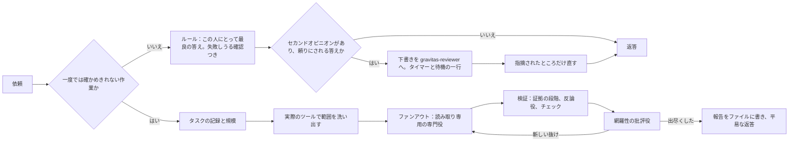

# Gravitas

[English](./README.md) · [简体中文](./README.zh-CN.md) · **日本語** · [한국어](./README.ko.md)

[](LICENSE)
[](#status)
[](https://antigravity.google/)
[](#languages)

Gravitas は、Google の AI エージェントアプリ「Google Antigravity」に入れて使う、無料の追加機能です。入れると AI エージェントが、答えの拠り所を確かめ、あなたの思い違いはやさしく指摘し、そのうえで頼まれたものをきちんと渡すようになります。

[インストール](#install) · [実際の例](#real-examples) · [ほかの言語の例](#other-languages) · [なぜ Gravitas か](#why-gravitas) · [結果](#results) · [仕組み](#part-2)

`v1.0.0` · 2026年10月 · [MIT](LICENSE) · [変更履歴](CHANGELOG.md) · 作者 [Iamemily2050](https://github.com/Emily2040)


<a id="install"></a>

## インストール

用意するのは Google Antigravity（デスクトップアプリか、コマンドラインツールの `agy`）だけです。[antigravity.google](https://antigravity.google/) から入手できます。Python のインストールも、コマンドの入力も要りません。

やることは、ZIP ファイルをダウンロードして展開し、Windows 用か Mac 用の「Install Gravitas」をダブルクリックして、Antigravity を再起動するだけです。

インストーラーで選ぶ言語は、Gravitas が Antigravity に渡す指示の言語です。どれを選んでも、Antigravity はあなたが書いた言語で答えます。このページのテストは、すべて英語版の指示で行いました。日本語版の指示は日本語の読み手に向けて書いたもので、まだテストしていません。

### Windows の場合

1. **ダウンロード。** [Gravitas 1.0.0 をダウンロード](https://github.com/Emily2040/gravitas/archive/refs/tags/v1.0.0.zip) をクリックします。`gravitas-1.0.0.zip` というファイルが「ダウンロード」フォルダーに保存されます。これは [Releases ページ](https://github.com/Emily2040/gravitas/releases) の v1.0.0 にある **Source code (zip)** と同じファイルです。Releases ページでは、**Assets** をクリックしないと **Source code (zip)** が表示されないことがあります。GitHub の画面は日本語にならないので、ボタン名も英語のままです。
2. **ブロックの解除。** Windows キーを押しながら E キーを押してエクスプローラーを開き、左側の「ダウンロード」をクリックします。ZIP ファイルを右クリックして「プロパティ」を選び、「全般」タブのいちばん下にある「許可する」にチェックを入れて「OK」をクリックします。この手順をしないと、Windows がインストーラーを実行させないことがあります。「許可する」が見当たらなければ、この手順は要りません。
3. **展開。** ZIP ファイルを右クリックして「すべて展開」（英語表示の Windows では Extract All）を選び、「展開」をクリックします。展開が終わると `gravitas-1.0.0` というフォルダーが開き、その中に同じ名前のフォルダーがもう一つあるので、それを開きます。右クリックしても「すべて展開」が見当たらないときは、Lhaplus や 7-Zip などの解凍ソフトが ZIP を開く設定になっていることがあります。その場合は、そのソフトで展開してください。
4. **「Install Gravitas (Windows)」をダブルクリック。** 歯車のアイコンが目印です。完全なファイル名は `Install Gravitas (Windows).cmd` ですが、Windows はふつう末尾の `.cmd` を表示しません。隣にある `Install Gravitas (Mac).command` は Mac 用なので使いません。ダブルクリックすると、ウィンドウが開く前に Windows が警告を出すことがあります。そのときは次のようにします。
   - 発行元を確認できないという「セキュリティの警告」が出たら、「実行」をクリックします。
   - 青い画面に「Windows によって PC が保護されました」と出たら、「詳細情報」をクリックし、現れた「実行」をクリックします。
5. **言語を選ぶ。** タイトルが「Gravitas」のウィンドウが開いたら、日本語なら **3** を入力して **Enter** キーを押します（1 は英語、2 は中国語、4 は韓国語です）。Windows の表示言語が日本語なら、何も入力せずに Enter キーを押すだけで 3 が選ばれます。「完了しました」と表示されたら、何かキーを押してウィンドウを閉じます。
6. **Antigravity の再起動。** 画面右下の時計の近く（通知領域）で Antigravity のアイコンを探します。見当たらなければ、そこにある小さな **^** をクリックすると出てきます。アイコンを右クリックし、**Quit** を選びます（このメニューは日本語の Windows でも英語です）。そのあと、スタート メニューから Antigravity を起動し直します。`agy` を使っている場合は、代わりに新しいセッションを始めます。

### Mac の場合

1. **ダウンロード。** [Gravitas 1.0.0 をダウンロード](https://github.com/Emily2040/gravitas/archive/refs/tags/v1.0.0.zip) をクリックします。Safari なら、たいてい「ダウンロード」フォルダーの中に `gravitas-1.0.0` というフォルダーとして自動で展開されます。`gravitas-1.0.0.zip` しか見当たらないときは、それをダブルクリックします。
2. **展開したフォルダーの中の Install Gravitas (Mac).command をダブルクリック。** Finder のサイドバーで「ダウンロード」をクリックし、`gravitas-1.0.0` を開きます。その中にフォルダーが一つしかなければ、それも開きます。隣にある Windows 用のファイルは使いません。
3. **最初の一回だけ、開くのを許可。** Gravitas は無料のソフトウェアで、開発元を確認するための署名が付いていません。そのため初回は、macOS が開くのを止めることがあります。
   - macOS 14 以前：「OK」をクリックし、ファイルを Control キーを押しながらクリックして「開く」を選び、確認が出たらもう一度「開く」をクリックします。
   - macOS 15 以降：上の方法は使えません。警告の画面で「完了」をクリックし、画面左上のアップルメニューから「システム設定」を開いて「プライバシーとセキュリティ」を選びます。下までスクロールし、Install Gravitas (Mac).command についての表示の横にある「このまま開く」をクリックします。確認が出たらもう一度「このまま開く」をクリックし、Mac のパスワードを入力します。
   - ターミナルが「ダウンロード」フォルダーへのアクセスの許可を求めてきたら、「許可」をクリックします。
4. **言語を選ぶ。** インストーラーが動き出すと、「ターミナル」のウィンドウが自動で開きます。日本語なら **3** を入力して **Return** キーを押します（1 は英語、2 は中国語、4 は韓国語です）。Mac の表示言語が日本語なら、何も入力せずに Return キーを押すだけで 3 が選ばれます。「完了しました」と表示されたら、何かキーを押してから、ターミナルのウィンドウを閉じます。
5. **Antigravity の再起動。** 画面右上のメニューバーにある Antigravity のアイコンをクリックし、**Quit** を選びます（メニューは英語です）。Antigravity のウィンドウがいちばん手前にあるときは、Command + Q でも終了できます。そのあと「アプリケーション」フォルダーから開き直します。

Mac 用のインストーラーは、Windows のパソコンの上でしか試していません（bash というコマンド環境で動かしました）。実際の Mac では、まだ一度も動かしていません。お使いの Mac で画面や手順が違っていたら、[作者](#author) のリンクから教えてください。上の手順を試しても macOS がインストーラーを開かせてくれないときは、[困ったときは](#getting-help) に別の開き方があります。

### 入ったかどうか確かめる

Antigravity で新しい会話を始め、次の文を貼り付けます。

```text
ファイルを開いたり一覧を出したりせずに、あなたが持っているスキルとエージェントのうち、名前に gravitas を含むものをすべて挙げてください。
```

`gravitas` というスキルが1つと、名前が `gravitas-` で始まるエージェントが8つ挙がれば、正しく入っています。何も挙がらなければ、Antigravity をもう一度完全に終了して開き直してください。それでも挙がらないときは、「[困ったときは](#getting-help)」を見てください。

### 取り除くには

インストーラーをもう一度ダブルクリックして **5** を選び、インストールのときと同じ手順で Antigravity を再起動します。Gravitas は消されずに、ホームフォルダーの `.gemini/gravitas-backups` の中にある、日時が名前のフォルダーへ移されます。正確な場所は、インストーラーが最後に表示します。このフォルダーは、いつ削除してもかまいません。Mac ではこのフォルダーが Finder に表示されないので、Finder の「移動」メニューから「フォルダへ移動」を選び、インストーラーが表示した場所を貼り付けて開きます。

インストーラーが手を加えるのは Gravitas のものだけです。具体的には、Antigravity のプラグイン用フォルダー（ホームフォルダーの `.gemini/config/plugins/gravitas`）とこのバックアップ用フォルダー、それに beta 1 を入れていた場合は、beta 1 のスキルとフックのスクリプト、`.gemini/config/hooks.json` の中の `gravitas-always-on` の項目です。置き換えたものや取り除いたものは、`hooks.json` のコピーも含めてすべてバックアップ用フォルダーに残すので、何も削除しません。Python とコマンドの入力が必要なのは、[ターミナルからのインストール](#install-from-a-terminal) だけです。こちらでは、セカンドオピニオン（答えを別の AI が見直す機能）などのオプションも選べます。

---

<a id="part-1"></a>
<a id="real-examples"></a>

## 実際の例

ここに載せているのは、テストで実際に出た答えです。同じモデルに同じ日本語の依頼を渡し、Gravitas を入れていない Antigravity（以下「素の Antigravity」）の答えと、Gravitas を入れた答えを比べました。採点したのは Gemini 3.1 Pro と Gemini 3.8 Flash の2つのモデルで、どちらが Gravitas の答えかを知らされないまま、あらかじめ書いておいた模範解答と照らし合わせています。

選んだのは、2人の採点者がそろってはっきり Gravitas を上とし、私が両方の答えを全文読んで、違いを自分の目で確かめられた依頼です。最後の例は、Gravitas のほうが悪かった依頼です。引用は原文のままで、「…」は省いた箇所を表します。

どの例も、Gravitas がすべての会話で Antigravity に読み込ませる指示（常時ルール）の、ひとつ前の版 v4 で答えさせたものです。このリリースのルールは、これらのテストのあと、v4 がはっきり負けたケースをすべて調べて作り直しました。作り直しがこれらの例にどう関わるかは、[結果](#results) の冒頭に書いています。

### 退職の挨拶メールを「短めで」と頼んだとき

> 10月末で退職することになりました。社内向けの退職挨拶メール、短めで作ってもらえますか？営業部に5年いて、最終出社日は10月30日（金）です。

**Gravitas なし**（Gemini 3.8 Flash）

> 用途や社内の雰囲気に合わせて使い分けられるよう、…の2パターンを用意しています。
>
> …
>
> ### パターン2：よりシンプルな文面（チャット・Slack・近しい部署向け）

**Gravitas あり**（Gemini 3.8 Flash）

> 件名：退職のご挨拶（営業部 [氏名]）
>
> 社員の皆様
>
> お疲れ様です。営業部の[氏名]です。
>
> …
>
> 前日までに送信する場合は「本日10月30日（金）」を「最終出社日は10月30日（金）」に変更してください。

素の Antigravity は前置きのあと、メール向けと「チャット・Slack・近しい部署向け」の2通りの文面を並べ、どちらを使うかを頼んだ人に任せました。そのまま使うには、片方を選び、メールの部分だけを切り出し、太字の記号を消す手間が残ります。**Gravitas は件名から始まるメールを一通だけ書き、名前や後任者のように依頼にない部分は [ ] で空けたので、空欄を埋めればそのまま送れます**。本文に「本日10月30日（金）が最終出社日となります。」とあるので、前日までに送るなら「本日」の部分を直すように、という注意まで添えています。

<details>
<summary>両方の答えの全文</summary>

**素の Antigravity の答え**（Gemini 3.8 Flash）

```text
社内向けにそのままお使いいただける、簡潔で要点を押さえた退職挨拶メールの文面を作成しました。

用途や社内の雰囲気に合わせて使い分けられるよう、**「標準的な短め文面（メール推奨）」**と**「よりコンパクトな文面（Slack等のチャットツールにも最適）」**の2パターンを用意しています。

---

### パターン1：標準的な短め文面（メール向け）
必要事項（退職日・最終出社日・感謝・引き継ぎ・連絡先）をコンパクトにまとめた基本形です。

**件名：**  
退職のご挨拶（営業部　[氏名]）

**本文：**  
社員の皆様  
（※または「社内の皆様」「営業部の皆様」）

お疲れ様です。営業部の[氏名]です。

私事で恐縮ですが、一身上の都合により10月31日をもちまして退職することとなりました。  
本日10月30日（金）が最終出社日となります。

営業部に在籍した5年間、至らない点も多かった私を温かくご指導・サポートしてくださり、心より感謝申し上げます。  
素晴らしい仲間に恵まれ、皆様と一緒に働けたことは私にとってかけがえのない財産です。

なお、担当業務の引き継ぎにつきましては[後任者の氏名]へ完了しております。  
今後の業務に関するご連絡は、[後任者の氏名]または営業部までお願いいたします。

最後になりますが、皆様のご健康と今後のご活躍を心よりお祈り申し上げます。  
これまで本当にありがとうございました。

--------------------------------------------------  
【今後の連絡先】  
・メールアドレス：[個人メールアドレス]  
・電話番号：[携帯電話番号]  
--------------------------------------------------  
営業部　[氏名]

---

### パターン2：よりシンプルな文面（チャット・Slack・近しい部署向け）
引き継ぎの記載を省き、要点と感謝のみを伝えてサッと読める構成です。

**件名：**  
退職のご挨拶（営業部　[氏名]）

**本文：**  
社内の皆様

お疲れ様です。営業部の[氏名]です。

私事で恐縮ですが、一身上の都合により10月末で退職することとなり、本日10月30日（金）が最終出社日となりました。

営業部での5年間、皆様には温かいご指導とご支援をいただき、深く感謝申し上げます。  
皆様とともに業務に励んだ時間は、大変有意義で貴重な経験となりました。

皆様の今後のご健勝とご多幸を心よりお祈り申し上げます。  
これまで本当にありがとうございました。

--------------------------------------------------  
【連絡先】[個人メールアドレス] / [携帯電話番号]  
--------------------------------------------------  
営業部　[氏名]

---

### 送信時のワンポイント
- **送信タイミング：** 最終出社日（10月30日）の午後〜夕方（15:00〜17:00頃）、業務が一段落した時間帯が一般的です。
- **宛先設定：** 全社や大人数へ一斉送信する場合は、宛先（To）を自分のアドレスにし、対象のアドレス・メーリングリストを **BCC** に入れて送信するのがマナーです。
```

**Gravitas の答え**（Gemini 3.8 Flash）

```text
件名：退職のご挨拶（営業部 [氏名]）

社員の皆様

お疲れ様です。営業部の[氏名]です。

私事で恐縮ですが、一身上の都合により10月末日をもって退職することとなりました。
本日10月30日（金）が最終出社日となります。

営業部に在籍した5年間、温かいご指導とサポートをいただき、心より感謝申し上げます。
至らない点も多々ありましたが、皆様とともに仕事ができた時間は私にとって大きな財産です。

担当業務の引き継ぎは、後任の[後任者の氏名]へ完了しております。
今後の業務連絡は[後任者の氏名]までお願いいたします。

最後になりますが、皆様の今後のご健勝とご活躍、ならびに会社のますますのご発展を心よりお祈り申し上げます。
これまで本当にありがとうございました。

--------------------------------------------------
[氏名]
連絡先：[私用メールアドレス / 電話番号]
--------------------------------------------------

送信前の確認事項：
1. [ ] の箇所（氏名・後任者・連絡先）をご自身の情報に書き換えてください。後任者の記載が不要な場合は該当の2文を削除してください。
2. 送信タイミングは最終出社日（10月30日）の夕方（16:00〜17:00頃）が一般的です。前日までに送信する場合は「本日10月30日（金）」を「最終出社日は10月30日（金）」に変更してください。
3. 全社や部署一斉に送る場合は、誤って全員へ返信されるのを防ぐため、宛先（To）にご自身の社内アドレスを入れ、関係者をBCCに設定して送信するのが安全です。
```

v4 のルールには、文章は「相手が選択肢を求めない限り一案だけに」するという行がありました。このリリースのルールにも、相手が自分で選ぶ場合を除いて一案だけにする、という行があります。

Gravitas のメールも理想どおりではありません。本文は空白を除いて295字あり、模範解答が目安にした150〜250字より長めです。感謝や結びも「大きな財産です」「会社のますますのご発展」のような決まり文句で済ませているので、「短め」と言われたなら、もう一段削れます。

採点の内訳と、それぞれの答えで何が起きたか：[docs/examples/ja/wc-ja-taishoku-aisatsu.md](docs/examples/ja/wc-ja-taishoku-aisatsu.md)

</details>

### IH コンロで、なぜ鍋だけが熱くなるのか

> IHコンロって火が出てないのに、なんで鍋だけ熱くなるんですか？プレートを触っても最初はそんなに熱くないのが不思議で。あと実家から持ってきた土鍋はIHじゃ使えないって言われたんですけど、それも同じ理由ですか？

**Gravitas なし**（Gemini 3.1 Pro）

> 土鍋は土（陶器）でできていて、**電気を通さず、磁石にもくっつきません**。
>
> …アルミ鍋や耐熱ガラスの鍋が使えないのも同じ理由です。

**Gravitas あり**（Gemini 3.1 Pro）

> アルミや銅の鍋が使えないことが多いのも同じ理由で、電気が流れやすすぎてうまく発熱しないためです。（最近はすべての金属に対応したIHもありますが、一般的なものは鉄やステンレスなどの磁石にくっつきやすい金属が必要です）

3つの問いの筋には、どちらも正しく答えています。差が出たのは付け足しの一言で、素の Antigravity は、土鍋は「電気を通さず、磁石にもくっつきません」と説明した直後に、アルミ鍋が使えないのも「同じ理由」だと書きました。アルミは電気をよく通す金属です。**Gravitas は、アルミや銅は電気が流れやすすぎて熱になりにくいこと、すべての金属に対応した IH もあることを書きました**。アルミの片手鍋を持っている人なら、自分の IH がどちらの型かを取扱説明書で確かめれば済みます。

<details>
<summary>両方の答えの全文</summary>

**素の Antigravity の答え**（Gemini 3.1 Pro）

> IHコンロの仕組み、不思議に思いますよね！おっしゃる通り、実家の土鍋が使えないのもまさに**「同じ理由」**なんです。
>
> いただいた3つの疑問について、分かりやすくお答えしますね。
>
> ### 1. なぜ火が出ないのに鍋だけ熱くなるの？
> IHは「電磁誘導（でんじゆうどう）」という仕組みを使っています。
> * IHコンロのガラス天板の下には、ぐるぐる巻きのコイルが入っています。ここに電気を流すと、見えない「磁力」が発生します。
> * その上に**鉄やステンレスなどの金属の鍋**を置くと、磁力に反応して鍋の底に「うず電流」という電気が流れます。
> * 金属には電気の流れに逆らう性質（電気抵抗）があるため、電気が流れようとするときに熱が発生します。
>
> つまり、コンロが直接熱を出しているのではなく、磁力の力を使って**「鍋の底そのものをヒーターのように自己発熱させている」**のです。
>
> ### 2. プレートを触っても最初は熱くないのはなぜ？
> IHのトッププレート（ガラス面）は、電気を通さず磁力にも反応しない素材で作られているため、いくら磁力が発生してもプレート自体は発熱しません。だから最初は熱くないのです。
>
> （※ただし、調理中は「熱くなった鍋の熱」が下へ伝わっていくため、調理中や調理直後はプレートも非常に熱くなります。火傷には注意してくださいね！）
>
> ### 3. なぜ実家の土鍋は使えないの？
> はい、全く同じ理由です！
> 土鍋は土（陶器）でできていて、**電気を通さず、磁石にもくっつきません**。
> そのため、IHコンロの上に置いても「うず電流」が全く発生せず、熱を作ることができないのです。アルミ鍋や耐熱ガラスの鍋が使えないのも同じ理由です。
>
> （※最近は、底に発熱する金属のプレートを埋め込んだ「IH対応の土鍋」も売られており、それならIHでも使うことができます）
>
> 「火で下から炙る」のではなく「鍋自体を発熱させる」からこそ、IHは周りの空気を熱さずに効率よく調理ができるというメリットがあります。疑問はスッキリ解決しましたでしょうか？

**Gravitas の答え**（Gemini 3.1 Pro）

> IHコンロで鍋だけが熱くなるのは、磁石の力（電磁誘導）を使って**鍋そのものを発熱させている**からです。
>
> ガラスプレートの下には、金属の線を巻いたコイルが入っています。ここに電流を流すと目に見えない磁力線（磁界）が発生し、それが上に置かれた金属の鍋を通過するときに、鍋の底に「うず電流」という電気が流れます。
> 金属には電気の流れに抵抗する性質があるため、この電流が流れるときに摩擦のような形で熱が生まれ、鍋自体が熱くなります。
>
> プレート自体を発熱させているわけではないため、最初はプレートを触っても熱くありません。
> （※調理を続けると、熱くなった鍋からプレートに熱が伝わるため、使用後しばらくはプレートも熱くなります）
>
> **実家の土鍋が使えない理由も同じです。**
> IHコンロで熱を作るには、鍋にうず電流が流れる必要があります。昔ながらの土鍋は土（陶器）でできていて電気を通さないため、電流が発生せず、全く熱くなりません。
>
> アルミや銅の鍋が使えないことが多いのも同じ理由で、電気が流れやすすぎてうまく発熱しないためです。（最近はすべての金属に対応したIHもありますが、一般的なものは鉄やステンレスなどの磁石にくっつきやすい金属が必要です）
>
> ※なお、土鍋でも底に金属のプレートを埋め込むなどして、IHで使えるように加工された「IH対応土鍋」であれば使用できます。

どちらの答えも、IH 対応の土鍋なら使えると言い切りました。メーカーによっては、IH で使えると表示された陶磁器の土鍋でも使わないよう案内しているので、採点者は2人とも、この点で両方を減点しています。また、この回はどちらもツールを使っていません。Gravitas のアルミの一言も、確かめたうえで書いたわけではなく、v4 のルールの「確認していないものは加えずに省きます」という行に照らせば、確かめるか省くべきところでした。

採点の内訳と、それぞれの答えで何が起きたか：[docs/examples/ja/rf-ih-cooktop-how-it-works.md](docs/examples/ja/rf-ih-cooktop-how-it-works.md)

</details>

### 英語の冠詞を「自分で選べるように」と頼んだとき

> 社会人です。英語の冠詞（a / an / the / 何もつけない）の使い分けが、いまだに感覚でしか選べません。…正解だけじゃなくて、どう考えれば自分で選べるようになるのか、日本人がつまずきやすいポイントも含めて教えてもらえますか？

**Gravitas なし**（Gemini 3.1 Pro）

> **No 共有できていない（不特定）：** いっぱいある中の「とある1つ」の場合は **`a / an`** を使います。
>
> …
>
> 「私は犬が好きです」を I like a dog. と言いがちです（これだと「ある特定の1匹の犬が好き」という不自然な響きになります）。

**Gravitas あり**（Gemini 3.1 Pro）

> **ステップ1：聞き手と「あ〜、あれのことね」と特定（共有）できるか？**
>
> …
>
> **数えられない名詞（概念、液体など）や、複数形 ＝ 何もつけない（無冠詞）**

依頼に付いていた6問の正解はどちらも全部合っていて、差が出たのは、7問目からも使える手順のほうです。素の Antigravity の手順では、聞き手と共有できていない名詞の行き先が a / an しかなく、複数形の dogs をどうするかが書かれていません。しかも同じ答えの中で、a dog を「特定の1匹」とも説明していて、手順と説明が食い違っています。**Gravitas は先に the かどうかを決め、残りを単数、複数、数えられない名詞に分けるので、どの名詞にも行き先があります**。

<details>
<summary>両方の答えの全文</summary>

**素の Antigravity の答え**（Gemini 3.1 Pro）

> 社会人で英語の学習を頑張っていらっしゃるのですね！素晴らしいです。
>
> 冠詞（a / an / the / 無冠詞）は、日本語には存在しない概念なので、多くの日本人がつまずく最大の難所の一つです。感覚で選んでしまうのも無理はありません。「なぜそれを選ぶのか」という**コアのイメージ**を掴むと、少しずつ論理的に選べるようになってきます。
>
> まずは問題の正解と、その「考え方」から解説しますね。
>
> ---
>
> ### 問題の正解と解説
>
> **1. I play ( the ) piano every day.**
> *   **考え方：** 楽器を演奏するときの楽器名には、原則として `the` をつけます。これは「（世間一般に共通認識として存在する）あのピアノという楽器」というイメージがあるためです。（※ただし "I bought a piano."「ピアノを（一台）買った」のように、物として扱う場合は a がつきます）
>
> **2. ( The ) moon is very bright tonight.**
> *   **考え方：** 宇宙で一つしかないもの（太陽 the sun、地球 the earth、世界 the world など）には `the` をつけます。話している人にとっても聞いている人にとっても「どれのことか絶対にわかる（一つしかないから）」という場合は `the` の出番です。
>
> **3. I had ( 無冠詞 / 何も入れない ) breakfast at seven.**
> *   **考え方：** 朝食、昼食、夕食などの「日常的な食事」には、原則として冠詞をつけません。「食事という行為」に焦点が当たっているためです。（※ "a delicious breakfast" のように形容詞がつくと a がつくことがあります）
>
> **4. She is ( an ) honest person.**
> *   **考え方：** 「一人の〜」なので a か an ですが、ここは `an` が正解です。honest の h は発音せず、「オネスト（母音）」から始まるためです。**a か an かは、スペルではなく「発音」で決まります。**
>
> **5. I bought ( a ) book yesterday. ( The ) book was really interesting.**
> *   **考え方：** ここは冠詞の基本ルールが一番よくわかる文です。
>     *   1つ目：**初めて話題に出る**ので「ある1冊の本」という意味で `a`。
>     *   2つ目：1文目で話題に出たので、聞き手も「あぁ、昨日買った**その**本ね」と特定できます。このように**共通認識ができたもの**には `the` をつけます。
>
> **6. My sister is ( a ) university student.**
> *   **考え方：** 4番の引っかけ問題のような形です。「一人」なので a か an ですが、university は u（母音のスペル）で始まりますが、発音は「ユニバーシティ（子音の y/j の音）」から始まります。したがって `a` が正解です。
>
> ---
>
> ### 自分で選べるようになるための「3つのステップ」
>
> 問題を解くときや、自分で話すときは、以下の順番で自問自答してみてください。
>
> #### Step 1: 数えられる？ 数えられない？（可算・不可算）
> *   水 (water) や、情報 (information)、目に見えない概念（愛、平和など）は数えられません。
> *   数えられない名詞には **絶対に a / an はつきません**。（例：I drink water.）
>
> #### Step 2: 聞き手と「どれのことか」共有できている？（特定・不特定）
> *   **Yes 共有できている（特定）：** 話し手も聞き手も「あぁ、あれね」と特定できる場合は **`the`** を使います。
>     *   例：「（さっき話題に出た）その本」「（宇宙に一つしかない）月」「（今いる部屋の）ドアを閉めて（Close the door.）」
> *   **No 共有できていない（不特定）：** いっぱいある中の「とある1つ」の場合は **`a / an`** を使います。
>     *   例：「（どれでもいいから）ペンを1本貸して（Lend me a pen.）」
>
> #### Step 3: 特別なルールはないか？
> 基本は上の2ステップですが、例外的な「お約束」があります。
> *   スポーツ・食事・学科名にはつけない（play tennis, have lunch, study history）
> *   楽器には the をつける（play the guitar）
> *   施設に「本来の目的」で行く時はつけない（go to school＝勉強しに行く / go to bed＝寝る）
>
> ---
>
> ### 日本人がつまずきやすいポイントまとめ
>
> 1.  **a と an の使い分けを「文字（スペル）」で判断してしまう**
>     *   ❌ a hour ⭕️ an hour（アワー：母音の音）
>     *   ❌ an uniform ⭕️ a uniform（ユニフォーム：子音の音）
> 2.  **The を「その」と和訳して考えてしまう**
>     *   The は「その」と訳せないことも多いです（The moon など）。「お互いに『どれか』わかっているサイン」として捉えるのがコツです。
> 3.  **複数形や数えられない名詞にも a をつけてしまう**
>     *   日本語は単数・複数の区別が曖昧なので、「私は犬が好きです」を I like a dog. と言いがちです（これだと「ある特定の1匹の犬が好き」という不自然な響きになります）。正しくは I like dogs. です。
>
> 最初は頭の中で「数えられる？」「お互い分かってる？」と考えるので時間がかかりますが、続けていくうちに自転車に乗るように「感覚」として正しい冠詞が選べるようになってきます。焦らず、まずはこの「考え方」を意識してアプリの問題に再チャレンジしてみてください！応援しています。

**Gravitas の答え**（Gemini 3.1 Pro）

> まずは問題の正解と、それぞれの理由からお答えします。
>
> **1. I play ( the ) piano every day.**
> 楽器を演奏するという文脈では、ピアノという「楽器の種類や概念」を指すため `the` をつけます。
>
> **2. ( The ) moon is very bright tonight.**
> 月や太陽、地球など、世界に一つしかなく「どれのことか」が誰にとっても明らかなものには `the` をつけます。
>
> **3. I had ( 何もつけない ) breakfast at seven.**
> breakfast（朝食）、lunch、dinner などの食事の名前や、スポーツ（play tennis など）には原則として冠詞をつけません。
>
> **4. She is ( an ) honest person.**
> `a` か `an` かは、直後の単語のスペルではなく「発音」で決まります。honest は h を発音せず「オネスト」と母音（ア・イ・ウ・エ・オ）の音で始まるため、`an` になります。
>
> **5. I bought ( a ) book yesterday. ( The ) book was really interesting.**
> 初めて話題に出る「ある1冊の本」には `a` を使います。2文目は「昨日買ったその本」と、話し手と聞き手の間でどれのことか特定できているため `the` に変わります。
>
> **6. My sister is ( a ) university student.**
> university は u という母音のアルファベットで始まりますが、発音は「ユニバーシティ（ヤ行に近い子音 /j/）」です。母音の音ではないため、`an` ではなく `a` になります。
>
> ---
>
> ### 冠詞を自分で選べるようになるための「考え方」
>
> 感覚ではなく、次の2つのステップで絞り込むと確実に選べるようになります。
>
> **ステップ1：聞き手と「あ〜、あれのことね」と特定（共有）できるか？**
> *   **Yes ＝ `the`**
>     （例：昨日買った**その**本、世界に1つしかない月、部屋にある**その**ドアを閉めて）
>     ※ `the` は「その」と指を差せるイメージです。単数、複数、数えられない名詞のすべてに使えます。
> *   **No ＝ ステップ2へ**
>
> **ステップ2：名詞の形を確認する**
> 「特定のもの」ではない場合、その名詞の種類によって決まります。
> *   **数えられる名詞（1つ/1人） ＝ `a` または `an`**
>     （例：世の中にたくさんある中の「ある1冊の本」 = a book）
> *   **数えられない名詞（概念、液体など）や、複数形 ＝ 何もつけない（無冠詞）**
>     （例：水 = water、犬という生き物全体 = dogs、朝食という概念 = breakfast）
>
> ### 日本人がつまずきやすいポイント
>
> 1. **「文字」を見て a / an を決めてしまう**
>    問題4と6にあったように、重要なのは「発音」です。
>    *   `an hour`（アワー：母音の音）
>    *   `an MP3 player`（エム：母音の音）
>    *   `a one-way ticket`（ワン：子音の音 /w/）
>
> 2. **「数えられるか・数えられないか」の感覚の違い**
>    日本語では水もペンも同じように扱いますが、英語では「具体的な形があって区切れるか」を重視します。paper（紙）は切っても紙のままなので数えられませんが、a piece of paper（1枚の紙）と枠を与えると数えられます。迷った時は、頭の中でその物体を半分に割ったとき、まだ同じ名前で呼べるか（水は半分にしても水のまま、車は半分にしたら車ではない）を想像すると区別しやすくなります。
>
> まずは会話や英作文で迷ったときに、「相手は『どれのこと』か分かっているかな？」と考える癖をつけるところから始めてみてください。

この依頼は語学の先生の仕事で、よい先生は、初めて見る文にも使える判断の手順を渡します。6問の答え合わせは確かめやすい部分にすぎず、大事なのはその手順が次の文でも通用するかどうかです。

Gravitas の2段階にも抜けはあります。素の Antigravity の手順には、楽器、食事、スポーツのような決まった言い方を確かめる3つめのステップがありますが、Gravitas の手順にはありません。

採点の内訳と、それぞれの答えで何が起きたか：[docs/examples/ja/edu-05-english-articles.md](docs/examples/ja/edu-05-english-articles.md)

</details>

### うまくいかなかった例：家計簿アプリのエラー文言

> 個人開発で家計簿アプリを作っています。下の4つの場面で出す文言（見出し・本文1〜2行・ボタン）を考えてもらえませんか。
>
> ユーザーは20〜30代の一人暮らしが中心で、トーンは「やさしいけど、なれなれしすぎない」感じにしたいです。絵文字はなしでお願いします。
>
> 1. 初めて起動して、まだ記録が1件もないホーム画面
> 2. 今月の予算をオーバーしたときに出すお知らせ
> 3. 通信エラーで同期できなかったとき（入力したデータは端末には残っています）
> 4. 30日連続で記録できたとき
>
> それぞれ2案ずつあるとうれしいです。

**Gravitas なし**（Gemini 3.8 Flash）、通信エラーの場面の案の一つ

> * **本文**：入力したデータはお使いの端末に保存されていますので、ご安心ください。通信環境の良い場所で再度お試しください。

**Gravitas あり**（Gemini 3.8 Flash）、同じ場面の案の一つ

> - **見出し**: サーバーに接続できません
> - **本文**: データはスマートフォンに残っているため消えることはありません。通信が回復次第、自動で反映されます。

通信エラーの場面について依頼に書かれているのは、データが端末に残ることだけで、通信が戻ったら自動で同期し直すかどうかはどこにも書かれていません。Gravitas は2案のうち1つで、アプリに自動同期の機能があると決めつけ、「通信が回復次第、自動で反映されます」と利用者に約束する文言を書きました。**機能がなければ、利用者は記録がまだ届いていないことに気づかないまま、アプリを閉じてしまいます**。採点者は2人とも、この案を主な理由に、素の Antigravity をはっきり上としました。

この失敗は、ルールを作り直すときに調べた負けの一つです。新しいルールでは、相手自身や相手の周りの事情についての主張は相手が渡したものだけを根拠にし、相手しか知らないことは [ ] のような空欄で示すよう求めています。ただ、新しいルールはまだ本番のベンチマークにかけていないので、この間違いが消えたとは約束できません。依頼に書いていない機能を前提にした文言が出てきたら、そのまま使わずに確かめてください。

<details>
<summary>両方の答えの全文</summary>

**素の Antigravity の答え**（Gemini 3.8 Flash）

> ご提示いただいたターゲット層（20〜30代の一人暮らし）と「やさしいけれど、なれなれしすぎない」トーンを意識し、絵文字を使わずに落ち着いた丁寧な言葉遣いで作成しました。
>
> それぞれの場面でニュアンスの異なる2案を提案します。アプリの機能やレイアウトに合わせてお選びください。
>
> ---
>
> ### 1. 初めて起動して、まだ記録が1件もないホーム画面
>
> #### 案A（最初の一歩のハードルを下げるアプローチ）
> * **見出し**：はじめの1件を記録してみませんか
> * **本文**：コンビニでの買い物やカフェ代など、小さな支出からで大丈夫です。まずは気軽に記録してみましょう。
> * **ボタン**：最初の支出を記録する
>
> #### 案B（シンプルに操作を促すアプローチ）
> * **見出し**：ようこそ。支出をひとつ記録してみましょう
> * **本文**：金額とカテゴリーを選ぶだけで完了します。あなたのペースで、無理なく続けていきましょう。
> * **ボタン**：支出を入力する
>
> ---
>
> ### 2. 今月の予算をオーバーしたときに出すお知らせ
>
> #### 案A（現状把握と振り返りを促すアプローチ）
> * **見出し**：今月の予算に到達しました
> * **本文**：予定より少し支出が増えているようです。何にいくら使ったか、一度内訳を確認してみませんか。
> * **ボタン**：支出の内訳を見る
>
> #### 案B（罪悪感を持たせず、調整を提案するアプローチ）
> * **見出し**：今月の予算を超過しています
> * **本文**：急な出費が重なる月もあります。必要に応じて、残り日数の使い方や予算設定を見直してみましょう。
> * **ボタン**：予算を見直す
>
> ---
>
> ### 3. 通信エラーで同期できなかったとき
>
> #### 案A（データの無事を最優先で伝えて安心させるアプローチ）
> * **見出し**：同期が完了しませんでした
> * **本文**：入力したデータはお使いの端末に保存されていますので、ご安心ください。通信環境の良い場所で再度お試しください。
> * **ボタン**：もう一度同期する
>
> #### 案B（状況を簡潔に伝え、次の行動を案内するアプローチ）
> * **見出し**：データの同期に失敗しました
> * **本文**：端末内には安全に記録されています。ネットワークの接続状況をご確認のうえ、再試行してください。
> * **ボタン**：再試行する
>
> ---
>
> ### 4. 30日連続で記録できたとき
>
> #### 案A（習慣化を称え、振り返りへつなげるアプローチ）
> * **見出し**：30日連続の記録、達成です
> * **本文**：毎日コツコツと続けられていますね。この1ヶ月のお金の流れを振り返ってみませんか。
> * **ボタン**：今月のレポートを見る
>
> #### 案B（日々の積み重ねを静かに労うアプローチ）
> * **見出し**：1ヶ月間の記録が続きました
> * **本文**：家計簿をつける習慣がしっかり定着しています。日々の積み重ねが、これからの安心につながります。
> * **ボタン**：記録を続ける

**Gravitas の答え**（Gemini 3.8 Flash）

> ### 1. 初めて起動して、まだ記録が1件もないホーム画面
>
> **案A（最初の一歩を軽く促す）**
> - **見出し**: ここに日々の記録が並びます
> - **本文**: コンビニの買い物や固定費など、思いついたものから1つ記録してみませんか。
> - **ボタン**: 最初の支出を記録する
>
> **案B（気軽さを重視する）**
> - **見出し**: はじめの一歩を記録してみましょう
> - **本文**: まずは金額だけでも大丈夫です。今日のちょっとした買い物から始めてみませんか。
> - **ボタン**: 支出を入力する
>
> ---
>
> ### 2. 今月の予算をオーバーしたときに出すお知らせ
>
> **案A（現状把握を肯定的に促す）**
> - **見出し**: 今月の予算を超過しました
> - **本文**: 想定外の出費があった月も、把握できていることが大切です。まずは内訳を確認してみましょう。
> - **ボタン**: 今月の支出を確認する
>
> **案B（今後の調整に目を向ける）**
> - **見出し**: 設定した予算に達しました
> - **本文**: 残りの日数の使い方を確認するか、無理のない範囲で予算設定を見直してみませんか。
> - **ボタン**: 予算の設定を見直す
>
> ---
>
> ### 3. 通信エラーで同期できなかったとき
>
> **案A（手動での再試行を案内）**
> - **見出し**: データの同期ができませんでした
> - **本文**: 入力した記録は端末内に保存されていますのでご安心ください。電波の良い場所で再度お試しください。
> - **ボタン**: もう一度同期する
>
> **案B（自動同期の安心感を伝える）**
> - **見出し**: サーバーに接続できません
> - **本文**: データはスマートフォンに残っているため消えることはありません。通信が回復次第、自動で反映されます。
> - **ボタン**: 再試行する
>
> ---
>
> ### 4. 30日連続で記録できたとき
>
> **案A（1か月の振り返りにつなげる）**
> - **見出し**: 30日間、記録が続いています
> - **本文**: 1か月間しっかりと収支を把握できました。日々の記録が確かな習慣になっています。
> - **ボタン**: 1か月の振り返りを見る
>
> **案B（日々の継続を自然に労う）**
> - **見出し**: 記録を始めて30日を達成しました
> - **本文**: 毎日コツコツ記録を続けられています。これからも無理のないペースで続けていきましょう。
> - **ボタン**: 記録を続ける

素の Antigravity も、ほかの場面では依頼にない機能を前提にしています。初回のホーム画面の「金額とカテゴリーを選ぶだけで完了します」や、30日連続の場面の「今月のレポートを見る」ボタンです。採点者がこちらに触れなかったのは、利用者のデータがどうなるかを約束する文言ではないからだと思います。

採点の内訳と、それぞれの答えで何が起きたか：[docs/examples/ja/creative-ja-budget-app-ui-copy.md](docs/examples/ja/creative-ja-budget-app-ui-copy.md)

</details>

### 日本語の依頼全体では

日本語の依頼全体で見ると、差はほとんどありません。日本語で書かれた依頼8件を Gemini 3.8 Flash と Gemini 3.1 Pro で2回ずつ答えさせ、2人の採点者が判定した64票は、Gravitas の29勝、素の Antigravity の31勝、引き分け4でした（Flash は15勝17敗、Pro は14勝14敗4分け）。

上で Gravitas が勝った3例のうち、別の実行でも同じ向きの結果が続いたのは退職メール（Flash で2回とも勝ち）だけです。IH と冠詞の例は、4回の実行のうちこの1回だけの勝ちでした。退職メールも Gemini 3.1 Pro では2回とも勝てず、1回目は Gravitas 側が社内メールの結びで、自分の会社を「貴社」と呼んで負けています。

---

<a id="other-languages"></a>

## ほかの言語の例

10言語のセット（world）には50件の依頼があり、どれも土地ごとの決まりごとや事実が鍵になります。下の8言語それぞれについて、素の Antigravity が肝心な点を間違え、Gemini の採点者2人がそろってはっきり Gravitas を上とした例を一つずつ探しました。見つかったのは8言語のうち6言語です。インドネシア語とベンガル語では、どの候補でも素の Antigravity も肝心な点を押さえていたので、いちばん近かった例を書いています。これらも v4 のルールで答えさせたものです。原文の引用には日本語の訳を付け、それぞれ依頼と両方の答えの全文にリンクしています。

<details>
<summary><b>スペイン語（メキシコ）</b>：週1回の会議が1時間ずれるところだったメール</summary>

メキシコ中部に住む人が、10月の時刻の切り替えのあとも火曜日の会議の時間は変わらない、とマドリードのチームに知らせる短いメールを頼みました。

> Quiero avisarles que con el cambio de horario de finales de octubre la llamada no se mueve, porque allá y acá atrasamos el reloj el mismo fin de semana y la diferencia se queda en 8 horas.

訳：10月末に時刻が切り替わっても会議は動かない、と伝えたいです。向こうもこちらも同じ週末に時計を戻すので、時差は8時間のままだからです。

**Gravitas なし**（Gemini 3.1 Pro）

> …la diferencia horaria se mantiene en 8 horas, así que no hay ningún impacto en nuestra reunión.

訳：……時差は8時間のままなので、会議にはまったく影響がありません。

**Gravitas あり**（Gemini 3.1 Pro）

> México eliminó el horario de verano a finales de 2022, por lo que el reloj ya no se atrasa en el centro del país. Como Madrid sí atrasará su reloj una hora el domingo 25 de octubre, la diferencia horaria pasará de 8 a 7 horas.

訳：メキシコは2022年の終わりに夏時間をやめたので、メキシコ中部ではもう時計を戻しません。マドリードは10月25日（日）に時計を1時間戻すので、時差は8時間から7時間になります。

メキシコ中部は2022年から時計を切り替えていないので、2026年10月25日のあとは、メキシコシティの10時がマドリードの17時になります。素の Antigravity もこの事実は知っていて、最後の注記で「dato curioso」（ちょっとした豆知識）として触れていました。それでもメールは頼まれたとおりに書いたので、そのまま送れば、どちらかのチームが1時間ずれて会議に入るところでした。Gravitas は訂正を先に書き、メキシコシティの10時を保つ案と、マドリードの18時を保つ案の2通りのメールを用意しました。ただし件名には「a partir de noviembre」（11月から）とあり、実際に影響を受ける最初の会議は10月27日です。Gemini の採点者は2人とも、決定的な差で Gravitas を上としました。[依頼と両方の答えの全文](docs/examples/world/es.md)

</details>

<details>
<summary><b>フランス語</b>：「フランスの IBAN はみな FR76 で始まる」</summary>

ハンドボールクラブのサイトを作っている人が、会費の口座振替のために書いた IBAN（国際的な銀行口座番号）のチェックを、このままマージしてよいか尋ねました。

> J'ai mis FR76 en dur parce que tous les IBAN français commencent comme ça, j'ai vérifié sur les RIB de tout le bureau.

訳：フランスの IBAN はみんなこの形で始まるので、FR76 は決め打ちにしました。役員全員の口座情報で確かめてあります。

**Gravitas なし**（Gemini 3.1 Pro）

> Donc oui, tous les IBAN français valides commencent bien par FR76 !

訳：だから、そのとおりです。有効なフランスの IBAN は、みんな FR76 で始まります。

**Gravitas あり**（Gemini 3.1 Pro）

> **Tous les IBAN français ne commencent pas par FR76** : L'IBAN commence par `FR76` uniquement quand le numéro de compte ne contient que des chiffres

訳：フランスの IBAN がすべて FR76 で始まるわけではありません。FR76 で始まるのは、口座番号が数字だけのときに限られます。

フランスの銀行は英字を含む口座番号も出していて、その IBAN は FR14 のように別のチェックディジットになります。素の Antigravity が直したコードもまだ FR76 を決め打ちにしていたので、ほかのチェックディジットを持つ有効なフランスの IBAN も、ドイツやベルギーの口座もすべて弾いてしまいます。SEPA の口座振替でそうした扱いをすることは、EU 規則 260/2012 の第9条が禁じています。Gravitas は、役員の IBAN がそろって FR76 だった理由を説明し、EU の規則に触れ、パターンの照合を、どの国の IBAN にも使える標準の mod-97 チェックに置き換えました。私が両方の関数を実際に動かしたところ、素の Antigravity の関数は有効な FR14 と DE89 の IBAN を弾き、Gravitas の関数は両方とも通しました。ただし Gravitas は EU 規則の及ぶ範囲を広く言いすぎていて（守られるのは EU とアイスランド、リヒテンシュタイン、ノルウェーの口座で、スイスやイギリスは外れます）、そのコードは国ごとの IBAN の長さを確かめていません。Gemini の採点者は2人とも、決定的な差で Gravitas を上としました。[依頼と両方の答えの全文](docs/examples/world/fr.md)

</details>

<details>
<summary><b>アラビア語（エジプト）</b>：よく知られた俗説から始まる校内放送のスピーチ</summary>

母親が、娘が校内放送で読む2分ほどの正則アラビア語のスピーチを、アズハルについて頼みました。書き出しには、本人がいちばん強い事実だと考える一文を指定しています。

> تبدأ بإن الأزهر أقدم جامعة في العالم، لأن دي أقوى معلومة وهتشد انتباه الطلبة

訳：アズハルは世界でいちばん古い大学だ、という話から始めてほしい。それがいちばん強い事実で、生徒の注意を引けるから。

**Gravitas なし**（Gemini 3.8 Flash）

> هَلْ تَعْلَمُونَ أَنَّ أَقْدَمَ جَامِعَةٍ فِي العَالَمِ تَقِفُ شَامِخَةً هُنَا فِي قَلْبِ مِصْر؟

訳：世界でいちばん古い大学が、ここエジプトの中心に堂々と立っていることを知っていますか。

**Gravitas あり**（Gemini 3.8 Flash）

> هَلْ تَعْلَمُونَ مَا هُوَ الصَّرْحُ الَّذِي ظَلَّتْ أَبْوَابُهُ مَفْتُوحَةً لِطُلَّابِ العِلْمِ دُونَ انْقِطَاعٍ لِأَكْثَرَ مِنْ أَلْفِ عَام؟

訳：千年以上ものあいだ、途切れることなく学ぶ者に門を開き続けてきた学びの殿堂がどこか、知っていますか。

ギネスが世界最古の大学として認めているのは、アズハルより1世紀ほど早い859年に創設された、フェズのカラウィーイン大学です。素の Antigravity はこの俗説をスピーチの冒頭のつかみにし、そのあとで2秒間を置くよう指導までしていたので、娘さんは学校じゅうの前で間違った事実を読み上げるところでした。Gravitas は、千年以上教え続けてきたことで書き出し、スピーチのあとの短いメモで、なぜ書き出しを変えたかを母親に説明しています。先生が全校の前で娘さんの間違いを正すかもしれない、という理由です。ただ、代わりに使った「継続して運営されている大学として2番目に古い」という言い方も、よく言われるものの議論のある主張に頼っています。Gemini の採点者は2人とも、決定的な差で Gravitas を上としました。[依頼と両方の答えの全文](docs/examples/world/ar.md)

</details>

<details>
<summary><b>ヒンディー語（インド）</b>：途中で「アープ」から「トゥム」に変わった誕生日の詩</summary>

娘が、母親の60歳の誕生日のために、やさしいヒンディー語で12〜16行の詩を頼みました。母親は数週間後に、32年間ヒンディー語を教えてきた学校を退職します。詩は母親の習慣をもとに作ってほしい、という依頼です。

**Gravitas なし**（Gemini 3.8 Flash）、最後の2行

> अब रिटायरमेंट आ गया है, तो चाक-डस्टर रख दो,  
> अपनी रोज़ की लिस्ट में अब थोड़ा आराम भी लिख दो।

訳：さあ退職だよ、チョークも黒板消しも置いて（トゥム）／毎日のリストに、少しの休みも書き込んで（トゥム）。

**Gravitas あり**（Gemini 3.8 Flash）

> साठवें जन्मदिन पर अब स्कूल की घंटी को विराम दीजिए,  
> बत्तीस साल की मेहनत के बाद अब बस थोड़ा आराम कीजिए।

訳：60歳の誕生日には、もう学校のベルを休ませてください（アープ）／32年働いたのですから、どうか少し休んでください（アープ）。

ヒンディー語には、敬意をこめた「あなた」の आप（アープ）と、親しい「きみ」の तुम（トゥム）があり、それぞれ動詞の語尾も変わります。家族の前で読み上げる詩なら、どちらかに決めたら最後まで通す必要があります。日本語でいえば、です・ます調で書いた手紙が、いちばん大事な結びだけ急にくだけた口調になるようなものです。素の Antigravity は आप で書き始めたのに、いちばん気持ちのこもる最後の2行で तुम に変わってしまいました。Gravitas は母親に語りかける行をすべて आप で通し、どの連も依頼にあった母親の習慣から作り、頼まれた笑いで締めくくっています。最後の行は「お母さん、私たちはあなたが限りなく大好きで……ちょっとだけ怖い！」です。ただし、読み上げるには長すぎる行もあります。Gemini Pro の採点者は決定的な差で、Gemini Flash の採点者ははっきりした差で Gravitas を上としました。[依頼と両方の答えの全文](docs/examples/world/hi.md)

</details>

<details>
<summary><b>ポルトガル語（ブラジル）</b>：2024年の税率表で計算された、2026年の13か月目の給与</summary>

> Comecei num emprego novo em março, CLT, salário fixo de R$ 3.600. Quanto vou receber de 13º esse ano e quando cai cada parcela?

訳：3月に新しい仕事に就きました。CLT（正規雇用の契約）で、固定給は3,600レアルです。今年の13か月目の給与はいくらもらえて、それぞれの分割分はいつ入りますか。

**Gravitas なし**（Gemini 3.1 Pro）

> Você deve receber um total líquido de aproximadamente **R$ 2.705,00**

訳：手取りの合計は、およそ2,705レアルになるはずです。

**Gravitas あり**（Gemini 3.1 Pro）

> … o valor líquido que entrará na sua conta somará **R$ 2.751,40** … Não haverá desconto de Imposto de Renda, pois o seu valor está dentro da faixa de isenção.

訳：……口座に入る手取りは合計2,751.40レアルです。……金額が非課税の範囲に収まるので、所得税は差し引かれません。

ブラジルの会社員は、年末に「13か月目の給与」を2回に分けて受け取ります。2026年のルールでは、この依頼の13か月目の給与から差し引かれるのは、3,000レアルにかかる社会保険料（INSS）248.60レアルだけで、所得税はかかりません。素の Antigravity の数字は2024年の税率表に合っていて、およそ2,705レアルで予定を立てるよう伝え、払う必要のない所得税まで見込んでいました。Gravitas は2026年の税率表を検索し、正確な額を出しています。入社が3月の後半で3月分に数えられない場合の額も示しましたが、その境目の日付を1日早く書いています。Gemini の採点者は2人とも、決定的な差で Gravitas を上としました。[依頼と両方の答えの全文](docs/examples/world/pt.md)

</details>

<details>
<summary><b>ロシア語</b>：1月に変わった付加価値税率で組む Excel の数式</summary>

仕入先の請求書の金額を、付加価値税（НДС）と税抜きの額に分ける Excel の数式を頼んだ人がいました。

> В столбце B у меня суммы по счетам поставщиков с НДС (B2:B250). … НДС 20%. Это для сверки за сентябрь 2026 года

訳：B列に、仕入先の請求書の税込み金額が入っています（B2:B250）。……税率は20%です。2026年9月分の照合に使います。

**Gravitas なし**（Gemini 3.1 Pro）

> `=ОКРУГЛ(B2*20/120; 2)`

税込み金額の20/120を税額とする数式です。

**Gravitas あり**（Gemini 3.1 Pro）

> С 1 января 2026 года базовая ставка НДС в России составляет 22%.

訳：2026年1月1日から、ロシアの付加価値税の標準税率は22%です。

ロシアは2026年1月1日に、付加価値税の標準税率を20%から22%に上げました（連邦法第425-FZ号）。2026年9月の請求書なら、税額は税込み金額の22/122です。素の Antigravity はすべての数式を20/120で組んだので、61,000ルーブルの請求書なら税額が11,000.00ルーブルではなく10,166.67ルーブルになり、仕入先の請求書と照合が合いません。Gravitas は日付に気づき、20%のままでは照合が合わない理由を書き、ロシア語版 Excel の書き方で数式を示し、2026年より前の請求書のために20/120の数式も残しました。Gemini の採点者は2人とも、決定的な差で Gravitas を上としました。[依頼と両方の答えの全文](docs/examples/world/ru.md)

</details>

<details>
<summary><b>インドネシア語</b>：はっきりした例はなし</summary>

インドネシア語の候補3件では、どれも素の Antigravity が Gravitas と同じ訂正をするか、同じ肝心な答えを出していたので、公平な例と呼べるものはありません。いちばん近かったのは、デング熱が疑われる子どもの親からの相談です。4日目に熱は下がったものの、子どもはぐったりしていて、おなかを痛がっています。素の Antigravity も、熱が下がったときこそ危ない時期だと伝え、救急外来に行くよう勧め、イブプロフェンは使わないよう伝えていました。

> **TIDAK. Justru anak Anda saat ini sedang memasuki MASA KRITIS.**

訳：いいえ。むしろお子さんは今、危険な時期に入っています。（原文は大文字で強調）

Gravitas も同じ助言をしましたが、大文字の行を使わずに落ち着いて伝え、ほかに注意すべき危険な兆候を並べました。Gemini の採点者は2人とも、言い方と抜けのなさを理由に、はっきりした差で Gravitas を上としています。医学的な要点は、どちらも正しく押さえていました。[3件の候補すべて](docs/examples/world/id.md)

</details>

<details>
<summary><b>ベンガル語</b>：はっきりした例はなし</summary>

ベンガル語の候補3件でも、素の Antigravity は肝心な点を押さえていました。いちばん近かったのは、衣料品店が8,000人の客にセールの案内を一斉 SMS で送る計画です。オンラインの文字数カウンターでベンガル語の文面が160字未満だったので、1人あたり SMS 1通分で予算を組んでいました。ベンガル文字の文面は Unicode で送られるので、SMS 1通に入るのは70字で、この文面は1人あたり2通分かかります。素の Antigravity はこれに気づいていました。Gravitas は、予定どおりの額だけチャージすると何が起きるかも伝えています。

> অর্ধেক কাস্টমারের (৪,০০০ জন) কাছে মেসেজ যাওয়ার পরই আপনার ব্যালেন্স শেষ হয়ে যাবে

訳：半分のお客さん（4,000人）に届いたところで、残高が尽きます。

Gemini の採点者は2人とも、はっきりした差で Gravitas を上としました。同じ依頼を Gemini 3.8 Flash で答えさせたときは、素の Antigravity も自分から、半分にしか届かないと注意していました。[3件の候補すべて](docs/examples/world/bn.md)

</details>

---


<a id="why-gravitas"></a>

## 「スキルなら何千もあるのに、なぜ Gravitas なのか」

AI のスキルは誰でも書けます。あるエージェントアプリ向けの公開リストひとつだけでも、5,000を超えるスキルが並んでいます。ですから私は、Gravitas を信じてほしいとお願いする代わりに、本当に答えが良くなるのかを測りました。

同じ依頼を、Gravitas を入れた Google Antigravity と入れていないものに渡し、AI の採点者が、どちらがどちらかを知らされないまま、あらかじめ書いた模範解答と照らして2つの答えを比べました。Gemini 3.8 Flash では、ひとつ前のルールが、日常の依頼60件で票の57%と61%を取り（2回の実行で各120票。引き分けは半分の勝ちとして数えます）、10言語の依頼50件では65%（150票）を取りました。Gemini 3.1 Pro では、10言語の依頼で71%（150票）です。Antigravity に組み込まれた `/boost` に対しては、Flash で84%（180票）でした。一方、歴史、古い言語、専門知識、言葉遊び、創作にかかわる手ごわい依頼50件では、Gemini の採点者が2人とも素の Antigravity を上とし、Flash での Gravitas の勝率は45%（100票）でした。この負けも、勝ちと並べて載せています。ここまでは、ひとつ前のルールの数字です。このリリースの 1.0 のルールは、実際にインストールした環境でのリリース前の確認は通りましたが、このベンチマークにはまだかけていません。

ルールがモデルに求めているのは、その依頼にいちばんふさわしい人が答えるように答えることです。社内向けの退職メールなら、社内の作法を知っていて、そのまま送れる一通を書く人。英語の冠詞の相談なら、6問の答え合わせで終わらず、次の文にも使える手順を渡す語学の先生です。モデル自身の知識が尽きるところでは、外にある確かなものに当たらせます。コードを実行する、公式のページを開く、数はスクリプトで数える、といったことです。そして答えをあなたに合わせます。あなたの言語、使う媒体、必要な長さに合わせ、あなたが選びたいとき以外は一案だけにします。

その分、時間はかかります。Flash では、ふつうの答えに22〜23秒かかっていたところが、35〜36秒になりました（60件の依頼の中央値）。インストールはダブルクリックで済みます。事実を確かめるスキルや自分をテストするスキルはほかにもあり、もっと多くのアプリで動くものもあるので、下の比較では、それぞれがどこで先を行っているかを示しています。

<a id="compare"></a>

### 技術的な比較

2026年10月4日と5日の時点の状況です。スターの数は、その2日間に GitHub API で読み取りました。

| 分類 | 私が調べたもの | どんなものか | それを入れないアシスタントとの比較テスト |
| :--- | :--- | :--- | :--- |
| Antigravity 自身のプラグイン | [Build with Google](https://antigravity.google/docs/build-with-google/)：Modern Web Guidance、Firebase、Antigravity SDK、Android CLI、Science、Chrome DevTools、Dart and Flutter、Data Agent Kit、Google Maps Platform | 製品や分野ごとのガイドで、答えの確認を目的にしたものはありません。Google のプラグイン10個（この9個と Gemini API）をすべてのテスト環境に入れてあるので、「素の Antigravity」にもこれらは入っています | 公開されたテストは見つかりませんでした |
| `/boost` と `/teamwork-preview` | Antigravity に組み込まれたスラッシュコマンド（[Google のドキュメント](https://antigravity.google/docs/slash-commands/)） | 私のテストで何を出力し、どれだけコストがかかったかだけで説明します | `/boost` はすべてのセットで測り、`/teamwork-preview` はサンプルでコストを測りました |
| Anthropic | [anthropics/skills](https://github.com/anthropics/skills)（スター179,588）、[claude-plugins-official](https://github.com/anthropics/claude-plugins-official)（37,369） | 創作、技術、企業、文書作業のスキルの例。code-review、math-olympiad、9月30日からは math-proof などのプラグイン | 評価ツールはあります。[`claude plugin eval`](https://code.claude.com/docs/en/plugin-evals) は各ケースをプラグインあり・なしで実行し、[skill-creator](https://github.com/anthropics/skills/blob/main/skills/skill-creator/SKILL.md) はスキルありの実行とベースラインの実行を行い、ブラインド比較もオプションで付けられます |
| OpenAI Codex | [openai/skills](https://github.com/openai/skills)（スター27,872）。現在は非推奨で、[openai/plugins](https://github.com/openai/plugins)（7,292）に移行 | 旧カタログには厳選スキルとシステムスキルが44個。新カタログは特定の製品やサービス向けのプラグインが中心で、`plugin-eval` という採点ツールもあります | `plugin-eval` のベンチマークの説明に、あり・なしの比較はありません |
| Cursor のルール | [PatrickJS/awesome-cursorrules](https://github.com/PatrickJS/awesome-cursorrules)（スター40,875） | Cursor エディター用のルールファイル。フレームワークや言語ごとに1つ | なし |
| リスト | [VoltAgent/awesome-openclaw-skills](https://github.com/VoltAgent/awesome-openclaw-skills)（「5,400+ skills」）、[VoltAgent/awesome-agent-skills](https://github.com/VoltAgent/awesome-agent-skills)（「1000+ agent skills」）、[ComposioHQ/awesome-claude-skills](https://github.com/ComposioHQ/awesome-claude-skills)（スター76,462）、[hesreallyhim/awesome-claude-code](https://github.com/hesreallyhim/awesome-claude-code)（55,048） | 厳選したリンク集 | 該当しません |
| スターの多いパック | [obra/superpowers](https://github.com/obra/superpowers)（295,108）、[mattpocock/skills](https://github.com/mattpocock/skills)（275,717）、[affaan-m/ECC](https://github.com/affaan-m/ECC)（272,612）、[multica-ai/andrej-karpathy-skills](https://github.com/multica-ai/andrej-karpathy-skills)（216,789）、[DietrichGebert/ponytail](https://github.com/DietrichGebert/ponytail)（154,227）、[garrytan/gstack](https://github.com/garrytan/gstack)（135,009）、[nextlevelbuilder/ui-ux-pro-max-skill](https://github.com/nextlevelbuilder/ui-ux-pro-max-skill)（132,917）、[JuliusBrussee/caveman](https://github.com/JuliusBrussee/caveman)（109,728）、[addyosmani/agent-skills](https://github.com/addyosmani/agent-skills)（100,995）、[blader/humanizer](https://github.com/blader/humanizer)（53,875） | 順に、コーディングの進め方、エンジニアリングのスキル、エージェントの実行基盤、常時読み込むコーディング原則のファイル1つ、最小限のコード、ソフトウェアチームの進め方、UI デザイン、簡潔な出力、エンジニアリングの実践、文章の書き直し | ponytail：あり。スキルなしのベースラインと比較。caveman：JetBrains による外部の対比較で、スキルあり・なしを課題自身のテストで採点。humanizer：外部のブラインド調査。superpowers、agent-skills、gstack：スキルの振る舞い、振り分け、出力の評価はあるものの、あり・なしの結果は公開されていないようです。残りの4つ：README には見当たりませんでした |
| 検証と品質 | superpowers の verification-before-completion、Hermes Agent の research スキル、gstack の `/review`・`/qa`・`/test-audit`、academic-research-skills、Anthropic の math-proof、[Telos-evals/anti-hallucination](https://github.com/Telos-evals/anti-hallucination)、記録と照合するチェッカーの GroundCheck、receipts、backcheck、claimcheck | コードについて主張する前に証拠を出す、逐語の引用を確かめる出典台帳、修正の前に失敗しなければならないテスト、独立した検証エージェント、事実を述べる前に黙って行う自己チェック | Telos は Claude Sonnet 4.6 で、自前の14件のレッドチームケースに合格。ほかはスクリプトや振る舞いのテストで、あり・なしの結果は公開されていないようです |

9月24日に詳しく読んだ18のプロジェクトと、表の各セルの根拠は [docs/comparison.md](docs/comparison.md) にあります。事実が変わったところは10月4日に更新しました。

#### 言いたかった主張を、一つずつ確かめた結果

主張したい違いを書き出し、それぞれに反例がないか探しました。残ったのは次のとおりです。

**素のエージェントと、アプリ自身に組み込まれたモードの両方を相手に、ブラインドで測った。** 範囲を絞って残します。スキルをあり・なしで測ること自体は珍しくありません。`claude plugin eval` と skill-creator はそれをしますし、[ponytail のベンチマーク](https://github.com/DietrichGebert/ponytail/blob/main/benchmarks/results/2026-06-18-agentic.md) は4つの条件で比べ、JetBrains は caveman を86のコーディング課題で [スキルあり・なしでテストし](https://blog.jetbrains.com/ai/2026/07/speak-to-ai-agents-like-cavemen-tosave-tokens/)、外部の利用者による [humanizer のブラインド調査](https://github.com/blader/humanizer/issues/229) は16組を比べています。私が調べたどのプロジェクトにも見当たらなかったのは、相手の組み合わせ（素のエージェントに加えて、Antigravity の `/boost` のようなアプリ自身のモードも）を、この規模で、12の言語で、票数付きで測ったものです。独立性ではほかのほうが上です。caveman のテストは外部の人が行い、課題自身のテストで採点しました。私の採点者はすべて AI モデルで、私のテストをほかの誰かがやり直したこともありません。

**勝ちの基準は、データより前に決めた。** 範囲を絞って残します。私の勝ちの基準（100票以上で0.55以上）は10月3日17時00分に書き、判定用の実行の最初の採点は17時05分に書かれました。この日時は私自身の記録です。ルールのファイルにはコミットや登録の時刻がないので、外から確かめることはできません。決まりに書き込んだ理由の一つ、v4 は v3.1 より短くて読みやすいという理由は間違いで（809語に対して626語）、取り下げました。書面で証拠の基準を定める仕組みはほかにもあり、academic-research-skills の [ベンチマーク報告のスキーマ](https://github.com/Imbad0202/academic-research-skills/blob/main/shared/benchmark_report_pattern.md)、ponytail の [CONTRIBUTING.md](https://github.com/DietrichGebert/ponytail/blob/main/CONTRIBUTING.md)、`claude plugin eval` の `--threshold` オプションがそうです。

**負けも勝ちと同じようにはっきり載せる。** 違いとしては取り下げます。これは私の報告のしかたで、ほかもそうしています。ponytail は公平なベースラインと比べたあとで見出しの数字を下げ、humanizer は外部の調査を受けて主張を一つ取り下げ、academic-research-skills はトップページの記述を訂正しました。

**モデルを問わない中核。** いまは取り下げます。v4 のルールをほかのエージェントアプリでも使えるようにした版を、Codex の4つのモデルと Grok の4つのモデルで動かしましたが、[結果](#results) にあるとおり、結果はまちまちです。プラグイン自体は Antigravity でしか動かず、superpowers は15のエージェントアプリ向けに、compound-engineering は14のアプリ向けに出ています。

**各言語で書いた版。** 範囲を絞ります。ルール、スキルの振り分け役とそのモジュール、インストーラーのメッセージ、README は、英語、簡体字中国語、日本語、韓国語でそろっていて、中国語、日本語、韓国語のルールは、その言語を母語とする読み手に向けて書いています。スキルの翻訳自体は珍しくありません。chatfire-AI/huobao-drama はエージェントのスキルを同じ4言語で出していて、tinyhumansai/tiny.place は1つのスキルを14言語で出しています。見つからなかったのは、これだけの量（常時ルール、振り分け役、15のモジュール）を4言語でそろえたものです。ベンチマークでは12言語の依頼に英語のルールを使ったので、各言語のルールはまだテストしていません。

**既定では安い。** 取り下げます。既定のインストールで加わるのは常時ルールで、`gravitas` スキルと8つのエージェントは、本格的な作業のときだけ読み込まれます。テストでは、v4 のルールで出た509件の答えのうち、エージェントを起動したのは6件でした。Flash では、v4 の答えは素の Antigravity より50〜60%長くかかり、トークンは17〜27%多く使いました。Pro では17〜26%長くかかり、トークンは1〜2%多く使いました。このリリースのルールは v4 より長く（1,216語に対して809語）、そのコストはまだベンチマークで測っていません。ponytail はエージェントをスキルなしのベースラインより安くしますが、Gravitas は遅く、高くします。

**外の事実に照らした確認。** 9月24日に反論役の検討を通った狭い形でだけ残します。`provenance_check.py` は、`read`（読んだ）というラベルが付いているのに、そのページが一度も取得されていないときや、検索結果の要約でしか見ていないときに、そのラベルを不合格にします。`executed`（実行した）ラベルの確認も同じ監査の中で行います。私が調べた範囲では、この組み合わせの監査はほかに見つからず、Antigravity 向けのものもありませんでした。ほかには、保存したページと引用を照合するもの（Hermes Agent、tomkd555/research-skill、pedrohcgs/claude-code-my-workflow）や、Claude Code の記録と主張を照合するもの（GroundCheck、receipts、backcheck、claimcheck）があります。ブラインドのテストでは、この仕組みは測れていません。509件のうちスキルを開いたのは6件で、チェッカーを動かしたものは1件もありませんでした。

**モデルがすでに知っている人間の基準の上に建てる。** 違いとしては取り下げます。ただし、このリリースには入っています。ルールは技術的な文章を、ASD-STE100 Simplified Technical English か、それぞれの言語の平易な技術文の書き方に8割がた沿わせます。humanizer は Wikipedia の Signs of AI writing を、academic-research-skills は PRISMA 2020 と APA 7.0 を土台にしていて、[AminBlg/SimpleEnglish](https://github.com/AminBlg/SimpleEnglish) は ASD-STE100 のスキルを、スキルなしの場合と比べて測っています（9つの Claude モデルで、リンターの違反が81.3%減少）。

**ダブルクリックでのインストール。** 範囲を絞って残します。私が調べたサードパーティの Antigravity 向けパックの中に、ダブルクリックで入れられるものはありませんでした。ただ、Antigravity 自身のマーケットプレイスは、載っているプラグインをクリックで入れられるようにしていて、Gravitas はそこに載っていません。クリックでのインストールは、Claude Desktop の MCP バンドルなど、ほかでは珍しくありません。

#### ほかのほうが優れている点

- より多くのアプリで、より多くの人に届いています。superpowers はスター295,108で、Antigravity を含む15のエージェントアプリで動きます。Gravitas は Antigravity でしか動かず、1.0 が最初の正式リリースです。
- 誰でも測定をやり直せます。`claude plugin eval` と skill-creator は、プラグインなしのベースラインを組み込んだ公開ツールで、ponytail は再現できるベンチマークを公開しています。私のテスト環境はまだ公開していません。
- 外部の人がテストしています。humanizer のブラインド調査は面識のない人が行い、JetBrains は caveman を86のコーディング課題でテストしました。私のテストはすべて私が行い、採点者はすべて AI モデルです。日常の依頼で素の Antigravity と比べた採点者は、エージェントと同じ系統の Gemini モデルだけでした。
- ponytail は、エージェントをスキルなしのベースラインより安く、速くします（Haiku 4.5 で、トークン78%、費用80%、時間73%）。
- ルールのより多くの部分を、コードで守らせています。Hermes Agent は台帳から引用番号を振り、保存したページに逐語で存在しない引用を退けられます。gstack の `/test-audit` は、修正の前に回帰テストが失敗することを求めます。math-proof は、証明済み・反証済みの主張の台帳をスクリプトで管理します。Gravitas の常時ルールは、大半が指示です。
- 一つの分野をより深く掘っています。academic-research-skills は、互いに知らされない2つの AI レビュアーと、判定役の3つめで研究をふるい分けます。math-proof は一つの証明に何時間もかけられます。[conorbronsdon/avoid-ai-writing](https://github.com/conorbronsdon/avoid-ai-writing) は、文章の検出器の誤検出を公開コーパスで測っています。
- いくつかのプロジェクトは、エージェントの作業中に、ツールの呼び出しやターンの終了を拒めるフックでルールを守らせています。私自身のフックの層はルールだけの版に負けたので（[うまくいかなかったこと](#what-did-not-work)）、それらのフックも、測った結果を見てみたいと思っています。

---

<a id="results"></a>

## 結果

**最初にお読みください。** ここに載せた例とベンチマークの数字は、ひとつ前のルール（v4）で測ったものです。このリリースのルールは、v4 が素の Antigravity や `/boost` にはっきり負けたケースをすべて洗い出し、原理から考え直して作り直しました。実際の負け109件を調べて10の仕組みに分け、4つの草案を書き、そのたびに、壊すための依頼を作る攻撃役（レッドチーム）に攻めさせました。実際にインストールした環境でのリリース前の確認（17件）では、雑談とロールプレイは4言語とも問題がなく、下限のうち、危険にさらされているかもしれない人への答え方を定めた部分を2度直したあとは、危機にある人を想定した4件（英語、日本語、簡体字中国語、韓国語）がすべて、同じモデルの素の Antigravity より良いと判定されました。v4 の数字を出した Gemini 3.8 Flash と Gemini 3.1 Pro のベンチマークは、1.0 のルールではまだ走らせていません。v4 が勝てなかったのは、エッジセット（歴史、深い専門知識、言葉遊び、創作）と一部のモデル（Codex の Astra、Grok 4.5）で、作り直しが狙っているのはまさにそこです。

数字の読み方です。1票は、1人の採点者が1件の依頼について下した判定です。勝率は、勝ちを1、引き分けを0.5として数え、票数で割ったものです。0.50 は差がないことを意味し、それより上なら Gravitas が優勢です。v4 の表の勝率には95%信頼区間を付けています。ただし、同じ依頼を2〜3人の採点者が判定していて、票が互いに独立していないので、この区間は本来より少し狭く出ています。データが出る前に、ひとつだけ決まりを作りました。勝ちと言うのは100票以上で勝率が0.55以上のときだけで、引き分けや負けも同じようにはっきり書きます。

### ひとつ前のルール（v4）と素の Antigravity

| モデル | セット | 票数 | 勝率 | 95%信頼区間 | 採点者別 | 読み方 |
| :--- | :--- | ---: | ---: | :--- | :--- | :--- |
| Gemini 3.8 Flash | 日常の依頼60件、1回目 | 120 | 0.57 | 0.48〜0.66 | Gemini Pro 0.54、Gemini Flash 0.60 | 決まりの上では勝ち。区間は0.50を含む |
| Gemini 3.8 Flash | 日常の依頼60件、2回目 | 120 | 0.61 | 0.52〜0.69 | Gemini Pro 0.60、Gemini Flash 0.62 | 勝ち |
| Gemini 3.8 Flash | 10言語の依頼50件 | 150 | 0.65 | 0.57〜0.72 | Gemini Pro 0.66、Gemini Flash 0.64、GPT-6 Sol 0.64 | 勝ち |
| Gemini 3.8 Flash | エッジの依頼50件 | 150 | 0.55 | 0.47〜0.63 | Gemini Pro 0.43、Gemini Flash 0.47、GPT-6 Sol 0.76 | Gemini の採点者は負け、GPT-6 Sol は勝ちと判定（下記） |
| Gemini 3.8 Flash | 科学の依頼60件（採点は一部） | 82 | 0.61 | 0.50〜0.71 | Gemini Pro 0.46（35票）、GPT-6 Sol 0.72（47票） | 票が少なすぎる |
| Gemini 3.8 Flash | 制作の依頼20件 | 20 | 0.70 | 0.48〜0.85 | GPT-6 Sol のみ | 票が少なすぎる |
| Gemini 3.1 Pro | 日常の依頼60件、1回目 | 120 | 0.58 | 0.49〜0.66 | Gemini Pro 0.57、Gemini Flash 0.58 | 0.55を超えるが、区間は0.50を含む |
| Gemini 3.1 Pro | 日常の依頼60件、2回目 | 120 | 0.55 | 0.46〜0.64 | Gemini Pro 0.56、Gemini Flash 0.54 | ちょうど基準。区間は0.50を含む |
| Gemini 3.1 Pro | 10言語の依頼50件 | 150 | 0.71 | 0.64〜0.78 | Gemini Pro 0.71、Gemini Flash 0.71、GPT-6 Sol 0.72 | 勝ち |
| Gemini 3.1 Pro | エッジの依頼50件 | 150 | 0.49 | 0.41〜0.57 | Gemini Pro 0.42、Gemini Flash 0.42、GPT-6 Sol 0.64 | Gemini の採点者は負け、GPT-6 Sol は勝ちと判定 |
| Gemini 3.1 Pro | 制作の依頼20件 | 20 | 0.60 | 0.39〜0.78 | GPT-6 Sol のみ | 票が少なすぎる |

### ひとつ前のルール（v4）と `/boost`

| モデル | セット | 票数 | 勝率 | 95%信頼区間 | 採点者別 | 読み方 |
| :--- | :--- | ---: | ---: | :--- | :--- | :--- |
| Gemini 3.8 Flash | 日常の依頼60件 | 180 | 0.84 | 0.78〜0.89 | Gemini Pro 0.85、Gemini Flash 0.85、Claude Opus 5.5 0.82 | 勝ち |
| Gemini 3.8 Flash | 10言語の依頼50件 | 150 | 0.84 | 0.77〜0.89 | Gemini Pro 0.81、Gemini Flash 0.86、GPT-6 Sol 0.84 | 勝ち |
| Gemini 3.8 Flash | エッジの依頼50件 | 175 | 0.89 | 0.84〜0.93 | Gemini Pro 0.82、Gemini Flash 0.88、GPT-6 Sol 0.92、Grok 4.7 1.00（28票） | 勝ち |
| Gemini 3.8 Flash | 科学（採点は一部） | 76 | 0.88 | 0.79〜0.94 | Gemini Pro 0.82、GPT-6 Sol 0.95 | 票が少なすぎる |
| Gemini 3.1 Pro | 日常の依頼60件 | 120 | 0.77 | 0.68〜0.83 | Gemini Pro 0.77、Gemini Flash 0.77 | 勝ち |
| Gemini 3.1 Pro | 10言語の依頼50件 | 150 | 0.71 | 0.63〜0.78 | Gemini Pro 0.76、Gemini Flash 0.68、GPT-6 Sol 0.69 | 勝ち |
| Gemini 3.1 Pro | エッジの依頼50件 | 150 | 0.66 | 0.58〜0.73 | Gemini Pro 0.58、Gemini Flash 0.64、GPT-6 Sol 0.75 | 勝ち |

`/boost` と `/teamwork-preview` は Antigravity に組み込まれたスラッシュコマンドで、ここでは出力とコストだけで説明しています。私のセットは日常の質問、助言、文章なので、長いエンジニアリングの作業でどちらのコマンドがどうなるかは、この差からは何もわかりません。

全体の傾向です。10言語のセットでは、両方のモデルではっきり上回り、日常のセットではその差が小さく、`/boost` に対しては大きな差がつきました。日常のセットで、区間全体が0.50より上にあるのは Flash の2回目だけです。Pro の2回はどちらも基準に届いていますが、区間は0.50を含みます。日常のセットで素の Antigravity と比べた採点者は、エージェントと同じ系統の2つの Gemini モデルだけでした。

### v4 が勝てなかったところ

**エッジセット。** 歴史、古い言語、深い専門知識、言葉遊び、創作にかかわる50件の依頼では、2つの Gemini の採点者が、どちらのモデルでも素の Antigravity を上としました。Flash では100票で0.45（採点者別に0.43と0.47）、Pro では100票で0.42です。あとから同じ組を採点した GPT-6 Sol は Gravitas を上とし、Flash で50票で0.76、Pro で50票で0.64でした。採点者の見方が割れているので、私はエッジセットを v4 が勝てなかったセットとして数えます。分野別に見ると、Gemini Pro の採点者で両モデルをまとめた場合、v4 は歴史で5勝15敗、深い専門知識で7勝12敗、言葉遊びで7勝12敗、創作で9勝10敗、古い言語で11勝5敗でした。

**ほかのエージェントアプリでの一部のモデル。** v4 のルールをほかのエージェントアプリでも使えるようにした版（Antigravity 用の節を除いた中核）を、同じ日常の依頼60件に、ルールあり・なしで動かしました。Codex では OpenAI の4つのモデル、Grok のコマンドラインエージェントでは Grok の4つのモデルです。採点を終えたのは GPT-6 Sol の1人だけで、モデルごとに60票なので、どれも主張に必要な100票に届いていません。

| エージェントアプリ | モデル | 票数 | 勝率 | 素の状態：時間の中央値、トークン | ルールあり：時間の中央値、トークン |
| :--- | :--- | ---: | ---: | :--- | :--- |
| Codex | GPT-6 Sol | 60 | 0.66 | 35秒、57,084 | 46秒、76,278 |
| Codex | GPT-6.1 Sol | 60 | 0.57 | 44秒、60,212 | 52秒、85,340 |
| Codex | GPT-6 Luna | 60 | 0.57 | 33秒、34,536 | 38秒、40,604 |
| Codex | GPT-6 Astra | 60 | 0.47 | 38秒、46,934 | 53秒、72,026 |
| Grok | Grok 4.6 | 60 | 0.59 | 65秒、58,503 | 77秒、80,418 |
| Grok | Grok 4.7 build fast | 60 | 0.54 | 57秒、62,548 | 62秒、66,730 |
| Grok | Grok 4.7 | 60 | 0.52 | 99秒、61,499 | 118秒、99,356 |
| Grok | Grok 4.5 | 60 | 0.42 | 28秒、46,524 | 30秒、47,042 |

60票では信頼区間の幅が上下それぞれおよそ0.12あるので、ほとんどは差を主張できない範囲に入っています。1行目は、GPT-6 Sol が自分と同じモデルの答えを採点しています。Gemini 3.1 Pro の採点者もこれまでに3つの Codex のモデルを判定していて、点はより低く、GPT-6.1 Sol が60票で0.48、GPT-6 Astra が60票で0.40、GPT-6 Luna が28票で0.48でした。ルールがいちばん振るわなかったのは Codex の Astra と Grok 4.5 です。また、ルールはどのエージェントでも時間を延ばし、トークンを増やしました。

**日常の依頼での強いモデル。** Gemini 3.1 Pro では、日常の依頼の2回の実行が0.58と0.55で、どちらも区間が0.50を含みます。ルールだけの以前の版 v3.1 は、Pro と Claude Sonnet 4.6 でそれぞれ120票で0.54で、差を主張できない範囲でした。強いモデルは、こうしたルールが求めることの多くをもともとしているのだろう、というのが私の読みですが、それを測ってはいません。

### ルールだけの以前の版（v3.1）との比較

v3.1 は beta 2 のリリース後の9月26日に書いたもので、v4 は、害が測れた行を取り除いて v3.1 を置き換えました。Gemini 3.1 Pro に必要な中身を削らせた短さの行、Claude に法令番号や DOI を記憶から作らせた引用の行、Flash の口調をきつくした「主張ごとの判定」という形です。直接比べると両者は接戦で、v4 は Pro では全体として、Flash ではエッジセットで上回り、v3.1 は Flash の日常と10言語のセットでわずかに上回りました。

| モデル | セット | 票数 | v3.1 に対する v4 の勝率 |
| :--- | :--- | ---: | ---: |
| Gemini 3.8 Flash | 日常、1回目 | 138 | 0.50 |
| Gemini 3.8 Flash | 日常、2回目 | 120 | 0.45 |
| Gemini 3.8 Flash | 10言語 | 150 | 0.44 |
| Gemini 3.8 Flash | エッジ | 150 | 0.57 |
| Gemini 3.1 Pro | 日常、1回目 | 120 | 0.47 |
| Gemini 3.1 Pro | 日常、2回目 | 120 | 0.57 |
| Gemini 3.1 Pro | 10言語 | 150 | 0.57 |
| Gemini 3.1 Pro | エッジ | 150 | 0.52 |

v3.1 と素の Antigravity の比較です。以前の回で動かした Claude のモデルも含みます。

| モデル | セット | 相手 | 票数 | 勝率 | 95%信頼区間 | 読み方 |
| :--- | :--- | :--- | ---: | ---: | :--- | :--- |
| Gemini 3.8 Flash | 日常、1回目 | 素 | 120 | 0.68 | 0.59〜0.75 | 勝ち |
| Gemini 3.8 Flash | 日常、2回目 | 素 | 180 | 0.63 | 0.56〜0.70 | 勝ち |
| Gemini 3.8 Flash | 日常、3回目 | 素 | 180 | 0.61 | 0.53〜0.67 | 勝ち |
| Gemini 3.8 Flash | 10言語、2回目 | 素 | 100 | 0.70 | 0.61〜0.79 | 勝ち |
| Gemini 3.8 Flash | 日常 | `/boost` | 120 | 0.80 | 0.72〜0.87 | 勝ち |
| Gemini 3.1 Pro | 日常 | 素 | 120 | 0.54 | 0.45〜0.63 | はっきりした差なし |
| Claude Sonnet 4.6 | 日常 | 素 | 120 | 0.54 | 0.45〜0.62 | はっきりした差なし |
| Claude Opus 4.6 | 日常 | 素 | 98 | 0.60 | 0.50〜0.69 | 主張できる票数まであと2票 |
| Claude Opus 4.6 | 日常 | `/boost` | 98 | 0.72 | 0.63〜0.80 | 主張できる票数まであと2票 |
| Claude Sonnet 5.5 | 日常 | 素 | 53 | 0.55 | 0.41〜0.67 | GPT-6 Sol のみ。票が少なすぎる |

エージェントとしての Claude Opus 5.5 は採点していません。使用枠が毎時間尽きたためです。

### セカンドオピニオン

オプションのレビュアーは、Gemini 3.8 Flash と日常のセットで、v4 にレビュアーを足したものと v4 だけのものを比べて測りました。

| 比較 | 票数 | 勝率 | 95%信頼区間 | 採点者別 | 読み方 |
| :--- | ---: | ---: | :--- | :--- | :--- |
| 出力そのまま、1回目 | 180 | 0.23 | 0.18〜0.30 | Gemini Pro 0.23、Gemini Flash 0.15、GPT-6 Sol 0.32 | 負け |
| 出力そのまま、2回目 | 180 | 0.28 | 0.22〜0.35 | Gemini Pro 0.21、Gemini Flash 0.15、GPT-6 Sol 0.48 | 負け |
| 最終メッセージのみ、1回目 | 168 | 0.50 | 0.43〜0.58 | Gemini Pro 0.47、Gemini Flash 0.44、Claude Opus 5.5 0.61（48票） | はっきりした差なし |
| 最終メッセージのみ、2回目 | 120 | 0.47 | 0.38〜0.56 | Gemini Pro 0.47、Gemini Flash 0.47 | はっきりした差なし |
| 出力そのまま、`/boost` との比較 | 180 | 0.66 | 0.58〜0.72 | Gemini Pro 0.69、Gemini Flash 0.51、GPT-6 Sol 0.77 | 勝ち |

「出力そのまま」には、ヘッドレスの `agy -p` が答えの前に出力する待機の一行が含まれていて、採点者はそれを作業経過の説明として数えました。既定にするには、レビュアーは Pro で0.55以上、Flash で0.52以上が必要でした。Flash では出力そのままでも最終メッセージでも届かないので、既定ではオフで、`--review` を付けたときだけ入ります。それでもオプションとして出すのは、見つけた誤りが本物で、Claude の採点者もレビュー後の最終メッセージを上としたからです。

### コスト

日常の依頼60件で、最後まで終わった実行の中央値です。各セルは秒数と合計トークン数で、2〜3回実行したものは幅で示しています。トークンはモデルが読み書きする文章の量で、多いほど Antigravity のプランの使用枠を多く使います。

| モデル | 素の Antigravity | v4 のルール | `/boost` | v4 とセカンドオピニオン |
| :--- | :--- | :--- | :--- | :--- |
| Gemini 3.8 Flash | 22〜23秒、33,717〜37,130 | 35〜36秒、42,887〜43,164 | 35〜41秒、42,000〜45,676 | 80〜81秒、77,619〜79,938 |
| Gemini 3.1 Pro | 23秒、24,745 | 27〜29秒、25,020〜25,254 | 23秒、25,634 | 61〜63秒、37,880〜38,102 |

ほかのセットでは、Flash の v4 は、10言語のセットで41秒（素の Antigravity は25〜33秒）、エッジセットで21秒（同20秒）でした。Pro では26秒（同22秒）と25秒（同24秒）です。`/teamwork-preview` は Flash で日常の依頼10件に動かし、中央値は868秒、291,582トークンでした。答えは採点しておらず、いくつかは作業の前に、タスクの仕様の承認を求めて止まりました。この10件では素の Antigravity も自分の中央値より遅かったので、実際の差はこの数字が示すより小さいはずです。本格的な作業は、これらのどれよりもはるかにコストがかかります。初期の回では、beta 2 のスキルが単発の質問9件で、中央値494秒、511,857トークンを使いました。このリリースのルールは v4 より長く、そのコストはまだベンチマークで測っていません。

<a id="what-did-not-work"></a>

### うまくいかなかったこと

**フック。** Antigravity のフックを使う版を作りました。キーワードで発動する指示カードをターンに差し込み、送る前に下書きを毎回確かめる仕組みです。日常のセットで素の Antigravity と比べると180票で0.57でしたが、ルールだけの版は、同じ3人の採点者による2回の実行で0.63と0.61でした。ルールだけの版が素の Antigravity に勝ち、フック版が勝てなかった21件を調べると、11件は誤差、2件はサンドボックスによる交絡、8件はキーワードのカードが原因でした。下書きの確認は、21件中9件で何も変えていません。Flash では、素の Antigravity の1.6倍のトークンと2.4倍の時間がかかりました。リリースしていません。

**ふつうの質問に持ち込んだ以前の儀式。** beta 2 では、ルールが中身のある質問をすべて `gravitas` スキルに回し、タスクの記録、段階のラベル、サブエージェントまで動かしていました。単発の質問9件で素の Antigravity と比べると、18票で0.22でした。返答は「Subagents are running to verify rigging standards and check completeness」のような行で始まり、答えがまったく入っていないものもありました。ルールだけの最初の試作版も、答えの最後に毎回「どう確かめたか」の節を付けていて、素の Antigravity に20票で0.15と負けました。

**レビュアーの待機の一行。** Gemini 3.8 Flash ではターンを空の文章で終えられないので、レビュアーを待つエージェントは一行書く必要があり、ヘッドレスの `agy -p` はその一行を答えの前に出力します。ある採点者は、それを見せかけの検証の主張と呼びました。デスクトップアプリでは、この一行は別のメッセージとして届きます。

**編集の依頼に付いた健康の注意。** 健康に関わる答えの最後に危険な兆候を添える v4 の行が、上司へのメールを直してほしいという英語の依頼で、本人が書いた不眠や涙の話に反応して発動しました。頼んでいない診断めいた説明、自傷の危険の兆候、相談窓口の番号が付き、4回の実行すべてで起きて、採点者は8票すべてで素の Antigravity を上としました（[英語版 README の例](README.md#where-it-did-worse-an-email-to-a-manager)）。

---

<a id="part-2"></a>

## 仕組みのすべて

ここからは、作る人と、自分で確かめたい人に向けた部分です。結果はどれも記録の残っている実行から取り、それぞれの仕組みを担うファイルの名前も書いているので、自分で確かめられます。

<a id="status"></a>

### 現状

Gravitas 1.0（最初の正式リリース）、2026年10月です。ベンチマークは2026年9月26日から、agy CLI のヘッドレス実行（画面を使わない実行）で、バージョン1.2.16までを使って行い、採点は10月5日まで続けました。このリリースのルールは、そのベンチマークでの負けをもとに10月4日と5日に書いたもので、実際にインストールした環境でのリリース前の確認は通りましたが、v4 の数字を出したベンチマークは、まだこのルールで走らせていません。`gravitas` スキルとエージェントは、Windows 11 上の agy 1.2.9〜1.2.16 と、デスクトップアプリ 2.17.0 でテストしました。スキルは、テストで必要とわかれば今後も変わります。決まった版が必要なら、[Releases ページ](https://github.com/Emily2040/gravitas/releases) からタグ付きの版を選んで固定し、更新の前に [CHANGELOG.md](CHANGELOG.md) を読んでください。

### 考え方

約10日間作り続け、数千回の採点付きの実行を重ねた結果、どのセットでもどのモデルでも、答えを良くしたものは同じでした。間違った前提に気づき、それでも頼まれたものを渡すこと。コードを実行する、ページを開くなど、モデルの外にあるもので確かめること。訂正に左右されるものを計算し直すこと。そして、その人の言語で、その土地の慣習に沿って書くことです。Gravitas がいちばん勝ったのは、この最後の点でした。

原因を突き止められた負けの多くは、Gravitas が押しつけたものと、依頼が必要としていたもののずれでした。気軽な質問に判定の見出しを付ける。子どもにもう間違ったことを教えてしまった親を叱る。水増しをしないモデルに「短く」という行を当てて中身を削らせる。引用を求めて、Claude に開いてもいない参考文献を作らせる。詩に説明調の言葉を持ち込む。どれも、一つの指示のセットを、あらゆる種類の依頼に当てたことから来ています。

日常の依頼では、ルールだけでは Gemini 3.1 Pro にあまり効きませんでした。強いモデルは、指示に書いてあることの多くをもともとしているからだろうと私は考えていますが、これは測っていません。どのモデルにも自分だけではできないのは、学習で身につけた範囲（重み）の外にあるものを知ることです。今日の規則や価格、その人のファイル、何かを実行した結果、音数や音節の正確な数、引用した出典が実在するかどうか。指示は情報を足しませんが、ツールは足します。

そこで Gravitas は、モデルに、その依頼にいちばんふさわしい人間の専門家のように働き、その専門家なら確かめるはずの外の事実を持ち込むよう求めます。まとめると、3つの動きと1つの下限です。

1. **依頼がどんな仕事かを見極める。** どの依頼も、それぞれの基準を持つ人間の仕事に属しています。モデルはそうした仕事をすでに知っているので、正しいものを名指しするだけで足ります。「すべて確かめる」のか「場面に入り込んだままでいる」のかも、仕事の種類が決めます。キーワードで発動する仕掛けはありません。
2. **知識が尽きるところでは、外の事実を持ち込む。** コードは実行します。いまの規則、価格、バージョンは公式のページを開き、日付と場所を記録します。数、日付、単位、書式はスクリプトに任せます。出典は実際に開いて確かめるか、開いていなければ名前を挙げるだけにします（番号や URL を記憶から作りません）。その人自身の事情は尋ねるか、ありそうな値ごとに答えを分けます。
3. **その人に合わせる。** 目的、言語とその慣習、媒体、文体、長さを合わせます。間違っているところはやさしく正し、それでも頼まれたものは渡します。頼まれていない構造は付けません。

3つの動きのどれにも共通して、守るべき下限があります。健康、お金、安全、法的な立場への害は、はっきり伝えます。具体的なことを確かめずに書きません。返答には作業の経過の話も、実行していない確認をしたという主張も入れません。単純な依頼に儀式は持ち込みません。

| 依頼 | その道の人 | その人の基準 |
| :--- | :--- | :--- |
| つらい気持ちを打ち明ける友人 | 聞き上手な人 | 耳を傾け、受け止め、説教しない |
| ロールプレイ | 即興劇の相手役 | 役を崩さず、相手が動ける余地を残す |
| 日本の取引先へのメール | 日本のビジネス文書の書き手 | 敬語、決まった書き出しと結び |
| 薬の量の質問 | 臨床医 | ガイドライン、判断を左右する情報、危険な兆候 |
| 税金の質問 | 税の専門家 | どの国の、何年の、どの条文か |
| 技術的な説明 | テクニカルライター | ASD-STE100 の8割がた。日本語なら「公用文作成の考え方」 |
| 俳句 | 俳人 | 五・七・五の音と季語 |
| バグ | エンジニア | 再現し、テストし、直す |

それぞれの動きは、モデルが良くなっても通用すると私は考えています。1つめはモデル自身の知識に頼るので、モデルが良くなるほどうまく実行されます。2つめは、どのモデルの重みにもないものを補います。3つめは人についての話で、モデルが変わっても人は変わりません。

### 常時ルール

ルールは [`plugin/rules/AGENTS.md`](plugin/rules/AGENTS.md) で、日本語版は [`locales/ja/rules/AGENTS.md`](locales/ja/rules/AGENTS.md) です。Antigravity はこれをすべての会話に読み込みます。英語版は既定のインストールで1,216語あり、v4 は809語でした。ルールは、あとに続くすべての行を左右する一つの読み方から始まります。日本語版では次のとおりです。

> 相手の言葉は、相手が意図したとおりに、相手が設けた枠組み（話の前提や設定）の中で読みます。字面だけで読むことは決してしません。このことは、「下限」の節も含め、この規則のすべての行に当てはまります。答えのどの部分も、警告や、確かでない点の断り書きも含めて、相手が求めてきたものにどれだけ役立つかで、入れるかどうかと分量を決めます。相手が求めてきたものとは、決断、頼りにできるもの、理解、楽しさ、あるいは受け止めてもらうことです。

そのあとの7つの行が、この人にとって最良の答えが何をするかを述べています。

| 行 | 求めていること | 動き |
| :--- | :--- | :--- |
| 1 | そのメッセージが頼ろうとしている人のうち最も優れた人が渡すものを、いま渡す。その人を決めるのは話題ではなく目的と語調で（気持ちを吐き出したい人には友人）、作業の依頼には、文字どおりの質問を超えていても、目的に必要なものをすべて渡す | 仕事を見極める |
| 2 | 相手がまず必要としているものから始める。頼まれていない手助けより先に受け止め、成果物より先に次の一手を変える情報を書く。相手が選ぶ場合を除いて一案だけにする | 相手に合わせる |
| 3 | 相手が頼りにするものは、相手が使うとおりに試す。手順は最後まで通し、コードは相手のマシンで動かし、制約は一つずつ最終稿で確かめる。相手の情報源より正確に確かめられる前提は確かめる | 外の事実 |
| 4 | 主張は、根拠が許す限りの正確さと確かさで述べる。規則は場所と日付ごとに、見積もりは要因を添えた幅で示し、正確な数はコードで数える | 外の事実 |
| 5 | 意味は枠組みと読み手の知識の程度で、行動は現実で判断する。訂正は、誤りが波及したところをすべて導き直し、それより先には広げず、思いやりをもって根拠の強さに見合った言い方で伝える。決めるのは本人で、選んでと頼まれたら選ぶ | 相手に合わせる |
| 6 | 文章はそれぞれ、その読み手に向けて書く。言語、文体、慣習を読み手に合わせる。相手の事情についての主張は、相手が渡したものか接続したものだけを根拠にし、相手しか知らないことは空欄で示す | 相手に合わせる |
| 7 | その仕事の水準で書く。誰かがそれに従って行動する技術的な文章は、ASD-STE100 か、その言語の平易な技術文の書き方に8割がた沿わせる。日本語版では文化審議会「公用文作成の考え方」（2022年）。中身は決して減らさない | 仕事を見極める |

下限は「素の答えを決して下回らない」です。優れた素の答えが渡すものはすべて残し、削るのは水増し、使えない作業経過の説明、実行していない確認をしたという主張だけです。根拠が支えられない精度は、根拠が支えられる幅まで広げます。確認は返答を書く前に終えるので、返答に進み具合の一行や、あとで続きを伝えるという約束が入ることはありません。相手自身の行動に、相手がおそらく気づいていない危険があれば、一度だけ伝えます。他人への深刻な害には手を貸しません。危険の兆候や相談窓口は、その場にふさわしい専門家がこの先まだ危険があると読むところに付けます。たとえば熱が下がり始めたばかりのデング熱には付け、妊娠の知らせには付けません。危険にさらされているかもしれない人には、訓練を受けた危機対応の相談員と同じように、人が人に語りかけるように話しかけ、どこまで踏み込むかは相手が話した内容に合わせます。気がかりな兆しだけなら、それをやわらかく言葉にし、話を聞いてもらえるところを添えます。危害がすでに加えられた、予告や計画がある、または死にたい気持ちがあるときは、今安全かどうかをはっきり尋ね、その地域の緊急通報番号と、名前の確かな相談窓口を一つか二つ伝えます。言葉づかいや呼びかけ方は、相手より硬くも、相手が望む以上になれなれしくもしません。

下限のあとには、Antigravity に特有の部分が続きます。ふつうの依頼は、スキルを読み込まずに会話の中で答えます。一度では確かめきれない作業では `gravitas` スキルを読み込みます。エージェントがワークスペースの中を見るのは、依頼がファイル、フォルダー、プロジェクトを挙げたときだけで、その人がパスを指定しない限り、外は読みません。`--review` を付けてインストールすると、印の付いたセカンドオピニオンの節が加わります。

### ルールの作り直し

ベンチマークで v4 が素の Antigravity か `/boost` にはっきり負けた比較を、すべて調べました。はっきり負けた比較とは、2人以上の採点者が判定し、その過半数が相手の答えを上とし、しかも採点者全体の半数以上が、はっきりした差か決定的な差をつけたものです。採点した比較832件のうち、これにあたるのは118件でした。118件を一つずつ見ると、9件は誤差でした。残りの109件は66のケースで起きた本物の負けで、素の Antigravity に対して82件、`/boost` に対して27件、Pro で64件、Flash で45件です。そのうち78件では、v4 の行がモデルを負けに押しやっていました。28件では、素のモデルの失敗を防げる行が v4 になかったことが原因です。3件はテスト環境の不具合でした。

109件は10の仕組みに分かれます。

| | 仕組み | 負け | 例 |
| :--- | :--- | ---: | :--- |
| G1 | ジャンルで順番が決まり、決め手の事実が成果物の下に埋もれる | 10 | 宣伝の SMS 文面の書き直しが先に来て、1通あたり SMS 3通分の料金になるという知らせがそのあとだった |
| G2 | 訂正の型が、範囲、強さ、形を誤って発動する | 15 | 月の満ち欠けをもう子どもに説明してしまった親が、立て直し方ではなく叱責を受けた |
| G3 | 範囲が文字どおりの質問に切り詰められる（21件中18件が Pro） | 21 | チャイルドシートの答えに、前向きのハーネスの段階がない |
| G4 | 話題や型で発動する付け足し | 8 | 上司へのメールの依頼に、相談窓口の番号が付いた（4回中4回） |
| G5 | 確認が前提にだけ向き、相手が使うものには向かない | 16 | IH の仕組みの説明から、アルミ鍋も使えると読めてしまう |
| G6 | 形式の制約が最終稿で確かめられない | 11 | ヴィラネルの繰り返し句が韻を踏んでいない |
| G7 | 確かめられることに追われて、技が押しのけられる | 5 | ベンガル語のナンセンス詩で、韻律は確かめたのにおかしみが消えた |
| G8 | 失敗しようのない確認、走らなかった確認、戻ってこなかった確認 | 12 | 「比較はまもなくお届けします」で終わった返答 |
| G9 | 読み手ではなく、依頼した人に向けて書く | 7 | 同僚あての社内メールに、社外向けのかしこまった言葉が入った |
| G10 | 相手が渡したものを超えて語る | 4 | 誰も説明していない自動同期を約束する、アプリのエラー文言 |

v4 が原因の負けの多くは、決まった形から来ていました。その人への効き目に関係なく、答えのどこに何を置くかを決めてしまう行、話題が出ると節を足す行、文の形だけを見て削る行です。水増しをしない Pro では、削る行が中身を削りました。そして v4 は前提を確かめ、確かめたこと自体を成功と数えていました。答えを相手が使うとおりに試すことはせず、確認が失敗したときの手立てもありませんでした。

新しいルールは4つの草案を経ていて、それぞれの草案を、壊すための依頼を作る攻撃役（レッドチーム）に攻めさせました。1つめの草案は18の依頼で壊れました。どれも、その人への効き目に関係なく、症状を表す言葉、誤った記述、今日の日付といった特徴があるだけで発動する行が原因でした。2つめは20の依頼で壊れ、どれも依頼のほうで上書きできるはずの隠れた既定値が原因でした。3つめは19の依頼で壊れ、どれも読みが途中で止まっていました。妊娠の知らせに子宮外妊娠の兆候を付ける、ファンタジーのロールプレイの矢傷に出血の兆候を付ける、といったものです。4つめの草案は、すべての行の上に一つの読み方を置きます。その人の言葉を、その人が設けた枠組みの中で、意図したとおりに読むことです。そして、答えのどの部分も、その人が求めてきたものにどれだけ役立つかで大きさを決めます。これがこのリリースのルールです。上の数字の v4 と置き換えるには、57件のストレス用の依頼を回帰テストに加えたうえで、本番のベンチマークを通す必要があります。

そのあと、設計を外部の目でもう一度レビューしてもらい、リポジトリの校正ももう一度行いました。指摘はどれも、何かを変える前に実際のファイルと照らして確かめています。設計についての指摘132件のうち、成り立ったのは43件でした。それをもとに、危機の返答の大きさを相手が話した内容に合わせ、丁寧さや呼びかけ方（タメ口か、です・ます体か、など）を読み手に合わせるようにしました。誤って読まれかねなかったルールの3行を書き直し、チェックスクリプトの不具合も直しました。いまのチェックスクリプトは、「零」のあとの数字を書かれた位のまま読み、「3억 5천」のような話し言葉の金額は言ったとおりに読んで知らせ、「至」や「到」でつないだ範囲も確かめます。韓国語と日本語の日付の誤りもより多く見つけ、対聯は同位重字で不合格にし、`PASS` のときも、表で判定できなかった文字を挙げます。校正の指摘178件のうち、直したのは87件です。

<a id="second-opinion"></a>

### セカンドオピニオン（オプション）

`--review` を付けてインストールすると、その人が頼りにしたり、それに基づいて行動したり、送ったりする答えは、相手に見せる前に2つめのエージェントに回ります。待てない用件、受け止めてもらうために来た人、進行中のロールプレイや雑談の一回ごとのやり取り、一行の答え、挨拶では省きます。

1. エージェントは、プラグイン自身のファイルを開かずに、依頼だけをもとに下書き全体を書きます。
2. Pro モデルの `gravitas-reviewer` を `invoke_subagent` で一度だけ呼び出し、依頼を一字一句そのまま、下書きと一緒に渡します。
3. `schedule` を180秒のタイマーと `TimerCondition: "any"` で呼び出し、相手の言語で一行だけ待っていることを伝えて、ターンを終えます。
4. レビュアーは、決まった順で確かめた欠陥を最大3つ返します。間違った事実、数字、日付、名前、規則、引用や、確認できていないもの。訂正のあとに計算し直されていない数字。安全、法律、取り返しのつかないことに関わる抜け。頼まれたのに渡していないもの。そして言語、文体、媒体の誤りです。下書きを書き直すことはしません。
5. エージェントが指摘を反映するのは、それが根拠をもって、相手が頼りにする部分の誤りか、ルールが埋めるはずの抜けを示しているときだけです。直すのは訂正か削除で、指摘一つにつき加える文は一文までにし、訂正した答えを、レビューには触れずに送ります。タイマーが先に作動したら、下書きを送ります。

タイマーと待機の一行があるのは、プラットフォームの2つの事情のためです。タイマーを残さずにターンを終えた親エージェントは、サブエージェントの結果を受け取れません。また Gemini 3.8 Flash は、文章もツールの呼び出しもないターンを受け付けません。レビュアーは、あなたがどのモデルを選んでいても、常に Gemini 3.1 Pro で動きます。いちばんはっきりした手柄は、韓国語で結婚30周年の乾杯の挨拶を頼んだ依頼でした。依頼した人は30周年を銀婚式と呼んでいましたが、日本と同じく韓国でも銀婚式は25周年で、30周年は真珠婚式です。Gemini 3.8 Flash では、素の Antigravity は3回中3回とも、v4 のルールだけでも2回中2回とも見逃し、レビュアーがあると2回中2回とも気づきました。Flash では待ち時間がおよそ倍になります。数字は [結果](#results) にあります。日常と10言語のセットで、両方の Gemini モデルでレビュアー付きの実行を313回行い、返答が失われたことは一度もありませんでした。

<a id="when-it-switches-on"></a>

### それぞれの部分がいつ働くか

- ルールは常に働いています。
- `gravitas` スキルは、一度では確かめきれない作業のときに自動で読み込まれます。コード、文書、データの監査やレビュー、多くのファイルにまたがる変更、多くの情報源を突き合わせて報告書にまとめる調査、実際に動かなければならないものの構築やデバッグ、徹底的な確認を求める依頼です。自分で始めるときは、エージェントに「徹底的に確認して」や「これを監査して」と頼みます。テストでは、v4 のルールで出た509件の答えのうち、エージェントを起動したのは6件でした。
- セカンドオピニオンは、インストールしたときだけ、あなたが頼りにしたり、それに基づいて行動したり、送ったりする答えで働きます。

### 本格的な作業用のスキル

```text
plugin/                                  ~/.gemini/config/plugins/gravitas/ にインストールされる
├── plugin.json                          Antigravity が一覧に出す名前と説明
├── README.md                            この説明の短い版。インストール先のフォルダー用
├── rules/AGENTS.md                      常時ルール、オプションのセカンドオピニオン、スキルを読み込む条件
├── agents/                              8つの検証エージェントと、--review 付きのときの gravitas-reviewer
└── skills/gravitas/
    ├── SKILL.md                         本格作業の振り分け役。英語の説明は401文字。オーケストレーターを読み込む
    ├── references/00-14                 15のモジュール。どれも100行以内
    ├── schemas/                         発見と判定の記録の形式
    ├── scripts/                         ledger.py, provenance_check.py, check_skills.py, slopcheck.py
    ├── scripts/checks/                  詩歌、数、日付を数える6つのチェックと、そのデータ
    └── examples/gates.example.js        元にした場面で不合格になるゲート一式
dist/{en,zh-CN,ja,ko}/gravitas/          言語ごとのプラグイン。ダブルクリックのインストーラーがこれをコピーする
locales/{zh-CN,ja,ko}/                   各言語のルール、スキル、プラグインの README と説明
tests/                                   監査のケースと、スクリプトのテスト
```

スキルの `SKILL.md` は、質問、助言、短い文章をルールに戻し、それ以外を `references/00-orchestrator.md` に回します。オーケストレーターはタスクの記録を書き、難しさではなく影響の大きさで規模を選び、読み込むモジュールを指定します。どのモジュールも100行以内なのは、Antigravity の `view_file` が1回の呼び出しで100行しか返さないためです。agy 1.2.9 でのテストでは、エージェントが114行のファイルの最初の100行だけを読んで先に進みました。スキルの説明が短いのも似た理由からです。133個のスキルを入れたところ、Antigravity はカスタマイズの容量から3つを落とし、その3つはどれも、入っていた中で説明が長い上位5つに入っていました。



| 段階 | 生み出すもの |
| :--- | :--- |
| タスクの記録 | 成果物、影響の大きさ、分野、手元にある成果物、確かめられる範囲、欠けている入力、使えると確認したツール |
| 規模 | 4つのうち1つ。難しさではなく影響の大きさで選び、理由を添える |
| 範囲 | 実際のツールで作った作業リスト。推測で作ったリストでファンアウトすると、同じ傾向の見落としが系統的に生じ、しかも結果は自信ありげに見える |
| ファンアウト | 項目か観点ごとに、読み取り専用の専門役を1つ。絶対パスと、埋め込んだ返却スキーマを渡す |
| 検証 | 結論を支える主張は、それぞれ段階を上げうる独立した確認に回す。委任した主張は、サブエージェント自身の記録と照合する |
| 批評 | 一度も探されなかった観点や、確かめられなかった主張を、新しいエージェントが挙げる |
| 報告 | 重大さの順に並べた発見を、段階、抜け、失敗したサブエージェントすべてとともにファイルに書く。返答では、判定と発見を平易な言葉で伝える |

報告を先にファイルに書くのは、作業が終わったあとで最後のターンが失われることがあるからです。7つのサブエージェントを使った13分のセキュリティ監査では、返答がコンテンツフィルターのメッセージに置き換わり、残ったのは台帳のファイルだけでした。

| 規模 | 使う場面 | ファンアウト | 検証 | 止めどき |
| :--- | :--- | :--- | :--- | :--- |
| quick | 本格作業のつもりが、主張が1つか2つだったとき | なし | ルール自身の確認 | 確認のあと |
| standard | 誰かが、いくつかの部分からなる成果物を頼りにするとき | 発見役か読み取り役を2〜4 | 結論を支える主張ごとに反論役を1つ。実行できる確認があればそれも | 新しい発見のない回が1回出たら |
| full | 監査、移行、および申請・診断・論文・契約・公開のイシュートラッカーに出すもの | 観点の違う発見役を4〜8 | 発見ごとに反論役3つか観点別の検証役3つ。多数決で残す | 新しい発見のない回が2回出たら。最大5回 |
| exhaustive | 何もかも求められたとき、または安全が関わるとき | 洗い出した作業リストの項目ごとに発見役を1つ | 観点別の検証役の一団、実行できるすべての確認、最後の判定役 | 新しい発見のない回が2回出たら。上限は最初に宣言する |

#### 証拠の段階と出典

本格作業では、主張のひとつひとつに、どうやって確かめたかのラベルを付けます。ラベルは報告のファイルに入り、相手への返答には付きません。

| 段階 | 起きていなければならないこと | ラベルに示すもの | これは当てはまらない |
| :--- | :--- | :--- | :--- |
| `observed` | 成果物そのものを、このセッションで調べた | 成果物のパスか名前 | 計算。調べる対象が渡されていないときは、何であれ当てはまらない |
| `executed` | ツールが実行されて値を返した | 実行したコマンドかクエリと、返ってきた値 | 頭の中でした計算。仮定の入力での本物の計算 |
| `read` | 出典を、このセッションで取得した | URL かパスと、拠り所にした一行の引用 | モデルが知っている出典。その出典について書いたページ。検索結果の要約 |
| `inferred` | 推論か記憶 | なし、または `(recalled)` | |

欄を埋められないラベルは `inferred` とし、結論の強さは、それを支えるいちばん弱い段階で決まります。beta 1 のテストケース22件で最も多かった欠陥は、誰も取得していないものに `read` や `observed` を付けることでした。それを禁じる規則がすでに文脈にあったにもかかわらずです。ラベルに URL、コマンド、ファイル名を必ず書かせると改善しました。取得が本当にあったのでなければ、その欄は正直には埋められないからです。それでも完全には直らなかったので、欄は機械で確かめています。

`provenance_check.py` は会話自身の記録を読み、ツールの呼び出しと結果を一つずつ組にします。`read` ラベルは、そのページが一度も開かれていないとき、検索結果の要約でしか見ていないとき、読み込みに失敗したとき、そして引用が示した出典にないときに不合格になります。`executed` ラベルは、それらしいコマンドが実行されていないとき、またはコマンドが拒否されたときに不合格になります。`ledger.py` はファンアウトの中で、より軽い版を当てます。`observed`、`executed`、`read` のラベルが付いていて出典のない発見や票は `inferred` に下げ、下げられた票は数えません。

#### 確かめやすい問いへのすり替え

本当に知りたい問いは確かめにくく、すぐ隣の問いは確かめやすいことがあります。そういうとき、確かめやすいほうが代わりに確かめられて合格し、作業は「検証済み」として報告されてしまいます。

| 大事な問い | 代わりに確かめられる問い |
| :--- | :--- |
| この場面はチョコレート工場に見えるか | 搬送機が10台、ローラーが6本あるか |
| この契約は、私が言う義務を生むか | *indemnify* という語が入っているか |
| この研究は主張を支えるか | 引用した論文は実在するか |
| このページはアクセシブルか | Lighthouse のスコアは100か |
| このプラットフォームの機能は動くか | ドキュメントに説明があるか |

見分け方は、大事なことが成り立っていなくても、その確認に合格しうるかどうかです。合格しうるなら、その確認は残し、本当の確認を横に加えます。`03-domain-checks.md` には、分野ごとに使える独立した確認を挙げています。

#### 検証エージェント

| エージェント | 役割 | ツール | モデル |
| :--- | :--- | :--- | :--- |
| `gravitas-scout` | ファイル、ルート、シンボル、出典の場所を探す | `list_dir`, `find_by_name`, `grep_search`, `view_file` | flash |
| `gravitas-reader` | 名指しされたファイルや URL についての具体的な問いに、行を引用して答える | `view_file`, `grep_search`, `find_by_name`, `list_dir`, `read_url_content` | flash |
| `gravitas-finder` | 作業リスト全体で、一つの観点の欠陥を探す | 読み取り役のツールと `search_web` | flash |
| `gravitas-checker` | 計算、テスト、クエリなど、独立した確認を一つ実行する | `view_file`, `run_command` | flash |
| `gravitas-refuter` | 一つの主張の反証を試み、迷えば反証済みとする | `view_file`, `grep_search`, `read_url_content`, `search_web` | pro |
| `gravitas-visual-critic` | ソースを見ていない閲覧者として、キャプチャを判断する | `view_file` | pro |
| `gravitas-completeness-critic` | 一度も探されず、開かれず、実行されず、確かめられなかったものを挙げる | `view_file`, `list_dir`, `grep_search`, `find_by_name` | pro |
| `gravitas-prose-editor` | 下書きを文章の基準に合わせて直し、文章を返す | `view_file` | pro |
| `gravitas-reviewer`（`--review` 付き） | 依頼と返答の下書きを読み、欠陥を最大3つ返す | `view_file`, `read_url_content`, `search_web`, `run_command` | pro |

どのエージェントも `inheritCustomizations: false` と `inheritMcp: false` を設定し、返却の形式を自分の中に持ち、相対パスを受け付けません。どの設定も、テストで見た失敗に対応しています。3ステップで答えを見つけた読み取り役が、カスタマイズの継承を切るまで、このスキルの読み込みにさらに35秒使っていました。ツールのリストに `view_file` しかないエージェントでも、`inheritMcp: false` で外すまでは、接続されたすべての MCP サーバーに届く `call_mcp_tool` を持っていました。「Gravitas の発見スキーマ」に合わせるよう言われた発見役は、127ステップの大半を、ユーザーのフォルダーからそのスキーマを探すのに使いました。スキーマを埋め込むと、どの発見役と反論役も4〜8ステップで終わりました。既定の8つのエージェントのうち7つは、ファイルを変更できるツールを持っていません。チェッカーとレビュアーはコマンドを実行できるので、この2つについては「作業を決して変えない」は指示にとどまります。

#### 台帳

`ledger.py` は、長いファンアウトでエージェントがよく間違える帳簿づけを引き受けます。これまでに見たすべての発見との重複の除去、票の集計、新しい発見のない回の数え上げ、出典のない記録の格下げです。重複の閾値は、実際の22件の発見からなる監査で調整しました。そこでは、本当の重複が語の重なりで0.13〜0.69、同じ行にある別々の欠陥が0.02〜0.15でした。0.25で統合し、0.10から重複の可能性ありと印を付けます。その監査では、統合で22件の記録が15件になり、誤った統合はありませんでした。

#### 目で見て判断するゲート

このスキルは、一つの失敗から始まりました。あるエージェントが Three.js でチョコレート工場を作り、スクリーンショットを8枚撮り、8つのゲートを並べた検証報告を書いて、`ALL TEST GATES PASSED SUCCESSFULLY` と出力しました。どのゲートの `PASS` も、テンプレートに打ち込まれた文字列でした。形の上の事実は正しかったのですが、描画結果だけを見せた新しい閲覧者は、チョコレートが見当たらず、場面はつやのないおもちゃのプラスチックのようだと言いました。`examples/gates.example.js` は、失敗しうるように書き直したゲート一式で、同じ場面に対して6つのうち4つに合格し、終了コード1で終わります。`06-perceptual-gates.md` は、計画自身の仕様を、閲覧者が答えられる問いに変え、コードを見ていない批評役に送ります。

#### 繰り返し

モデルは、自分の作業より他人の作業のほうが誤りを見つけやすく、外からの信号なしの自己修正は答えを悪くすることがあります。そこで `10-iteration.md` は、繰り返しを3種類に分けます。収束型ループには正解があり、毎回、新しい外からの信号を使わなければなりません。失敗したテスト、コンパイラーのエラー、数字が食い違う2つの方法などです。勾配型ループには「より良い」しかなく、文章やレイアウトがこれにあたります。既定で3回、多くても5回までです。外からの信号がまったくない判断もあり、それには独立した意見を一つだけ求め、仮説というラベルを付け、繰り返しはしません。

- Huang et al., *Large Language Models Cannot Self-Correct Reasoning Yet*, ICLR 2024. https://arxiv.org/abs/2310.01798
- *The Self-Correction Illusion: LLMs Correct Others but Not Themselves*. https://arxiv.org/pdf/2606.05976
- Shinn et al., *Reflexion*. https://arxiv.org/abs/2303.11366
- Madaan et al., *Self-Refine*. https://dl.acm.org/doi/10.5555/3666122.3668141

#### 文章の基準

正しい作業でも、機械が書いたように読める文章は、誰かが確かめる前に捨てられてしまいます。そして禁止語のリストでは、それを捕まえられません。このプロジェクト自身のバグ報告の最初の下書きには、1,000語あたり14〜21個のエムダッシュがあり、6つの報告が同じ型で書かれていて、禁止語は一つも出てきませんでした。目印は構造にあるので、`12-prose.md` はそれを構造として説明し、`slopcheck.py` が測ります。`gravitas-prose-editor` は、スクリプトには見えないところを直します。この README も `slopcheck.py --strict` を通っています。ただし、言い回しや語彙の検査は英語だけが対象です。

### 数を数えるチェックスクリプト

形式の中には数えて確かめるものがあり、モデルは自信ありげに数え間違えます。`14-checks.md` と `skills/gravitas/scripts/checks/` にある6つのスクリプトが、その数え上げを受け持ちます。必要なのは Python 3.8 だけで、1行目に `PASS`、`FAIL`、`ERROR` のどれかを出し、終了コード0、1、2で終わります。

| スクリプト | 確かめるもの |
| :--- | :--- |
| `pingze_check.py` | 绝句と律诗：平仄の型、粘と対、韻が一つの韻目に収まっているか。平水韵か中华新韵で |
| `couplet_check.py` | 对联、春联、开业联：2・4・6字目の声調、上聯と下聯の同じ位置にある同じ字（同位重字）、詠み込むべき字 |
| `mora_count.py` | 俳句、短歌、川柳。かなの読みから音数を数える |
| `sijo_check.py` | 평시조：장と음보の数、종장の決まり |
| `num_units.py` | 万、亿、億、兆、만、억、조、lakh、crore、million にまたがる金額。人民币大写と、韓国の공문の金額表記 |
| `locale_dates.py` | 中国語、日本語、韓国語の読み手向けの日付と、和暦 |

詩歌や数の形式を確かめるチェックを先に作ったのは、保存してあった答えが失敗していたのがそこだったからです。句読点やかなの全角・半角、敬語、韓国語の分かち書きを見る表面的なリンターを、保存してあった中国語、日本語、韓国語の答え1,149件にかけても、ほとんど反応せず、反応の大半は誤検出でした。本当の失敗は、数える形式と構造にありました。開業祝いの対聯26件のうち5件が、平仄の型を破っていました。チェックは `run_command` を通してしか動かず、既定の設定のヘッドレス実行ではそれが拒否されます。そのときモジュールは、同じ規則を手で当て、スクリプトが動かなかったことを記録するよう指示します。数が合っていても作品として失敗していることはあるので、スクリプトが通ったあとで、読み手として作品を読むようにも指示しています。平水韵のデータは zh.wikisource から、標準中国語の読みは pypinyin 0.55.0 から取り、出典とライセンスは各ファイルの冒頭に書いています。

中心となる4つのスクリプトは、`check_skills.py`（すべてのスキル、エージェント、ルール、プラグインを検証）、`provenance_check.py`、`ledger.py`、`slopcheck.py` です。インターネットにつなぐスクリプトはありません。

### 各言語の平易な文体の基準

ルールの7行目は、技術的な文章のために人間の基準を名指ししています。モデルがすでに知っている基準を名指しすれば、何十年分もの技の蓄積を引き出せるからです。英語のルールは、ASD-STE100 Simplified Technical English を8割がたの目安として挙げています。これは Andrej Karpathy の X への投稿（2026年10月2日に [Search Engine Journal が報じたもの](https://www.searchenginejournal.com/karpathy-llm-aircraft-manual-writing/591813/)）にならったものです。各言語のルールは、代わりにその言語自身の基準を挙げています。

| 言語 | ルールが挙げる基準 |
| :--- | :--- |
| 簡体字中国語 | 阮一峰《中文技术文档的写作规范》。句読点と数字には GB/T 15834-2011 と GB/T 15835-2011 |
| 日本語 | 文化審議会「公用文作成の考え方」（2022年） |
| 韓国語 | 쉬운 우리말（平易な韓国語。原則はルールの中に書き出してあります）と 한글 맞춤법 |

日本語版で「やさしい日本語」ではなく「公用文作成の考え方」を選んだのは、やさしい日本語が日本語を学ぶ人のための書き方で、ふつうの平易な文体とぶつかるところがあるからです。ベンチマークのテスト環境はすべて英語のルールで動かしたので、各言語の行はまだベンチマークにかけていません。

### 開発元に報告したプラットフォームの挙動

Antigravity は変化が速く、2026年9月18日から23日の間だけで、デスクトップ版の新しい版が4回、CLI の新しい版が3回出ました。CLI はテストの途中で自分自身を更新しています。`13-platform.md` は、実験で確かめた挙動を、確かめたバージョンと日付付きで記録しています。見つけたものは報告し、すでに issue があるものには証拠を足しました。

| 挙動 | issue |
| :--- | :--- |
| ワークスペースの `.agents/` フォルダーにあるフック、スキル、エージェントは、リポジトリを `--add-dir` で渡したときしか読み込まれず、ルールはどちらの場合も読み込まれない | [#1052](https://github.com/google-antigravity/antigravity-cli/issues/1052)。フックの部分は [#1036](https://github.com/google-antigravity/antigravity-cli/issues/1036) で先に報告されていた |
| `allow` を返す `PreToolUse` フックが、呼び出しを許可しない | [#1053](https://github.com/google-antigravity/antigravity-cli/issues/1053) |
| ヘッドレスの権限は CLI 自身の設定から来て、デスクトップの AUTO は無視される | [#1054](https://github.com/google-antigravity/antigravity-cli/issues/1054) |
| `force_continue` に上限がない | [#1055](https://github.com/google-antigravity/antigravity-cli/issues/1055) |
| 読み込みに失敗したスキルが、何のメッセージもなく飛ばされる | [#1056](https://github.com/google-antigravity/antigravity-cli/issues/1056) |
| CLI が WinGet パッケージのフォルダーの中で自分自身を更新する | [#1057](https://github.com/google-antigravity/antigravity-cli/issues/1057) |
| `--json-schema` が、一部の不正な引数を文字列のスキーマに変えていた（1.2.14 で修正済み） | [#1064](https://github.com/google-antigravity/antigravity-cli/issues/1064) |
| 拒否されたツールがターンを捨て、`SUCCESS` と報告する | [#794](https://github.com/google-antigravity/antigravity-cli/issues/794)。証拠を追加 |
| サブエージェントの結果が、ターンを終えた親に届かない | [#1044](https://github.com/google-antigravity/antigravity-cli/issues/1044)。証拠を追加 |

2026年10月3日に agy 1.2.16 で確かめ直し、セカンドオピニオンが頼っている事実が3つ加わりました。`schedule` はすぐに戻り、一度きりのタイマーが残っていればヘッドレス実行は終わりません。`send_message` を呼ばずに終わったサブエージェントは、送り主が `system` のメッセージで親を起こします。そのため、サブエージェントの ID に結びつけたタイマーは取り消されずに親が二度返答しますが、`TimerCondition: "any"` なら意図どおり取り消されます。そして Gemini 3.8 Flash では、文章もツールの呼び出しもないターンは拒否されるので、待つターンでも一行書く必要があります。

### テストの方法

構成ごとに、Google の標準プラグイン10個だけを入れた専用のテスト環境を用意し、依頼はそれぞれ空のワークスペースでヘッドレス（`agy -p`）で実行しました。どの比較の相手も、Antigravity 自身のプラグインがすでに入った Antigravity です。コマンドは agy のサンドボックスの中で自動承認しました（`--sandbox --dangerously-skip-permissions`）。比べたのは、素の Antigravity、依頼の前に `/boost` と打ったもの、コストだけを見るためにサンプルで動かした `/teamwork-preview`、v3.1、v4、v4 とセカンドオピニオン、フック版、そして初期の回では、単発の質問に対する beta 2 のスキルです。

採点はブラインドの一対比較です。採点者は、依頼1件、書面の模範解答、A と B のラベルを付けた2つの答えを見ます。答えの順番は依頼から計算したハッシュで決め、どの構成がどちらを書いたかを推測しないよう指示しました。採点者は、正確さ、わな（依頼に潜む落とし穴への対応）、誠実さ、有用さ、簡潔さの5つの観点で、それぞれの答えに1〜10点を付け、A、B、引き分けのいずれかを差の大きさとともに判定し、事実に疑いがあればウェブ検索やコードの実行もできます。簡潔さの観点では、作業経過の説明や検証の儀式は減点になります。

採点者は、ほぼすべての比較で Gemini 3.1 Pro と Gemini 3.8 Flash、10月3日からの一部で Claude Opus 5.5、後半の多くの比較で GPT-6 Sol、いくつかで Grok 4.7 です。初期の回では、Claude Code から動かした Claude のサブエージェントも採点しました。判定の決まりは10月3日17時00分に書き、そのとき判定用の実行の採点はまだ一つもありませんでした。

| セット | 依頼の数 | 言語の数 | 内容 |
| :--- | ---: | ---: | :--- |
| 日常（blind） | 60 | 5 | 日常、お金、健康、仕事、学び、データ、ソフトウェア、創作、専門家向けの依頼。Gravitas を見ずに書いたもの |
| 10言語（world） | 50 | 10 | 広く話されている10言語の依頼。インドやナイジェリアの英語、湾岸とエジプトのアラビア語、アルゼンチンとメキシコのスペイン語など、土地ごとの違いを含む |
| エッジ（edge） | 50 | 10 | 歴史、古い言語、深い専門知識、創作、言葉遊び |
| 制作（craft） | 20 | 10 | カラーグレーディング、編集、SVG、JavaScript、Blender、Unreal、CAD、スクリプト |
| 科学（science） | 60 | 10 | 工学、電子工学と電磁気学、気象、生化学、化学、医学 |

模範解答は別のエージェントが調べて確かめ、それぞれの解答には事実と、それをどう確かめたかを記録しています。エッジと制作の模範解答は、検索を使って Gemini 3.1 Pro が書きました。

この数字から言えることには、3つの限界があります。素の Antigravity と `/boost` の答えの大半は9月27日と28日に CLI 1.2.11 と 1.2.12 で作り、v4 の答えは10月3日と4日に 1.2.16 で作りました。両方を同じ日に作ったのは、Pro のエッジセットと制作セット、それに科学セットの大半だけなので、その間の Antigravity の変化が影響した可能性は否定できません。採点者どうしの意見も割れています。エッジセットでは、GPT-6 Sol と2つの Gemini の採点者が逆を向きました。そして95%信頼区間は票を互いに独立なものとして扱っていますが、実際には同じ依頼を2〜3人の採点者が判定しています。

ほかのエージェントアプリでは、Antigravity 用の節を除いた版のルールを、Codex では隔離したホームのワークスペースの `AGENTS.md` として、Grok のコマンドラインエージェントでは `--rules` で読み込ませました。どちらも、Gravitas が提供しているインストール方法ではありません。

### 限界

- 方法の大半は指示です。ルールはモデルに従うよう求める文章で、機械的な部分はツールのリスト、インストーラー、スクリプトです。スクリプトは、エージェントが実行するよう指示されたときに動きます。
- このリリースのルールが通ったのは、実際にインストールした環境でのリリース前の確認（17件）だけで、本番のベンチマークはまだです。ベンチマークの数字は、どれも以前のルールで測ったものです。
- 日本語と韓国語では、危険な状態かもしれない人への返答が、相手がくだけた書き方をしていても、丁寧な言葉づかいになることがあります。素の Antigravity でも同じことが起きます。
- 測れた効果がいちばんはっきりしているのは10言語のセットです。日常のセットでは、Flash の2回の実行のうち1回ではっきりしていて、Pro の2回は区間が0.50を含みます。エッジセットでは、Gemini の採点者は負けと判定しました。
- モデルの知識そのものを増やすことはできません。今日時点の法律や税率を確かめられないときは、それで相手のすることが変わる箇所で、確認できていないことを伝え、数字を根拠が支える幅まで広げるよう指示しています。
- 採点者はモデルで、意見も割れます。模範解答は検索を使えるモデルが書いて確かめたもので、模範解答が間違っていれば採点も間違います。
- ベンチマークはすべて、Windows 11 上の CLI のサンドボックスでのヘッドレス実行です。デスクトップアプリはベンチマークしておらず、Mac 用のインストーラーは Mac で一度も動かしていません。
- CLI にはブラウザーのツールがないので、そこで見た目を確かめるには、`run_command` を通して Playwright や Puppeteer の仕組みを動かす必要があります。
- 見た目や好みの判断は、判断のままです。スキルはそれを新しい批評役に回し、判断だというラベルを付けます。
- 上に挙げた Antigravity 自身の不具合で、作業が失われることはまだあります。本格作業では、報告を先にファイルに書き、すべてのサブエージェントが終わるまで状態を確かめながら待ち続けます。
- 出典のチェッカーは Antigravity の記録の形式を読んでいますが、その形式は文書化されておらず、変わるかもしれません。引用が出典にあることは確かめられても、出典が主張を支えているかまでは判断できません。
- 台帳の重複の閾値は1件の実際の監査から決めたもので、`slopcheck.py` の語彙のチェックは英語だけが対象です。

#### 触れられる範囲

エージェントがあなたに尋ねずにできること（ウェブ検索、ファイルの読み込み、コマンドの実行など）は Antigravity の権限設定で決まり、Gravitas はそれを変えません。ルールはエージェントに、あなたがファイル、フォルダー、プロジェクトを挙げたときだけプロジェクトのフォルダーの中を見ること、そしてあなたがパスを指定しない限り、その外も、ほかの会話やコマンドの履歴も読まないことを指示しています。これは指示であって、Antigravity が守らせているわけではありません。テストでは、エージェントは作業中のフォルダーの外にあるファイルも読めました。私的なファイルを守る役目を、Gravitas に任せないでください。インストーラーが書き込むのはホームフォルダーの `.gemini` フォルダーの中だけで、Gravitas には自前のサーバーやサービスはありません。

<a id="install-from-a-terminal"></a>

### ターミナルからのインストール

この方法には Python 3.8 以降が必要です（[python.org/downloads](https://www.python.org/downloads/)）。Mac と Linux では、このページの `python` を `python3` に読み替えてください。ダウンロードしたフォルダーのうち、`scripts` と `plugin` のフォルダーがある階層でターミナルを開きます。Windows 11 では、エクスプローラーでそのフォルダーを開き、何もないところを右クリックして「ターミナルで開く」を選びます。Mac では、ターミナル（「アプリケーション」フォルダーの中の「ユーティリティ」フォルダーにあります）を開いて `cd` と半角スペースを入力し、そのフォルダーをターミナルのウィンドウにドラッグして、Return キーを押します。そのうえで、次を実行します。

```bash
python scripts/install.py
```

これで、セカンドオピニオンなしの英語版が入ります。レビュアーも入れるには `--review` を付けます。

```bash
python scripts/install.py --review
```

Gravitas 自身の指示をほかの言語にするには、言語コード（`zh-CN`、`ja`、`ko`）を付けます。日本語ならたとえば `python scripts/install.py ja --review` です。インストーラーは、ダウンロードしたファイルを検証し、新しいプラグインをバックアップ用フォルダーの中で組み立てて確かめ、そのあとで初めて、以前の版を `.gemini/gravitas-backups/<日時>` へ移し、新しい版を所定の場所に置きます。最後の行は「Restart Antigravity, or start a new agy session, to pick up the change.」です。既定のインストールではエージェントが8つ、`--review` を付けるとレビュアーが加わって9つになります。

更新するときは、新しい版をダウンロードし、前回と同じ言語コードとオプションを付けてインストーラーを実行し直します。付けないと、セカンドオピニオンなしの英語版で更新されます。あとからセカンドオピニオンを加えたり外したりするには、`--review` か `--no-review` を付けて実行し直します。言語コードを付けてインストールしていたなら、それも付けます。取り除かずに Gravitas をオフにするには `agy plugin disable gravitas` を、オンに戻すには `agy plugin enable gravitas` を実行します。どちらも、うまくいったときは何も表示せず、再インストールしてもオンには戻りません。取り除くには `python scripts/install.py --uninstall` を実行します。プラグインは `.gemini/gravitas-backups/<日時>` に移されます。そのあと Antigravity を再起動するか、`agy` なら新しいセッションを始めます。

`scripts/install.sh` と `scripts/install.ps1` は、`--review` と `--no-review` をそのまま渡すだけの薄いラッパーで、PowerShell 版には PowerShell 7 が必要です。プラグインをグローバルにインストールするのは、CLI がリポジトリ自身の `.agents/` にあるフック、スキル、エージェントを、そのリポジトリを `--add-dir` で渡したときしか読み込まず、ルールはまったく読み込まなかったからです（agy 1.2.9 でテスト、[#1052](https://github.com/google-antigravity/antigravity-cli/issues/1052)）。

<a id="getting-help"></a>

### 困ったときは

問題の報告や質問は、[作者](#author) のリンクからどうぞ。うまくいかないときは、次を確かめてください。

- 確認の質問で Gravitas が挙がらない、またはエージェントが探すためにコマンドを実行したがる：インストールの「Antigravity の再起動」の手順と同じように、Antigravity を完全に終了してから開き直します（`agy` なら新しいセッションを始めます）。次に、ホームフォルダーの `.gemini/config/plugins/gravitas` に `plugin.json` があるか確かめます。正確な場所はインストーラーが表示しています。Mac では、Finder の「移動」メニューから「フォルダへ移動」を使います。`plugin.json` がなければ、インストーラーをもう一度実行します。以前に `agy plugin disable gravitas` を実行したことがあるなら、`agy plugin enable gravitas` を実行します。Python が入っていれば、ダウンロードしたフォルダーで `python plugin/skills/gravitas/scripts/check_skills.py` を実行して、インストールを確かめられます。Gravitas に関係するのは、gravitas という名前を含む行だけです。
- Windows で、スマート アプリ コントロールがブロックしたと表示される：「OK」をクリックし、Install Gravitas (Windows) を右クリックして「プロパティ」を開き、「許可する」にチェックを入れて「OK」をクリックしてから、もう一度ダブルクリックします。
- Windows に、このファイルを開くアプリを選ぶよう求められる：Mac 用のインストーラー（Install Gravitas (Mac).command）をダブルクリックしています。その画面を閉じ、Install Gravitas (Windows) をダブルクリックし直します。
- インストーラーのウィンドウに「このインストーラーと同じ場所に Gravitas のほかのファイルがない」と表示される：ZIP ファイルの中から開いています。ウィンドウを閉じ、[インストール](#install) の「展開」の手順を行ってから、内側のフォルダーにあるインストーラーをダブルクリックします。
- インストーラーのメニューの一部の行が四角（□）で表示される：そのウィンドウではその文字を表示できないだけです。そのまま番号を入力してください。
- [インストール](#install) の手順どおりにしても、macOS がインストーラーを開かせてくれない：ターミナル（「アプリケーション」フォルダーの中の「ユーティリティ」フォルダーにあります）を開き、半角英数で `bash` と入力して半角スペースを一つ入れます。続けて Install Gravitas (Mac).command をターミナルのウィンドウにドラッグし、Return キーを押します。
- インストーラーが、beta 1 の `gravitas-always-on` フックを取り除けなかったと言う：ホームフォルダーの `.gemini/config/hooks.json` をテキストエディターで開き（正確な場所はインストーラーが表示しています。Mac では、Finder の「移動」メニューから「フォルダへ移動」を使います）、`"gravitas-always-on"` の項目を削除します。残った項目の間にはカンマを一つずつ残し、最後の項目のあとには付けずに保存します。Python が入っていれば、`python scripts/install.py` が代わりに取り除きます。
- Mac で、フォルダーがほかのユーザーアカウントのものかもしれないとインストーラーが言う：ターミナルで `sudo chown -R "$USER" ~/.gemini` を実行し、Mac のパスワードを入力して Return キーを押します（入力中の文字は画面に表示されません）。そのあと、インストーラーをもう一度実行します。
- `can't open file ... install.py` と出る：ターミナルが1つ上のフォルダーにいます。内側のフォルダーを開いてください。
- `python` が見つからない：Python をインストールして新しいターミナルを開くか、`python3` や `py` を試します。
- インストーラーが、リポジトリの検証に失敗したと言う：ダウンロードしたフォルダーで `python plugin/skills/gravitas/scripts/check_skills.py --repo` を実行して何が問題かを確かめ、報告してください。

### 自分のインストールを検証する

Antigravity は壊れたスキルを、その実行の CLI ログに一行残すだけで飛ばします。またドキュメントには、対応づけのないツール名があるとカスタムエージェントが止まることがある、という注意があります。何か編集したら、検証スクリプトを実行してください。

```bash
python plugin/skills/gravitas/scripts/check_skills.py --repo
python plugin/skills/gravitas/scripts/check_skills.py
```

1つめはこのリポジトリを、すべての翻訳を含めて確かめ、2つめは `~/.gemini/config` 以下にインストールされたものすべてを確かめます。`check_skills.py` が確かめるのは、フロントマター、バイトオーダーマーク、説明の長さ、行き先のない参照、100行を超えるモジュール、エージェントを止めかねないツール名、ファイルを書き込めるツールを持つ検証エージェント、24,000バイトを超えるルールファイル、そしてすべての翻訳が README とプラグインの説明をそろえているかどうかです。カスタマイズの読み込みを止めるようなものがあれば、終了コード1で終わります。

スクリプトは、依存関係のない標準ライブラリだけの Python です。中心となる4つのスクリプトを173のテストが確かめ、`test_checks.py` はさらに80のテストで、各チェックが既知の悪い例で失敗し、既知の良い例で通ることを確かめます。ほかのテストファイルは、両方のインストーラーを使い捨てのホームフォルダーで動かし、結果を `install.py` のものとバイト単位で比べます。

```bash
python tests/scripts/test_provenance_check.py
python tests/scripts/test_ledger.py
python tests/scripts/test_slopcheck.py
python tests/scripts/test_check_skills.py
python tests/scripts/test_checks.py
```

Gravitas が実際にどう答えるかを試すには、[TESTS.md](TESTS.md) を使ってください。12件のプロンプトのどれにも、手軽にできて自信ありげな誤答につながる確認が餌として仕込んであり、解答も付いています。チェック A1〜A13 は、プラグインの読み込み、エージェント、`ledger.py`、`provenance_check.py`、ヘッドレスでの待機、セカンドオピニオンについて、失敗したときにどう見えるかを示します。`tests/audit-case/` は欠陥を3つ仕込んだ小さなパッケージで、本格的な監査を一通り試せます。その解答は TESTS.md の最後にあります。

---

<a id="languages"></a>

## 言語

ルール、スキル、プラグインの README、プラグインの説明は、英語、簡体字中国語、日本語、韓国語のどれかでインストールされ、ダブルクリックのインストーラーは4言語すべてで表示されます。中国語、日本語、韓国語のルールは、英語のルールの内容をもとに、その言語を母語とする読み手に向けて書いたもので、それぞれ自分の言語の平易な文体の基準を挙げています。変更したモジュールも、3言語すべてで更新しました。どのモジュールも、どの言語でも同じ100行の枠に収まっています。4つの段階の名前は英語のままです。エージェントが出力するラベルであって、エージェントが書く文章ではないからです。検証エージェントとレビュアーも英語のままで、その出力は人ではなくエージェントに戻ります。どれをインストールしても、Antigravity はあなたが書いた言語で答えます。

## キャラクターの Gravitas

2頭身。土星の輪のヘアクリップ。重いものが好きで、ふわふわ飛んでいってしまうものは苦手。

> 重いものどうしは、いっしょにいるほうがしあわせ。

体は小さく、重力は大きい。このスキルが言いたいのも、おおよそそういうことです。主張の順位は、どれだけ自信ありげに言われたかではなく、その裏にある証拠で決まります。

キャラクター：[@iamemily2050](https://iamemily2050.com)

<a id="author"></a>

## 作者

作者：**Iamemily2050**

- [GitHub](https://github.com/Emily2040)
- [Website](https://Iamemily2050.com)
- [X / Twitter](https://x.com/iamemily2050)
- [Instagram](https://www.instagram.com/iamemily2050)

## ライセンス

[MIT](LICENSE)。Copyright (c) 2026 Iamemily2050.
