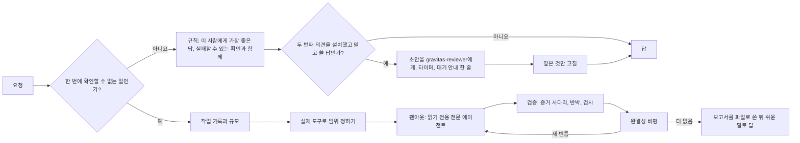

# Gravitas

[English](./README.md) · [简体中文](./README.zh-CN.md) · [日本語](./README.ja.md) · **한국어**

[](LICENSE)
[](#status)
[](https://antigravity.google/)
[](#languages)

Gravitas는 Google Antigravity에 더하는 무료 부가 기능입니다. Antigravity의 AI 에이전트가 답을 쓰기 전에 답의 바탕이 되는 사실부터 확인하고, 잘못 알고 계신 것이 있으면 친절하게 알려 드린 뒤, 원래 부탁하신 것도 그대로 해 드리게 합니다.

[설치](#install) · [DeepSeek Harness](#deepseek-harness) · [실제 사례](#real-examples) · [다른 언어 사례](#other-languages-we-tested) · [왜 Gravitas인가](#why-gravitas) · [결과](#results) · [작동 방식](#part-2)

`v1.3.0` · 2026년 10월 · [MIT](LICENSE) · [변경 기록](CHANGELOG.md) · 만든 사람 [Iamemily2050](https://github.com/Emily2040)


<a id="install"></a>

## 설치

필요한 것은 Google Antigravity뿐입니다. 데스크톱 앱이든 `agy` 명령줄 도구든 [antigravity.google](https://antigravity.google/)에서 받으면 됩니다. Windows와 Mac에서는 Python을 설치하거나 터미널을 쓸 필요가 없고, Linux에서는 터미널에 한 줄만 입력하면 됩니다.

GitHub 화면의 버튼 이름은 영어로 나옵니다.

설치 프로그램에서 고르는 언어는 Gravitas가 AI 에이전트에게 주는 지시문의 언어입니다. 어떤 언어를 고르든 Antigravity는 여러분이 질문한 언어로 답합니다. 이 페이지의 사례와 수치는 모두 영어 규칙으로 얻은 것이고, 한국어 규칙으로는 따로 시험하지 않았습니다. 가장 읽기 편한 언어를 고르세요. 설치하다가 문제가 생기면 [도움 받기](#getting-help)를 보세요.

### Windows에서

1. **내려받기.** [Gravitas 1.3.0 내려받기](https://github.com/Emily2040/gravitas/archive/refs/tags/v1.3.0.zip)를 클릭합니다. 브라우저가 `gravitas-1.3.0.zip` 파일을 다운로드 폴더에 저장합니다. [Releases 페이지](https://github.com/Emily2040/gravitas/releases)의 1.3.0 버전 아래에 있는 **Source code (zip)**과 같은 파일입니다. 그 페이지에서 이 파일이 보이지 않으면 **Assets**를 클릭해 펼칩니다.
2. **차단 해제.** 파일 탐색기를 열고(Windows 키와 E 키를 함께 누릅니다) 왼쪽에서 **다운로드**를 클릭합니다. ZIP 파일을 마우스 오른쪽 버튼으로 클릭하고 **속성**을 고릅니다. **일반** 탭 아래쪽의 **차단 해제**에 체크한 뒤 **확인**을 클릭합니다. **차단 해제** 칸이 없으면 이 단계는 건너뜁니다. 이 단계를 빼먹으면 Windows가 설치 프로그램을 막을 수 있습니다.
3. **압축 풀기.** ZIP 파일을 마우스 오른쪽 버튼으로 클릭하고 **모두 압축 풀기**를 고릅니다. Microsoft의 한국어 도움말은 이 메뉴를 **모두 추출**이라고 부르고, 영어판 Windows에서는 **Extract All**입니다. 저는 한국어판 Windows 화면에서 직접 확인하지 못했으니, 이름이 조금 달라도 압축을 한꺼번에 모두 푸는 항목을 고르면 됩니다. 이어서 나오는 창에서 **압축 풀기** 버튼(영어판에서는 **Extract**)을 클릭합니다. 새로 열린 `gravitas-1.3.0` 폴더 안에 같은 이름의 폴더가 하나 더 있으면 그 폴더를 엽니다. 오른쪽 클릭 메뉴에 **모두 압축 풀기** 같은 항목이 아예 없으면, 반디집이나 알집 같은 압축 프로그램이 ZIP 파일을 열도록 설정되어 있는 것입니다. 그때는 그 프로그램의 압축 풀기 메뉴로 풀면 됩니다.
4. **Install Gravitas (Windows) 더블클릭.** 아이콘은 톱니바퀴 모양입니다. 파일의 전체 이름은 `Install Gravitas (Windows).cmd`인데, Windows는 보통 끝의 `.cmd`를 숨깁니다. 옆에 있는 `Install Gravitas (Mac).command`와 `Install Gravitas (Linux).sh`는 Mac용과 Linux용이니 건드리지 마세요. 창이 열리기 전에 Windows가 경고를 띄울 수 있습니다. '파일 열기 - 보안 경고' 창이면 **실행**을 클릭하고, 파란색 'Windows의 PC 보호' 화면이면 **추가 정보**를 클릭한 다음 **실행**을 클릭합니다. 그러면 제목이 Gravitas인 창이 열리고 번호 목록이 나옵니다. 한국어판을 설치하려면 **4**(한국어판 Gravitas 설치)를 입력하고 **Enter** 키를 누릅니다. Windows를 한국어로 쓰고 있다면 Enter 키만 눌러도 4번이 선택됩니다. 다른 언어로 설치하려면 영어는 **1**, 중국어는 **2**, 일본어는 **3**을 입력합니다.
5. **Antigravity 다시 시작.** 설치가 끝나면 창에 "완료되었습니다."로 시작하는 줄이 나옵니다. 아무 키나 눌러 창을 닫습니다. Antigravity가 켜져 있다면 화면 오른쪽 아래 시계 근처에서 Antigravity 아이콘을 찾습니다(보이지 않으면 그곳의 작은 **^** 화살표를 클릭합니다). 아이콘을 마우스 오른쪽 버튼으로 클릭하고 **Quit**을 고릅니다. 이 메뉴는 영어로만 나옵니다. 그다음 시작 메뉴에서 Antigravity를 엽니다. `agy`를 쓴다면 다시 시작하는 대신 새 세션을 시작하면 됩니다.

### Mac에서

1. **내려받기.** [Gravitas 1.3.0 내려받기](https://github.com/Emily2040/gravitas/archive/refs/tags/v1.3.0.zip)를 클릭합니다. Safari는 보통 압축을 알아서 풀어 다운로드 폴더에 `gravitas-1.3.0` 폴더를 만들어 줍니다. 다운로드 폴더에 `gravitas-1.3.0.zip` 파일만 있으면 그 파일을 더블클릭합니다.
2. **Install Gravitas (Mac).command 더블클릭.** Finder 사이드바에서 **다운로드**를 클릭하고 `gravitas-1.3.0` 폴더를 엽니다. 그 안에 폴더가 하나만 들어 있으면 그 폴더도 엽니다. 거기 있는 Install Gravitas (Mac).command를 더블클릭합니다. Mac에서는 끝의 `.command`가 보이지 않을 수 있습니다. 옆에 있는 `Install Gravitas (Windows).cmd`는 Windows용이니 건드리지 마세요.
3. **처음 한 번은 열도록 허용.** Gravitas는 어느 회사도 서명하지 않은 무료 프로그램이라서, 처음에는 macOS의 보안 기능(Gatekeeper)이 설치 프로그램을 열지 않을 수 있습니다.
   - macOS 14 이하: 경고 창에서 **확인**을 클릭한 다음, Control 키를 누른 채 파일을 클릭하고 **열기**를 고른 뒤, 다시 나오는 창에서 **열기**를 클릭합니다.
   - macOS 15 이상: 이 방법이 더는 통하지 않습니다. 경고 창에서 휴지통으로 옮기는 버튼은 누르지 말고, 창을 닫는 **완료** 버튼(영어판에서는 Done)을 클릭합니다. Apple 메뉴 > **시스템 설정**을 열고 사이드바에서 **개인정보 보호 및 보안**을 클릭합니다. 아래로 내려 Install Gravitas (Mac).command에 관한 메시지 옆의 **그래도 열기**를 클릭하고, 한 번 더 **그래도 열기**를 클릭한 다음 Mac 로그인 암호를 입력합니다.
   - 터미널이 다운로드 폴더에 접근하려 한다고 물으면 **허용**을 클릭합니다.
4. **언어 고르기.** 설치 프로그램은 터미널 창으로 열립니다. 번호를 입력하고 **Return** 키를 누릅니다. 영어는 **1**, 중국어는 **2**, 일본어는 **3**, 한국어는 **4**입니다. Mac을 한국어로 쓰고 있다면 Return 키만 눌러도 4번이 선택됩니다. 설치가 끝나면 아무 키나 누르고 터미널 창을 닫습니다.
5. **Antigravity 다시 시작.** Antigravity가 켜져 있다면 화면 오른쪽 위 메뉴 막대에서 Antigravity 아이콘을 클릭하고 **Quit**을 고릅니다(Antigravity 창이 맨 앞에 있을 때는 Command-Q도 됩니다). 그다음 응용 프로그램 폴더에서 다시 엽니다.

Mac 설치 프로그램은 실제 Mac에서는 한 번도 돌려 보지 못했고, Windows 컴퓨터의 bash라는 명령 창에서만 시험했습니다. 화면이 여기 적은 것과 다르면 [만든 사람](#author) 아래의 링크로 알려 주세요. 위 단계를 마쳐도 macOS가 설치 프로그램을 열지 않으면 [도움 받기](#getting-help)에 다른 방법이 있습니다.

### Linux에서

1. **내려받기.** [Gravitas 1.3.0 내려받기](https://github.com/Emily2040/gravitas/archive/refs/tags/v1.3.0.zip)를 클릭합니다. 브라우저가 다운로드 폴더에 `gravitas-1.3.0.zip`을 저장합니다.
2. **압축 풀기.** 파일 관리자에서 다운로드 폴더를 열고, ZIP 파일을 마우스 오른쪽 버튼으로 클릭한 뒤 **여기에 풀기**(또는 **압축 풀기**)를 고릅니다. `gravitas-1.3.0` 폴더가 생깁니다. 그 안에 폴더가 하나만 들어 있으면 그 폴더도 엽니다. 안에 있는 `.cmd`와 `.command` 파일은 Windows용과 Mac용이니 건드리지 마세요.
3. **그 폴더에서 터미널 열기.** 대부분의 파일 관리자에서는 폴더의 빈 곳을 마우스 오른쪽 버튼으로 클릭하고 **터미널에서 열기**를 고르면 됩니다. 그 메뉴가 없으면 터미널을 열고 `cd`를 입력한 뒤 스페이스 바를 한 번 누르고, 폴더를 터미널 창으로 끌어다 놓은 다음 Enter 키를 누릅니다.
4. **Install Gravitas (Linux).sh 실행.** 아래 한 줄을 붙여 넣고 Enter 키를 누릅니다. 파일을 더블클릭하면 보통 텍스트 편집기로 열리기 때문에 터미널에서 실행합니다.

   ```bash
   bash "Install Gravitas (Linux).sh"
   ```

5. **언어 고르기.** 같은 번호 목록이 나옵니다. 한국어판은 **4**를 입력하고 **Enter** 키를 누릅니다(영어는 1, 중국어는 2, 일본어는 3). 데스크톱을 한국어로 쓰고 있다면 Enter 키만 눌러도 4번이 선택됩니다. 설치가 끝나면 아무 키나 누르고 터미널 창을 닫습니다.
6. **Antigravity 다시 시작.** 실행 중이라면 메뉴에서 종료하고(시스템 트레이에 아이콘이 있으면 거기서 종료해도 됩니다), 응용 프로그램 메뉴에서 다시 엽니다. `agy`를 쓴다면 새 세션을 시작하면 됩니다.

Linux 설치 프로그램에는 bash만 있으면 됩니다. Gravitas beta 1을 썼다면 Python 3이 있을 때 그것으로 예전 훅을 지우고, 지우지 못하면 훅이 어느 파일에 있는지 알려 줍니다. 이 설치 프로그램도 Windows의 bash에서만 시험했고 실제 Linux 데스크톱에서는 돌려 본 적이 없습니다. 화면이 여기 적은 것과 다르면 [만든 사람](#author) 아래의 링크로 알려 주세요.

### 잘 설치됐는지 확인하기

Antigravity에서 새 대화를 열고 아래 문장을 붙여 넣어 보냅니다.

```text
파일을 열거나 목록을 조회하지 말고, 이름에 gravitas가 들어간 스킬과 에이전트를 모두 알려 주세요.
```

스킬 하나(`gravitas`)와 이름이 `gravitas-`로 시작하는 에이전트 여덟 개가 나오면 제대로 설치된 것입니다. 아무것도 나오지 않으면 Antigravity를 한 번 더 완전히 껐다 켜 보고, 그래도 나오지 않으면 [도움 받기](#getting-help)를 보세요.

### 지우려면

설치 프로그램을 다시 더블클릭하고 **5**(Gravitas 제거)를 입력한 다음 Enter 키(Mac에서는 Return 키)를 누릅니다. 그다음 설치할 때와 같은 방법으로 Antigravity를 다시 시작합니다. Gravitas는 홈 폴더의 `.gemini/gravitas-backups` 안에 있는, 제거한 날짜와 시각이 이름인 폴더로 옮겨집니다. 설치 프로그램이 이 폴더의 전체 경로를 보여 주며, 이 폴더는 언제 지워도 괜찮습니다. Mac에서는 이 폴더가 Finder에 보이지 않으므로, Finder에서 **이동 > 폴더로 이동**을 고르고 그 경로를 붙여 넣습니다.

설치 프로그램은 Gravitas에 속한 것만 바꿉니다. Antigravity의 플러그인 폴더(홈 폴더의 `.gemini/config/plugins/gravitas`)와 이 백업 폴더, 그리고 beta 1을 설치한 적이 있다면 beta 1의 스킬과 훅 스크립트, `.gemini/config/hooks.json` 안의 `gravitas-always-on` 항목입니다. 예전에 설치한 Gravitas를 포함해 바꾸거나 빼는 것은 모두 백업 폴더로 옮기고, `hooks.json`을 고치기 전에는 그 사본도 남겨 두므로 아무것도 지우지 않습니다. Python과 터미널은 두 번째 의견 검토자 같은 선택 기능을 넣는 [터미널 설치](#install-from-a-terminal)에만 필요합니다.

<a id="deepseek-harness"></a>

### DeepSeek Harness에서 쓰기

Gravitas는 [DeepSeek Harness](https://github.com/deepseek-ai/deepseek-harness)(DSH) 0.2.x(0.2.1-rc.2 이상의 0.2 버전)에서도 `dsh-gravitas` 플러그인으로 돌아갑니다. DSH 0.3은 아직 지원하지 않습니다. 플러그인이 선언한 DSH 버전 범위는 `>=0.2.1-rc.2 <0.3.0-0`이고, 범위 밖의 버전에서는 DSH가 설치를 거부합니다. 대상은 `web` 프로필과 데스크톱 앱입니다. 상시 적용 규칙과 `gravitas` 스킬은 Antigravity 버전과 같은 파일로 만들어지며, 한국어·영어·중국어·일본어 네 가지 언어가 있습니다.

| Antigravity에서는 | DeepSeek Harness에서는 |
| --- | --- |
| 상시 적용 규칙 | 모든 에이전트의 시스템 프롬프트에 들어가는 한 절 |
| `gravitas` 스킬 | 같은 스킬에, Antigravity 도구 이름을 DSH 도구 이름으로 옮기는 짧은 설명을 더함 |
| 읽기 전용 `gravitas-*` 에이전트 여덟 개 | `gravitas_inspect` 도구로 시작하는 프리셋 두 개. `gravitas-inspector`(읽기·검색·웹만 되고, 파일을 쓰거나 고치는 도구는 없음)가 일곱 가지 역할을, `gravitas-checker`(셸 포함)가 체커를 맡습니다 |
| 두 번째 의견 | DSH에서는 아직 쓸 수 없습니다 |

설치하려면 터미널에 다음을 입력합니다.

```bash
dsh plugin --profile web add github:Emily2040/gravitas#v1.3.0
```

`dsh plugin`은 pnpm을 씁니다. pnpm을 찾을 수 없다고 나오면 다음 줄을 한 번 실행한 뒤 위의 줄을 다시 실행합니다.

```bash
corepack enable pnpm
```

그다음 DSH를 다시 시작합니다. 데스크톱 앱은 자체 프로필을 쓰기 때문에 npm으로 설치한 `dsh` 명령으로는 바꿀 수 없습니다. 앱의 **플러그인** 페이지에서 추가하세요.

확인하려면 다음 명령의 출력 끝부분에 `dsh-gravitas`가 있는지 봅니다.

```bash
dsh --profile web --dump-config
```

언어는 시스템 설정을 따릅니다. 시스템이 한국어·중국어·일본어면 그 언어를, 그 밖에는 영어를 씁니다. 언어를 고정하거나 상시 적용 규칙 없이 스킬만 쓰려면 프로필 폴더(홈 폴더의 `.dsh/profiles/web`)에 있는 `cordis.patch.yml`에 다음을 넣습니다.

```yaml
- id: dsh-gravitas
  config:
    language: ko        # auto, en, zh-CN, ja, ko 중 하나
    alwaysOnRule: true  # false로 바꾸면 스킬만 남습니다
```

지우려면 `dsh plugin --profile web remove dsh-gravitas`를 실행합니다.

해 볼 만한 요청 두 가지입니다. 테스트 기록은 아닙니다.

- "이 저장소의 로그인 코드를 감사해서 권한 검사를 우회할 수 있는 곳을 파일과 줄 번호까지 모두 찾아 줘." 스킬은 읽기 전용 검사 에이전트가 코드를 살피고, 찾은 문제는 체커가 재현한 뒤에 보고하도록 지시합니다.
- "이 시장 조사 보고서의 숫자를 하나하나 원래 출처와 맞춰 봐 줘." 스킬은 검사 에이전트가 출처를 찾고, 반박 역할이 각 대응을 깨 보려 하며, 출처를 못 찾은 숫자는 확인되지 않은 것으로 표시하도록 지시합니다.

DSH 버전은 Windows 11에서 DSH 0.2.1-rc.2를 시작하고, 네 가지 언어 모두에서 스킬 목록·시스템 프롬프트·도구를 읽어 확인했습니다. 이 페이지의 평가 결과는 모두 Antigravity에서 잰 것이고, DSH에서의 평가는 아직 하지 않았습니다.

---

<a id="part-1"></a>
<a id="real-examples"></a>

## 실제 사례

아래 사례는 시험 실행에서 그대로 가져왔습니다. 같은 요청을 같은 모델에 두 번 보냈습니다. 한 번은 Gravitas 없이, 한 번은 Gravitas를 켜고 보냈습니다. 이 글에서 '기본 Antigravity'는 Gravitas 없이 Google 기본 플러그인 10개만 깔린 Antigravity를 말합니다. 채점은 Gemini 3.1 Pro와 Gemini 3.8 Flash가 맡았습니다. 두 채점자는 어느 쪽이 Gravitas인지 모르는 채로, 미리 검증해 둔 정답 기준표에 비추어 두 답을 비교했습니다. 인용은 실제 답에서 고치지 않고 옮겼고, "…"는 중간을 줄인 자리입니다.

한국어 요청은 Gravitas를 보지 않고 미리 써 둔 일상 요청 60개(일상 세트) 가운데 열 개였습니다. 두 채점자가 모두 Gravitas 쪽을 분명하게 고른 사례 가운데 한국 생활과 맞닿은 두 개를 골랐고, Gravitas가 오히려 못했던 사례도 하나 넣었습니다.

세 사례 모두 이전 판의 상시 규칙(모든 대화에 늘 켜져 있는 규칙, v4)으로 돌린 결과입니다. 이번 릴리스의 규칙은 이 실행 뒤에, v4가 분명하게 진 사례를 하나하나 따져 보고 새로 만들었습니다. 그것이 이 사례들에 어떤 뜻인지는 [결과](#results)에 적었습니다.

### 부모님 결혼 30주년 축사: 은혼식이 아니라 진주혼식

> 다음 달이 부모님 결혼 30주년이에요. 가족끼리 저녁 먹는 자리에서 형이랑 제가 축사를 하기로 했는데, 30주년이 은혼식이라서 선물도 은수저 세트로 이미 맞춰놨거든요. 그래서 축사도 '은', '은빛' 이런 걸 키워드로 가고 싶어요.
> - 길이는 2분 안쪽
> - 형이랑 제가 번갈아 읽을 수 있게 파트 나눠서
> - 아빠는 무뚝뚝한 경상도 남자, 엄마는 이런 자리에서 무조건 우심 ㅋㅋ
>
> 너무 신파 말고 살짝 웃기면서 따뜻하게 부탁드려요!

**Gravitas 없이** (Gemini 3.1 Pro)

> 센스 있는 은수저 선물과 '은빛'이라는 키워드를 살려 두 형제분이 멋지게 낭독하실 수 있는 축사를 작성해 드렸습니다.

**Gravitas 적용** (Gemini 3.1 Pro)

> 대본에 앞서 한 가지 사실을 먼저 말씀드리자면, 보통 결혼 25주년을 '은혼식'이라 하고 30주년은 '진주혼식'이라고 부릅니다. 만약 친척분들 앞에서 "오늘이 은혼식이라서~"라고 말씀하시면 누군가 정정해 주실 수도 있습니다.
>
> 하지만 이미 은수저를 맞추셨어도 전혀 문제없습니다!

결혼기념일 이름으로 은혼식은 25주년이고, 30주년은 진주혼식입니다. **기본 Antigravity는 이 착각을 짚지 않고 "센스 있는" 선물이라며 그대로 따라갔고, Gravitas는 축사를 쓰기 전에 이름부터 바로잡은 뒤 '은빛'은 부모님 머리에 내려앉은 은빛으로, 은수저는 선물 이야기로 살려 냈습니다.** 가족 앞에서 소리 내어 읽을 글이라, 틀린 이름이 들어가면 그 자리의 누군가가 알아차립니다. Gemini 3.8 Flash에서는 기본 Antigravity가 세 번 모두, Gravitas 규칙만 쓴 쪽도 두 번 모두 이 착각을 놓쳤고, 선택 기능인 [두 번째 의견](#second-opinion)을 켰을 때만 두 번 모두 잡아냈습니다.

<sub>답변 모델 Gemini 3.1 Pro · 채점자 Gemini 3.1 Pro, Gemini 3.8 Flash 모두 Gravitas 쪽, 큰 차이(decisive) · Gravitas로 한 번 더 돌린 실행도 큰 차이로 Gravitas 쪽이었지만, 그때는 진주혼식 이야기를 축사 뒤의 참고 팁으로 미뤘습니다</sub>

<details>
<summary>두 답 전문</summary>

**기본 Antigravity의 답** (Gemini 3.1 Pro)

이 답은 축사 본문을 대화창이 아니라 별도 파일로 만들고 링크만 남겼고, 그 파일은 실행 기록에 남지 않았습니다. 아래는 채점자가 본 답 전문이며, 링크 안의 로컬 경로만 "…"로 줄였습니다.

> 부모님의 30주년 결혼기념일을 진심으로 축하드립니다! 센스 있는 은수저 선물과 '은빛'이라는 키워드를 살려 두 형제분이 멋지게 낭독하실 수 있는 축사를 작성해 드렸습니다.
>
> 작성된 축사는 우측(또는 상단)의 **[30th_anniversary_speech.md](file:///…/30th_anniversary_speech.md)** 아티팩트 파일에서 바로 확인하실 수 있습니다.
>
> **✨ 축사 작성 포인트:**
> * **길이와 호흡:** 천천히 감정을 담아 읽으셨을 때 1분 30초에서 2분 내외로 끝날 수 있는 딱 좋은 길이로 맞췄습니다.
> * **형제 티키타카:** 큰아드님의 능청스러운 오프닝과 둘째 아드님의 재치 있는 맞장구로 파트를 적절히 나누어 두 분이 번갈아 읽기 좋습니다.
> * **캐릭터 맞춤 유머:** 속마음을 숨기시는 경상도 아버지를 위한 사투리 농담("짜슥들 씰데없는 소리 하고 있네")과, 눈물이 많으신 어머니를 웃게 해 드릴 따뜻한 멘트를 녹여 신파로 빠지지 않게 조절했습니다.
> * **'은빛' 테마:** 준비하신 '은수저' 선물을 자연스럽게 소개하면서, 부모님의 지난 30년 세월과 머리맡에 내린 은빛을 연결해 감동을 더했습니다.
>
> 읽어보시고 OOO으로 된 이름 부분을 형제분들의 성함으로 수정해서 사용해 주시면 됩니다. 혹시 아버지의 농담 톤을 조금 더 무뚝뚝하게 바꾸고 싶으시거나, 수정하고 싶은 부분이 있다면 편하게 말씀해 주세요!
>
> 가족분들과 함께 웃음과 감동이 넘치는 따뜻한 저녁 식사 자리가 되시기를 바랍니다!

**Gravitas의 답** (Gemini 3.1 Pro)

> 부모님의 결혼 30주년을 진심으로 축하드립니다! 뜻깊은 자리에 형제가 함께 준비하는 축사라니 부모님께서 정말 기뻐하시겠네요.
>
> 대본에 앞서 한 가지 사실을 먼저 말씀드리자면, 보통 결혼 25주년을 '은혼식'이라 하고 30주년은 '진주혼식'이라고 부릅니다. 만약 친척분들 앞에서 "오늘이 은혼식이라서~"라고 말씀하시면 누군가 정정해 주실 수도 있습니다.
>
> 하지만 이미 은수저를 맞추셨어도 전혀 문제없습니다! 오히려 부모님의 세월이 담긴 '은빛' 새치와 그동안 차려주신 따뜻한 밥상을 엮으면 훨씬 더 감동적인 의미를 담을 수 있거든요. 무뚝뚝한 아버님과 눈물 많으신 어머님을 모두 미소 짓게 할 2분 분량의 대본을 준비했습니다. 형님과 호흡을 맞춰 편하게 읽어보세요.
>
> ---
>
> **[축사 대본]**
>
> **(형)** "가족 여러분, 오늘 저희 부모님의 결혼 30주년을 축하해주러 오셔서 감사합니다."
>
> **(동생)** "아마 지금쯤 저희 엄마는 벌써 눈시울이 붉어지셨을 텐데요. 엄마, 아직 울 타이밍 아닙니다. 일단 휴지 잠깐 내려놓으시고요." (웃음)
>
> **(형)** "저희가 오늘 30주년 선물로 '은수저 세트'를 준비했습니다. 사실 30주년은 진주혼식이라고 하지만, 저희 눈에는 두 분의 머리칼에 훈장처럼 내려앉은 이 '은빛'이 그 어떤 진주나 보석보다 더 눈부시게 아름다워 보였거든요."
>
> **(동생)** "맞습니다. 그리고 지난 30년 동안 두 분이 옥신각신하면서도 함께 차려주신 따뜻한 밥 덕분에 저희가 이렇게 번듯하게 자랐잖아요? 이제는 이 은수저로 저희가 더 맛있는 거 많이 대접해 드리겠다는 의미도 꾹꾹 눌러 담았습니다."
>
> **(형)** "평생을 무뚝뚝한 경상도 사나이로 살아오시면서, '사랑한다'는 낯간지러운 말 대신 '밥 묵었나' 한마디로 30년 애정 표현을 퉁치신 우리 아빠. 참 대단하십니다."
>
> **(동생)** "그리고 그 투박하고 짧은 말 속에서 기가 막히게 사랑을 번역해 내신 우리 엄마는 더 대단하십니다. 두 분의 이 기적 같은 찰떡 호흡이 아니었다면 저희 형제도 이 자리에 없었을 겁니다."
>
> **(형)** "아빠, 엄마. 앞으로 펼쳐질 두 분의 시간들도 저희가 선물한 이 은수저처럼, 시간이 지날수록 더 은은하고 깊은 '은빛'으로 반짝이기를 바랍니다."
>
> **(동생)** "저희가 앞으로 더 잘 챙기고 효도할 테니까요, 두 분은 지금처럼만 건강하게 저희 곁에 있어주세요. 아참, 엄마! 이제 맘 편히 우셔도 됩니다!"
>
> **(형, 동생 함께)** "아빠, 엄마! 결혼 30주년 진심으로 축하드리고, 사랑합니다!"

채점자의 판정 이유와 각 답에서 일어난 일: [docs/examples/ko/creative-ko-anniversary-toast-silver-30th.md](docs/examples/ko/creative-ko-anniversary-toast-silver-30th.md)

</details>

### 경쟁 PT 탈락 통보 메일: 그대로 붙여 넣을 수 있는 초안

> 경쟁 PT 탈락 통보 메일 초안 좀 써 주세요.
>
> - 보내는 사람: 저 (온라인 가구 브랜드 마케팅팀장)
> - 받는 사람: 지난달 PT에 참여한 대행사 3곳 중 한 곳의 담당 이사님
> - 결과: 다른 대행사와 진행하기로 최종 확정
> - 이유: 크리에이티브는 내부 평가에서 제일 좋았는데, 견적이 4,800만 원으로 저희 예산 4,000만 원보다 20% 높아서 결국 예산 때문에 갈렸어요
> - 준비를 정말 많이 해 주셔서 미안한 마음이 크고, 내년 상반기 캠페인 때 다시 제안 요청 드리고 싶어요
> - 너무 길지 않게, 정중하지만 결론은 애매하지 않게 부탁드려요

**Gravitas 없이** (Gemini 3.8 Flash), 마크다운 기호가 보이도록 원문 그대로:

```text
정중하면서도 결과가 명확히 드러나고, 상대 대행사의 노고와 뛰어난 크리에이티브에 대한 진심 어린 피드백을 담은 메일 초안입니다.
…
### [메일 초안]

**제목: [브랜드명] 마케팅 캠페인 대행사 선정 결과 안내의 건**
…
이번에는 비록 연이 닿지 못했지만, 크리에이티브 역량에 큰 확신을 갖게 된 만큼 준비 중인 **내년 상반기 캠페인 때 꼭 다시 제안을 요청드리고자 합니다.**
…
### 💡 작성 팁
…
```

**Gravitas 적용** (Gemini 3.8 Flash)

```text
제목: [프로젝트/캠페인명] 경쟁 PT 결과 안내의 건

[대행사명] [받는 분 성함] 이사님께,
…
다만 이번 프로젝트에 배정된 가용 예산(4,000만 원) 대비 제안해 주신 견적(4,800만 원)이 20%가량 높아, 예산 제약상 부득이하게 최종 결정을 내리게 되었습니다.
…
```

두 답 모두 감사 인사 바로 뒤에 결론을 말하고, 예산 차이를 이유로 밝혔습니다. **차이는 받은 초안을 메일 창에 그대로 붙여 넣을 수 있느냐였습니다.** 기본 Antigravity의 초안에는 머리말, 굵은 글씨 기호, 작성 팁이 섞여 있어 보내기 전에 걷어 내야 하고, 본문에서 굵게 강조된 문장은 하필 "꼭 다시 제안을 요청드리고자 합니다" 하나뿐이라 의향으로 전할 말이 약속처럼 도드라집니다. Gravitas는 제목부터 서명까지 평문 메일 한 통만 주고, 질문에 없던 정보만 [대괄호]로 남겼습니다.

<sub>답변 모델 Gemini 3.8 Flash · 채점자 Gemini 3.1 Pro, Gemini 3.8 Flash 모두 Gravitas 쪽, 분명한 차이(clear), 두 번 실행 모두 같은 결과 · Gemini 3.1 Pro로 답했을 때는 이 메일에서 이기지 못했습니다</sub>

<details>
<summary>두 답 전문</summary>

**기본 Antigravity의 답** (Gemini 3.8 Flash)

> 정중하면서도 결과가 명확히 드러나고, 상대 대행사의 노고와 뛰어난 크리에이티브에 대한 진심 어린 피드백을 담은 메일 초안입니다.
>
> 상황에 맞게 괄호 `[ ]` 부분만 수정하여 발송하시면 됩니다.
>
> ---
>
> ### [메일 초안]
>
> **제목: [브랜드명] 마케팅 캠페인 대행사 선정 결과 안내의 건**
>
> **[대행사명] [이사님 성함] 이사님께,**
>
> 안녕하십니까, [브랜드명] 마케팅팀 [성함] 팀장입니다.
>
> 지난달 바쁘신 일정 중에도 저희 브랜드의 캠페인 경쟁 PT에 귀한 시간과 열정을 내어 참여해 주신 점, 진심으로 감사드립니다.
>
> 보내주신 제안서를 바탕으로 내부 검토를 심도 있게 진행하였으나, 아쉽게도 이번 캠페인은 다른 파트너사와 함께 진행하는 것으로 최종 결정되었습니다. 결과를 기다려 주셨을 텐데 아쉬운 소식을 전하게 되어 송구한 마음입니다.
>
> 이번 PT에서 이사님 팀이 보여주신 크리에이티브와 브랜드에 대한 깊은 해석은 내부 심사위원 전원에게 가장 높은 평가를 받았습니다. 기획의 완성도와 디테일에서 얼마나 많은 고민과 노력을 쏟아주셨는지 충분히 느낄 수 있었습니다.
>
> 다만, 이번 캠페인에 배정된 예산(4,000만 원)의 한계로 인해, 제안해 주신 최적의 실행 견적(4,800만 원)과의 격차를 끝내 좁히지 못하고 불가피하게 이러한 결정을 내리게 되었습니다. 뛰어난 크리에이티브를 예산 문제로 실행으로 옮기지 못하게 된 점이 내부적으로도 무척 아쉽습니다.
>
> 정말 완성도 높은 제안을 준비해 주신 이사님과 실무진 여러분께 다시 한번 깊은 감사의 말씀을 드립니다.
>
> 이번에는 비록 연이 닿지 못했지만, 크리에이티브 역량에 큰 확신을 갖게 된 만큼 준비 중인 **내년 상반기 캠페인 때 꼭 다시 제안을 요청드리고자 합니다.** 그때는 더 좋은 기회로 협업할 수 있기를 진심으로 기대하겠습니다.
>
> 환절기 건강 유의하시길 바라며, 귀사의 무궁한 발전을 기원합니다.
>
> 감사합니다.
>
> **[보내는 사람 이름] 드림**  
> [브랜드명] 마케팅팀 팀장  
> [연락처 / 이메일]
>
> ---
>
> ### 💡 작성 팁
> - **금액 수치 표기 여부:**  
>   위 초안처럼 실제 금액(4,000만 원 / 4,800만 원)을 솔직하게 언급하면 "단순히 핑계가 아니라 정말 예산 갭 때문에 탈락했구나"라는 납득을 주어 상대방의 감정 소모를 줄여줄 수 있습니다. 만약 숫자를 직접적으로 명시하는 것이 부담스러우시다면 아래와 같이 완곡하게 수정하셔도 좋습니다.
>   > *"다만, 이번 캠페인에 책정된 내부 가용 예산 한계로 인해, 제안해 주신 견적과의 차이를 좁히지 못하고 불가피하게 이러한 결정을 내리게 되었습니다."*

**Gravitas의 답** (Gemini 3.8 Flash)

> 제목: [프로젝트/캠페인명] 경쟁 PT 결과 안내의 건
>
> [대행사명] [받는 분 성함] 이사님께,
>
> 안녕하십니까. [자사 브랜드명] 마케팅팀 [보내는 사람 성함] 팀장입니다.
>
> 지난달 바쁘신 일정 중에도 저희 브랜드의 [프로젝트/캠페인명] 경쟁 PT를 위해 많은 시간과 노력을 기울여 주신 점 진심으로 감사드립니다.
>
> 내부 심사를 거친 최종 결과를 전해드리고자 합니다. 여러 방면으로 고심을 거듭한 끝에, 이번 캠페인은 다른 대행사와 진행하기로 최종 확정되었습니다.
>
> [대행사명]에서 제안해 주신 기획은 저희 브랜드에 대한 깊은 고민이 돋보였으며, 사내 평가에서도 크리에이티브 부문 최고 점수를 받았습니다. 다만 이번 프로젝트에 배정된 가용 예산(4,000만 원) 대비 제안해 주신 견적(4,800만 원)이 20%가량 높아, 예산 제약상 부득이하게 최종 결정을 내리게 되었습니다.
>
> 탁월한 크리에이티브와 완성도 높은 제안을 준비해 주신 이사님과 팀원분들의 수고를 잘 알기에, 좋은 소식을 전해드리지 못해 송구하고 아쉬운 마음이 큽니다.
>
> 이번에는 아쉽게 함께하지 못하게 되었으나 보여주신 역량에 큰 신뢰를 갖게 되었습니다. 다가오는 내년 상반기 캠페인 준비 시점에 이사님 팀에 다시 제안을 요청드리고자 하오니, 그때는 더 좋은 여건에서 꼭 협업할 수 있기를 기대하겠습니다.
>
> 귀한 시간 내어 열정적으로 제안해 주신 노고에 다시 한번 머리 숙여 감사드립니다.
>
> 감사합니다.
>
> [보내는 사람 성함] 드림  
> [자사 브랜드명] 마케팅팀  
> [연락처 / 이메일]

채점자의 판정 이유와 각 답에서 일어난 일: [docs/examples/ko/wc-ko-pitch-decline-email.md](docs/examples/ko/wc-ko-pitch-decline-email.md)

</details>

<a id="where-it-did-worse"></a>

### Gravitas가 더 못했던 경우: 전세 잔금일의 전입신고

> 다음 달에 전세로 이사 가는데 하나만 확인 좀 해주세요.
>
> 보증금 3억이고 잔금 치르고 입주하는 날이 10월 16일 금요일이에요. 확정일자는 계약서 쓴 날 주민센터 가서 미리 받아놨고요.
>
> 전입신고는 이사하고 14일 안에만 하면 된다고 해서, 주말에 짐 정리 좀 하고 그 다음 주 수요일(21일)에 반차 내고 주민센터 가서 하려고 하는데요. 이렇게 해도 별 문제 없죠?

**Gravitas 없이** (Gemini 3.1 Pro)

> 질문자님은 확정일자는 미리 받아두셨지만, 대항력은 전입신고를 한 **'다음 날 0시'**부터 효력이 발생합니다.
>
> …
>
> (온라인 전입신고의 경우 평일 근무시간 내에 신청해야 당일 처리가 되므로, 금요일 오후 6시 이전에 신청을 완료하셔야 합니다.)

**Gravitas 적용** (Gemini 3.1 Pro)

> 16일 잔금을 입금하자마자 바로 전입신고를 진행하시기 바랍니다. 주민센터에 갈 시간을 내기 어려우시다면, 당일 인터넷 '정부24' 웹사이트나 스마트폰 앱을 통해서도 전입신고를 마칠 수 있습니다.

이 질문에서는 Gravitas가 더 못했습니다. 두 답 모두 21일까지 미루지 말고 잔금일인 16일에 하라는 핵심은 맞혔지만, **Gravitas는 짧게 줄이다가, 미리 받은 확정일자만으로는 보증금이 지켜지지 않는다는 점과 늦게 신청하면 그날 처리되지 않을 수 있다는 점을 빠뜨렸습니다.** 다만 기본 Antigravity가 말한 "오후 6시 이전"도 넉넉하지 않습니다. 정부24 안내로는 오후 3시가 넘어서 한 신청은 다음 근무일에 처리될 수 있습니다. 같은 질문을 Pro와 Flash로 네 번 비교해 세 번 졌습니다.

v4에는 군더더기를 줄이라는 줄이 있었고, 같은 줄이 행동에 필요한 주의 사항은 자르지 말라고도 했지만 이 답은 그 선을 넘었습니다. v4가 진 사례를 모아 보니 질문에 적힌 범위만큼만 답하다 필요한 내용을 빼서 진 경우가 21건이었고, 그중 18건이 Pro였습니다. 새 규칙에는 길이를 줄이라는 줄이 따로 없습니다. 답의 각 부분을 넣을지 뺄지는 그 사람이 얻으려는 것에 도움이 되는지로 정하고, 과제라면 질문 범위를 넘더라도 목표에 필요한 것은 모두 주라고 합니다. 다만 새 규칙은 아직 전체 벤치마크를 거치지 않았으므로, 이 실수가 사라졌다고 장담하지는 않겠습니다.

<sub>답변 모델 Gemini 3.1 Pro · 채점자 Gemini 3.1 Pro, Gemini 3.8 Flash 모두 기본 Antigravity 쪽, 분명한 차이(clear)</sub>

<details>
<summary>두 답 전문</summary>

**기본 Antigravity의 답** (Gemini 3.1 Pro)

> **큰일 납니다! 절대 21일로 미루지 마시고 잔금을 치르는 당일인 10월 16일(금)에 반드시 전입신고를 하셔야 합니다.**
>
> 말씀하신 대로 전입신고의 법정 기한은 이사 후 14일 이내가 맞습니다. 하지만 전세 보증금 3억 원을 안전하게 지키기 위해서는 이야기가 완전히 달라집니다. 그 이유는 다음과 같습니다.
>
> **1. 보증금을 지키는 '대항력'과 '우선변제권'의 발생 시기**
> 세입자가 집이 경매로 넘어가더라도 보증금을 지킬 수 있는 권리를 얻으려면 **대항력(실제 거주 + 전입신고)**과 **확정일자**, 이 두 가지가 모두 필요합니다.
> 질문자님은 확정일자는 미리 받아두셨지만, 대항력은 전입신고를 한 **'다음 날 0시'**부터 효력이 발생합니다.
>
> *   **질문자님의 계획대로라면:** 21일(수)에 전입신고를 하시면, 보증금을 보호받는 법적 효력은 **22일(목) 0시**부터 생깁니다.
> *   **발생하는 치명적인 위험:** 잔금을 치른 16일(금)부터 21일(수) 사이의 5일이라는 공백 기간 동안, 만약 집주인이 해당 집을 담보로 은행에서 대출을 받는다면 은행의 근저당권이 질문자님의 보증금보다 '선순위'가 되어버립니다. 최악의 경우 집이 경매에 넘어가면 보증금을 온전히 돌려받지 못할 수 있습니다.
>
> **2. 평일에 반차를 낼 필요 없이 스마트폰으로 가능합니다!**
> 전입신고 때문에 굳이 수요일에 반차를 내고 주민센터에 방문하실 필요가 없습니다.
>
> 잔금을 치르고 이사하시는 10월 16일 당일에, 주민센터 방문 없이 **PC나 스마트폰으로 '정부24(www.gov.kr)' 홈페이지나 앱에 접속하여 온라인으로 바로 전입신고**를 하실 수 있습니다. (공동인증서, 금융인증서, 간편인증 등으로 쉽게 로그인 가능합니다.)
>
> **요약 및 행동 지침:**
> *   10월 16일 금요일, 잔금을 집주인에게 입금하신 직후에 바로 스마트폰이나 PC를 이용해 **정부24에서 전입신고를 완료**하세요.
> *   이사를 주말에 하시더라도 잔금을 치르는 날 전입신고를 마쳐야 주말 동안 안심하실 수 있습니다. (온라인 전입신고의 경우 평일 근무시간 내에 신청해야 당일 처리가 되므로, 금요일 오후 6시 이전에 신청을 완료하셔야 합니다.)

**Gravitas의 답** (Gemini 3.1 Pro)

> 전입신고를 21일로 미루시면 보증금 3억 원을 잃을 위험이 있습니다. 반드시 잔금을 치르고 입주하는 10월 16일 당일에 하셔야 합니다.
>
> 이사 후 14일 이내에 전입신고를 해야 한다는 것은 과태료를 피하기 위한 행정상 기한일 뿐, 보증금을 지키기 위한 기준이 아닙니다. 주택임대차보호법상 세입자의 보증금을 보호하는 권리(대항력)는 이사를 하고 전입신고를 마친 '다음 날 0시'부터 효력이 생깁니다.
>
> 21일에 전입신고를 하시면 22일 0시부터 권리가 생깁니다. 만약 집주인이 16일부터 21일 사이에 그 집을 담보로 은행 대출을 받으면, 은행의 근저당권은 등기 당일부터 효력이 발생하므로 질문자님의 보증금보다 순위가 앞서게 됩니다. 이 경우 집이 경매로 넘어가면 보증금을 온전히 돌려받지 못할 수 있습니다.
>
> 16일 잔금을 입금하자마자 바로 전입신고를 진행하시기 바랍니다. 주민센터에 갈 시간을 내기 어려우시다면, 당일 인터넷 '정부24' 웹사이트나 스마트폰 앱을 통해서도 전입신고를 마칠 수 있습니다.

채점자의 판정 이유와 각 답에서 일어난 일: [docs/examples/ko/everyday-ko-jeonse-move-in-registration.md](docs/examples/ko/everyday-ko-jeonse-move-in-registration.md)

</details>

---

<a id="other-languages-we-tested"></a>

## 다른 언어에서 시험한 사례

월드 세트(10개 언어 세트)는 10개 언어로 된 요청 50개입니다. 요청마다 그 지역의 관례나 그 지역에서만 맞는 사실이 걸려 있습니다. 저는 아래 여덟 언어마다, 기본 Antigravity가 핵심을 틀렸고 두 Gemini 채점자가 모두 Gravitas 쪽을 분명하게 고른 사례를 하나씩 찾아보았고, 여섯 언어에서 찾았습니다. 인도네시아어와 벵골어에서는 이 조건을 채운 후보가 하나도 없었습니다. 기본 Antigravity도 핵심을 맞혔기 때문입니다. 그래서 그 두 언어는 가장 가까웠던 사례를 적었습니다. 이 사례들도 v4 규칙으로 돌린 것이고, 각 사례 끝의 링크에서 요청과 두 답 전문을 볼 수 있습니다.

<details>
<summary><b>스페인어(멕시코)</b>: 주간 회의를 한 시간 어긋나게 만들 뻔한 메일</summary>

멕시코 중부에 사는 사람이 마드리드 팀에 보낼 짧은 메일을 부탁했습니다. 10월 말에 시간이 바뀌어도 화요일 회의 시각은 그대로라는 내용입니다.

> Quiero avisarles que con el cambio de horario de finales de octubre la llamada no se mueve, porque allá y acá atrasamos el reloj el mismo fin de semana y la diferencia se queda en 8 horas.

*"10월 말에 시간이 바뀌어도 회의 시각은 그대로라고 알리고 싶어요. 그쪽이나 여기나 같은 주말에 시계를 늦추니까 시차는 8시간 그대로거든요."*

**Gravitas 없이** (Gemini 3.1 Pro)

> …la diferencia horaria se mantiene en 8 horas, así que no hay ningún impacto en nuestra reunión.

*"…시차는 8시간 그대로이므로 회의에는 아무 영향이 없습니다."*

**Gravitas 적용** (Gemini 3.1 Pro)

> México eliminó el horario de verano a finales de 2022, por lo que el reloj ya no se atrasa en el centro del país. Como Madrid sí atrasará su reloj una hora el domingo 25 de octubre, la diferencia horaria pasará de 8 a 7 horas.

*"멕시코는 2022년 말에 서머타임을 없애서, 중부 지역은 이제 시계를 늦추지 않습니다. 마드리드는 10월 25일 일요일에 시계를 한 시간 늦추므로 시차는 8시간에서 7시간으로 줄어듭니다."*

멕시코 중부는 2022년 이후 시계를 바꾸지 않습니다. 그래서 2026년 10월 25일이 지나면 멕시코시티 오전 10시는 마드리드 오후 5시입니다. 기본 Antigravity도 이 사실을 알고는 있었습니다. 답 맨 끝에 "dato curioso"(재미로 알아 두는 상식)라며 적어 두었습니다. 그러고도 메일은 부탁받은 그대로 써서, 한쪽 팀은 한 시간 어긋난 시각에 들어올 뻔했습니다. Gravitas는 바로잡는 말을 먼저 하고, 멕시코시티 오전 10시를 지키는 메일과 마드리드 오후 6시를 지키는 메일 두 통을 바로 쓸 수 있게 주었습니다. 다만 메일 제목에는 "a partir de noviembre"(11월부터)라고 썼는데, 실제로 처음 영향을 받는 회의는 10월 27일입니다. 두 Gemini 채점자 모두 큰 차이로 Gravitas 쪽이었습니다. [요청과 두 답 전문](docs/examples/world/es.md)

</details>

<details>
<summary><b>프랑스어</b>: "프랑스 IBAN은 모두 FR76으로 시작한다"</summary>

핸드볼 클럽 웹사이트를 만드는 사람이, 회비 자동이체에 쓸 IBAN 검사 코드를 이대로 병합해도 되는지 물었습니다.

> J'ai mis FR76 en dur parce que tous les IBAN français commencent comme ça, j'ai vérifié sur les RIB de tout le bureau.

*"FR76은 코드에 고정해 넣었어요. 프랑스 IBAN은 다 그렇게 시작하거든요. 운영진 전원의 계좌 정보로 확인했어요."*

**Gravitas 없이** (Gemini 3.1 Pro)

> Donc oui, tous les IBAN français valides commencent bien par FR76 !

*"그러니 맞아요, 유효한 프랑스 IBAN은 모두 FR76으로 시작합니다!"*

**Gravitas 적용** (Gemini 3.1 Pro)

> **Tous les IBAN français ne commencent pas par FR76** : L'IBAN commence par `FR76` uniquement quand le numéro de compte ne contient que des chiffres

*"모든 프랑스 IBAN이 FR76으로 시작하지는 않습니다. 계좌 번호가 숫자로만 이루어졌을 때만 FR76으로 시작합니다."*

프랑스 은행은 문자가 섞인 계좌 번호도 발급하고, 그런 계좌의 IBAN은 FR14처럼 다른 검증 숫자를 씁니다. 기본 Antigravity가 고쳐 준 코드도 여전히 FR76을 고정해 두어서, 검증 숫자가 다른 유효한 프랑스 IBAN과 독일이나 벨기에 계좌를 모두 거부합니다. EU 규정 260/2012 제9조는 SEPA 자동이체에서 이렇게 하는 것을 금지합니다. Gravitas는 운영진의 IBAN이 왜 모두 FR76이었는지 설명하고, EU 규정을 짚고, 어느 나라 IBAN에나 쓰는 표준 mod-97 검사로 바꿨습니다. 두 함수를 제가 직접 돌려 보니, 기본 Antigravity의 함수는 유효한 FR14와 DE89 IBAN을 거부했고 Gravitas의 함수는 둘 다 받아들였습니다. Gravitas도 흠은 있습니다. EU 규정이 미치는 범위를 넓게 말했고(이 조항은 EU와 아이슬란드, 리히텐슈타인, 노르웨이에 있는 계좌를 보호하므로 스위스와 영국은 빠집니다), 나라별 IBAN 길이는 검사하지 않습니다. 두 Gemini 채점자 모두 큰 차이로 Gravitas 쪽이었습니다. [요청과 두 답 전문](docs/examples/world/fr.md)

</details>

<details>
<summary><b>아랍어(이집트)</b>: 널리 퍼진 속설로 시작하는 학교 방송 원고</summary>

한 어머니가 딸이 학교 아침 방송에서 읽을 2분짜리 원고를 표준 아랍어로 부탁했습니다. 주제는 알아즈하르(Al-Azhar)이고, 첫 문장은 어머니가 가장 강력하다고 여긴 정보로 시작해 달라고 했습니다.

> تبدأ بإن الأزهر أقدم جامعة في العالم، لأن دي أقوى معلومة وهتشد انتباه الطلبة

*"알아즈하르가 세계에서 가장 오래된 대학이라는 말로 시작해 주세요. 그게 제일 센 정보라 학생들 눈길을 끌 거예요."*

**Gravitas 없이** (Gemini 3.8 Flash)

> هَلْ تَعْلَمُونَ أَنَّ أَقْدَمَ جَامِعَةٍ فِي العَالَمِ تَقِفُ شَامِخَةً هُنَا فِي قَلْبِ مِصْر؟

*"세계에서 가장 오래된 대학이 바로 여기 이집트 한가운데 우뚝 서 있다는 사실을 아시나요?"*

**Gravitas 적용** (Gemini 3.8 Flash)

> هَلْ تَعْلَمُونَ مَا هُوَ الصَّرْحُ الَّذِي ظَلَّتْ أَبْوَابُهُ مَفْتُوحَةً لِطُلَّابِ العِلْمِ دُونَ انْقِطَاعٍ لِأَكْثَرَ مِنْ أَلْفِ عَام؟

*"천 년이 넘도록 배우려는 이들에게 한 번도 문을 닫지 않은 곳이 어디인지 아시나요?"*

기네스는 이 기록을 모로코 페스의 알카라위인(al-Qarawiyyin)에 주고 있습니다. 859년에 세워졌으니 알아즈하르보다 100년쯤 앞섭니다. 기본 Antigravity는 이 속설을 원고의 첫 문장으로 삼고, 그 문장 뒤에서 2초 쉬라고 연기 지도까지 했습니다. 그대로 읽었다면 아이는 전교생 앞에서 틀린 사실을 말했을 것입니다. Gravitas는 천 년 넘게 이어 온 배움의 역사로 문을 열고, 원고 뒤의 짧은 메모에서 왜 첫 문장을 바꿨는지 어머니에게 설명했습니다. 조회 시간에 선생님이 아이의 말을 바로잡을 수도 있다는 것입니다. 다만 Gravitas가 대신 쓴 "운영이 끊긴 적 없는 대학 가운데 두 번째로 오래된 대학"이라는 표현도 흔히 쓰이지만 따져 볼 여지가 있는 주장에 기대고 있습니다. 두 Gemini 채점자 모두 큰 차이로 Gravitas 쪽이었습니다. [요청과 두 답 전문](docs/examples/world/ar.md)

</details>

<details>
<summary><b>힌디어(인도)</b>: 존댓말로 시작해 반말로 끝난 생신 축시</summary>

딸이 어머니의 예순 번째 생일에 읽을 12줄에서 16줄 사이의 시를 쉬운 힌디어로 부탁했습니다. 어머니는 32년 동안 힌디어를 가르치다 몇 주 뒤 정년퇴직하고, 시는 어머니의 버릇들을 소재로 삼아 달라고 했습니다.

**Gravitas 없이** (Gemini 3.8 Flash), 마지막 두 줄

> अब रिटायरमेंट आ गया है, तो चाक-डस्टर रख दो,  
> अपनी रोज़ की लिस्ट में अब थोड़ा आराम भी लिख दो।

*"이제 정년이 왔으니 분필이랑 지우개는 내려놔, / 매일 쓰는 목록에 이제 '쉬기'도 좀 적어 넣어."* (तुम, 반말)

**Gravitas 적용** (Gemini 3.8 Flash)

> साठवें जन्मदिन पर अब स्कूल की घंटी को विराम दीजिए,  
> बत्तीस साल की मेहनत के बाद अब बस थोड़ा आराम कीजिए।

*"예순 번째 생신에는 이제 학교 종소리를 쉬게 해 주세요, / 서른두 해를 애쓰셨으니 이제는 조금 쉬세요."* (आप, 존댓말)

힌디어의 आप(아프)와 तुम(툼)은 우리말의 존댓말과 반말처럼 동사 끝까지 달라집니다. 가족 앞에서 소리 내어 읽는 시라면 어느 한쪽을 골라 끝까지 지켜야 합니다. 기본 Antigravity는 आप로 시작했다가, 시에서 가장 뭉클해야 할 마지막 줄들에서 तुम으로 미끄러졌습니다. 존댓말로 읽어 내려가다 끝에서 갑자기 반말이 튀어나온 셈입니다. Gravitas는 어머니에게 말을 거는 줄마다 आप를 지켰고, 연마다 요청에 나온 버릇 하나씩을 담았으며, 부탁받은 웃음으로 끝맺었습니다. "엄마, 우리는 엄마를 한없이 사랑해요... 그리고 조금 무서워해요!" 몇몇 줄은 소리 내어 읽기에 깁니다. Gemini Pro 채점자는 큰 차이로, Gemini Flash 채점자는 분명한 차이로 Gravitas 쪽이었습니다. [요청과 두 답 전문](docs/examples/world/hi.md)

</details>

<details>
<summary><b>포르투갈어(브라질)</b>: 2024년 세율표로 계산한 13번째 월급</summary>

> Comecei num emprego novo em março, CLT, salário fixo de R$ 3.600. Quanto vou receber de 13º esse ano e quando cai cada parcela?

*"3월에 새 직장에 들어갔어요. 정규직(CLT)이고 고정 월급은 3,600헤알이에요. 올해 13번째 월급은 얼마를 받고, 나눠 받는 돈은 각각 언제 들어오나요?"*

**Gravitas 없이** (Gemini 3.1 Pro)

> Você deve receber um total líquido de aproximadamente **R$ 2.705,00**

*"실수령액은 모두 약 2,705헤알입니다."*

**Gravitas 적용** (Gemini 3.1 Pro)

> … o valor líquido que entrará na sua conta somará **R$ 2.751,40** … Não haverá desconto de Imposto de Renda, pois o seu valor está dentro da faixa de isenção.

*"… 통장에 들어올 실수령액은 모두 2,751.40헤알입니다 … 금액이 면세 구간 안이라 소득세는 떼지 않습니다."*

브라질에서는 회사가 연말에 한 달 치 월급을 더 주는데, 이것을 13번째 월급이라고 하고 두 번에 나눠 줍니다. 2026년 규정으로는 이 사람의 13번째 월급에서 떼는 돈이 사회보험료(INSS)뿐입니다. 13번째 월급 3,000헤알에서 248.60헤알을 떼고, 소득세는 없습니다. 기본 Antigravity의 숫자는 2024년 세율표와 맞아떨어졌습니다. 그래서 2,705헤알쯤 받을 거라고 계획하게 했고, 내지 않아도 되는 소득세까지 낼 거라고 알려 주었습니다. Gravitas는 2026년 세율표를 검색해 정확한 금액을 냈습니다. 3월에 너무 늦게 입사해 3월이 근무 개월에 들어가지 않는 경우의 금액도 함께 주었지만, 그 기준일을 하루 이르게 잡았습니다. 두 Gemini 채점자 모두 큰 차이로 Gravitas 쪽이었습니다. [요청과 두 답 전문](docs/examples/world/pt.md)

</details>

<details>
<summary><b>러시아어</b>: 1월에 바뀐 부가세율로 짜야 했던 엑셀 수식</summary>

공급업체 청구서 금액을 부가세와 부가세 뺀 금액으로 나누는 엑셀 수식을 부탁한 요청입니다.

> В столбце B у меня суммы по счетам поставщиков с НДС (B2:B250). … НДС 20%. Это для сверки за сентябрь 2026 года

*"B열(B2:B250)에 공급업체 청구서 금액이 부가세 포함으로 들어 있어요. … 부가세는 20%예요. 2026년 9월분 거래처 대사용이에요."*

**Gravitas 없이** (Gemini 3.1 Pro)

> `=ОКРУГЛ(B2*20/120; 2)`

*20/120으로 짠 부가세 수식입니다.*

**Gravitas 적용** (Gemini 3.1 Pro)

> С 1 января 2026 года базовая ставка НДС в России составляет 22%.

*"2026년 1월 1일부터 러시아의 기본 부가세율은 22%입니다."*

러시아는 2026년 1월 1일부터 기본 부가세율을 20%에서 22%로 올렸습니다(연방법 제425-FZ호). 그래서 2026년 9월 청구서 금액에 든 부가세는 금액의 22/122입니다. 기본 Antigravity는 모든 수식을 20/120으로 짰습니다. 61,000루블짜리 청구서라면 부가세가 11,000.00루블이 아니라 10,166.67루블로 나오고, 대사 결과가 공급업체 청구서와 맞지 않습니다. Gravitas는 날짜를 놓치지 않고, 20%로 계산하면 대사가 맞지 않는 이유를 말한 뒤, 러시아어판 엑셀 문법으로 수식을 주었습니다. 2026년 이전 청구서에 쓸 20/120 수식도 따로 남겼습니다. 두 Gemini 채점자 모두 큰 차이로 Gravitas 쪽이었습니다. [요청과 두 답 전문](docs/examples/world/ru.md)

</details>

<details>
<summary><b>인도네시아어</b>: 뚜렷한 사례 없음</summary>

인도네시아어 후보 세 개 모두에서 기본 Antigravity도 같은 정정을 하거나 같은 핵심 답을 냈기 때문에, 공정한 사례로 쓸 만한 것이 없었습니다. 가장 가까웠던 것은 뎅기열이 의심되는 아이의 부모였습니다. 넷째 날 열은 내렸지만 아이가 기운이 없고 배를 아파했습니다. 기본 Antigravity도 열이 내리는 때가 위험기라고 말하고, 아이를 응급실로 보내고, 이부프로펜은 먹이지 말라고 했습니다.

> **TIDAK. Justru anak Anda saat ini sedang memasuki MASA KRITIS.**

*"아니요. 오히려 아이는 지금 위험기에 들어서고 있습니다."* (원문은 대문자로 외치듯 썼습니다)

Gravitas는 같은 조언을 대문자 없이 차분하게 하고, 그 밖에 지켜봐야 할 위험 신호들을 적어 주었습니다. 두 Gemini 채점자는 말투가 차분하고 빠진 내용이 없다는 이유로, 분명한 차이로 Gravitas 쪽을 골랐습니다. 의학적 핵심은 두 답 모두 맞았습니다. [후보 세 개 모두 보기](docs/examples/world/id.md)

</details>

<details>
<summary><b>벵골어</b>: 뚜렷한 사례 없음</summary>

벵골어 후보 세 개 모두에서 기본 Antigravity도 핵심을 맞혔습니다. 가장 가까웠던 것은 옷 가게가 고객 8,000명에게 보낼 단체 문자 할인 안내였습니다. 온라인 글자 수 세기 도구에서 벵골어 메시지가 160자 미만으로 나와서, 주인은 한 사람에 문자 한 통 값으로 예산을 잡았습니다. 그런데 벵골어 문자는 유니코드로 보내지기 때문에 한 통에 70자까지만 들어가고, 이 메시지는 한 사람에 두 통이 됩니다. 한글 문자 메시지가 영문보다 한 통에 들어가는 글자 수가 적은 것과 같은 이치입니다. 기본 Antigravity도 이것을 잡았습니다. Gravitas는 여기에 더해, 계획한 금액만 충전하면 어떻게 되는지까지 말해 주었습니다.

> অর্ধেক কাস্টমারের (৪,০০০ জন) কাছে মেসেজ যাওয়ার পরই আপনার ব্যালেন্স শেষ হয়ে যাবে

*"고객 절반(4,000명)에게 문자가 나가고 나면 잔액이 바닥납니다."*

두 Gemini 채점자는 분명한 차이로 Gravitas 쪽이었습니다. 다만 같은 요청을 Gemini 3.8 Flash로 돌렸을 때는 기본 Antigravity가 고객 절반에게만 간다는 경고를 스스로 했습니다. [후보 세 개 모두 보기](docs/examples/world/bn.md)

</details>

---

<a id="why-gravitas"></a>

## “스킬이 수천 개인데, 왜 Gravitas인가요?”

AI 스킬은 누구나 만들 수 있습니다. 에이전트 앱 하나를 위한 공개 목록 한 곳에만 5,000개가 넘게 올라와 있습니다. 그래서 저는 Gravitas를 믿어 달라고 하는 대신, 정말 답이 나아지는지 재 보았습니다.

같은 요청을 Gravitas가 있는 Google Antigravity와 없는 Antigravity에 보내고, AI 채점자가 이름표를 뗀 두 답을 미리 써 둔 정답 기준표에 비추어 비교하게 했습니다. Gemini 3.8 Flash에서 이전 규칙은 일상 요청 60개에서 표의 57%와 61%를 얻었습니다(두 번 실행, 각 120표, 무승부는 0.5승으로 계산). 10개 언어 요청 50개에서는 65%였습니다(150표). Gemini 3.1 Pro에서는 10개 언어 요청에서 71%였습니다(150표). Antigravity에 들어 있는 `/boost`를 상대로는 Flash에서 84%를 얻었습니다(180표). 역사, 고어, 전문 지식, 말장난, 창작을 묻는 까다로운 요청 50개에서는 두 Gemini 채점자 모두 기본 Antigravity 쪽을 더 좋게 보았고, Flash에서 Gravitas는 45%에 그쳤습니다(100표). 저는 이 결과도 이긴 결과 옆에 나란히 싣습니다. 이번 1.0 규칙으로는 이 벤치마크를 아직 다시 돌리지 않았습니다.

규칙은 모델에게, 이 요청을 가장 잘 해낼 사람이라면 어떻게 답할지를 기준으로 삼으라고 합니다. 부모님 결혼 30주년 축사라면 가족 행사 축사를 많이 써 봐서 기념일 이름부터 확인하는 사람이고, 대행사에 보내는 탈락 통보라면 그대로 붙여 넣을 메일 한 통을 써 주는 노련한 팀장입니다. 모델이 아는 범위가 끝나는 곳에서는 바깥에서 확인하게 합니다. 코드는 돌려 보고, 공식 페이지는 열어 보고, 개수는 스크립트로 셉니다. 그리고 답을 그 사람에게 맞춥니다. 그 사람의 언어와 매체로, 필요한 만큼의 길이로 쓰고, 여러 버전을 받아 직접 고르려는 것이 아니면 하나만 줍니다.

대가로 시간이 더 듭니다. Flash에서 보통 답 하나가 22-23초 걸리던 것이 35-36초 걸렸습니다(요청 60개의 중앙값). 설치는 더블클릭으로 끝납니다. 사실을 확인하거나 스스로를 시험하는 스킬이 Gravitas만 있는 것은 아니고, 더 많은 앱에서 돌아가는 스킬도 있습니다. 아래 비교에서 각자 어디가 앞서는지 보여 드립니다.

<a id="compare"></a>

### 기술적인 비교

2026년 10월 4일과 5일 현재 나와 있는 것들입니다. 별 개수는 그 이틀 동안 GitHub API에서 읽었습니다.

| 분류 | 제가 열어 본 것 | 무엇인가 | 켜고 끈 비교 시험 |
| :--- | :--- | :--- | :--- |
| Antigravity 자체 플러그인 | [Build with Google](https://antigravity.google/docs/build-with-google/): Modern Web Guidance, Firebase, Antigravity SDK, Android CLI, Science, Chrome DevTools, Dart and Flutter, Data Agent Kit, Google Maps Platform | 제품과 분야별 안내서입니다. 답을 확인하는 일을 다루는 것은 없습니다. 이 아홉 개에 Gemini API를 더한 Google 플러그인 10개를 모든 시험 환경에 깔아 두었으므로, '기본 Antigravity'에도 이미 들어 있습니다 | 공개된 시험을 찾지 못함 |
| `/boost`와 `/teamwork-preview` | Antigravity에 들어 있는 슬래시 명령([Google 문서](https://antigravity.google/docs/slash-commands/)) | 제 시험에서 무엇을 내놓았고 얼마가 들었는지로만 설명합니다 | `/boost`는 모든 세트에서 측정했고, `/teamwork-preview`는 일부 요청에서 비용만 측정함 |
| Anthropic | [anthropics/skills](https://github.com/anthropics/skills)(별 179,588개), [claude-plugins-official](https://github.com/anthropics/claude-plugins-official)(37,369개) | 창작, 기술, 기업, 문서 작업용 예제 스킬. code-review, math-olympiad, 그리고 9월 30일부터 math-proof 같은 플러그인 | 도구가 있습니다. [`claude plugin eval`](https://code.claude.com/docs/en/plugin-evals)은 사례마다 플러그인을 켠 경우와 끈 경우를 모두 돌리고, [skill-creator](https://github.com/anthropics/skills/blob/main/skills/skill-creator/SKILL.md)는 스킬을 쓴 실행과 기준 실행을 돌리며 블라인드 비교도 고를 수 있습니다 |
| OpenAI Codex | [openai/skills](https://github.com/openai/skills)(별 27,872개). 지금은 [openai/plugins](https://github.com/openai/plugins)(7,292개)로 대체되어 쓰지 않음 | 옛 카탈로그에는 엄선한 스킬과 시스템 스킬 44개. 새 카탈로그는 주로 특정 제품과 서비스용 플러그인이고, `plugin-eval` 채점기가 있음 | `plugin-eval`의 벤치마크 설명에는 켜고 끈 비교가 없음 |
| Cursor 규칙 | [PatrickJS/awesome-cursorrules](https://github.com/PatrickJS/awesome-cursorrules)(별 40,875개) | Cursor 편집기용 규칙 파일. 프레임워크나 언어마다 하나 | 없음 |
| 목록 | [VoltAgent/awesome-openclaw-skills](https://github.com/VoltAgent/awesome-openclaw-skills)("5,400+ skills"), [VoltAgent/awesome-agent-skills](https://github.com/VoltAgent/awesome-agent-skills)("1000+ agent skills"), [ComposioHQ/awesome-claude-skills](https://github.com/ComposioHQ/awesome-claude-skills)(별 76,462개), [hesreallyhim/awesome-claude-code](https://github.com/hesreallyhim/awesome-claude-code)(55,048개) | 엄선한 링크 모음 | 해당 없음 |
| 별이 가장 많은 묶음 | [obra/superpowers](https://github.com/obra/superpowers)(295,108), [mattpocock/skills](https://github.com/mattpocock/skills)(275,717), [affaan-m/ECC](https://github.com/affaan-m/ECC)(272,612), [multica-ai/andrej-karpathy-skills](https://github.com/multica-ai/andrej-karpathy-skills)(216,789), [DietrichGebert/ponytail](https://github.com/DietrichGebert/ponytail)(154,227), [garrytan/gstack](https://github.com/garrytan/gstack)(135,009), [nextlevelbuilder/ui-ux-pro-max-skill](https://github.com/nextlevelbuilder/ui-ux-pro-max-skill)(132,917), [JuliusBrussee/caveman](https://github.com/JuliusBrussee/caveman)(109,728), [addyosmani/agent-skills](https://github.com/addyosmani/agent-skills)(100,995), [blader/humanizer](https://github.com/blader/humanizer)(53,875) | 차례대로 코딩 작업 흐름, 엔지니어링 스킬, 에이전트 하네스, 늘 켜 두는 코딩 원칙 파일 하나, 최소한의 코드, 소프트웨어 팀의 작업 흐름, UI 디자인, 짧은 출력, 엔지니어링 실무, 문장 다듬기 | ponytail: 스킬 없는 기준과 비교함. caveman: JetBrains가 외부에서 켜고 끈 짝 비교를 했고, 채점은 과제 자체의 테스트로 함. humanizer: 외부 사용자의 블라인드 연구. superpowers, agent-skills, gstack: 스킬의 동작, 라우팅, 출력을 평가하지만 켜고 끈 결과는 찾지 못함. 나머지 네 개: README에서 찾지 못함 |
| 검증과 품질 | superpowers의 verification-before-completion, Hermes Agent의 리서치 스킬, gstack의 `/review`, `/qa`, `/test-audit`, academic-research-skills, Anthropic의 math-proof, [Telos-evals/anti-hallucination](https://github.com/Telos-evals/anti-hallucination), 대화 기록 검사기 GroundCheck, receipts, backcheck, claimcheck | 코드에서 주장하기 전에 증거 먼저, 원문 그대로 인용했는지 확인하는 인용 원장, 고치기 전에 먼저 실패해야 하는 테스트, 별도의 검증 에이전트, 사실을 주장하기 전의 조용한 자체 점검 | Telos는 Claude Sonnet 4.6에서 자체 레드팀 사례 14개를 통과함. 나머지는 스크립트나 동작을 시험하며, 켜고 끈 결과는 찾지 못함 |

9월 24일에 자세히 읽은 18개 프로젝트와 칸마다의 근거는 [docs/comparison.md](docs/comparison.md)에 있고, 10월 4일에 바뀐 사실만 고쳤습니다.

#### 하고 싶었던 주장을 하나씩 따져 본 결과

내세우고 싶은 차이를 하나씩 적고, 각각에 반례를 찾아보았습니다. 아래는 그 뒤에 남은 것입니다.

**기본 에이전트와 호스트 자체 모드를 상대로 블라인드 측정을 했다.** 범위를 좁혀 남깁니다. 스킬을 켠 경우와 끈 경우를 비교하는 것 자체는 특별하지 않습니다. `claude plugin eval`과 skill-creator가 그렇게 하고, [ponytail의 벤치마크](https://github.com/DietrichGebert/ponytail/blob/main/benchmarks/results/2026-06-18-agentic.md)는 네 갈래를 비교하며, JetBrains는 코딩 과제 86개에서 caveman을 [켠 경우와 끈 경우로](https://blog.jetbrains.com/ai/2026/07/speak-to-ai-agents-like-cavemen-tosave-tokens/) 시험했고, 외부 사용자가 한 [humanizer 블라인드 연구](https://github.com/blader/humanizer/issues/229)는 16쌍이었습니다. 제가 열어 본 프로젝트 어디에서도 찾지 못한 것은 상대의 구성입니다. 기본 에이전트뿐 아니라 호스트 자체 모드까지 상대로 삼고, 이만한 규모로, 12개 언어에서, 표 수까지 밝힌 경우입니다. 독립성은 다른 곳이 앞섭니다. caveman의 시험은 외부인이 했고 과제 자체의 테스트로 채점했습니다. 제 채점자는 모두 AI 모델이고, 제 시험을 다시 돌려 본 사람은 아직 없습니다.

**무엇을 이겼다고 할지를 데이터보다 먼저 정했다.** 범위를 좁혀 남깁니다. 승리 기준(표 100개 이상에서 0.55 이상)은 10월 3일 17시에 적었고, 결정 실행의 첫 채점은 17시 5분에 기록되었습니다. 이 날짜는 제가 밝히는 것일 뿐입니다. 결정 규칙 파일에는 커밋이나 등록 시각이 없어서 바깥에서 확인할 수 없습니다. 결정 규칙에 적어 둔 이유 하나, 곧 v4가 v3.1보다 읽기에 짧다는 것은 틀렸고(809단어 대 626단어), 그 이유는 거둬들였습니다. 미리 적어 둔 증거 기준은 다른 곳에도 있습니다. academic-research-skills의 [벤치마크 보고서 스키마](https://github.com/Imbad0202/academic-research-skills/blob/main/shared/benchmark_report_pattern.md), ponytail의 [CONTRIBUTING.md](https://github.com/DietrichGebert/ponytail/blob/main/CONTRIBUTING.md), `claude plugin eval`의 `--threshold` 옵션이 그렇습니다.

**진 결과도 이긴 결과만큼 분명하게 싣는다.** 차이로는 뺍니다. 제가 보고하는 방식일 뿐이고, 다른 곳도 그렇게 합니다. ponytail은 공정한 기준을 쓰자 대표 수치를 낮췄고, humanizer는 외부 연구 뒤에 주장 하나를 내렸고, academic-research-skills는 첫 화면의 주장을 고쳤습니다.

**모델에 매이지 않는 핵심.** 지금은 뺍니다. v4 규칙의 이식판을 Codex 모델 네 개와 Grok 모델 네 개에서 돌렸는데, [결과](#results)에 적은 대로 엇갈렸습니다. 플러그인 자체는 Antigravity에서만 돌아갑니다. superpowers는 에이전트 앱 15개, compound-engineering은 14개에 내놓습니다.

**각 언어로 쓴 판.** 범위를 좁힙니다. 규칙, 스킬의 라우터와 모듈, 설치 프로그램의 메시지, README가 영어, 중국어 간체, 일본어, 한국어로 있고, 중국어, 일본어, 한국어 규칙은 그 언어를 쓰는 독자를 위해 그 언어로 썼습니다. 스킬을 번역해 내놓는 일 자체는 드물지 않습니다. chatfire-AI/huobao-drama는 에이전트 스킬을 같은 네 언어로 내놓고, tinyhumansai/tiny.place는 스킬 하나를 14개 언어로 내놓습니다. 제가 찾지 못한 것은 이만큼 큰 묶음(상시 규칙, 라우터, 모듈 15개)을 네 언어로 갖춘 경우입니다. 벤치마크는 12개 언어 요청에 영어 규칙을 돌렸으므로, 각 언어 규칙은 아직 시험하지 않았습니다.

**기본 설치는 비용이 적다.** 뺍니다. 기본 설치는 상시 규칙을 더하고, 심층 작업 스킬과 에이전트 여덟 개는 심층 작업에서만 불러옵니다. 시험에서 v4 규칙의 답 509개 가운데 에이전트를 띄운 것은 6개였습니다. 그래도 Flash에서 v4의 답은 기본 Antigravity보다 50-60%쯤 오래 걸리고 토큰을 17-27% 더 썼습니다. Pro에서는 17-26% 오래 걸리고 토큰을 1-2% 더 썼습니다. 이번 릴리스의 규칙은 더 길고(v4의 809단어에 비해 1,216단어), 그 비용은 아직 벤치마크로 재지 않았습니다. ponytail은 에이전트를 스킬 없는 기준보다 싸게 만듭니다. Gravitas는 느리고 비싸게 만듭니다.

**바깥의 사실로 확인한다.** 9월 24일의 반박 시험에서 살아남은 좁은 형태로만 남깁니다. `provenance_check.py`는 한 번도 가져오지 않았거나 검색 요약으로만 본 페이지에 붙은 `read` 표시를, `executed` 표시와 같은 감사 안에서 실패로 처리합니다. 제가 찾은 감사 도구 가운데 이렇게 하는 것은 이것이 처음이고, Antigravity용으로도 처음입니다. 다른 곳은 인용을 저장한 페이지와 대조하거나(Hermes Agent, tomkd555/research-skill, pedrohcgs/claude-code-my-workflow), 주장을 Claude Code 대화 기록과 대조합니다(GroundCheck, receipts, backcheck, claimcheck). 블라인드 시험은 이 장치를 재지 못했습니다. 답 509개 가운데 스킬을 연 것은 6개였고, 검사기를 돌린 것은 없었습니다.

**모델이 이미 아는 사람의 기준 위에 짓는다.** 이번 릴리스에 들어 있지만 차이로는 뺍니다. 규칙은 기술 문서를 ASD-STE100 Simplified Technical English, 또는 그 언어의 쉬운 기술 문체에 80%쯤 맞추게 합니다. 한국어 규칙은 지침 이름을 대는 대신 쉬운 우리말 원칙을 규칙 안에 직접 적습니다. humanizer는 위키백과의 Signs of AI writing을, academic-research-skills는 PRISMA 2020과 APA 7.0을 바탕으로 하고, [AminBlg/SimpleEnglish](https://github.com/AminBlg/SimpleEnglish)는 스킬 없는 경우와 비교해 측정한 ASD-STE100 스킬입니다(Claude 모델 아홉 개에서 린터 위반 81.3% 감소).

**더블클릭 설치.** 범위를 좁혀 남깁니다. 제가 열어 본 제3자 Antigravity 묶음 가운데 더블클릭 설치 프로그램을 내놓는 곳은 없었습니다. Antigravity의 마켓플레이스는 목록에 오른 플러그인을 이미 클릭 한 번으로 설치해 주고, Gravitas는 거기 올라 있지 않습니다. 클릭 설치는 다른 곳에서는 흔합니다. Claude Desktop의 MCP 번들이 한 예입니다.

#### 다른 프로젝트가 더 잘하는 것

- 더 많은 앱에서 더 많은 사람에게 닿습니다. superpowers는 별 295,108개에 에이전트 앱 15개에서 돌아가고, 그중에 Antigravity도 있습니다. Gravitas는 Antigravity에서만 돌아가고, 1.0이 첫 정식 릴리스입니다.
- 누구나 측정을 다시 돌려 볼 수 있습니다. `claude plugin eval`과 skill-creator는 플러그인 없는 기준이 들어 있는 공개 도구이고, ponytail은 재현할 수 있는 벤치마크를 공개합니다. 제 시험 하네스는 아직 공개하지 않았습니다.
- 외부인이 시험했습니다. humanizer의 블라인드 연구는 모르는 사람이 했고, JetBrains는 코딩 과제 86개에서 caveman을 시험했습니다. 제 시험은 모두 제가 돌렸고, 채점자는 모두 AI 모델입니다. 일상 세트에서 기본 Antigravity와 비교한 채점자는 모두 Gemini 모델로, 에이전트와 같은 계열이었습니다.
- ponytail은 에이전트를 스킬 없는 기준보다 싸고 빠르게 만듭니다(Haiku 4.5에서 토큰은 기준의 78%, 비용은 80%, 시간은 73%).
- 규칙을 코드로 더 많이 강제합니다. Hermes Agent는 원장에서 인용 번호를 매기고 저장한 페이지에 그대로 없는 인용을 거부할 수 있고, gstack의 `/test-audit`은 고치기 전에 회귀 테스트가 먼저 실패해야 하며, math-proof는 증명된 주장과 반박된 주장의 원장을 스크립트로 관리합니다. Gravitas의 상시 규칙은 대부분 지시문입니다.
- 한 분야를 더 깊게 팝니다. academic-research-skills는 서로 모르는 AI 검토자 두 명과 판정하는 세 번째 검토자로 연구를 거르고, math-proof는 증명 하나에 몇 시간을 쓸 수 있으며, [conorbronsdon/avoid-ai-writing](https://github.com/conorbronsdon/avoid-ai-writing)은 공개 말뭉치에서 문체 탐지기의 오탐을 잽니다.
- 몇몇 프로젝트는 에이전트가 일하는 도중에 훅으로 규칙을 강제해, 도구 호출이나 턴 종료를 거부할 수 있습니다. 제 훅 계층은 규칙만 쓴 것보다 못했으므로([효과가 없었던 것](#what-did-not-work)), 그쪽 결과도 측정한 것을 보고 싶습니다.

---

<a id="results"></a>

## 결과

**먼저 읽어 주세요.** 이 README의 사례와 수치는 이전 규칙(v4)으로 잰 것입니다. 이번 1.0 규칙은 v4가 기본 Antigravity나 `/boost`에 분명하게 진 사례를 모두 처음부터 다시 따져 보고 새로 만들었습니다. 실제로 진 109건을 열 가지 원인으로 나누었고, 초안 네 개는 차례로 규칙을 깨뜨리려고 덤비는 공격자에게 시험받았습니다. 새 규칙은 실제로 설치한 상태에서 사례 17개로 돌린 출시 점검을 통과했습니다. 잡담과 역할극은 네 언어 모두 문제가 없었고, 최소 기준을 두 차례 고친 뒤에는 위기 사례 네 개(영어, 일본어, 중국어 간체, 한국어)가 모두 같은 모델의 기본 Antigravity보다 낫다는 판정을 받았습니다. 전체 벤치마크는 아직 거치지 않았습니다. v4가 이기지 못한 곳은 에지 세트(역사, 깊은 지식, 말장난, 창작)와 일부 모델(Codex의 GPT-6 Astra, Grok 4.5)이었고, 이번에 새로 만든 규칙이 겨냥하는 곳도 바로 거기입니다.

숫자 읽는 법. 표 하나는 채점자 한 명이 요청 하나에 내린 판정입니다. 승률은 이기면 1, 비기면 0.5로 세어 표 수로 나눈 값입니다. 그래서 0.50은 차이가 없다는 뜻이고, 그보다 높으면 Gravitas 쪽입니다. 승률마다 95% 신뢰구간을 붙였는데, 같은 요청을 채점자 두세 명이 판정하므로 이 구간은 실제보다 조금 더 확실해 보입니다. 저는 데이터가 나오기 전에 규칙 하나를 정해 두었습니다. 표 100개 이상에서 승률 0.55 이상일 때만 이겼다고 말하고, 비기거나 진 결과도 똑같이 분명하게 싣는다는 것입니다.

### 이전 규칙(v4) 대 기본 Antigravity

| 모델 | 세트 | 표 수 | 승률 | 95% 신뢰구간 | 채점자별 | 읽는 법 |
| :--- | :--- | ---: | ---: | :--- | :--- | :--- |
| Gemini 3.8 Flash | 일상 요청 60개, 1차 실행 | 120 | 0.57 | 0.48-0.66 | Gemini Pro 0.54, Gemini Flash 0.60 | 기준상 승리. 신뢰구간에 0.50이 들어 있음 |
| Gemini 3.8 Flash | 일상 요청 60개, 2차 실행 | 120 | 0.61 | 0.52-0.69 | Gemini Pro 0.60, Gemini Flash 0.62 | 승리 |
| Gemini 3.8 Flash | 10개 언어 요청 50개 | 150 | 0.65 | 0.57-0.72 | Gemini Pro 0.66, Gemini Flash 0.64, GPT-6 Sol 0.64 | 승리 |
| Gemini 3.8 Flash | 에지 요청 50개 | 150 | 0.55 | 0.47-0.63 | Gemini Pro 0.43, Gemini Flash 0.47, GPT-6 Sol 0.76 | Gemini 채점자는 패배, GPT-6 Sol은 승리로 봄(아래 참고) |
| Gemini 3.8 Flash | 과학 요청 60개, 일부만 채점 | 82 | 0.61 | 0.50-0.71 | Gemini Pro 0.46(35표), GPT-6 Sol 0.72(47표) | 표가 모자람 |
| Gemini 3.8 Flash | 크래프트 요청 20개 | 20 | 0.70 | 0.48-0.85 | GPT-6 Sol만 | 표가 모자람 |
| Gemini 3.1 Pro | 일상 요청 60개, 1차 실행 | 120 | 0.58 | 0.49-0.66 | Gemini Pro 0.57, Gemini Flash 0.58 | 0.55는 넘었지만 신뢰구간에 0.50이 들어 있음 |
| Gemini 3.1 Pro | 일상 요청 60개, 2차 실행 | 120 | 0.55 | 0.46-0.64 | Gemini Pro 0.56, Gemini Flash 0.54 | 기준에 딱 걸침. 신뢰구간에 0.50이 들어 있음 |
| Gemini 3.1 Pro | 10개 언어 요청 50개 | 150 | 0.71 | 0.64-0.78 | Gemini Pro 0.71, Gemini Flash 0.71, GPT-6 Sol 0.72 | 승리 |
| Gemini 3.1 Pro | 에지 요청 50개 | 150 | 0.49 | 0.41-0.57 | Gemini Pro 0.42, Gemini Flash 0.42, GPT-6 Sol 0.64 | Gemini 채점자는 패배, GPT-6 Sol은 승리로 봄 |
| Gemini 3.1 Pro | 크래프트 요청 20개 | 20 | 0.60 | 0.39-0.78 | GPT-6 Sol만 | 표가 모자람 |

### 이전 규칙(v4) 대 `/boost`

| 모델 | 세트 | 표 수 | 승률 | 95% 신뢰구간 | 채점자별 | 읽는 법 |
| :--- | :--- | ---: | ---: | :--- | :--- | :--- |
| Gemini 3.8 Flash | 일상 요청 60개 | 180 | 0.84 | 0.78-0.89 | Gemini Pro 0.85, Gemini Flash 0.85, Claude Opus 5.5 0.82 | 승리 |
| Gemini 3.8 Flash | 10개 언어 요청 50개 | 150 | 0.84 | 0.77-0.89 | Gemini Pro 0.81, Gemini Flash 0.86, GPT-6 Sol 0.84 | 승리 |
| Gemini 3.8 Flash | 에지 요청 50개 | 175 | 0.89 | 0.84-0.93 | Gemini Pro 0.82, Gemini Flash 0.88, GPT-6 Sol 0.92, Grok 4.7 1.00(28표) | 승리 |
| Gemini 3.8 Flash | 과학, 일부만 채점 | 76 | 0.88 | 0.79-0.94 | Gemini Pro 0.82, GPT-6 Sol 0.95 | 표가 모자람 |
| Gemini 3.1 Pro | 일상 요청 60개 | 120 | 0.77 | 0.68-0.83 | Gemini Pro 0.77, Gemini Flash 0.77 | 승리 |
| Gemini 3.1 Pro | 10개 언어 요청 50개 | 150 | 0.71 | 0.63-0.78 | Gemini Pro 0.76, Gemini Flash 0.68, GPT-6 Sol 0.69 | 승리 |
| Gemini 3.1 Pro | 에지 요청 50개 | 150 | 0.66 | 0.58-0.73 | Gemini Pro 0.58, Gemini Flash 0.64, GPT-6 Sol 0.75 | 승리 |

`/boost`와 `/teamwork-preview`는 Antigravity에 들어 있는 슬래시 명령이고, 저는 이 둘을 무엇을 내놓았고 얼마가 들었는지로만 설명합니다. 제 세트는 일상적인 질문, 조언, 글쓰기라서, 이 차이는 긴 엔지니어링 작업에서 두 명령이 어떤지에 대해서는 아무것도 말해 주지 않습니다.

정리하면, 10개 언어 세트에서는 두 모델 모두 분명히 앞섰고, 일상 세트에서는 그보다 덜 앞섰으며, `/boost`와는 차이가 컸습니다. 일상 세트에서 신뢰구간 전체가 0.50 위에 있는 것은 Flash의 2차 실행 하나뿐입니다. Pro의 두 실행은 기준에는 닿았지만 둘 다 신뢰구간에 0.50이 들어 있습니다. 일상 세트에서 기본 Antigravity와 비교한 채점자는 두 Gemini 모델뿐으로, 에이전트와 같은 계열입니다.

### v4가 이기지 못한 곳

**에지 세트.** 역사, 고어, 깊은 지식, 말장난, 창작을 묻는 요청 50개에서 두 Gemini 채점자는 두 모델 모두에서 기본 Antigravity 쪽을 더 좋게 보았습니다. Flash에서 100표 0.45(채점자별 0.43과 0.47), Pro에서 100표 0.42였습니다. 같은 짝을 나중에 채점한 GPT-6 Sol은 Gravitas 쪽이었습니다. Flash에서 50표 0.76, Pro에서 50표 0.64였습니다. 채점자끼리 생각이 갈리므로, 저는 에지 세트를 v4가 이기지 못한 세트로 셉니다. Gemini Pro 채점자 기준으로 두 모델을 합쳐 분야별로 보면, v4는 역사에서 5번 이기고 15번 졌고, 깊은 지식에서 7번 이기고 12번, 말장난에서 7번 이기고 12번, 창작에서 9번 이기고 10번 졌으며, 고어에서는 11번 이기고 5번 졌습니다.

**다른 에이전트 앱의 일부 모델.** v4 규칙의 이식판(Antigravity 전용 부분을 뺀 핵심)을 켠 경우와 끈 경우로 나눠, 같은 일상 요청 60개를 Codex의 OpenAI 모델 네 개와 Grok 명령줄 에이전트의 Grok 모델 네 개에서 돌렸습니다. 채점을 끝낸 것은 GPT-6 Sol 하나뿐이고 모델마다 60표라서, 주장에 필요한 100표에 닿은 것은 없습니다.

| 에이전트 앱 | 모델 | 표 수 | 승률 | 규칙 없이: 시간 중앙값, 토큰 | 규칙 적용: 시간 중앙값, 토큰 |
| :--- | :--- | ---: | ---: | :--- | :--- |
| Codex | GPT-6 Sol | 60 | 0.66 | 35초, 57,084 | 46초, 76,278 |
| Codex | GPT-6.1 Sol | 60 | 0.57 | 44초, 60,212 | 52초, 85,340 |
| Codex | GPT-6 Luna | 60 | 0.57 | 33초, 34,536 | 38초, 40,604 |
| Codex | GPT-6 Astra | 60 | 0.47 | 38초, 46,934 | 53초, 72,026 |
| Grok | Grok 4.6 | 60 | 0.59 | 65초, 58,503 | 77초, 80,418 |
| Grok | Grok 4.7 build fast | 60 | 0.54 | 57초, 62,548 | 62초, 66,730 |
| Grok | Grok 4.7 | 60 | 0.52 | 99초, 61,499 | 118초, 99,356 |
| Grok | Grok 4.5 | 60 | 0.42 | 28초, 46,524 | 30초, 47,042 |

60표로는 신뢰구간이 위아래로 0.12쯤 벌어지므로, 대부분은 차이를 말할 수 없는 범위 안에 있습니다. 첫 줄에서는 GPT-6 Sol이 자기 모델의 답을 채점했습니다. Gemini 3.1 Pro 채점자도 지금까지 Codex 모델 세 개를 채점했는데, 점수가 더 낮았습니다. GPT-6.1 Sol 0.48과 GPT-6 Astra 0.40(각 60표), GPT-6 Luna 0.48(28표)입니다. 규칙이 가장 못한 곳은 Codex의 GPT-6 Astra와 Grok 4.5였습니다. 또 이 규칙은 모든 에이전트를 느리게 만들고 토큰을 더 쓰게 했습니다.

**일상 세트의 더 강한 모델.** Gemini 3.1 Pro에서 일상 세트 두 실행은 0.58과 0.55였고, 둘 다 신뢰구간에 0.50이 들어 있습니다. 규칙만 쓰던 앞선 판인 v3.1은 Pro와 Claude Sonnet 4.6에서 0.54였고(각 120표), 차이를 말할 수 없는 범위 안이었습니다. 더 강한 모델은 이런 규칙이 요구하는 것을 이미 상당 부분 하고 있다고 저는 보지만, 이것을 따로 재지는 않았습니다.

### 규칙만 쓰던 앞선 판(v3.1)과의 비교

v3.1은 beta 2를 내놓은 뒤인 9월 26일에 썼고, v4는 측정에서 해롭다고 나온 줄들을 빼고 v3.1을 대신했습니다. 빠진 줄은 Gemini 3.1 Pro가 필요한 내용까지 잘라 내게 만든 짧게 쓰라는 줄들, Claude가 법 조항 번호와 DOI를 기억으로 지어내게 만든 인용 줄들, Flash의 말투를 날카롭게 만든 '주장마다 판정' 형식입니다. 둘을 맞붙이면 비슷했습니다. Pro에서, 그리고 Flash의 에지 세트에서는 v4가 앞섰고, Flash의 일상 세트와 10개 언어 세트에서는 v3.1이 조금 앞섰습니다.

| 모델 | 세트 | 표 수 | v3.1 대비 v4의 승률 |
| :--- | :--- | ---: | ---: |
| Gemini 3.8 Flash | 일상, 1차 실행 | 138 | 0.50 |
| Gemini 3.8 Flash | 일상, 2차 실행 | 120 | 0.45 |
| Gemini 3.8 Flash | 10개 언어 | 150 | 0.44 |
| Gemini 3.8 Flash | 에지 | 150 | 0.57 |
| Gemini 3.1 Pro | 일상, 1차 실행 | 120 | 0.47 |
| Gemini 3.1 Pro | 일상, 2차 실행 | 120 | 0.57 |
| Gemini 3.1 Pro | 10개 언어 | 150 | 0.57 |
| Gemini 3.1 Pro | 에지 | 150 | 0.52 |

v3.1 대 기본 Antigravity. 앞선 라운드에서 돌린 Claude 모델도 함께 적었습니다.

| 모델 | 세트 | 상대 | 표 수 | 승률 | 95% 신뢰구간 | 읽는 법 |
| :--- | :--- | :--- | ---: | ---: | :--- | :--- |
| Gemini 3.8 Flash | 일상, 1차 실행 | 기본 | 120 | 0.68 | 0.59-0.75 | 승리 |
| Gemini 3.8 Flash | 일상, 2차 실행 | 기본 | 180 | 0.63 | 0.56-0.70 | 승리 |
| Gemini 3.8 Flash | 일상, 3차 실행 | 기본 | 180 | 0.61 | 0.53-0.67 | 승리 |
| Gemini 3.8 Flash | 10개 언어, 2차 실행 | 기본 | 100 | 0.70 | 0.61-0.79 | 승리 |
| Gemini 3.8 Flash | 일상 | `/boost` | 120 | 0.80 | 0.72-0.87 | 승리 |
| Gemini 3.1 Pro | 일상 | 기본 | 120 | 0.54 | 0.45-0.63 | 뚜렷한 차이 없음 |
| Claude Sonnet 4.6 | 일상 | 기본 | 120 | 0.54 | 0.45-0.62 | 뚜렷한 차이 없음 |
| Claude Opus 4.6 | 일상 | 기본 | 98 | 0.60 | 0.50-0.69 | 주장하기에 두 표 모자람 |
| Claude Opus 4.6 | 일상 | `/boost` | 98 | 0.72 | 0.63-0.80 | 주장하기에 두 표 모자람 |
| Claude Sonnet 5.5 | 일상 | 기본 | 53 | 0.55 | 0.41-0.67 | GPT-6 Sol만, 표가 모자람 |

에이전트로 쓴 Claude Opus 5.5는 채점하지 못했습니다. 한 시간마다 사용 한도가 찼기 때문입니다.

### 두 번째 의견

선택 기능인 검토자를 붙인 v4와 v4만 쓴 쪽을, Gemini 3.8 Flash와 일상 세트로 비교했습니다.

| 비교 | 표 수 | 승률 | 95% 신뢰구간 | 채점자별 | 읽는 법 |
| :--- | ---: | ---: | :--- | :--- | :--- |
| 출력 그대로, 1차 실행 | 180 | 0.23 | 0.18-0.30 | Gemini Pro 0.23, Gemini Flash 0.15, GPT-6 Sol 0.32 | 패배 |
| 출력 그대로, 2차 실행 | 180 | 0.28 | 0.22-0.35 | Gemini Pro 0.21, Gemini Flash 0.15, GPT-6 Sol 0.48 | 패배 |
| 최종 메시지만, 1차 실행 | 168 | 0.50 | 0.43-0.58 | Gemini Pro 0.47, Gemini Flash 0.44, Claude Opus 5.5 0.61(48표) | 뚜렷한 차이 없음 |
| 최종 메시지만, 2차 실행 | 120 | 0.47 | 0.38-0.56 | Gemini Pro 0.47, Gemini Flash 0.47 | 뚜렷한 차이 없음 |
| 출력 그대로, `/boost` 상대 | 180 | 0.66 | 0.58-0.72 | Gemini Pro 0.69, Gemini Flash 0.51, GPT-6 Sol 0.77 | 승리 |

'출력 그대로'에는 헤드리스 `agy -p`가 답 앞에 찍는 한 줄짜리 대기 안내가 들어 있고, 채점자들은 이것을 과정 설명으로 감점했습니다. 검토자가 기본값이 되려면 Pro에서 0.55, Flash에서 0.52 이상이 필요했습니다. Flash에서는 출력 그대로든 최종 메시지만이든 그 선에 못 미쳤으므로 기본값은 꺼짐이고, `--review`를 붙여야 설치됩니다. 그래도 선택 기능으로 넣은 것은 실제로 잡아낸 것들이 있고, Claude 채점자는 검토를 거친 최종 메시지를 더 좋게 보았기 때문입니다.

### 비용

일상 요청 60개에서 끝까지 마친 실행의 중앙값입니다. 칸마다 초와 전체 토큰을 적었고, 두세 번 돌린 경우는 범위로 적었습니다. 토큰은 모델이 읽고 쓰는 글의 양이고, 토큰을 많이 쓸수록 Antigravity 요금제의 사용량도 많이 듭니다.

| 모델 | 기본 Antigravity | v4 규칙 | `/boost` | v4 + 두 번째 의견 |
| :--- | :--- | :--- | :--- | :--- |
| Gemini 3.8 Flash | 22-23초, 33,717-37,130 | 35-36초, 42,887-43,164 | 35-41초, 42,000-45,676 | 80-81초, 77,619-79,938 |
| Gemini 3.1 Pro | 23초, 24,745 | 27-29초, 25,020-25,254 | 23초, 25,634 | 61-63초, 37,880-38,102 |

다른 세트에서는 이랬습니다. Flash의 v4는 10개 언어 세트에서 41초가 걸렸고 기본 Antigravity는 25-33초였으며, 에지 세트에서는 21초 대 20초였습니다. Pro에서는 26초 대 22초, 25초 대 24초였습니다. `/teamwork-preview`는 Flash로 일상 요청 10개에서 돌렸고, 중앙값이 868초에 291,582토큰이었습니다. 답은 채점하지 않았고, 몇몇 요청에서는 일을 시작하기 전에 작업 명세를 승인해 달라며 멈췄습니다. 그 10개 요청에서는 기본 Antigravity도 평소 중앙값보다 느렸으므로, 실제 차이는 이 숫자보다 작습니다. 심층 작업은 이 모두보다 훨씬 많이 듭니다. 초기 라운드에서 beta 2 스킬은 단일 질문 9개에 중앙값 494초, 511,857토큰이 들었습니다. 이번 릴리스의 규칙은 v4보다 길고, 그 비용은 아직 벤치마크로 재지 않았습니다.

<a id="what-did-not-work"></a>

### 효과가 없었던 것

**훅.** Antigravity 훅을 쓰는 판을 만들어 보았습니다. 키워드에 반응해 지시 카드를 턴에 끼워 넣고, 보내기 전에 초안마다 검사를 하는 방식입니다. 일상 세트에서 기본 Antigravity를 상대로 180표에서 0.57이었고, 같은 채점자 세 명이 채점한 규칙만 쓴 쪽의 두 실행은 0.63과 0.61이었습니다. 규칙만 쓴 쪽은 기본 Antigravity를 이기고 훅 판은 이기지 못한 21건을 살펴보니, 11건은 우연한 흔들림, 2건은 샌드박스 조건 차이, 8건은 키워드 카드 때문이었습니다. 초안 검사는 21건 가운데 9건에서 아무것도 바꾸지 못했습니다. Flash에서는 기본 Antigravity보다 토큰이 1.6배, 시간이 2.4배 들었습니다. 내놓지 않았습니다.

**평범한 질문에 붙던 예전 절차.** beta 2의 규칙은 실질적인 질문을 모두 심층 작업 스킬로 보냈고, 그러면 작업 기록, 등급 표시, 서브에이전트가 따라붙었습니다. 단일 질문 9개에서 기본 Antigravity와 비교하니 18표에서 0.22였습니다. 답이 "Subagents are running to verify rigging standards and check completeness" 같은 줄로 시작했고, 답이 아예 없는 것도 하나 있었습니다. 규칙만 쓴 첫 시험판도 답마다 끝에 '어떻게 확인했는가' 절을 붙였고, 기본 Antigravity에 20표에서 0.15로 졌습니다.

**출력에 찍히는 검토 대기 줄.** Gemini 3.8 Flash에서는 빈 텍스트로 턴을 끝낼 수 없어서, 검토자를 기다리는 에이전트가 한 줄을 말해야 합니다. 헤드리스 `agy -p`는 그 줄을 답 앞에 찍습니다. 채점자 한 명은 이것을 하지도 않은 확인을 했다고 꾸미는 말이라고 했습니다. 데스크톱 앱에서는 이 줄이 따로 된 메시지로 옵니다.

**편집 일에 붙은 건강 경고.** 건강과 관련된 답 끝에 위험 신호를 붙이게 한 v4의 줄이, 상사에게 보낼 업무 조정 메일을 다듬어 달라는 영어 요청에서도 메일에 들어 있던 증상 단어에 반응해 네 번 모두 작동했습니다. 새 규칙은 그 분야 전문가가 보기에 위험이 아직 남아 있는 경우에만 위험 신호를 알려 주게 합니다. 이 사례의 전문은 [docs/examples/en/health-burnout-email-to-manager.md](docs/examples/en/health-burnout-email-to-manager.md)에 있습니다(영어).

---

<a id="part-2"></a>

## 작동 방식 전체

여기부터는 직접 만들고 고치는 분들을 위한 부분입니다. 모든 결과는 기록이 남은 실행에서 나왔고, 장치마다 어느 파일에 들어 있는지 적어 두었으니 직접 확인할 수 있습니다.

<a id="status"></a>

### 상태

첫 정식 릴리스인 Gravitas 1.0, 2026년 10월입니다. 벤치마크는 2026년 9월 26일부터 agy CLI에서 헤드리스로 돌렸고, 1.2.16까지의 버전을 썼으며, 채점은 10월 5일까지 이어졌습니다. 이번 릴리스의 규칙은 그 벤치마크에서 진 사례를 바탕으로 10월 4일과 5일에 썼고, 실제로 설치한 상태에서 돌린 출시 점검은 통과했지만 벤치마크 자체는 아직 거치지 않았습니다. 심층 작업 스킬과 에이전트는 Windows 11에서 agy 1.2.9부터 1.2.16까지와 데스크톱 앱 2.17.0으로 시험했습니다. 시험 결과에 따라 스킬은 계속 바뀌므로, 고정된 판이 필요하면 [Releases 페이지](https://github.com/Emily2040/gravitas/releases)에서 태그가 붙은 버전을 쓰시고, 업데이트하기 전에는 [CHANGELOG.md](CHANGELOG.md)를 읽어 주세요.

### 생각의 출발점

열흘쯤 만들고 수천 번의 채점 실행을 거치면서, 어느 세트 어느 모델에서나 답을 낫게 만든 것은 같았습니다. 잘못된 전제를 잡아내고도 부탁받은 것을 해 주는 것, 코드를 돌려 보거나 페이지를 열어 보는 식으로 모델 바깥의 무언가에 대어 확인하는 것, 바로잡은 내용에 기대던 것을 다시 계산하는 것, 그리고 그 사람의 언어와 그 지역의 관례대로 쓰는 것입니다. Gravitas가 가장 크게 이긴 곳도 마지막 것이었습니다.

원인을 밝힐 수 있었던 패배는 대부분 Gravitas가 강요한 것과 요청에 필요한 것이 어긋난 경우였습니다. 가벼운 질문에 붙은 판정 제목, 아이에게 이미 틀린 것을 알려 준 부모를 꾸짖는 말, 군더더기가 없는 모델에서 내용을 잘라 낸 짧게 쓰라는 줄, Claude가 열어 보지도 않은 참고 문헌을 지어내게 만든 인용 요구, 시에 끼어든 설명조 말투가 그랬습니다. 지시문 한 벌을 모든 종류의 요청에 똑같이 들이댄 결과입니다.

일상 요청에서 규칙만 더했을 때 Gemini 3.1 Pro는 크게 나아지지 않았습니다. 강한 모델은 지시문이 말하는 것을 이미 상당 부분 하고 있기 때문이라고 짐작하지만, 이것을 따로 재지는 않았습니다. 어떤 모델도 혼자서는 할 수 없는 것은 자기 가중치 바깥에 있는 것을 아는 일입니다. 오늘의 규정과 가격, 그 사람의 파일, 무언가를 실행한 결과, 모라나 음절의 정확한 개수, 인용한 출처가 실제로 있는지가 그렇습니다. 지시문은 정보를 더해 주지 않습니다. 도구가 더해 줍니다.

그래서 Gravitas는 모델에게 이 요청을 가장 잘 해낼 사람이 일하는 방식대로 일하라고 하고, 그 사람이라면 확인했을 바깥의 사실을 끌어오게 합니다. 줄이면 세 가지 원칙과 그 밑을 받치는 최소 기준입니다.

1. **어떤 일인지 알아보기.** 요청마다 그 일을 하는 사람들의 기준이 있습니다. 모델은 그 기준을 이미 알고 있으므로, 맞는 일을 짚어 주기만 하면 됩니다. "모두 확인하기"와 "장면 안에 머물기" 사이의 선택도 키워드가 아니라 그 일이 정합니다.
2. **아는 것이 끝나는 곳에서는 바깥의 사실로 확인하기.** 코드는 돌려 봅니다. 현재의 규정, 가격, 버전은 공식 페이지를 열어 보고 날짜와 장소를 적습니다. 개수, 날짜, 단위, 형식은 스크립트에 맡깁니다. 인용한 출처는 직접 열어 보거나, 열지 못했다면 링크 없이 출처 이름만 문장으로 밝힙니다. 그 사람만 아는 사실은 묻거나, 있을 법한 값마다 답을 나눠 줍니다.
3. **사람에게 맞추기.** 그 사람의 목표, 언어와 관례, 매체, 말투, 길이에 맞춥니다. 틀린 것은 친절하게 바로잡고, 그래도 원래 원하던 것은 줍니다. 부탁하지 않은 형식은 씌우지 않습니다.

세 원칙 밑의 최소 기준은 이렇습니다. 건강, 돈, 안전, 법적 지위에 끼칠 해는 분명하게 말합니다. 구체적인 내용은 반드시 확인합니다. 답에는 과정 이야기도, 하지 않은 확인을 했다는 주장도 없습니다. 간단한 요청에는 격식 차린 절차를 붙이지 않습니다.

| 요청 | 그 일을 가장 잘하는 사람 | 그 사람의 기준 |
| :--- | :--- | :--- |
| 힘든 일을 털어놓는 친구 | 잘 들어 주는 사람 | 들어 주고, 받아 주고, 훈계하지 않음 |
| 역할극 | 즉흥극 상대역 | 배역을 지키고, 상대가 움직일 여지를 남김 |
| 한국 거래처에 보내는 메일 | 한국 비즈니스 메일에 능숙한 사람 | 하십시오체, 정해진 첫인사와 맺음말 |
| 약 용량 질문 | 임상의 | 진료 지침, 답을 가르는 정보, 위험 신호 |
| 세금 질문 | 세무 상담가 | 관할, 연도, 해당 조항 |
| 기술 설명 | 기술 문서 작가 | 쉬운 우리말, 영어라면 ASD-STE100의 80%쯤 |
| 시조 | 시조 시인 | 초장, 중장, 종장의 음보와 종장 첫 음보 세 음절 |
| 버그 | 엔지니어 | 재현, 테스트, 수정 |

세 원칙은 모델이 좋아져도 쓸모가 줄지 않으리라고 봅니다. 첫째는 모델 자신의 지식에 기대므로, 모델이 나아질수록 더 잘 해냅니다. 둘째는 어떤 모델의 가중치에도 없는 것을 채워 줍니다. 셋째는 사람에 관한 것이고, 사람은 모델이 바뀐다고 바뀌지 않습니다.

### 상시 규칙

규칙은 [`plugin/rules/AGENTS.md`](plugin/rules/AGENTS.md)이고, 한국어판은 [`locales/ko/rules/AGENTS.md`](locales/ko/rules/AGENTS.md)입니다. Antigravity는 이 규칙을 모든 대화에 불러옵니다. 기본 설치에서 영어 규칙은 1,216단어이고, v4는 809단어였습니다. 규칙은 뒤의 모든 줄을 다스리는 읽기 원칙 하나로 시작합니다. 한국어 규칙에서는 이렇게 씁니다.

> 사용자의 말은 사용자가 정한 틀 안에서, 사용자가 뜻한 대로 읽습니다. 겉으로 드러난 단어만 보고 읽는 일은 절대 하지 않습니다. 이 원칙은 아래 '최소 기준' 절을 포함해 이 규칙의 모든 줄에 적용됩니다. 답의 모든 부분은 경고와 의문까지 포함해, 사용자가 바라고 온 것에 무엇을 해 주는지에 따라 들어갈 자리와 분량이 정해집니다.

이어지는 일곱 줄이 이 사람에게 가장 좋은 답이 무엇을 하는지 말합니다.

| 줄 | 요구하는 것 | 원칙 |
| :--- | :--- | :--- |
| 1 | 그 메시지가 찾는 최고의 적임자라면 지금 줄 것을 줍니다. 적임자는 주제가 아니라 목적과 어조로 정하고(하소연이라면 친구), 과제라면 질문 범위를 넘더라도 목표에 필요한 것은 모두 줍니다 | 어떤 일인지 알아보기 |
| 2 | 가장 먼저 필요한 것을 앞에 둡니다. 청하지 않은 도움보다 공감이 먼저이고, 결과물보다 다음 행동을 바꿀 내용이 먼저입니다. 직접 고를 것이 아니면 한 가지 버전만 냅니다 | 사람에게 맞추기 |
| 3 | 믿고 쓸 것은 실제로 쓸 방식대로 시험합니다. 단계는 끝까지 따라가 보고, 코드는 그 사람의 컴퓨터에서 돌리고, 최종 글의 제약은 하나씩 확인합니다. 그 사람이 기댄 출처보다 더 잘 확인할 수 있는 전제는 확인합니다 | 바깥의 사실로 확인하기 |
| 4 | 주장마다 근거가 허락하는 만큼 정확하고 확실하게 말합니다. 법과 규정은 관할과 날짜를 기준으로, 추정치는 범위와 그 범위를 좌우하는 요인으로, 정확한 개수는 코드로 셉니다 | 바깥의 사실로 확인하기 |
| 5 | 뜻은 틀과 독자의 수준으로, 행동은 현실로 판단합니다. 바로잡을 때는 오류가 퍼진 곳을 모두 다시 따지되 그 밖은 건드리지 않고, 친절하게, 근거만큼의 확신으로 말합니다. 결정은 그 일의 주인에게 맡기고, 골라 달라고 하면 고릅니다 | 사람에게 맞추기 |
| 6 | 글마다 그 글의 독자에게 맞춥니다. 그 독자의 언어, 격식, 관례로 씁니다. 그 사람의 사정에 관한 주장은 그 사람이 준 자료에서만 가져오고, 그 사람만 아는 내용은 빈칸으로 둡니다 | 사람에게 맞추기 |
| 7 | 그 분야의 기준에 맞춰 씁니다. 누군가 읽고 그대로 따라 할 기술 문서는 ASD-STE100의 80%쯤, 또는 그 언어의 쉬운 기술 문체를 따르되, 내용은 절대 줄이지 않습니다 | 어떤 일인지 알아보기 |

최소 기준 "평범한 답보다 못하지 않게"는 잘 쓴 평범한 답이 주는 것을 모두 지킵니다. 덜어 내는 것은 군더더기, 쓸모없는 과정 설명, 하지 않은 확인을 했다는 주장뿐이고, 근거가 뒷받침하지 못하는 정밀함은 근거만큼 범위를 넓혀 말합니다. 확인은 답을 쓰기 전에 끝내므로, 답에는 진행 상황 문구도, 나중에 알려 주겠다는 약속도 없습니다. 그 사람이 하려는 일에 미처 보지 못했을 위험이 있으면 한 번 말합니다. 다른 사람에게 심각한 해를 끼치는 일은 절대 돕지 않습니다. 위험 신호와 상담 전화는 그 분야 전문가가 보기에 위험이 아직 남아 있는 경우에만 알려 줍니다. 막 열이 내리기 시작한 뎅기열에는 알려 주고, 임신 소식에는 알려 주지 않습니다. 위험에 처했을 수 있는 사람에게는 훈련받은 위기 상담사처럼 답합니다. 한 사람이 다른 한 사람에게 말하듯, 지금 안전한지 분명하게 묻고, 그 지역의 긴급 신고 번호를 알려 줍니다. 한국어 규칙은 여기에 한 가지를 더 적어 둡니다. 말투는 그 사람이 쓴 말보다 딱딱하지 않게, 그 사람이 청하는 것보다 허물없지 않게 한다는 것입니다. 반말로 말을 걸며 털어놓는 사람에게는 반말로 답하지만, '너무 힘들다. 죽고 싶다' 같은 혼잣말에는 부드러운 해요체로 답하고, 편하게 쓴 사람에게 딱딱한 합쇼체나 공문 말투로는 답하지 않습니다. 이 줄은 아직 벤치마크를 거치지 않았습니다. 출시 점검은 영어 규칙으로 했는데, 해요체로 편하게 쓴 사람의 위기 상황 사례에도 답이 '\~습니다', '\~부탁드립니다' 같은 딱딱한 합쇼체로 나왔고, 기본 Antigravity도 마찬가지였습니다.

최소 기준 다음에는 Antigravity 전용 부분이 옵니다. 평범한 요청에는 스킬을 불러오지 않고 대화 안에서 답합니다. 한 번에 확인할 수 없는 일에는 `gravitas` 스킬을 불러옵니다. 에이전트는 요청이 파일, 폴더, 프로젝트를 지목할 때만 워크스페이스 안을 살펴보고, 사용자가 경로를 대지 않는 한 그 밖은 읽지 않습니다. `--review`로 설치하면 규칙에 두 번째 의견 절이 따로 표시된 채 더해집니다.

### 규칙을 다시 만든 과정

벤치마크에서 v4가 기본 Antigravity나 `/boost`에 분명하게 진 비교를 모두 살펴보았습니다. 채점자 두 명 이상이 판정했고, 그 과반이 v4가 졌다고 보았으며, 채점자의 절반 이상이 차이가 분명하다고 본 비교입니다. 채점한 비교 832건 가운데 118건이 여기에 들었습니다. 이 118건을 하나하나 따져 보니 9건은 우연한 흔들림이었습니다. 나머지 109건은 66개 사례에서 나온 실제 패배였습니다. 기본 Antigravity에 82건, `/boost`에 27건을 졌고, Pro에서 64건, Flash에서 45건이었습니다. 그중 78건은 v4의 어떤 줄이 모델을 패배 쪽으로 밀었습니다. 28건은 기본 모델의 실수를 잡아 줄 줄이 v4에 없었습니다. 3건은 시험 하네스의 결함이었습니다.

109건은 열 가지 원인으로 나뉩니다.

| | 원인 | 패배 | 예 |
| :--- | :--- | ---: | :--- |
| G1 | 장르가 순서를 정해, 결정적인 사실이 결과물 밑에 깔림 | 10 | 홍보 문자를 먼저 고쳐 써 주고, 그 문자가 한 사람에 3건으로 과금된다는 소식은 그 뒤에 나옴 |
| G2 | 정정 틀이 범위, 강도, 형식에서 빗나감 | 15 | 아이에게 달의 모양 변화를 이미 틀리게 설명한 부모가 바로잡을 방법 대신 꾸지람을 들음 |
| G3 | 질문에 적힌 범위로만 답을 줄임(21건 중 18건이 Pro) | 21 | 카시트 답에서 앞보기 하네스 단계를 빠뜨림 |
| G4 | 주제나 틀에 반응해 붙는 덧붙임 | 8 | 상사에게 보내는 메일에 위기 상담 전화가 붙음, 네 번 중 네 번 |
| G5 | 확인이 전제만 겨누고, 그 사람이 쓸 것은 겨누지 않음 | 16 | 인덕션 원리 설명이 알루미늄 냄비도 된다고 예측함 |
| G6 | 최종 결과물의 형식 제약을 확인하지 않음 | 11 | 후렴구끼리 운이 맞지 않는 빌라넬 |
| G7 | 확인할 수 있는 것에 밀려 솜씨가 사라짐 | 5 | 운율은 맞췄지만 엉뚱한 재미가 사라진 벵골어 난센스 동요 |
| G8 | 실패할 수 없거나, 돌지 않았거나, 돌아오지 않은 확인 | 12 | "비교표는 곧 준비해 드리겠습니다"로 끝난 답 |
| G9 | 읽을 사람이 아니라 부탁한 사람에게 맞춰 씀 | 7 | 같은 회사 동료에게 보내는 메일에 들어간 격식 차린 회사 용어 |
| G10 | 그 사람이 준 것을 넘어서 말함 | 4 | 아무도 말한 적 없는 자동 동기화를 약속하는 앱 오류 메시지 |

v4 때문에 진 경우는 대부분 고정된 틀에서 나왔습니다. 답에서 무엇이 어디에 올지 정해 버리거나, 어떤 주제가 나오면 정해진 절을 붙이거나, 문장 모양만 보고 잘라 내는 줄들이었고, 그 사람에게 어떤 효과가 나는지는 따지지 않았습니다. 군더더기가 없는 Pro에서는 잘라 내는 줄이 내용을 깎았습니다. 또 v4는 전제를 확인하고 확인했다는 사실 자체를 성공으로 쳤습니다. 그 사람이 실제로 쓸 방식으로 답을 시험한 적이 없었고, 확인이 실패했을 때의 대책도 없었습니다.

새 규칙은 초안 네 개를 거쳤고, 초안마다 공격자가 그 초안을 깨뜨리려고 만든 요청을 들이댔습니다. 첫 초안은 18개 요청에서 깨졌습니다. 매번 그 사람에게 어떤 효과가 있든, 증상 단어나 틀린 말이나 오늘 날짜 같은 특징이 보이기만 하면 반응하는 줄이 원인이었습니다. 둘째 초안은 20개에서 깨졌고, 모두 요청이 뒤집을 수 있는 숨은 기본값 때문이었습니다. 셋째 초안은 19개에서 깨졌고, 모두 요청을 끝까지 읽어 내지 못하고 중간에서 멈춘 경우였습니다. 임신 소식에 자궁외임신의 징후를 붙이거나, 판타지 역할극의 화살 상처에 출혈 징후를 붙인 것이 그런 예입니다. 넷째 초안은 모든 줄 위에 읽기 원칙 하나를 두었습니다. 그 사람의 말을, 그 사람의 틀 안에서, 그 사람이 뜻한 대로 읽는다는 것입니다. 그리고 답의 모든 요소를, 그 사람이 얻으려는 것에 얼마나 도움이 되는지에 따라 넣고 그 크기를 정합니다. 그것이 이번 릴리스의 규칙입니다. 위의 수치에서 v4를 대신하려면 전체 벤치마크를 거쳐야 하고, 그때 공격용 요청 57개를 회귀 세트로 더합니다.

그 뒤 설계를 바깥에서 한 번 더 검토받고, 저장소도 한 번 더 교정했습니다. 지적은 하나하나 실제 파일과 맞춰 본 뒤에야 반영했습니다. 설계에 관한 주장 132개 가운데 43개가 맞았고, 그에 따라 네 가지를 고쳤습니다. 위기 상황의 답은 그 사람이 한 말의 무게에 맞추게 했고, 말씨와 호칭은 읽는 사람을 따르게 했으며, 규칙 세 줄을 더 분명하게 다듬었고, 검사 스크립트를 고쳤습니다. 이제 검사는 零 뒤에 오는 숫자를 적힌 자리대로 읽고, '3억 5천'처럼 말로 하는 금액은 말한 그대로 읽되 따로 짚어 주며, 至나 到로 이은 범위도 검사하고, 한국어와 일본어 날짜 오류를 전보다 많이 잡습니다. 대련은 같은 자리에 같은 글자가 오면(同位重字) 실패로 판정하고, 표로 판정하지 못한 글자가 있으면 `PASS`를 찍더라도 그 글자를 밝힙니다. 교정에서 나온 지적 178개 가운데 87개를 고쳤습니다.

<a id="second-opinion"></a>

### 두 번째 의견(선택)

`--review`로 설치하면, 그 사람이 믿고 쓰거나 행동에 옮기거나 보낼 답은 그 사람이 보기 전에 두 번째 에이전트에게 갑니다. 기다릴 수 없는 일, 공감을 바라고 온 사람, 진행 중인 장면이나 채팅의 매 턴, 한 줄짜리 답과 인사에는 건너뜁니다.

1. 에이전트는 플러그인 자체 파일을 열지 않고 요청만 보고 초안 전체를 씁니다.
2. Pro 모델의 `gravitas-reviewer`를 `invoke_subagent`로 한 번 호출하고, 요청 원문과 초안을 넘깁니다.
3. `TimerCondition: "any"`로 180초짜리 `schedule`을 걸고, 그 사람의 언어로 대기 안내 한 줄을 남긴 채 턴을 끝냅니다.
4. 검토자는 정해진 순서로 따져 많아야 세 개의 결함을 돌려줍니다. 순서는 틀렸거나 확인되지 않은 사실·수치·날짜·이름·규칙·인용, 정정한 뒤에 다시 계산하지 않은 수치, 빠뜨린 안전·법률·되돌릴 수 없는 일에 관한 사항, 부탁받고도 하지 않은 것, 마지막으로 잘못 고른 언어·말투·매체입니다. 초안을 고쳐 쓰지는 않습니다.
5. 에이전트는 그 사람이 믿고 쓸 것의 오류나 규칙이 채웠을 빈틈을 근거와 함께 보여 주는 지적만 반영합니다. 바로잡거나 지우는 방식으로 고치고, 지적 하나에 많아야 한 문장을 더하며, 고친 답을 검토 이야기 없이 보냅니다. 타이머가 먼저 울리면 초안을 보냅니다.

타이머와 대기 안내 줄은 플랫폼의 두 가지 사실 때문에 있습니다. 걸어 둔 타이머 없이 턴을 끝낸 부모 에이전트는 서브에이전트의 결과를 받지 못하고, Gemini 3.8 Flash는 텍스트도 도구 호출도 없는 턴을 거부합니다. 검토자는 어떤 모델을 골랐든 늘 Gemini 3.1 Pro로 돕니다. 가장 뚜렷하게 잡아낸 것은 [위의 30주년 축사](#real-examples)였습니다. 요청한 사람은 30주년을 은혼식이라고 했지만 30주년은 진주혼식입니다. Gemini 3.8 Flash에서 기본 Antigravity는 세 번 중 세 번, v4 규칙만 쓴 쪽은 두 번 중 두 번 놓쳤고, 검토자를 붙이자 두 번 중 두 번 잡았습니다. Flash에서는 기다리는 시간이 대략 두 배가 되며, 수치는 [결과](#results)에 있습니다. 일상 세트와 10개 언어 세트에서 두 Gemini 모델로 검토자를 붙여 313번 돌리는 동안 답이 사라진 적은 없었습니다.

<a id="when-it-switches-on"></a>

### 각 부분이 켜지는 때

- 규칙은 늘 켜져 있습니다.
- 심층 작업 스킬은 한 번에 확인할 수 없는 일에서 스스로 불려 옵니다. 코드, 문서, 데이터의 감사나 검토, 여러 파일에 걸친 변경, 많은 출처를 맞춰 보고 보고서로 정리하는 리서치, 실제로 돌아가야 하는 것을 만들거나 디버깅하는 일, 철저히 검증해 달라는 모든 요청이 그렇습니다. 에이전트에게 "꼼꼼히 확인해 줘"나 "이 코드 감사(audit)를 해 줘"라고 해서 직접 시작할 수도 있습니다. 시험에서 v4 규칙의 답 509개 가운데 에이전트를 띄운 것은 6개였습니다.
- 두 번째 의견은 설치했을 때만, 그리고 믿고 쓰거나 행동에 옮기거나 보낼 답에서만 돕니다.

### 심층 작업 스킬

```text
plugin/                                  ~/.gemini/config/plugins/gravitas/ 로 설치됨
├── plugin.json                          Antigravity가 목록에 보여 주는 이름과 설명
├── README.md                            이 설명을 줄인 사본, 설치된 폴더용
├── rules/AGENTS.md                      상시 규칙, 선택 기능인 두 번째 의견, 스킬을 불러올 때
├── agents/                              검증 에이전트 여덟 개, --review면 gravitas-reviewer 추가
└── skills/gravitas/
    ├── SKILL.md                         심층 작업 라우터, 설명 401자, 오케스트레이터를 불러옴
    ├── references/00-16                 모듈 열일곱 개, 각각 100줄 이하
    ├── schemas/                         발견 사항과 판정 기록
    ├── scripts/                         ledger.py, provenance_check.py, check_skills.py, slopcheck.py
    ├── scripts/checks/                  운문, 숫자, 날짜를 세는 검사 여섯 개와 그 데이터
    └── examples/gates.example.js        자기가 만들어진 장면에서 빨간불이 켜지는 게이트 모음
dist/{en,zh-CN,ja,ko}/gravitas/          언어별 플러그인, 더블클릭 설치 프로그램이 복사하는 것
locales/{zh-CN,ja,ko}/                   각 언어의 규칙, 스킬, 플러그인 README, 설명
tests/                                   감사 사례와 스크립트 테스트
```

스킬의 `SKILL.md`는 질문, 조언, 짧은 글은 규칙으로 돌려보내고, 그 밖의 일은 `references/00-orchestrator.md`로 보냅니다. 오케스트레이터는 작업 기록을 쓰고, 어려움이 아니라 결과의 무게로 규모를 고르고, 불러올 모듈을 정합니다. 모듈이 저마다 100줄 이하인 것은 Antigravity의 `view_file`이 한 번에 100줄을 돌려주기 때문입니다. agy 1.2.9에서 시험할 때, 에이전트가 114줄짜리 파일의 앞 100줄만 읽고 넘어간 일이 있었습니다. 스킬 설명이 짧은 것도 비슷한 이유입니다. 스킬 133개를 설치했을 때 Antigravity는 커스터마이징 예산에 들어가지 못한 3개를 뺐는데, 셋 모두 설명이 가장 긴 다섯 개 안에 들어 있었습니다.



| 단계 | 내놓는 것 |
| :--- | :--- |
| 작업 기록 | 결과물, 결과의 무게, 분야, 있는 자료, 확인할 수 있는 범위, 빠진 정보, 쓸 수 있다고 확인한 도구 |
| 규모 | 넷 가운데 하나. 어려움이 아니라 결과의 무게로 고르고 이유를 밝힘 |
| 범위 | 실제 도구로 만든 작업 목록. 짐작한 목록으로 팬아웃하면 늘 같은 곳을 빠뜨리면서도 다 봤다고 자신하게 됨 |
| 팬아웃 | 항목이나 관점마다 읽기 전용 전문 에이전트 하나. 절대 경로와 반환 스키마를 넣어 지시함 |
| 검증 | 결론을 떠받치는 주장마다 등급을 올릴 수 있는 독립 검증으로 보내고, 맡긴 주장은 그 서브에이전트의 대화 기록과 대조함 |
| 비평 | 한 번도 찾아보지 않은 각도와 검증하지 않은 주장을 짚는 새 에이전트 |
| 보고서 | 심각도순의 발견 사항, 등급, 빈틈, 실패한 서브에이전트까지 모두 파일로 씀. 답에서는 판정과 발견 사항을 쉬운 말로 전함 |

보고서를 먼저 파일로 쓰는 것은 일이 끝난 뒤에 마지막 턴이 사라질 수 있기 때문입니다. 서브에이전트 7개로 13분 동안 한 보안 감사에서 답이 콘텐츠 필터 메시지로 바뀌었고, 남은 것은 원장 파일뿐이었습니다.

| 규모 | 언제 | 팬아웃 | 검증 | 멈추는 때 |
| :--- | :--- | :--- | :--- | :--- |
| quick | 심층 작업이 알고 보니 주장 한두 개일 때 | 없음 | 규칙 자체의 확인 | 확인 뒤 |
| standard | 여러 부분으로 된 결과물을 누군가 믿고 쓸 때 | 찾기 또는 읽기 에이전트 2-4개 | 결론을 떠받치는 주장마다 반박 1개, 돌릴 수 있는 검사 모두 | 새로 나온 것이 없는 라운드 1번 뒤 |
| full | 감사, 마이그레이션, 신고, 진단, 논문, 계약, 공개 이슈 트래커로 갈 것 | 찾기 에이전트 4-8개, 저마다 다른 각도 | 발견 사항마다 반박 3개 또는 관점별 검증 3개, 과반이어야 살아남음 | 새로 나온 것이 없는 라운드 2번 뒤, 최대 5라운드 |
| exhaustive | 사용자가 전부를 원하거나 안전이 걸렸을 때 | 찾아낸 작업 목록의 항목마다 하나 | 관점별 검증단과 돌릴 수 있는 모든 검사, 마지막 판정자 | 새로 나온 것이 없는 라운드 2번 뒤, 상한은 처음에 밝힘 |

#### 증거 등급과 출처

심층 작업에서는 주장마다 어떻게 알게 되었는지 표시합니다. 표시는 보고서 파일에만 들어가고, 사람에게 하는 답에는 하나도 붙지 않습니다.

| 등급 | 반드시 있었어야 하는 일 | 표시에 들어가야 하는 것 | 이것은 해당하지 않음 |
| :--- | :--- | :--- | :--- |
| `observed` | 이번 세션에서 결과물 자체를 살펴봄 | 결과물의 경로나 이름 | 계산. 살펴볼 것이 주어지지 않았을 때의 모든 것 |
| `executed` | 도구가 실행되어 값을 돌려줌 | 실행한 명령이나 쿼리, 그리고 돌려받은 값 | 모델이 머릿속으로 한 산수. 짐작한 입력으로 한 진짜 계산 |
| `read` | 이번 세션에서 출처를 가져옴 | URL이나 경로, 그리고 기댄 줄의 인용 | 모델이 알아보는 출처. 그 출처에 관한 페이지. 검색 요약 |
| `inferred` | 추론이나 기억 | 없음, 또는 `(recalled)` | |

칸을 채울 수 없는 표시는 `inferred`이고, 결론의 등급은 그것을 떠받치는 단계 가운데 가장 약한 것을 따릅니다. beta 1 시험 사례 22개에서 가장 흔한 결함은, 아무도 가져오지 않은 것에 `read`나 `observed`를 붙인 것이었습니다. 그러지 말라는 규칙이 이미 맥락에 들어 있었는데도 그랬습니다. 표시에 URL, 명령, 파일 이름을 넣게 하자 나아졌습니다. 실제로 가져오지 않았다면 그 칸을 정직하게 채울 수 없기 때문입니다. 그래도 완전히 고쳐지지는 않아서, 칸을 기계적으로 검사합니다.

`provenance_check.py`는 대화 자체의 기록을 읽고 도구 호출마다 그 결과를 짝지어 봅니다. `read` 표시는 그 페이지를 연 적이 없거나, 검색 요약으로만 봤거나, 불러오지 못했을 때, 그리고 인용이 그 출처에 없을 때 실패합니다. `executed` 표시는 그와 비슷한 명령이 돈 적이 없거나 그 명령이 거부되었을 때 실패합니다. `ledger.py`는 팬아웃 안에서 이보다 가벼운 검사를 합니다. `observed`, `executed`, `read`로 표시했지만 출처가 없는 발견 사항이나 표는 `inferred`로 낮추고, 낮춰진 표는 세지 않습니다.

#### 대리 지표의 함정

정말 중요한 질문은 확인하기 어렵고 옆의 질문은 확인하기 쉬울 때, 쉬운 쪽을 대신 확인하고, 통과하고, 검증했다고 보고하게 됩니다.

| 정말 중요한 질문 | 대신 확인하게 되는 것 |
| :--- | :--- |
| 이 장면이 초콜릿 공장처럼 보이는가? | 운반기가 10개, 롤러가 6개 있는가? |
| 이 계약이 내가 말하는 의무를 만드는가? | *indemnify*(손해 보전)라는 단어가 들어 있는가? |
| 이 연구가 그 주장을 뒷받침하는가? | 인용한 논문이 실제로 있는가? |
| 이 페이지는 접근성이 좋은가? | Lighthouse 점수가 100인가? |
| 이 플랫폼 기능이 실제로 작동하는가? | 문서에 그렇게 적혀 있는가? |

가려내는 방법은, 정작 중요한 것이 거짓인데도 그 확인이 통과할 수 있느냐를 묻는 것입니다. 통과할 수 있다면 그 확인은 남겨 두고, 진짜 확인을 옆에 더합니다. `03-domain-checks.md`에 분야마다 쓸 수 있는 독립 검증을 적어 두었습니다.

#### 검증 에이전트

| 에이전트 | 하는 일 | 도구 | 모델 |
| :--- | :--- | :--- | :--- |
| `gravitas-scout` | 파일, 경로, 심볼, 출처를 찾음 | `list_dir`, `find_by_name`, `grep_search`, `view_file` | flash |
| `gravitas-reader` | 지정한 파일이나 URL에 관한 질문에 답하고 해당 줄을 인용함 | `view_file`, `grep_search`, `find_by_name`, `list_dir`, `read_url_content` | flash |
| `gravitas-finder` | 작업 목록 전체에서 한 종류의 결함을 찾음 | `gravitas-reader`의 도구와 `search_web` | flash |
| `gravitas-checker` | 계산, 테스트, 쿼리 같은 독립 검증 하나를 돌림 | `view_file`, `run_command` | flash |
| `gravitas-refuter` | 주장 하나를 반박하려 하며, 기본 판정은 반박됨 | `view_file`, `grep_search`, `read_url_content`, `search_web` | pro |
| `gravitas-visual-critic` | 소스를 본 적 없는 관찰자로서 캡처 화면을 판단함 | `view_file` | pro |
| `gravitas-completeness-critic` | 한 번도 찾아보거나 열거나 돌리거나 검증하지 않은 것을 짚음 | `view_file`, `list_dir`, `grep_search`, `find_by_name` | pro |
| `gravitas-prose-editor` | 초안을 문체 기준에 맞게 고쳐 글로 돌려줌 | `view_file` | pro |
| `gravitas-reviewer`(`--review`일 때) | 요청과 답 초안을 읽고 결함을 많아야 세 개 돌려줌 | `view_file`, `read_url_content`, `search_web`, `run_command` | pro |

에이전트마다 `inheritCustomizations: false`와 `inheritMcp: false`를 두고, 반환 형식을 지시 안에 직접 담고, 상대 경로는 받지 않습니다. 설정 하나하나가 시험에서 본 실패에 대한 답입니다. 세 단계 만에 답을 찾은 읽기 에이전트가 이 스킬을 불러오느라 35초를 더 썼는데, 설정 상속을 끊자 사라졌습니다. 도구 목록에 `view_file`만 있던 에이전트가 연결된 모든 MCP 서버에 닿는 `call_mcp_tool`도 여전히 쓸 수 있었는데, `inheritMcp: false`로 없앴습니다. "Gravitas 발견 사항 스키마"에 맞추라는 지시를 받은 찾기 에이전트는 127단계 대부분을 그 스키마를 찾느라 사용자의 폴더를 뒤지는 데 썼습니다. 스키마를 지시 안에 넣자 찾기와 반박 에이전트가 모두 4-8단계 만에 끝냈습니다. 기본 에이전트 여덟 개 가운데 일곱 개는 파일을 바꿀 수 있는 도구가 없습니다. checker와 reviewer는 명령을 돌릴 수 있으므로, 이 둘에게 "검사하는 작업을 절대 바꾸지 말라"는 것은 지시문입니다.

#### 원장

`ledger.py`는 긴 팬아웃에서 에이전트가 자주 틀리는 기록 관리를 맡습니다. 지금까지 본 모든 발견 사항과의 중복 제거, 표 집계, 새로 나온 것이 없는 라운드 세기, 출처 없는 기록 낮추기입니다. 중복 판정 기준은 실제 감사에서 나온 발견 사항 22개로 맞췄습니다. 그 감사에서 진짜 중복은 단어 겹침 점수가 0.13에서 0.69였고, 같은 줄의 서로 다른 결함은 0.02에서 0.15였습니다. 그래서 0.25에서 합치고, 0.10부터는 중복일 수 있다고 표시합니다. 그 감사에서는 기록 22개가 잘못 합친 것 없이 15개로 줄었습니다.

#### 지각 게이트

이 스킬은 실패 하나에서 시작했습니다. 에이전트가 Three.js로 초콜릿 공장을 만들고, 스크린샷 8장을 찍고, 게이트 8개짜리 검증 보고서를 쓴 뒤 `ALL TEST GATES PASSED SUCCESSFULLY`를 찍었습니다. 게이트마다의 `PASS`는 틀에 그냥 써 넣은 문자열이었습니다. 기하학적 사실은 맞았지만, 렌더링만 본 새 관찰자는 초콜릿이 없고 장면이 무광 플라스틱 장난감처럼 보인다고 했습니다. `examples/gates.example.js`는 실패할 수 있게 다시 쓴 게이트 모음으로, 같은 장면에서 게이트 6개 중 4개만 통과하고 종료 코드 1로 끝납니다. `06-perceptual-gates.md`는 계획에 적힌 사양을 관찰자가 답할 수 있는 질문으로 바꾸고, 코드를 본 적 없는 비평 에이전트에게 보냅니다.

#### 반복

모델은 남의 작업에서는 오류를 잘 찾지만 자기 작업에서는 잘 찾지 못하고, 바깥 신호 없이 스스로 고치다 보면 답이 오히려 나빠질 수 있습니다. 그래서 `10-iteration.md`는 반복을 세 종류로 나눕니다. 수렴형 반복은 정답이 있고, 매번 새로운 바깥 신호가 들어와야 합니다. 실패한 테스트, 컴파일러 오류, 두 방법이 서로 다른 숫자를 내는 경우가 그렇습니다. 점진 개선형 반복은 정답 없이 더 나은 것만 있는 경우로, 글이나 배치가 그렇습니다. 기본 3번, 많아야 5번 돕니다. 바깥 신호가 전혀 없는 판단도 있는데, 그런 경우에는 반복하지 않고 독립된 의견 하나를 가설로 표시해 받습니다.

- Huang et al., *Large Language Models Cannot Self-Correct Reasoning Yet*, ICLR 2024. https://arxiv.org/abs/2310.01798
- *The Self-Correction Illusion: LLMs Correct Others but Not Themselves*. https://arxiv.org/pdf/2606.05976
- Shinn et al., *Reflexion*. https://arxiv.org/abs/2303.11366
- Madaan et al., *Self-Refine*. https://dl.acm.org/doi/10.5555/3666122.3668141

#### 문체 기준

내용이 맞아도 기계가 쓴 티가 나는 글은 누가 확인해 보기도 전에 버려지고, 금지어 목록으로는 그것을 잡지 못합니다. 이 프로젝트의 버그 보고서 첫 초안들은 1,000단어마다 엠 대시가 14-21개였고, 보고서 여섯 개가 같은 틀이었으며, 금지어는 하나도 없었습니다. 티는 구조에서 나므로, `12-prose.md`는 그것을 구조로 설명하고 `slopcheck.py`가 잽니다. 스크립트가 보지 못하는 것은 `gravitas-prose-editor`가 고칩니다. 이 README는 `slopcheck.py --strict`를 통과합니다. 다만 `slopcheck.py`의 어휘 검사는 영어에만 적용되므로, 한국어 문장은 구조 검사만 받습니다.

### 검사 스크립트

어떤 형식은 세어야 하는데, 모델은 자신 있게 말하면서도 틀리게 셉니다. `14-checks.md`와 `skills/gravitas/scripts/checks/`의 스크립트 여섯 개가 세는 일을 맡습니다. Python 3.8만 있으면 되고, 첫 줄에 `PASS`, `FAIL`, `ERROR` 가운데 하나를 찍고, 종료 코드 0, 1, 2로 끝납니다.

| 스크립트 | 검사하는 것 |
| :--- | :--- |
| `pingze_check.py` | 绝句와 律诗: 평측 배치, 粘과 对, 한 운목, 平水韵 또는 中华新韵 기준 |
| `couplet_check.py` | 对联, 春联, 开业联: 2, 4, 6번째 자리의 성조, 두 구의 같은 자리에 겹친 글자(同位重字), 꼭 넣어야 하는 글자 |
| `mora_count.py` | 하이쿠, 단카, 센류. 가나 읽기에서 셈 |
| `sijo_check.py` | 평시조: 장과 음보 수, 종장 규칙 |
| `num_units.py` | 万, 亿, 億, 兆, 만, 억, 조, lakh, crore, million을 오가는 금액, 人民币大写와 한국 공문 금액 |
| `locale_dates.py` | 중국, 일본, 한국 독자를 위한 날짜와 和暦 |

형식 검사를 먼저 만든 것은 저장해 둔 답들이 실패한 곳이 거기였기 때문입니다. 저장해 둔 중국어, 일본어, 한국어 답 1,149개에 문장 부호 폭, 가나 폭, 높임 표현, 한국어 띄어쓰기 같은 겉모양 검사기를 돌려 보니 거의 걸리는 것이 없었고, 걸린 것도 대부분 오탐이었습니다. 진짜 실패는 셀 수 있는 형식과 구조에 있었습니다. 개업 대련 26개 가운데 5개가 성조 배치를 어겼습니다. 검사는 `run_command`로만 돌 수 있는데, 헤드리스 실행의 기본 설정은 이것을 거부합니다. 그럴 때 모듈은 같은 규칙을 손으로 적용하고 스크립트가 돌지 않았다고 기록하라고 합니다. 개수가 맞아도 작품은 실패할 수 있으므로, 스크립트를 통과한 뒤에도 독자처럼 작품을 읽어 보라고 합니다. 平水韵 데이터는 zh.wikisource에서, 표준 중국어 발음은 pypinyin 0.55.0에서 가져왔고, 출처와 라이선스는 각 파일 머리에 적었습니다.

핵심 스크립트 다섯 개는 `check_skills.py`(모든 스킬, 에이전트, 규칙, 플러그인 검증), `provenance_check.py`, `narration_check.py`(확인했다고 쓰면서 명령, 파일, 캡처, URL 가운데 아무것도 대지 않은 문장을 답에서 모아 보여 줍니다. 영어만 지원), `ledger.py`, `slopcheck.py`입니다. 어떤 스크립트도 인터넷에 연결하지 않습니다.

### 각 언어의 쉬운 문체 기준

규칙의 7번째 줄은 기술 문서에 쓸 사람의 기준을 이름으로 댑니다. 모델이 이미 아는 기준을 짚어 주면, 수십 년 쌓인 글쓰기 기술을 끌어다 쓸 수 있기 때문입니다. 영어 규칙은 Andrej Karpathy가 X에 올린 글을 따라 ASD-STE100 Simplified Technical English를 80%쯤 맞추라고 합니다([Search Engine Journal 보도](https://www.searchenginejournal.com/karpathy-llm-aircraft-manual-writing/591813/), 2026년 10월 2일). 각 언어 규칙은 그 대신 자기 언어의 기준을 댑니다.

| 언어 | 규칙이 이름으로 대는 기준 |
| :--- | :--- |
| 중국어 간체 | 阮一峰《中文技术文档的写作规范》, 문장 부호와 숫자는 GB/T 15834-2011과 GB/T 15835-2011 |
| 일본어 | 文化審議会「公用文作成の考え方」(2022) |
| 한국어 | 쉬운 우리말(지침 이름 없이 원칙을 규칙에 직접 적음), 한글 맞춤법 |

한국어 규칙은 이 기준에서 꼭 필요한 것만 골라 적었습니다. 문장은 짧게, 한 문장에 한 가지만 담고, 행위자가 있으면 능동문으로 쓰며, '\~에 의해', '\~을 가지고 있다', '되어지다' 같은 번역투를 쓰지 않습니다. 같은 대상은 끝까지 같은 말로 부르고, 날짜를 숫자와 마침표로 쓸 때는 '2026. 10. 4.'처럼 일 뒤에도 마침표를 찍습니다. 이 기준은 누군가 읽고 그대로 따라 할 기술적인 글에만 적용하고, 시조나 축사 같은 다른 글은 그 글 본래의 격식과 말투를 지킵니다. 모든 시험 환경은 영어 규칙으로 돌렸으므로, 각 언어 규칙의 이 줄은 아직 벤치마크를 거치지 않았습니다.

### 플랫폼에서 찾은 문제, 업스트림에 보고함

Antigravity는 빠르게 바뀝니다. 2026년 9월 18일부터 23일 사이에 데스크톱 릴리스가 네 번, CLI 릴리스가 세 번 나왔고, CLI는 시험 도중에 스스로 업데이트했습니다. `13-platform.md`는 실험으로 확인한 동작을 적고, 항목마다 확인한 버전과 날짜를 붙입니다. 찾은 것은 이슈로 올렸고, 이미 이슈가 있으면 증거를 보탰습니다.

| 동작 | 이슈 |
| :--- | :--- |
| 워크스페이스 `.agents/` 폴더의 훅, 스킬, 에이전트는 저장소를 `--add-dir`로 넘겼을 때만 불러오고, 규칙은 어느 쪽이든 불러오지 않음 | [#1052](https://github.com/google-antigravity/antigravity-cli/issues/1052). 훅 부분은 [#1036](https://github.com/google-antigravity/antigravity-cli/issues/1036)에서 먼저 보고됨 |
| `allow`를 돌려주는 `PreToolUse` 훅이 호출을 허용하지 않음 | [#1053](https://github.com/google-antigravity/antigravity-cli/issues/1053) |
| 헤드리스 권한은 CLI 자체 설정에서 오고, 데스크톱의 AUTO는 무시됨 | [#1054](https://github.com/google-antigravity/antigravity-cli/issues/1054) |
| `force_continue`에 상한이 없음 | [#1055](https://github.com/google-antigravity/antigravity-cli/issues/1055) |
| 파싱에 실패한 스킬을 아무 메시지 없이 건너뜀 | [#1056](https://github.com/google-antigravity/antigravity-cli/issues/1056) |
| CLI가 WinGet 패키지 폴더 안에서 스스로 업데이트함 | [#1057](https://github.com/google-antigravity/antigravity-cli/issues/1057) |
| `--json-schema`가 일부 잘못된 인수를 문자열 스키마로 바꾸던 문제(1.2.14에서 고쳐짐) | [#1064](https://github.com/google-antigravity/antigravity-cli/issues/1064) |
| 거부된 도구가 턴을 버리고도 `SUCCESS`를 보고함 | [#794](https://github.com/google-antigravity/antigravity-cli/issues/794), 증거 보탬 |
| 턴을 끝낸 부모 에이전트에게 서브에이전트의 결과가 닿지 않음 | [#1044](https://github.com/google-antigravity/antigravity-cli/issues/1044), 증거 보탬 |

2026년 10월 3일 agy 1.2.16에서 다시 시험해, 두 번째 의견이 기대는 사실 세 가지를 더 확인했습니다. `schedule`은 바로 돌아오고, 걸려 있는 일회성 타이머는 헤드리스 실행을 살려 둡니다. `send_message`를 부르지 않고 끝난 서브에이전트는 보낸 이가 `system`인 메시지로 부모를 깨웁니다. 그래서 서브에이전트 ID에 묶은 타이머는 취소되지 않고 부모가 두 번 답하는 반면, `TimerCondition: "any"`는 의도대로 취소됩니다. 그리고 Gemini 3.8 Flash에서는 텍스트도 도구 호출도 없는 턴이 거부되므로, 기다리는 턴은 한 줄을 말해야 합니다.

### 시험 방법

설정마다 Google 기본 플러그인 10개가 깔린 별도의 시험 홈을 두고, 요청마다 빈 워크스페이스에서 헤드리스(`agy -p`)로 돌렸습니다. 그래서 모든 비교의 상대는 이미 자체 플러그인을 갖춘 Antigravity입니다. 명령은 agy의 샌드박스 안에서 자동 승인했습니다(`--sandbox --dangerously-skip-permissions`). 비교한 갈래는 기본 Antigravity, 요청 앞에 `/boost`를 붙인 것, 일부 요청에서 비용만 잰 `/teamwork-preview`, v3.1, v4, 두 번째 의견을 붙인 v4, 훅 판, 그리고 초기 라운드에서 단일 질문에 돌린 beta 2 스킬입니다.

채점은 블라인드 짝 비교였습니다. 채점자는 요청 하나, 정답 기준표, A와 B로 이름 붙인 두 답을 받았고, 두 답의 순서는 요청의 해시로 정했으며, 어느 설정이 어느 답을 썼는지 짐작하지 말라는 지시를 받았습니다. 다섯 기준(정확성, 함정 대응, 정직성, 유용성, 간결성)에서 답마다 1점에서 10점을 매기고, A, B, 무승부 가운데 하나와 차이의 크기를 판정했으며, 사실이 의심스러우면 웹을 검색하거나 코드를 돌릴 수 있었습니다. 간결성 기준은 과정 설명과 검증 절차를 늘어놓는 것을 감점합니다.

채점자는 거의 모든 비교에서 Gemini 3.1 Pro와 Gemini 3.8 Flash였고, 10월 3일부터 일부는 Claude Opus 5.5, 나중의 비교 상당수는 GPT-6 Sol, 몇몇은 Grok 4.7이 맡았습니다. 앞선 라운드는 Claude Code에서 띄운 Claude 서브에이전트도 채점했습니다. 결정 규칙은 10월 3일 17시에, 결정 실행의 채점 결과가 하나도 없을 때 적었습니다.

| 세트 | 요청 | 언어 | 내용 |
| :--- | ---: | ---: | :--- |
| 일상(블라인드) | 60 | 5 | 일상, 돈, 건강, 일, 배움, 데이터, 소프트웨어, 창작, 전문가 요청. Gravitas를 보지 않고 씀 |
| 월드 | 50 | 10 | 널리 쓰이는 10개 언어의 요청. 인도 영어와 나이지리아 영어, 걸프 아랍어와 이집트 아랍어, 아르헨티나 스페인어와 멕시코 스페인어 같은 지역별 차이 포함 |
| 에지 | 50 | 10 | 역사, 고어, 깊은 지식, 창작, 말장난 |
| 크래프트 | 20 | 10 | 색 보정, 편집, SVG, JavaScript, Blender, Unreal, CAD, 스크립트 |
| 과학 | 60 | 10 | 공학, 전자와 전자기, 날씨, 생화학, 화학, 의학 |

정답 기준표는 별도의 에이전트들이 조사하고 검증했고, 기준표마다 어떤 사실을 어떻게 확인했는지 적혀 있습니다. 에지와 크래프트 세트의 기준표는 Gemini 3.1 Pro가 검색을 써서 썼습니다.

수치가 어디까지 말해 주는지에는 세 가지 한계가 있습니다. 기본 Antigravity와 `/boost`의 답은 대부분 9월 27일과 28일에 CLI 1.2.11과 1.2.12로 만들었고, v4의 답은 10월 3일과 4일에 1.2.16으로 만들었습니다. 양쪽을 같은 날 만든 것은 Pro의 에지 세트와 크래프트 세트, 그리고 과학 세트 대부분뿐이므로, 그 사이에 Antigravity가 바뀌었을 가능성을 배제할 수 없습니다. 채점자끼리 생각이 갈립니다. 에지 세트에서는 GPT-6 Sol과 두 Gemini 채점자가 반대쪽을 가리킵니다. 그리고 95% 신뢰구간은 표를 서로 독립인 것으로 다루지만, 실제로는 같은 요청을 채점자 두세 명이 판정합니다.

다른 에이전트 앱에서는 이식판 규칙을 Codex에서는 격리된 홈의 워크스페이스 `AGENTS.md`로, Grok 명령줄 에이전트에서는 `--rules`로 넣어 돌렸습니다. 둘 다 정식 설치 방식은 아닙니다.

### 한계

- 방법의 대부분은 지시문입니다. 규칙은 모델에게 따르라고 하는 글이고, 기계적인 부분은 도구 목록, 설치 프로그램, 스크립트입니다. 스크립트도 에이전트가 돌리라는 지시를 받아야 돕니다.
- 이번 릴리스의 규칙은 전체 벤치마크를 거치지 않았습니다. 위의 수치는 모두 v4나 그 이전 판의 것입니다.
- 일본어와 한국어에서 위기 상황의 답은 편하게 쓴 사람에게도 정중한 말투(한국어는 합쇼체)로 나올 수 있습니다. 규칙은 그 사람의 말투를 따르라고 하지만, 출시 점검에서는 두 언어 모두 그렇게 되지 않았고 기본 Antigravity도 같았습니다.
- 측정된 이득은 10개 언어 세트에서 가장 뚜렷합니다. 일상 세트에서는 Flash의 두 실행 가운데 하나에서만 뚜렷하고, Pro의 두 실행은 신뢰구간에 0.50이 들어 있습니다. 에지 세트에서는 Gemini 채점자들이 패배로 보았습니다.
- 모델이 아는 것보다 더 많이 알게 만들 수는 없습니다. 오늘 기준의 법이나 요율을 확인할 수 없을 때는, 확인되지 않은 것이 그 사람의 행동을 바꾸는 경우 그렇다고 말하고, 수치는 근거가 뒷받침하는 만큼 범위를 넓혀 말하라고 합니다.
- 채점자는 모델이고, 서로 생각이 갈립니다. 정답 기준표도 모델이 검색을 써서 쓰고 확인했으므로, 기준표가 틀리면 채점도 틀립니다.
- 모든 벤치마크 실행은 Windows 11의 CLI 샌드박스에서 헤드리스로 했습니다. 데스크톱 앱은 벤치마크하지 않았고, Mac과 Linux 설치 프로그램은 실제 Mac이나 Linux에서 돌려 본 적이 없습니다.
- CLI에는 브라우저 도구가 없으므로, 그곳에서 화면을 확인하려면 `run_command`로 Playwright나 Puppeteer 하네스를 돌려야 합니다.
- 지각과 취향의 판단은 판단으로 남습니다. 스킬은 그것을 새 비평 에이전트에게 보내고, 판단이라고 표시합니다.
- 위에 적은 Antigravity 자체의 결함 때문에 작업이 사라질 수 있습니다. 심층 작업은 보고서를 먼저 파일로 쓰고, 모든 서브에이전트가 끝날 때까지 계속 확인합니다.
- 출처 검사기는 문서로 공개되지 않은 Antigravity의 대화 기록 구조를 읽으므로, 그 구조가 바뀌면 함께 바뀌어야 합니다. 인용이 출처에 있는지는 확인하지만, 출처가 주장을 뒷받침하는지는 판단하지 못합니다.
- 원장의 중복 판정 기준은 실제 감사 하나에서 나왔고, `slopcheck.py`의 어휘 검사는 영어에만 적용됩니다.

#### 건드릴 수 있는 것

웹 검색, 파일 읽기, 명령 실행처럼 에이전트가 묻지 않고 할 수 있는 일은 Antigravity의 권한 설정이 정하고, Gravitas는 그 설정을 바꾸지 않습니다. 규칙은 에이전트에게 파일, 폴더, 프로젝트를 지목했을 때만 프로젝트 폴더 안을 살펴보고, 경로를 대지 않는 한 그 밖이나 다른 대화, 명령 기록은 절대 읽지 말라고 합니다. 이것은 지시문일 뿐이고, Antigravity가 강제하지는 않습니다. 시험에서 에이전트는 작업 중인 폴더 밖의 파일도 여전히 읽을 수 있었습니다. 남에게 보이면 안 되는 파일을 지키는 일을 Gravitas에 맡기지 마세요. 설치 프로그램은 홈 폴더의 `.gemini` 폴더 안에만 쓰고, Gravitas에는 자체 서버나 서비스가 없습니다.

<a id="install-from-a-terminal"></a>

### 터미널로 설치하기

이 방법에는 [python.org/downloads](https://www.python.org/downloads/)에서 받은 Python 3.8 이상이 필요합니다. Mac이나 Linux에서는 이 페이지의 `python`을 모두 `python3`로 바꿔 입력하세요. 내려받은 폴더 가운데 `scripts`와 `plugin` 폴더가 들어 있는 폴더에서 터미널을 엽니다. Windows 11에서는 파일 탐색기로 그 폴더를 열고, 빈 곳을 마우스 오른쪽 버튼으로 클릭해 **터미널에서 열기**를 고릅니다. Mac에서는 터미널(응용 프로그램 > 유틸리티)을 열고 `cd`를 입력한 뒤 스페이스 바를 한 번 누르고, 그 폴더를 터미널 창으로 끌어다 놓은 다음 Return 키를 누릅니다. 그리고 다음을 실행합니다.

```bash
python scripts/install.py
```

이렇게 하면 두 번째 의견 없이 영어판 Gravitas가 설치됩니다. 검토자까지 넣으려면 `--review`를 붙입니다.

```bash
python scripts/install.py --review
```

Gravitas 자체 지시문을 다른 언어로 쓰려면 언어 코드 `zh-CN`, `ja`, `ko` 가운데 하나를 붙입니다. 한국어판에 검토자까지 넣으려면 `python scripts/install.py ko --review`입니다. 설치 프로그램은 내려받은 파일을 검증하고, 새 플러그인을 백업 폴더 안에서 만들어 거기서 확인한 뒤에야, 예전 판을 `.gemini/gravitas-backups/<날짜-시각>`으로 옮기고 새 판을 제자리에 넣습니다. 마지막 줄은 "Restart Antigravity, or start a new agy session, to pick up the change."입니다. 기본 설치의 에이전트는 여덟 개이고, `--review`를 붙이면 검토자가 더해져 아홉 개입니다.

업데이트할 때는 새 판을 내려받아 같은 언어 코드와 옵션으로 설치 프로그램을 다시 돌립니다. 이것을 빼먹으면 업데이트는 두 번째 의견 없는 영어판을 설치합니다. 나중에 두 번째 의견을 넣거나 빼려면 `--review`나 `--no-review`를 붙이고, 언어 코드로 설치했다면 그 코드도 함께 붙여 다시 돌립니다. 지우지 않고 끄기만 하려면 `agy plugin disable gravitas`를, 다시 켜려면 `agy plugin enable gravitas`를 실행합니다. 두 명령 모두 성공하면 아무것도 출력하지 않고, 다시 설치해도 다시 켜지지 않습니다. 지우려면 `python scripts/install.py --uninstall`을 실행합니다. 플러그인이 `.gemini/gravitas-backups/<날짜-시각>`으로 옮겨집니다. 그다음 Antigravity를 다시 시작하거나, agy라면 새 세션을 시작합니다.

`scripts/install.sh`와 `scripts/install.ps1`은 `--review`와 `--no-review`를 그대로 넘겨주는 얇은 래퍼이고, PowerShell 쪽은 PowerShell 7이 필요합니다. 플러그인을 전역으로 설치하는 것은, CLI가 저장소 자체의 `.agents/` 훅, 스킬, 에이전트를 그 저장소를 `--add-dir`로 넘겼을 때만 불러오고, 규칙은 아예 불러오지 않았기 때문입니다(agy 1.2.9에서 시험, [#1052](https://github.com/google-antigravity/antigravity-cli/issues/1052)).

<a id="getting-help"></a>

### 도움 받기

문제를 알리거나 질문하려면 [만든 사람](#author) 아래의 링크를 쓰세요. 무언가 작동하지 않을 때는 다음을 확인해 보세요.

- Windows에서 스마트 앱 컨트롤이 설치 프로그램을 차단했다는 메시지가 나오면: **확인**을 클릭합니다. Install Gravitas (Windows)를 마우스 오른쪽 버튼으로 클릭해 **속성**을 고르고, **차단 해제**에 체크한 뒤 **확인**을 클릭하고 다시 더블클릭합니다.
- 더블클릭했더니 Windows가 이 파일을 어떤 앱으로 열지 물으면: Mac용 설치 프로그램을 더블클릭한 것입니다. 그 창을 닫고 Install Gravitas (Windows)를 더블클릭합니다.
- 설치 프로그램 창에 "이 설치 프로그램과 같은 폴더에 Gravitas의 나머지 파일이 없어서 아무것도 바꾸지 않았습니다."라고 나오면: ZIP 파일 안에서 바로 연 것입니다. 창을 닫고 [설치](#install)의 압축 풀기 단계대로 압축을 푼 다음, 안쪽 폴더에 있는 설치 프로그램을 더블클릭합니다.
- 설치 프로그램 메뉴의 몇 줄이 빈 네모 칸으로 보이면: 그 창이 그 글자를 표시하지 못하는 것뿐입니다. 번호는 그대로 입력하면 됩니다.
- [설치](#install) 단계를 따라 해도 macOS가 설치 프로그램을 열지 않으면: 터미널(응용 프로그램 > 유틸리티)을 열고 `bash`를 입력한 뒤 스페이스 바를 한 번 누릅니다. 그다음 Install Gravitas (Mac).command를 터미널 창으로 끌어다 놓고 Return 키를 누릅니다.
- 확인용 질문에 Gravitas가 나오지 않거나, 에이전트가 찾아보려고 명령을 돌리겠다고 하면: 설치의 'Antigravity 다시 시작' 단계대로 Antigravity를 완전히 껐다가 다시 엽니다(`agy`라면 새 세션을 시작합니다). 그다음 홈 폴더의 `.gemini/config/plugins/gravitas`에 `plugin.json`이 있는지 확인합니다. 전체 경로는 설치 프로그램이 보여 주었고, Mac에서는 Finder의 **이동 > 폴더로 이동**을 쓰면 됩니다. 파일이 없으면 설치 프로그램을 다시 돌립니다. 예전에 `agy plugin disable gravitas`를 실행한 적이 있다면 `agy plugin enable gravitas`를 실행합니다. Python이 있다면 내려받은 폴더에서 `python plugin/skills/gravitas/scripts/check_skills.py`를 실행해 설치를 확인할 수 있습니다. gravitas라는 이름이 들어간 줄만 Gravitas에 관한 것입니다.
- 설치 프로그램이 beta 1의 `gravitas-always-on` 훅을 지우지 못했다고 하면: 홈 폴더의 `.gemini/config/hooks.json`을 텍스트 편집기로 열고(전체 경로는 설치 프로그램이 보여 주고, Mac에서는 Finder의 **이동 > 폴더로 이동**을 쓰면 됩니다), `"gravitas-always-on"` 항목을 지운 다음, 남은 항목 사이에 쉼표를 하나씩만 두고 마지막 항목 뒤에는 쉼표를 두지 않은 채 저장합니다. Python이 설치되어 있다면 `python scripts/install.py`가 대신 지워 줍니다.
- Mac에서 설치 프로그램이 폴더가 다른 사용자 계정의 소유일 수 있다고 하면: 터미널에서 `sudo chown -R "$USER" ~/.gemini`를 실행하고, Mac 로그인 암호를 입력한 뒤(입력하는 동안 화면에는 아무것도 나타나지 않습니다) Return 키를 누릅니다. 그다음 설치 프로그램을 다시 돌립니다.
- `can't open file ... install.py`가 나오면: 터미널이 한 단계 위 폴더에 있는 것입니다. 안쪽 폴더를 엽니다.
- `python`을 찾을 수 없다고 나오면: Python을 설치하고 새 터미널을 열거나, `python3`나 `py`를 써 봅니다.
- 설치 프로그램이 저장소 검증에 실패했다고 하면: 내려받은 폴더에서 `python plugin/skills/gravitas/scripts/check_skills.py --repo`를 실행해 무엇이 잘못되었는지 보고, 알려 주세요.

### 설치 검증하기

Antigravity는 깨진 스킬을 그 실행의 CLI 로그에 한 줄 남기는 것 말고는 아무 말 없이 건너뛰고, 문서는 도구 이름을 잘못 짝지으면 사용자 지정 에이전트가 멈출 수 있다고 경고합니다. 무엇을 고쳤든 고친 뒤에는 검증 도구를 돌리세요.

```bash
python plugin/skills/gravitas/scripts/check_skills.py --repo
python plugin/skills/gravitas/scripts/check_skills.py
```

첫 줄은 모든 번역을 포함해 이 저장소를 검사하고, 둘째 줄은 `~/.gemini/config` 아래에 설치된 모든 것을 검사합니다. `check_skills.py`는 프런트매터, BOM(바이트 순서 표시), 설명 길이, 끊긴 참조, 100줄이 넘는 모듈, 에이전트를 멈추게 할 수 있는 도구 이름, 파일 쓰기 도구를 가진 검증 에이전트, 24,000바이트가 넘는 규칙 파일, 그리고 번역마다 README와 플러그인 설명이 들어 있는지를 검사합니다. 설정이 불러와지지 못하게 할 문제가 있으면 종료 코드 1로 끝납니다.

스크립트는 의존성 없는 표준 라이브러리 Python입니다. 핵심 스크립트 네 개를 테스트 173개가 덮고, `test_checks.py`가 80개를 더 돌려 검사마다 알려진 나쁜 예에서 실패하고 알려진 좋은 예에서 통과하는지 봅니다. 다른 테스트 파일은 두 더블클릭 설치 프로그램을 쓰고 버리는 임시 홈 폴더에서 돌리고, 그 결과를 `install.py`의 결과와 바이트 단위로 비교합니다.

```bash
python tests/scripts/test_provenance_check.py
python tests/scripts/test_ledger.py
python tests/scripts/test_slopcheck.py
python tests/scripts/test_narration_check.py
python tests/scripts/test_check_skills.py
python tests/scripts/test_checks.py
```

Gravitas가 실제로 어떻게 답하는지 시험하려면 [TESTS.md](TESTS.md)를 쓰세요. 프롬프트 12개마다 손쉽지만 자신 있게 틀린 답으로 이어지는 확인이 미끼로 들어 있고, 정답표가 딸려 있습니다. 검사 A1~A13은 플러그인 로드, 에이전트, `ledger.py`, `provenance_check.py`, 헤드리스 대기, 두 번째 의견에서 실패가 어떤 모습인지 적어 둡니다. `tests/audit-case/`는 결함 세 개를 심어 둔 작은 패키지로, 전체 감사를 한 번 돌려 볼 수 있습니다. 정답표는 TESTS.md 끝에 있습니다.

---

<a id="languages"></a>

## 언어

규칙, 스킬, 플러그인 README, 플러그인 설명은 영어, 중국어 간체, 일본어, 한국어 가운데 하나로 설치되고, 더블클릭 설치 프로그램은 네 언어로 모두 안내합니다. 중국어, 일본어, 한국어 규칙은 영어 규칙의 내용을 바탕으로 그 언어를 쓰는 독자를 위해 그 언어로 썼고, 저마다 자기 언어의 쉬운 문체 기준을 이름으로 댑니다. 바뀐 모듈도 세 언어 모두 고쳤습니다. 모든 모듈은 어느 언어에서나 같은 100줄 안에 들어갑니다. 증거 등급 이름 네 개는 영어로 남겼습니다. 에이전트가 쓰는 글이 아니라 찍어 내는 표시이기 때문입니다. 검증 에이전트와 검토자도 영어로 남겼는데, 그 출력은 사람이 아니라 에이전트에게 돌아가기 때문입니다. 무엇을 설치하든 Antigravity는 여러분이 쓴 언어로 답합니다.

## Gravitas

2등신. 토성 고리 모양 머리핀. 무거운 것을 좋아하고, 둥둥 떠다니는 것은 싫어합니다.

> 무거운 것들은 함께 있을 때 더 행복해.

작은 몸에 큰 중력. 이 스킬이 말하려는 것도 대략 그렇습니다. 주장의 무게는 얼마나 자신 있게 말했느냐가 아니라, 뒤에 있는 증거로 정해집니다.

캐릭터 디자인 [@iamemily2050](https://iamemily2050.com).

<a id="author"></a>

## 만든 사람

**Iamemily2050**

- [GitHub](https://github.com/Emily2040)
- [웹사이트](https://Iamemily2050.com)
- [X / Twitter](https://x.com/iamemily2050)
- [Instagram](https://www.instagram.com/iamemily2050)

## 라이선스

[MIT](LICENSE). Copyright (c) 2026 Iamemily2050.
