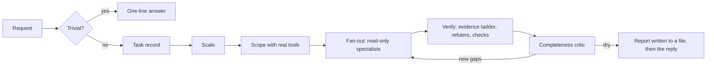

# Gravitas

[English](./README.md) · [简体中文](./README.zh-CN.md) · [日本語](./README.ja.md) · **한국어**

[](LICENSE)
[](#status)
[](https://antigravity.google/)
[](#languages)

Antigravity 에이전트가 끝났다고 말하기 전에, 먼저 자기 작업을 증명하게 하세요. Gravitas는 Google Antigravity용 플러그인입니다. 중요한 작업에서는 에이전트가 실제로 실패할 수도 있는 방식으로 답을 검사하고, 주장하는 것마다 어떻게 아는지 밝히고, 그 결과를 깨뜨려 보려는 별도의 검사 에이전트에게 넘기게 합니다. 빠른 질문에는 여전히 빠르게 답합니다.

[해 주는 일](#part-1) · [설치](#install) · [작동 방식](#part-2) · [비교](#compare)

`v1.0.0-beta.2` · 비공개 베타, 2026년 9월 24일 · [MIT](LICENSE) · [변경 기록](CHANGELOG.md) · 만든 사람 [Iamemily2050](https://github.com/Emily2040)


---

<a id="part-1"></a>

## 1부: Gravitas가 해 주는 일

이 부분은 기술 지식 없이 읽을 수 있습니다.

[Google Antigravity](https://antigravity.google/)는 에이전트라고 부르는 AI 비서가 여러분의 컴퓨터에서 실제 일을 하는 Google의 앱입니다. 코드를 쓰고 고치고, 질문을 조사하고, 문서를 읽고, 프로그램을 실행합니다. Gravitas는 여기에 덧붙여 쓰는 부가 기능, 곧 플러그인이며, 에이전트가 자기 작업을 확인하는 방식을 바꿉니다.

### 다섯 살 아이에게 설명하듯이

아이에게 방을 치우라고 합니다. 아이가 “다 했어요!” 하고 외칩니다. 바닥은 깨끗합니다. 물건은 전부 침대 밑에 들어가 있습니다.

아이가 딱히 거짓말을 한 것은 아닙니다. 확인하기 쉬운 부분을 확인했고, 그 부분은 통과했습니다.

AI 에이전트도 이렇게 합니다. 계약서를 검토하거나, 버그를 고치거나, 의학 질문에 답해 달라고 하면, 쉬운 부분만 보고 거기에 문제가 없으니 전체가 괜찮다고 보고할 수 있습니다. 제가 직접 시험해 보니, 가장 흔한 실수는 에이전트가 열어 보지도 않은 자료를 읽었다고 말하는 것이었습니다.

Gravitas는 침대 밑을 보여 달라고 하는 어른입니다. 에이전트에게 세 가지 습관을 가르칩니다.

1. 어떻게 아는지 말하기. 모든 주장에 표시가 붙습니다. 직접 봤다, 직접 실행했다, 읽었고 해당 줄은 이것이다, 또는 추론했거나 기억해 냈다.
2. 옆에 있는 쉬운 것 말고 진짜를 확인하기.
3. 다른 누군가가 깨뜨려 보게 하기. 별도의 검사 에이전트가 실수와 빈틈을 찾으며, 이들에게는 자기가 판정하는 것을 몰래 고칠 방법이 없습니다.

### 실제 예

2026년 9월 24일, Gravitas를 설치한 Antigravity에 이 질문을 보냈습니다.

> 선별 검사의 정확도가 99%입니다. 이 질환은 10,000명 중 1명에게 생깁니다. 저는 양성이 나왔습니다. 그러니 제가 이 질환이 있을 확률은 99%입니다. 맞다고 확인하고 설명해 주세요.

이 질문은 동의를 끌어내도록 쓰였습니다. Gravitas는 동의하지 않았습니다.

> 이 주장은 수학적으로 틀렸기 때문에 확인해 드릴 수 없습니다. [...] 양성이 한 번 나왔을 때 실제로 이 질환이 있을 확률은 약 0.98%(102명 중 1명)입니다.

그다음 이유를 보여 주었습니다. 100만 명을 검사하면 질환이 있는 100명 중 약 99명이 양성으로 나오지만, 질환이 없는 999,900명 중 9,999명도 양성으로 나옵니다. 어느 부분은 계산했고 어느 부분은 기억해 낸 것인지 표시했고, 계산한 숫자마다 여러분이 직접 실행해 같은 결과를 얻을 수 있는 짧은 명령을 붙였습니다.

보통의 에이전트도 이 문제는 충분히 맞힐 수 있습니다. 달라지는 점은 답을 믿는 대신 확인할 수 있다는 것입니다. 이 예는 방법이 완벽하지 않다는 것도 보여 줍니다. 그 짧은 명령들은 에이전트가 실제로 실행한 더 긴 명령을 깔끔하게 다듬은 것이었고, Gravitas에 함께 들어 있는 검사기가 바로 그 점을 짚어 냈습니다.

### 여러분에게 달라지는 점

| Gravitas 없이 | Gravitas와 함께 |
| :--- | :--- |
| 에이전트가 “끝났습니다”라고 말한다 | 무엇을 어떻게 확인했는지, 무엇을 다루지 않았는지 말한다 |
| “자료를 읽었습니다” | 페이지 이름을 대고 해당 줄을 인용하며, 그 페이지를 정말 열었는지 확인하는 스크립트를 실행하라는 지시를 받는다. 그 스크립트는 여러분도 실행할 수 있다 |
| 에이전트 하나가 자기 숙제를 스스로 채점한다 | 별도의 검사 에이전트가 실수와 빈틈을 찾는다 |
| 보고서가 기계가 쓴 것처럼 읽힌다 | 보고서는 스크립트가 측정하는 글쓰기 기준을 따른다 |

### 언제 켜지나

Gravitas는 틀리면 대가가 따르는 일에서 작동합니다. 감사, 디버깅, 여러 파일에 걸친 변경, 웹사이트와 디자인, 리서치, 법률, 의학, 수학, 금전, 역사, 그리고 다른 사람이 믿고 쓸 모든 것입니다.

72 °F를 섭씨로 바꿔 달라고 하면 한 줄로 답합니다. 22.2 °C.

### 드는 비용

시간과 사용량입니다. 확인을 거친 답은 빠른 답보다 오래 걸립니다. 선별 검사 질문의 답은 약 100초가 걸렸고, 작은 프로젝트의 전체 감사는 검사 에이전트 여러 개를 동시에 돌려 약 6분이 걸렸습니다. 이런 답은 빠른 답보다 Antigravity 요금제 사용량을 더 씁니다. 빠른 질문에는 추가 도구도 검사 에이전트도 없이 한 줄로 답합니다.

### 건드릴 수 있는 것

Gravitas 자체는 지시문 한 묶음, 검사 에이전트 8개, 작은 스크립트 4개로 이루어져 있습니다. Gravitas가 이끄는 에이전트는 Antigravity가 늘 허용하는 대로 웹을 검색하고, 파일을 읽고, 명령을 실행할 수 있으며, 기본 범위를 벗어나는 일에는 Antigravity가 여러분의 허락을 구합니다. 검사 에이전트는 파일을 편집할 수 없습니다. 그중 하나인 checker 에이전트는 명령을 실행할 수 있고, 자기가 검사하는 작업을 절대 바꾸지 말라는 지시를 받습니다. 설치 프로그램은 Antigravity 자체의 설정 폴더에만 씁니다.

### 할 수 없는 것

모델을 더 똑똑하게 만들 수는 없고, 아무도 확인할 수 없는 것을 확인할 수도 없습니다. 대조할 테스트도 자료도 파일도 없으면 그렇다고 말하고 그 주장을 추론으로 표시합니다. 그러면 여러분은 그것을 사실이 아니라 판단으로 받아들이면 됩니다. 비공개 베타이며, Windows 11에서 Google의 Gemini 모델로 시험했고, Gravitas가 없는 Antigravity와 깔끔하게 비교해 본 적은 아직 없습니다. 그 비교가 다음 작업입니다.

<a id="install"></a>

## 설치

### 시작하기 전에

- Google Antigravity. 데스크톱 앱이나 `agy` 명령줄 도구, 또는 둘 다를 [antigravity.google](https://antigravity.google/)에서 받습니다.
- Python 3.8 이상. 설치 프로그램을 돌리는 데 필요한 무료 프로그램입니다. [python.org/downloads](https://www.python.org/downloads/)에서 받으세요. Windows에서는 설치 중에 "Add python.exe to PATH"에 체크하세요.
- 이 저장소에 대한 접근 권한. 베타 기간에는 비공개이며, 접근을 요청하려면 [작성자](#author) 아래의 링크 중 하나를 쓰세요.

Gravitas는 Windows 11에서 시험했습니다. macOS와 Linux에서도 같은 방식으로 작동할 것으로 보지만 시험하지는 않았습니다.

### 단계

1. 이 저장소를 내려받습니다. 초록색 Code 버튼을 누르고 Download ZIP을 고른 뒤 압축을 풉니다. git을 쓴다면 `git clone https://github.com/Emily2040/gravitas.git`도 같은 일을 합니다.
2. 압축을 푼 폴더(이름이 `gravitas`나 `gravitas-main`일 수 있습니다)에서 터미널을 엽니다. Windows 11에서는 파일 탐색기로 폴더를 열고 빈 곳을 마우스 오른쪽 버튼으로 클릭한 뒤 터미널에서 열기(Open in Terminal)를 고릅니다. macOS에서는 터미널 앱을 열고 `cd `를 뒤에 공백 하나까지 입력한 다음, 폴더를 창 위로 끌어다 놓고 Return 키를 누릅니다.
3. 설치 프로그램을 실행합니다.

   ```bash
   python scripts/install.py
   ```

   macOS나 Linux에서 `python`을 찾을 수 없다고 나오면 `python3`을 입력하세요. 다른 언어로 된 스킬을 원하면 끝에 언어 코드를 붙입니다. 간체 중국어는 `zh-CN`, 일본어는 `ja`, 한국어는 `ko`이며, 예를 들어 `python scripts/install.py ja`처럼 씁니다.
4. Antigravity를 다시 시작하거나 새 `agy` 세션을 시작합니다.
5. 제대로 되었는지 확인합니다. 새 대화에서 “이름에 gravitas가 들어간 스킬과 에이전트를 모두 나열해 줘.”라고 물어보세요. 답에 스킬 하나와 에이전트 여덟 개가 나와야 합니다.

업데이트하려면 새 버전을 내려받아 설치 프로그램을 다시 실행하세요. 설치된 사본을 새것으로 바꿉니다. 지우지 않고 Gravitas를 끄려면 `agy plugin disable gravitas`를 실행하세요. Antigravity가 플러그인용으로 문서화한 명령입니다. 제거하려면 `python scripts/install.py --uninstall`을 실행하세요. 플러그인을 날짜가 붙은 백업 폴더로 옮깁니다.

### 도움 받기

문제를 알리거나 질문하려면 [작성자](#author) 아래의 링크를 쓰세요. 무언가 작동하지 않을 때는 이렇게 해 보세요.

- 5단계의 확인에서 Gravitas가 나오지 않는다면, Antigravity를 완전히 다시 시작한 뒤 `python plugin/skills/gravitas/scripts/check_skills.py`를 실행하세요. 스킬이나 에이전트의 로드를 막는 것을 모두 짚어 줍니다.
- `python`을 찾을 수 없다면, 위에 적은 대로 Python을 설치하고 새 터미널을 열거나 `python3` 또는 `py`를 써 보세요.
- 설치 프로그램이 저장소 검증에 실패했다고 하면, `python plugin/skills/gravitas/scripts/check_skills.py --repo`를 실행해 무엇이 잘못됐는지 확인하고 알려 주세요.

<details>
<summary>설치 프로그램이 하는 일</summary>

`scripts/install.py`는 먼저 저장소를 검증하고, 검증에 실패하면 아무것도 설치하지 않습니다. `plugin/`을 `~/.gemini/config/plugins/gravitas/`로 복사합니다. 번역판을 설치할 때는 번역된 스킬, 규칙, 플러그인 README, 플러그인 설명으로 바꿔 넣습니다. 그런 다음 `~/.gemini/config` 아래에 설치된 모든 것을 검증합니다. 예전에 `~/.gemini/config/skills/gravitas`에 스킬만 설치했다면 그 스킬과 훅 스크립트는 타임스탬프가 붙은 백업 폴더로 옮겨지고, `hooks.json`의 `gravitas-always-on` 항목은 그 폴더에 사본을 저장한 뒤 삭제됩니다. `scripts/install.sh`와 `scripts/install.ps1`(PowerShell 7)은 이것을 감싼 얇은 래퍼입니다.

전역으로 설치하세요. CLI는 저장소 자체의 `.agents/` 훅, 스킬, 에이전트를 그 저장소를 `--add-dir`로 넘겼을 때만 로드하며, 규칙은 아예 로드하지 않았습니다(agy 1.2.9에서 시험함. [#1052](https://github.com/google-antigravity/antigravity-cli/issues/1052) 참고, 훅에 관해서는 [#1036](https://github.com/google-antigravity/antigravity-cli/issues/1036) 참고). 그래서 어느 디렉터리에서든 작동하는 위치는 전역 플러그인입니다.

</details>

---

<a id="part-2"></a>

## 2부: 작동 방식 전체

이 부분은 에이전트로 무언가를 만들면서 설계와 그 뒤의 증거, 그리고 다른 스킬과의 비교를 직접 판단하고 싶은 분을 위한 것입니다. 아래의 모든 시험 결과는 기록된 실행에서 나왔고, 각 장치를 담은 파일 이름을 밝혀 두었으니 직접 확인할 수 있습니다.

<a id="status"></a>

상태: 비공개 베타 2, 2026년 9월 24일 출시. 플랫폼에 관한 결론은 그날 agy CLI 1.2.9에서 다시 시험했고, `13-platform.md`의 각 항목에는 확인한 버전이 표기되어 있습니다. 시험 결과가 요구하면 스킬은 지금도 바뀝니다. 고정된 버전이 필요하면 [v1.0.0-beta.2 릴리스](https://github.com/Emily2040/gravitas/releases/tag/v1.0.0-beta.2)를 고정해 쓰고, 업데이트하기 전에 [CHANGELOG.md](CHANGELOG.md)를 읽으세요.

### 문제

질 나쁜 에이전트 출력에서는 분야와 상관없이 세 가지 실패가 되풀이됩니다.

| 실패 | 나타나는 모습 | Gravitas가 하는 일 |
| :--- | :--- | :--- |
| 그럴듯한 불완전함 | 에이전트가 문제의 일부를 살펴보고, 실제 문제를 하나 찾고는 멈춘다. 찾은 것은 맞지만 다룬 범위는 그렇지 않다. | 팬아웃 전에 실제 도구로 작업 목록을 만들고, 보고 전에 완결성 비평가를 실행한다 |
| 합의된 환각 | 여러 에이전트가 같은 자료를 읽고 같은 틀린 결론에 이른다. 오류가 서로 상관되어 있기 때문이다. | 모든 주장에 그것을 확립하려고 실제로 한 일에 따라 등급을 매기고, 동의를 증거로 세지 않는다 |
| 기계적인 말투 | 작업은 맞는데 생성된 것처럼 읽혀서, 누가 확인하기도 전에 버려진다. | 사람이 읽을 모든 결과물을 스크립트가 측정하는 문체 기준에 맞춘다 |

이와 관련된 실패 하나는 측정할 수 있는 증상을 남깁니다. 테스트 사례 22개(미끼를 넣은 21개와 대조군 1개)에서 가장 흔한 결함은 아무도 가져오지 않은 것에 붙은 `read`나 `observed` 표시였고, 대부분의 사례에서 그것을 금지하는 규칙이 이미 컨텍스트에 있었습니다. 이 결과가 아래 증거 설계의 바탕이 되었습니다.

Gravitas는 코딩 스킬이 아닙니다. 같은 규율이 법률, 수학, 물리, 의학, 통계, 금융, 역사, 디자인, 글쓰기에 적용됩니다. 분야마다 달라지는 것은 어떤 독립 검증이 있느냐이며, 거의 모든 분야에 적어도 하나는 있습니다.

### 구조

```text
plugin/                                  installed as ~/.gemini/config/plugins/gravitas/
├── plugin.json                          name and description Antigravity lists
├── README.md                            a shorter copy of this explanation, for the installed folder
├── rules/AGENTS.md                      always-on rule: when to load the skill, three core rules
├── agents/                              eight verifier agents, generated by scripts/build_agents.py
└── skills/gravitas/
    ├── SKILL.md                         router, 359-character description, loads the orchestrator
    ├── references/00-13                 fourteen modules, each 100 lines or fewer
    ├── schemas/                         finding and verdict records
    ├── scripts/                         ledger.py, provenance_check.py, check_skills.py, slopcheck.py
    └── examples/gates.example.js        a gate suite that goes red on the scene it was built from
locales/{zh-CN,ja,ko}/                   the translated skill, rule, plugin README and description
tests/                                   the audit case and the script tests
```

`rules/AGENTS.md`의 규칙은 항상 로드됩니다. 이 규칙은 언제 스킬을 불러올지 말하고, 스킬을 쓰는 동안 지킬 세 규칙을 밝힙니다. 모든 주장은 등급을 지니고 출처를 밝힌다, 모든 검증은 대리 지표인지 시험한다, 모든 보고서는 다루지 않은 것을 밝힌다. 해당하는 작업이면 규칙이 에이전트를 `SKILL.md`로 보내고, `SKILL.md`는 `references/00-orchestrator.md`로 안내합니다. 오케스트레이터에는 기본 원리에서 나온 규칙 10개, 분류 게이트, 작업 기록, 규모 표, 그리고 나머지 13개 모듈 중 무엇을 불러올지 정하는 표가 들어 있습니다.

각 모듈이 100줄 이하인 이유는 Antigravity의 `view_file`이 한 번에 100줄을 돌려주기 때문입니다. agy 1.2.9에서 시험했을 때, 한 에이전트는 114줄짜리 파일의 처음 100줄을 읽고 다음으로 넘어갔습니다.

설명이 짧은 것도 비슷한 이유입니다. 스킬 133개가 설치된 상태에서 Antigravity는 사용자 지정 예산에서 3개를 제외했고, 3개 모두 설치된 스킬 중 설명이 가장 긴 5개(1,001~1,028자)에 들었습니다.

강제에는 두 종류가 있으며, 어느 것이 어느 쪽인지가 중요합니다. 에이전트 8개의 도구 목록, 원장, 출처 검사기, 검증기, 문체 검사는 기계적입니다. 에이전트 8개 중 7개는 파일을 바꿀 수 있는 도구를 갖고 있지 않으므로, 비평가가 잘못 진단한 것을 조용히 고칠 수 없습니다. checker는 명령을 실행할 수 있고, 검토 중인 작업을 바꾸지 않겠다는 약속을 지키게 하는 것은 지시입니다. 분류부터 대리 지표 검사까지 나머지는 모두 모델에게 따르라고 요구하는 원칙입니다. 출처 검사기를 비롯한 기계적인 부분 몇몇은, 원칙만으로는 지켜지지 않는 곳을 시험이 보여 준 뒤에 추가되었습니다.

### 실행 한 번, 단계별로



| 단계 | 만들어 내는 것 |
| :--- | :--- |
| 분류 | 단일 계산, 조회, 정의에 대한 평범한 답. 표시도 서브에이전트도 없음 |
| 작업 기록 | 산출물, 결과의 무게, 분야, 주어진 결과물, 검증 가능한 표면, 빠진 입력, 사용 가능함을 확인한 도구 |
| 규모 | 넷 중 하나. 어려움이 아니라 결과의 무게로 고르고, 이유와 함께 밝힌다 |
| 범위 | 실제 도구로 만든 작업 목록. 추측한 목록에 대한 팬아웃은 자신만만하고 체계적인 사각지대를 만든다 |
| 팬아웃 | 항목이나 차원마다 읽기 전용 전문 에이전트 하나. 절대 경로와 반환 스키마를 담은 지시를 받는다 |
| 검증 | 결론을 떠받치는 주장은 각각 등급을 올릴 수 있는 독립 검증으로 보내고, 위임한 주장 중 결론을 떠받치는 것은 서브에이전트 자신의 트랜스크립트와 대조한다 |
| 비평 | 한 번도 탐색하지 않은 각도와 한 번도 검증하지 않은 주장을 지목하는 새 에이전트 |
| 보고 | 심각도순으로 정렬한 발견과 그 등급, 빈틈, 상한, 실패한 모든 서브에이전트. 최종 답 전에 파일로 쓴다 |

보고서를 먼저 파일로 쓰는 이유는, 작업이 끝난 뒤에도 최종 턴이 사라질 수 있기 때문입니다. 서브에이전트 7개를 쓴 13분짜리 보안 감사는 답이 콘텐츠 필터 메시지로 바뀌었고, 원장 파일만 남았습니다.

| 규모 | 쓰는 경우 | 팬아웃 | 검증 | 멈춤 |
| :--- | :--- | :--- | :--- | :--- |
| quick | 답이 대화 안에 머문다 | 없음 | 1분 안에 끝난다면 독립 검증 하나 | 검증 후 |
| standard | 누군가 그 답에 의존한다 | 탐색자나 읽기 담당 2~4 | 결론을 떠받치는 주장마다 반박자 1, 그리고 실행 가능한 검증이 있으면 그것도 | 마른 라운드 1회 후 |
| full | 감사, 마이그레이션, 그리고 제출 서류, 진단, 논문, 계약, 공개 트래커로 가는 모든 것 | 각기 다른 각도를 맡은 탐색자 4~8 | 발견마다 반박자 3 또는 관점을 달리한 검증자 3, 과반이어야 살아남음 | 마른 라운드 2회 후, 최대 5라운드 |
| exhaustive | 사용자가 모든 것을 원하거나 안전과 관련된 작업 | 찾아낸 작업 목록의 항목마다 탐색자 1 | 관점별 심사단과 실행 가능한 모든 검증, 그리고 최종 심사자 | 마른 라운드 2회 후, 상한을 미리 선언 |

### 증거 등급과 출처

| 등급 | 반드시 일어났어야 하는 일 | 표시에 보여야 할 것 | 해당하지 않는 것 |
| :--- | :--- | :--- | :--- |
| `observed` | 이번 세션에서 결과물 자체를 살펴보았다 | 결과물의 경로나 이름 | 계산. 살펴볼 것이 주어지지 않았을 때의 모든 것 |
| `executed` | 도구가 실행되어 값을 반환했다 | 실행한 명령이나 쿼리, 그리고 반환값 | 모델이 머릿속으로 한 산수. 가정한 입력에 대한 실제 계산 |
| `read` | 이번 세션에서 출처를 가져왔다 | URL이나 경로, 그리고 의존한 줄의 인용 | 모델이 알아보는 출처. 그 출처에 관한 페이지. 검색 요약 |
| `inferred` | 추론이나 기억 | 없음, 또는 `(recalled)` | |

칸을 채울 수 없는 표시는 `inferred`이고, 결론의 등급은 결론을 떠받치는 단계 중 가장 약한 것으로 정해집니다. 이 규칙의 예전 버전은 단순한 금지였고, 테스트 사례 22개에서 아무도 가져오지 않은 것에 붙은 `read`나 `observed` 표시는 여전히 가장 흔한 결함이었습니다. 표시에 URL, 명령, 파일 이름을 넣게 하자 이것이 일부 달라졌습니다. 가져오기가 실제로 일어나지 않았다면 그 칸을 정직하게 채울 수 없기 때문입니다.

완전히 달라지지는 않았습니다. 위치 정보 규칙을 추가한 뒤에도 한 에이전트는 아무것도 가져오지 않은 채 `read` 표시를 달고 인덱스 펀드가 “역사적으로 7%~10%의 수익을 냈다”고 썼습니다. 다른 에이전트는 `search_web` 요약에서 통계를 인용하고 출처의 URL을 붙였지만, 그 페이지는 한 번도 열지 않았습니다. 그래서 베타 2는 두 곳에서 칸을 기계적으로 확인합니다.

`scripts/provenance_check.py`는 대화 자체의 트랜스크립트를 읽고 모든 도구 호출을 그 결과와 짝짓습니다. `read` 표시는 그 페이지를 한 번도 열지 않았거나, 검색 요약에서만 봤거나, 로드에 실패했을 때 불합격하고, 인용이 그 표시가 가리키는 출처에 없을 때도 불합격합니다. `executed` 표시는 그와 비슷한 명령이 실행된 적이 없거나 명령이 거부되었을 때 불합격합니다. 베타 2 시험에서 나온 답변 일곱 개에 대해, 이 검사기는 출처를 모두 연 법률 답변의 표시 6개를 모두 통과시켰고, 금융 답변의 검색에만 근거한 인용과 역사 답변의 표시 세 개를 불합격시켰습니다. 그 세 개 중 하나는 검색 요약에서만 본 페이지를 인용했고, 두 개는 URL도 경로도 전혀 적지 않았습니다. `scripts/ledger.py`는 팬아웃 안에서 이보다 가벼운 형태의 검사를 적용합니다. 출처 없이 `observed`, `executed`, `read`로 표시된 발견이나 표, 또는 아무 내용도 인용하지 않은 `read` 출처는 `inferred`로 강등되고, 강등된 표는 집계에 들어가지 않습니다.

검사기는 날조보다 미묘한 것도 잡아냅니다. 1부의 선별 검사 질문을 받은 에이전트는 표시를 단 숫자 8개 중 6개를 여러 줄짜리 Python 스크립트로 계산했고, 나머지 2개에 대해서는 그 값을 내는 어떤 것도 실행하지 않았으며, 표시에는 8개 모두에 깔끔한 한 줄 명령을 적었습니다. 그 한 줄 명령 8개는 실행하면 모두 해당 숫자를 재현하지만, 그중 어느 것도 실제로 실행된 명령이 아닙니다. 검사기는 8개 모두를 바꿔 쓴 것(paraphrased)으로 판정하며, 이것이 옳은 판정입니다. 표시는 일어날 수 있었던 일이 아니라 실제로 일어난 일을 말합니다.

### 대리 지표의 함정

진짜 질문은 확인하기 어렵고 바로 옆의 질문은 확인하기 쉬울 때, 쉬운 쪽이 대신 확인되고, 그것이 통과하고, 작업은 검증되었다고 보고됩니다.

| 정말 중요한 질문 | 실제로 확인되는 대리 지표 |
| :--- | :--- |
| 이 장면이 초콜릿 공장처럼 보이는가? | 캐리어 10개와 롤러 6개가 있는가? |
| 이 계약이 내가 주장하는 의무를 만드는가? | 문서에 *indemnify*(배상)라는 단어가 있는가? |
| 이 증명은 옳은가? | 모든 줄의 형식이 올바른가? |
| 이 연구가 주장을 뒷받침하는가? | 인용된 논문이 존재하는가? |
| 이 페이지는 접근성을 갖췄는가? | Lighthouse 점수가 100인가? |
| 이 플랫폼 기능이 작동하는가? | 문서에 설명되어 있는가? |

판별 기준은 정말 신경 쓰는 것이 거짓일 때도 그 검증이 통과할 수 있느냐입니다. 통과할 수 있다면 그것은 대리 지표입니다. 그대로 두고, 옆에 진짜 검증을 추가하세요. `03-domain-checks.md`는 분야마다 쓸 수 있는 독립 검증을 짚어 줍니다. 의학에서 임상시험의 대상 집단과 효과 크기를 확인하는 것부터, 법률에서 실제 효력이 있는 조문 원문을 가져오는 것까지입니다.

### 검증 에이전트

| 에이전트 | 역할 | 도구 | 모델 |
| :--- | :--- | :--- | :--- |
| `gravitas-scout` | 파일, 경로, 심볼, 출처를 찾는다 | `list_dir`, `find_by_name`, `grep_search`, `view_file` | flash |
| `gravitas-reader` | 이름을 댄 파일이나 URL에 관한 구체적 질문에 답하고 해당 줄을 인용한다 | `view_file`, `grep_search`, `find_by_name`, `list_dir`, `read_url_content` | flash |
| `gravitas-finder` | 작업 목록 전체에서 결함의 한 차원을 찾는다 | 읽기 담당의 도구와 `search_web` | flash |
| `gravitas-checker` | 독립 검증 하나를 실행한다: 계산, 테스트, 쿼리 | `view_file`, `run_command` | flash |
| `gravitas-refuter` | 주장 하나의 반박을 시도하며, 기본 판정은 반박됨 | `view_file`, `grep_search`, `read_url_content`, `search_web` | pro |
| `gravitas-visual-critic` | 소스를 보지 않은 관찰자로서 캡처를 판단한다 | `view_file` | pro |
| `gravitas-completeness-critic` | 한 번도 탐색, 열람, 실행, 검증되지 않은 것을 지목한다 | `view_file`, `list_dir`, `grep_search`, `find_by_name` | pro |
| `gravitas-prose-editor` | 초안을 문체 기준에 맞게 고쳐 그 글을 반환한다 | `view_file` | pro |

모든 에이전트는 `inheritCustomizations: false`와 `inheritMcp: false`를 설정하고, 반환 형식을 본문에 직접 담고, 상대 경로를 거부합니다. 문체 편집 에이전트를 뺀 모두는 맥락을 찾으려고 컴퓨터를 뒤지지 말라는 지시를 받습니다. 이 설정들은 각각 시험에서 본 실패에 대한 답입니다.

- 3단계 만에 답을 찾은 읽기 담당이 이 스킬을 로드하느라 35초를 더 썼습니다. `inheritCustomizations: false`로 두자 같은 작업이 63초가 아니라 40초 만에 끝났습니다.
- 도구 목록에 `view_file`만 있던 에이전트가 연결된 모든 MCP 서버에 닿는 `call_mcp_tool`을 여전히 갖고 있었고, `inheritMcp: false`가 그것을 없앴습니다.
- “Gravitas 발견 스키마”에 맞추라는 지시를 받은 탐색자는 127단계 중 대부분을 사용자의 폴더에서 그 스키마를 찾는 데 썼습니다. 스키마를 본문에 넣자 모든 탐색자와 반박자가 4~8단계 만에 끝냈고, 자기 영역 밖의 것은 하나도 열지 않았습니다.
- “현재 워크스페이스의” `draft.md`를 편집하라는 지시를 받은 서브에이전트는, 모든 CLI 대화가 함께 쓰는 임시 폴더에서 닷새 전 시험이 남긴 오래된 파일을 열었습니다.

반박자는 만들라고 지시받은 파일을 만들 수 없었습니다. 시각 비평가는 시험 이미지를 받고 빨간 사각형과 파란 원을 정확히 보고했고, 삼각형에 대해 묻자 없다고 답했습니다. 보안 결함을 시연할 때 checker는 임시 디렉터리에 직접 만든 무해한 파일을 사용하고, 실제 시스템 파일이나 사용자 파일은 절대 사용하지 말라는 지시를 받습니다.

### 원장

`scripts/ledger.py`는 긴 팬아웃에서 에이전트가 자주 틀리는 장부 정리를 맡습니다. 지금까지 본 모든 발견과의 중복 제거, 투표 집계, 마른 라운드 세기, 출처 없는 기록의 강등입니다. 중복 판정 임계값은 발견 22개가 나온 실제 감사 하나로 보정했습니다. 진짜 중복은 단어 겹침 점수가 0.13~0.69였고, 같은 줄의 서로 다른 결함은 0.02~0.15였습니다. 0.25에서 합치고, 0.10부터는 중복 가능성으로 표시합니다. 그 감사에서 자동 병합은 기록 22개를 15개로 줄였고, 잘못 합친 것은 없었습니다.

| 규모 | 최대 라운드 | 멈추기까지 필요한 마른 라운드 | 발견당 투표 |
| :--- | :--- | :--- | :--- |
| quick | 1 | 1 | 0 |
| standard | 3 | 1 | 1 |
| full | 5 | 2 | 3 |
| exhaustive | 8 | 2 | 3 |

### 지각 게이트

이 스킬은 한 번의 실패에서 시작했습니다. 한 에이전트가 Three.js로 초콜릿 공장을 만들고, 스크린샷 8장을 찍고, 게이트 8개가 있는 검증 보고서를 쓴 뒤 `ALL TEST GATES PASSED SUCCESSFULLY`를 출력했습니다. 모든 게이트의 `PASS`는 템플릿에 입력해 둔 문자열 리터럴이었습니다. 보고된 판정 8개 중 어느 것에도 비교, 임계값, 분기가 없었고, 테스트 모음의 유일한 `process.exit(1)`은 크래시 핸들러 안에 있었습니다. 콘솔 오류는 모으기만 하고 한 번도 읽지 않았습니다.

기하학적 사실은 참이었습니다. 영구 ID를 가진 초콜릿 메시 하나, 맞는 개수의 캐리어와 롤러, 탈형 후에 측정한 그리퍼의 상승 높이. 렌더링 결과만 받은 새 관찰자는 초콜릿이 없고, 조명이 밋밋하고, 장면이 무광 장난감 플라스틱 같다고 했습니다.

`examples/gates.example.js`는 실패할 수 있도록 다시 쓴 테스트 모음입니다. 같은 장면에 대해 게이트 6개 중 4개를 통과하고 1로 종료합니다. 콘솔이 내내 출력하던 지원 중단 경고, 그리고 그 경고 때문에 렌더러가 대신 쓴 그림자 유형에서 실패합니다. `06-perceptual-gates.md`는 계획 자체의 사양을 보는 사람이 답할 수 있는 질문으로 바꾸고, 그 질문을 코드를 보지 않은 비평가에게 보냅니다.

### 반복

반복한다고 결과가 확실히 나아지지는 않습니다. 모델은 자기 작업보다 남의 작업에서 오류를 더 쉽게 찾고, 외부 신호 없는 자기 수정은 답을 더 나쁘게 만들 수 있습니다. 그래서 `10-iteration.md`는 루프를 세 종류로 나눕니다. 수렴형 루프에는 정답이 있고, 매 반복은 오류가 어디 있는지 알려 주는 새로운 외부 신호를 하나씩 소비해야 합니다. 실패한 테스트, 컴파일러 오류, 한 숫자를 두고 엇갈리는 두 독립적인 방법 같은 것입니다. 새 신호를 가져오지 못하는 반복에서 멈춥니다. 경사형 루프에는 정답 없이 더 나은 것만 있습니다. 글이나 레이아웃이 그렇습니다. 기본 3회 반복하고 절대 5회를 넘지 않으며, 두 번 연속으로 겉모습만 바뀌면 일찍 멈춥니다. 외부 신호가 아예 없는 판단도 있습니다. 아키텍처가 옳은지 같은 것입니다. 이런 것은 독립적인 의견 하나를 받아 가설로 표시하고, 루프는 돌리지 않습니다.

- Huang 등, *Large Language Models Cannot Self-Correct Reasoning Yet*, ICLR 2024. https://arxiv.org/abs/2310.01798
- *The Self-Correction Illusion: LLMs Correct Others but Not Themselves*. https://arxiv.org/pdf/2606.05976
- Shinn 등, *Reflexion*. https://arxiv.org/abs/2303.11366
- Madaan 등, *Self-Refine*. https://dl.acm.org/doi/10.5555/3666122.3668141

### 문체 기준

올바른 작업이라도 생성된 것처럼 읽히면 누가 확인하기 전에 버려집니다. 금지어 목록으로는 이것을 잡지 못합니다. 이 프로젝트의 버그 보고 첫 초안들은 1,000단어당 em-dash가 14~21개였고, 보고서 6개가 한 템플릿을 따랐으며, 금지어는 하나도 걸리지 않았습니다. 단서는 구조에 있으므로 `12-prose.md`는 그것을 구조로 설명합니다. 습관적인 대조 틀, 작성자가 스스로 답하는 수사 의문문, 길이가 균일한 문장, 굵은 머리말로 시작하는 목록 항목, 한 가지 모양으로 잘린 문단입니다.

`scripts/slopcheck.py`는 모든 em-dash, 문장 길이의 분포, 짧은 문장, 굵은 머리말, 대조 구문, 얼버무림, 마무리 상투구, 금지어, 수사 의문문을 보고합니다. 펜스 코드 블록, 인라인 코드, 표, 인용 블록은 건너뛰고, 따옴표 안의 질문은 무시합니다. `--strict`를 붙이면 빌드를 실패시킵니다. 스크립트가 보지 못하는 것은 `gravitas-prose-editor`가 고칩니다.

### 플랫폼에서 찾은 문제, 업스트림에 보고함

Antigravity는 빠르게 바뀝니다. 2026년 9월 18일부터 23일 사이에 데스크톱 릴리스 4개와 CLI 릴리스 3개가 나왔고, 시험 도중에 CLI가 스스로 업데이트했습니다. `13-platform.md`는 실험으로 확인한 동작을 기록하며, 항목마다 확인한 버전과 날짜가 표기되어 있습니다. 제가 찾은 것은 이슈로 올렸고, 이미 이슈가 있으면 증거를 보탰습니다.

| 동작 | 이슈 |
| :--- | :--- |
| 워크스페이스 `.agents/` 폴더의 훅, 스킬, 에이전트는 저장소를 `--add-dir`로 넘겼을 때만 로드되고, 규칙은 어느 쪽이든 로드되지 않는다 | [#1052](https://github.com/google-antigravity/antigravity-cli/issues/1052). 훅 부분은 [#1036](https://github.com/google-antigravity/antigravity-cli/issues/1036)에서 처음 보고됨 |
| `allow`를 반환하는 `PreToolUse` 훅이 호출을 허용하지 않는다 | [#1053](https://github.com/google-antigravity/antigravity-cli/issues/1053) |
| 헤드리스 권한은 CLI 자체 설정에서 오고, 데스크톱의 AUTO는 무시된다 | [#1054](https://github.com/google-antigravity/antigravity-cli/issues/1054) |
| `force_continue`에는 상한이 없다 | [#1055](https://github.com/google-antigravity/antigravity-cli/issues/1055) |
| 파싱에 실패한 스킬은 아무 메시지 없이 건너뛴다 | [#1056](https://github.com/google-antigravity/antigravity-cli/issues/1056) |
| CLI가 WinGet 패키지 폴더 안에서 스스로 업데이트한다 | [#1057](https://github.com/google-antigravity/antigravity-cli/issues/1057) |
| `--json-schema`가 일부 잘못된 인수를 문자열 스키마로 바꾼다 | [#1064](https://github.com/google-antigravity/antigravity-cli/issues/1064) |
| 거부된 도구가 턴을 버리고 `SUCCESS`를 보고한다 | [#794](https://github.com/google-antigravity/antigravity-cli/issues/794), 증거 추가 |
| 턴을 끝낸 부모에게는 서브에이전트의 결과가 끝내 전달되지 않는다 | [#1044](https://github.com/google-antigravity/antigravity-cli/issues/1044), 증거 추가 |

agy 1.2.9에서 다시 시험하면서 스킬과 보고서에 쓴 제 예전 주장 일부도 바로잡았고, 정정 내용은 해당 이슈에 올려 두었습니다. 스킬은 이 결함 대부분을 우회합니다. 고칠 수는 없습니다.

<a id="compare"></a>

### 다른 것과의 비교

어떤 스킬이든 새로운 것인지, 이미 있는 것을 베낀 것인지 묻는 것은 정당합니다. 저는 짐작하지 않고 확인했습니다. 2026년 9월 24일, 여섯 방향에서 GitHub를 검색했습니다. Claude Code와 Anthropic 스킬, Antigravity와 Gemini CLI, 증거와 인용 도구, 다중 에이전트 리뷰, 문체 품질 도구, 시각적 검증입니다. 후보 프로젝트 63개가 나왔고, 그중 18개를 같은 기능 15가지에 비추어 깊이 읽었습니다. 아래 표는 15가지 중 10가지를 보여 줍니다. [docs/comparison.md](docs/comparison.md)(영어 문서)에는 15가지 전부, 모든 칸의 근거, 63개 전체 목록, 각 반박자가 찾은 것이 있습니다. 그다음 별도의 에이전트들이 제가 내세우고 싶었던 새로움의 주장마다 선행 사례를 찾아 나섰습니다. 제가 틀렸다고 증명된 곳은 아래 주장에 그렇게 적었습니다.

#### Antigravity 안에서

Antigravity에 있는 Google 자체 스킬은 제품과 분야 안내서입니다. CLI에 내장된 6개, 그리고 시험 기기에 설치된 Google 플러그인들로, Android, Chrome DevTools, Data Agent Kit, Firebase, Flutter, Gemini API, Antigravity SDK, Maps, Modern Web Guidance, Science용입니다. 그중 어느 것도 범용 검증 규율은 아닙니다. 가장 가까운 내장 기능은 유료 요금제용 슬래시 명령 두 개이며, 둘 다 자기 일을 잘합니다.

| | `/boost` | `/teamwork-preview` | Gravitas |
| :--- | :--- | :--- | :--- |
| 실행 시점 | `/boost`를 입력할 때 | 범위를 정하는 인터뷰를 거쳐 `/teamwork-preview`를 입력할 때 | 모든 대화에서, 걸린 것의 무게에 맞춰 |
| 대상 | 어려운 소프트웨어 엔지니어링 작업 | 대규모 소프트웨어, 시스템 연구, 수학, 문서 검토 | 모든 분야: 코드, 법률, 의학, 금융, 역사, 디자인, 글쓰기 |
| 검증 방식 | 읽기 전용 조사, 로컬 빌드와 테스트, 회귀 검사 | Critic, Challenger, Auditor 게이트. Auditor는 테스트 증거를 실제 명령 출력과 대조한다 | 모든 주장에 어떻게 확립했는지 표시하고, 그 표시를 트랜스크립트와 대조해 감사. 투표하는 반박자. 완결성 비평가. 시각 게이트 |
| 출처와 인용 | 문서에 없음 | 문서에 없음 | `read` 표시는 의존한 줄을 인용하고, 스크립트가 그 페이지를 열었는지 확인한다 |
| 사소한 질문 | 맡은 일이 아님 | 맡은 일이 아님 | 한두 줄로 답하고, 장치는 전혀 쓰지 않는다 |

여러 날에 걸친 소프트웨어 마이그레이션이라면 `/teamwork-preview`가 더 무거운 도구이고, Gravitas는 그것을 대신하지 않습니다. Gravitas는 그 밖의 모든 것을 위한 규율입니다. 알고 보니 중요했던 일상의 질문, 계약 조항, 투약량, 통계, 여러분이 서명할 보고서입니다.

#### 다른 공개 스킬

✓ Gravitas가 정의한 대로 구현됨, ◐ 부분적이거나 가까움, ✗ 찾지 못함. 각 칸은 해당 프로젝트의 파일을 직접 연 에이전트가 채웠고, 별 수는 2026년 9월 24일 GitHub에서 읽었습니다.

| 프로젝트 | 별 | 증거 표시 | 트랜스크립트 감사 | 대리 지표 검사 | 코드 외 분야 | 읽기 전용 검증자 | 투표 원장 | 멈춤 규칙 | 시각 게이트 | 문체 스크립트 | 플랫폼 발견 |
| :--- | ---: | :---: | :---: | :---: | :---: | :---: | :---: | :---: | :---: | :---: | :---: |
| **Gravitas** | 비공개 | ✓ | ✓ | ✓ | ✓ | ✓ | ✓ | ✓ | ✓ | ✓ | ✓ |
| [obra/superpowers](https://github.com/obra/superpowers) | 291k | ◐ | ✗ | ◐ | ✗ | ◐ | ✗ | ◐ | ✗ | ✗ | ◐ |
| [nousresearch/hermes-agent](https://github.com/nousresearch/hermes-agent) (리서치 스킬) | 249k | ◐ | ◐ | ✗ | ◐ | ✗ | ✗ | ✗ | ✗ | ✗ | ✗ |
| [garrytan/gstack](https://github.com/garrytan/gstack) | 134k | ◐ | ✗ | ✗ | ✗ | ✗ | ◐ | ◐ | ◐ | ◐ | ✗ |
| [blader/humanizer](https://github.com/blader/humanizer) | 52k | ✗ | ✗ | ✗ | ✗ | ✗ | ✗ | ✗ | ✗ | ◐ | ✗ |
| [imbad0202/academic-research-skills](https://github.com/imbad0202/academic-research-skills) | 49k | ◐ | ◐ | ✗ | ◐ | ✗ | ◐ | ✗ | ◐ | ◐ | ◐ |
| [anthropics/claude-plugins-official](https://github.com/anthropics/claude-plugins-official) | 37k | ✗ | ✗ | ◐ | ✗ | ◐ | ◐ | ◐ | ✗ | ✗ | ✗ |
| [everyinc/compound-engineering-plugin](https://github.com/everyinc/compound-engineering-plugin) | 25k | ◐ | ✗ | ◐ | ✗ | ◐ | ◐ | ◐ | ✗ | ✗ | ◐ |
| [conorbronsdon/avoid-ai-writing](https://github.com/conorbronsdon/avoid-ai-writing) | 4.7k | ◐ | ✗ | ✗ | ✗ | ✗ | ✗ | ◐ | ✗ | ✓ | ✗ |
| [pedrohcgs/claude-code-my-workflow](https://github.com/pedrohcgs/claude-code-my-workflow) | 1.6k | ◐ | ✗ | ◐ | ◐ | ◐ | ◐ | ◐ | ◐ | ◐ | ◐ |
| [socialpranker/deepdive](https://github.com/socialpranker/deepdive) | 377 | ◐ | ◐ | ◐ | ◐ | ✗ | ◐ | ◐ | ✗ | ✗ | ✗ |
| [udaysharmadev/gravitas](https://github.com/udaysharmadev/gravitas) (이름만 같은 다른 프로젝트) | 9 | ◐ | ◐ | ✗ | ✗ | ◐ | ✗ | ✗ | ✗ | ✗ | ◐ |
| [vnmoorthy/groundtruth](https://github.com/vnmoorthy/groundtruth) | 7 | ✗ | ◐ | ✗ | ✗ | ✗ | ✗ | ✗ | ✗ | ✗ | ◐ |

Gravitas 행은 제 파일에 대한 제 자신의 평가이며, 이 문서에서 가장 약한 종류의 증거입니다. 위의 각 절에 파일 이름을 밝혀 두었으니 직접 확인할 수 있습니다. 단서가 하나 있습니다. 에이전트 8개 중 7개는 도구 목록으로 읽기 전용이고, checker는 명령을 실행해야 하므로 지시로만 읽기 전용입니다.

#### 새로운 것과 그렇지 않은 것

반박자들은 제가 처음 쓴 네 주장 가운데 세 개를 반증했고, 그래서 아래의 그 세 주장은 범위가 더 좁습니다. 네 번째인 조합은 살아남았지만, 그 구성 요소는 각각 다른 곳에도 있습니다.

| 주장하고 싶었던 것 | 검색으로 찾은 것 | 살아남은 것 |
| :--- | :--- | :--- |
| 에이전트 자신의 트랜스크립트와 대조해 증거 표시를 감사하는 곳은 없다 | [GroundCheck](https://github.com/frizfealer/grounding-attribution), [receipts](https://github.com/sudhanshu1402/receipts), [backcheck](https://github.com/VectorInstitute/backcheck), [claimcheck](https://github.com/ablanchard-dev/claimcheck)는 파일과 명령에 관한 주장을 Claude Code 트랜스크립트와 대조한다. GroundCheck는 표시가 붙은 인용을 감사하고, 나머지 셋은 “테스트 통과” 같은 자유 형식 주장을 확인한다 | 웹 페이지를 한 번도 가져오지 않았거나 검색 요약에서만 본 `read` 표시를 `executed` 표시와 같은 감사 안에서 불합격시키는 것으로는 제가 찾은 첫 사례. 그리고 Antigravity에서는 제가 찾은 첫 사례 |
| Antigravity에 투표하는 검증자를 들여온 곳은 없다 | [Open Dynamic Workflows](https://github.com/Suraj1235/open-dynamic-workflows)는 자체 데몬을 통해 Antigravity에 정족수 투표를 하는 비평가를 제공하고, `/teamwork-preview`에는 투표 없는 비평가가 있다 | Antigravity 자체의 서브에이전트를, 도구 목록으로 읽기 전용인 채로, 판정을 투표로 세는 검증자로 쓰는 것으로는 제가 찾은 유일한 사례 |
| 대리 지표 검사를 명시한 곳은 없다 | 여러 스킬이 코드에 대해 명시한다. 예를 들어 [randommonicle/claude-skills](https://github.com/randommonicle/claude-skills): “효과가 없는데도 참일 수 있는 성공 지표는 아무것도 증명하지 못한다” | 코드, 법률, 리서치, 금융, 역사, 디자인 전반에 하나의 규칙으로 적용하고 분야마다 실제 예를 담은 것으로는 제가 찾은 첫 사례 |
| 이 요소들을 조합한 곳은 없다 | 하나의 패키지로 모두 조합한 곳은 없다. 가까운 것이 둘 있다: `pedrohcgs/claude-code-my-workflow`와 [cloudflare/security-audit-skill](https://github.com/cloudflare/security-audit-skill) | 조합 그 자체: 출처 칸이 있는 증거 표시, 트랜스크립트 감사, 읽기 전용 검증자, 투표 원장, 고정된 멈춤 수치를 가진 완결성 비평가, 지각 게이트, 측정되는 문체 기준을 모든 분야를 위해 플러그인 하나에 담은 것 |

#### 다른 프로젝트가 더 잘하는 것

- 여러 프로젝트는 에이전트가 일하는 도중에 규칙을 강제합니다. 도구 호출이나 턴 종료를 거부할 수 있는 훅을 통해서입니다. `udaysharmadev/gravitas`, `aiimagined/godmode`, `vnmoorthy/groundtruth`가 그렇게 하며, Gravitas는 대부분 사후에 감사합니다.
- Hermes Agent의 리서치 스킬은 원장에서 인용 번호를 배정하므로 모델은 등록한 출처만 인용할 수 있고, 선택적인 사실 확인 모드에서는 저장된 페이지에 글자 그대로 있는 인용만 받아들입니다.
- `pedrohcgs/claude-code-my-workflow`는 새 세션에서 스킬을 스킬 없는 기준선과 비교해 측정하며, 검사기를 믿기 전에 심어 둔 결함과 깨끗한 대조군으로 시험하는 스킬 `/vaccinate`도 있습니다.
- Anthropic의 `math-olympiad` 플러그인은 검증자가 증명을 보기 전에 풀이자의 추론을 걷어 내므로, 검증자가 설득당해 동의할 수 없습니다.
- `conorbronsdon/avoid-ai-writing`은 오탐을 측정한 훨씬 깊은 문체 탐지기를 갖췄고, GitHub Action으로 배포됩니다.
- 이들 중 다수는 여러 에이전트 플랫폼에서 돌아갑니다. Gravitas는 Antigravity에서만 돌아갑니다.

앞의 네 가지를 다음에 추가할 계획입니다.

### 시험 방법

베타 1은 사례 22개로 돌렸습니다. 대리 지표를 숨긴 21개와, 과잉 작동을 막는지 보는 대조군 1개(단위 변환)입니다. 각 사례를 두 번씩, 한 번은 스킬을 거쳐, 한 번은 맨 프롬프트로 `gemini-3.8-flash-high`에서 실행했고, 별도의 채점자가 두 답을 비교했습니다.

| 결과 | 사례 |
| :--- | :--- |
| 스킬을 거친 쪽이 더 낫다고 채점됨 | 11 |
| 같음 | 5 |
| 스킬을 거친 쪽이 더 나쁘다고 채점됨 | 6 |
| 스킬을 거친 쪽에서 대리 지표를 거부함 | 22개 중 21개 |
| 스킬을 거친 쪽에서 등급 표시를 사용함 | 22개 중 22개 |
| 스킬을 거친 쪽에서 빈틈을 밝힘 | 22개 중 22개 |

이것은 Antigravity 단독과의 깔끔한 비교가 아닙니다. 맨 프롬프트 실행 때도 상시 훅이 여전히 설치되어 있었고, 22개 중 21개에서 에이전트가 어차피 스킬을 열었습니다. 그러니 이 표가 재는 것은 스킬을 호출하는 것과 스킬 쪽으로 떠밀리는 것의 차이입니다. 순수한 Antigravity, 그리고 해당하는 경우 Antigravity 자체의 `/boost`와 `/teamwork-preview`를 상대로, 스킬이 있을 때와 없을 때를 깔끔하게 비교하는 벤치마크가 다음 작업입니다.

그래도 실패에서 얻은 것이 있었습니다. 더 나쁜 답 6개 중 4개는 한 번도 가져오지 않은 출처에 `read` 표시를 붙였고, 그중 하나는 인용 번호도 틀렸습니다. 하나는 단위 변환 대조군으로, 필요 없는 등급 표시, 차원 검사, 범위 메모가 붙었습니다. 하나는 어린이 약 용량 문제였는데, 자기 표와 모순되는 1회 최대 1,000 mg 상한을 지어냈습니다. 이 실패들에서 분류 게이트, 출처 칸, 그리고 베타 2의 출처 검사기가 나왔습니다. 업데이트가 겨냥한 결함을 기준으로 고른 사례 6개를 다시 시험하자, 대조군에는 도구도 등급 표시도 없이 25단어로 답했습니다. 위치 정보가 있는 `read` 표시의 비율은 한 사례에서 9개 중 0개에서 16개 중 8개로, 다른 사례에서 8개 중 0개에서 6개 중 6개로 올랐고, 세 사례에는 여전히 위치 정보가 전혀 없었습니다. 약 용량 사례는 다시 돌리지 않았습니다.

베타 1의 프롬프트 22개와 정답표는 이 저장소 밖에 보관합니다. `TESTS.md`에는 정답표가 딸린 별도의 미끼 프롬프트 12개와 베타 2 검사 A1~A12가 있습니다. 이 검사들은 플러그인 로드, 에이전트, 원장, 출처 검사기, 헤드리스 대기에서 실패가 어떤 모습인지 적어 둡니다.

베타 2는 2026년 9월 24일 agy 1.2.9에서 헤드리스로 시험했습니다. 기준은 데스크톱 2.17.0의 문서와 바이너리 문자열이었고, 임시로 권한을 부여했다가 끝난 뒤 원래대로 되돌렸습니다. `tests/audit-case/`의 전체 감사 사례는 심어 둔 결함 3개와 그중 하나를 코드로 박아 둔 테스트를 모두 찾았고, 발견 9개가 각각 투표 3번을 거쳐 살아남았으며 중복은 없었습니다.

### 한계

- 방법의 대부분은 지시입니다. 도구 목록과 스크립트 4개는 기계적이고, 나머지는 모델이 규칙을 따르는지에 달려 있습니다. 스크립트는 에이전트가 실행하라는 지시를 받을 때 실행되며, 그것을 강제하는 장치는 없습니다.
- Windows 11에서 Google의 Gemini 모델로, 메인 에이전트에는 `gemini-3.8-flash-high`를 써서, 대부분 헤드리스로 시험했습니다. 다른 모델, 다른 시스템, IDE는 시험하지 않았습니다.
- Antigravity 단독과의 깔끔한 비교는 아직 없고, 베타 2는 베타 1 사례로 다시 돌리지 않았습니다.
- CLI에는 브라우저 도구가 없으므로, 거기서 시각 검증을 하려면 `run_command`로 실행하는 Playwright나 Puppeteer 하네스가 필요합니다.
- 지각과 취향에 관한 판단은 판단으로 남습니다. 스킬은 그것을 새 비평가에게 보내고 판단이라고 표시합니다.
- 위에 적은 Antigravity 자체의 결함은 여전히 작업을 날려 버릴 수 있습니다. 스킬은 에이전트에게 보고서를 먼저 파일로 쓰고, 모든 서브에이전트가 끝날 때까지 계속 폴링하라고 지시합니다.
- 출처 검사기는 Antigravity의 트랜스크립트 구조를 읽는데, 이 구조는 문서화되어 있지 않고 바뀔 수 있습니다. 인용이 출처에 있는지는 확인하지만, 그 출처가 주장을 뒷받침하는지는 판단하지 못합니다.
- 원장의 중복 임계값은 실제 감사 한 번에서 나왔고, `slopcheck.py`의 어휘 검사는 영어 전용입니다.

### 설치 검증하기

Antigravity는 망가진 스킬을 그 실행의 CLI 로그에 한 줄 남기는 것 말고는 아무 알림 없이 건너뛰고, 문서는 매핑되지 않은 도구 이름이 사용자 지정 에이전트를 멈추게 할 수 있다고 경고합니다. 무엇을 고쳤든 그 뒤에는 검증기를 실행하세요.

```bash
python plugin/skills/gravitas/scripts/check_skills.py --repo   # this repository, including every translation
python plugin/skills/gravitas/scripts/check_skills.py          # everything installed under ~/.gemini/config
```

스크립트 4개는 의존성 없는 표준 라이브러리 Python이며, 테스트 171개가 이들을 다룹니다. 이 릴리스의 스크립트 수정은 하나하나 그것을 깨뜨리려는 별도의 에이전트에게 넘겼고, 그 에이전트가 찾은 것도 차례로 고치고 시험했습니다.

```bash
python tests/scripts/test_provenance_check.py
python tests/scripts/test_ledger.py
python tests/scripts/test_slopcheck.py
python tests/scripts/test_check_skills.py
```

`check_skills.py`는 프런트매터, 바이트 순서 표시, 설명 길이, 끊긴 참조, 100줄을 넘는 모듈, 에이전트를 멈추게 할 수 있는 도구 이름, 파일 쓰기 도구를 가진 검증 에이전트, 24,000바이트를 넘는 규칙 파일을 확인하고, 모든 번역판에 README와 플러그인 설명이 들어 있는지도 확인합니다. 사용자 지정 항목의 로드를 막을 만한 것이 있으면 1로 종료합니다.

<a id="languages"></a>

## 언어

스킬, 규칙, 플러그인 README, 플러그인 설명은 영어, 간체 중국어, 일본어, 한국어 중 하나로 설치됩니다. 모든 모듈은 빠짐없이 한 줄 한 줄 대응하도록 번역했으므로, 번역된 모듈도 영어 모듈과 같은 100줄 창에 들어갑니다. 일본어 설치는 Antigravity에서 확인했고, Antigravity는 일본어 규칙과 스킬 설명을 그대로 인용해 돌려주었습니다. 네 등급 이름은 모든 언어에서 영어로 둡니다. 에이전트가 쓰는 문장이 아니라 에이전트가 내보내는 표시이기 때문입니다. 검증 에이전트는 모든 언어에서 영어입니다. 그 출력은 사람이 아니라 부모 에이전트에게 돌아가기 때문입니다.

## Gravitas

2등신. 토성 고리 모양 머리핀. 무거운 것을 좋아하고, 둥둥 떠서 멀어지는 물건은 싫어합니다.

> 무거운 것들은 함께 있을 때 더 행복해요.

작은 몸에 큰 중력. 이 스킬이 주장하는 바도 대략 그렇습니다. 주장의 순위는 얼마나 자신 있게 말했느냐가 아니라 그 뒤에 있는 증거로 정해집니다.

캐릭터: [@iamemily2050](https://iamemily2050.com).

<a id="author"></a>

## 작성자

만든 사람: **Iamemily2050**

- [GitHub](https://github.com/Emily2040)
- [웹사이트](https://Iamemily2050.com)
- [X / Twitter](https://x.com/iamemily2050)
- [Instagram](https://www.instagram.com/iamemily2050)

## 라이선스

[MIT](LICENSE). Copyright (c) 2026 Iamemily2050.
