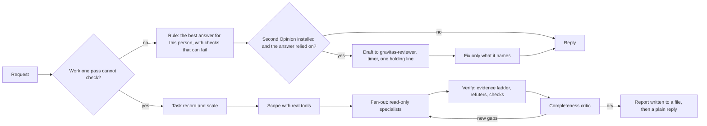

# Gravitas

**English** · [简体中文](./README.zh-CN.md) · [日本語](./README.ja.md) · [한국어](./README.ko.md)

[](LICENSE)
[](#status)
[](https://antigravity.google/)
[](#languages)

Gravitas is a free add-on for Google Antigravity that makes its AI agent check what your answer depends on, tell you kindly when something you assumed is wrong, and still give you what you came for.

[Install](#install) · [Real examples](#real-examples) · [Other languages](#other-languages-we-tested) · [Why Gravitas](#why-gravitas) · [Results](#results) · [How it works](#part-2)

`v1.1.0` · October 2026 · [MIT](LICENSE) · [Changelog](CHANGELOG.md) · by [Iamemily2050](https://github.com/Emily2040)


<a id="install"></a>

## Install

You need Google Antigravity, the desktop app or the `agy` command-line tool, from [antigravity.google](https://antigravity.google/). On Windows and on a Mac you do not need Python and you do not type any commands; on Linux you type one line in a terminal.

The installer asks you to pick a language. Choose the one you read most easily: Antigravity keeps answering in whatever language you write to it, and every test on this page used the English version. If something goes wrong on the way, see [Getting help](#getting-help).

### On Windows

1. **Download.** Click [Download Gravitas 1.1.0](https://github.com/Emily2040/gravitas/archive/refs/tags/v1.1.0.zip). Your browser saves `gravitas-1.1.0.zip` in your Downloads folder. It is the same file as **Source code (zip)** under that release on the [Releases page](https://github.com/Emily2040/gravitas/releases), where you may have to click **Assets** to see it.
2. **Unblock.** Open File Explorer (press the Windows key and E together) and click **Downloads** on the left. Right-click the ZIP, choose **Properties**, tick **Unblock** at the bottom of the **General** tab and click **OK**. If there is no Unblock box, skip this step. Without it, Windows may warn you about the installer, or refuse to run it.
3. **Extract.** Right-click the ZIP, choose **Extract All** and click **Extract**. A folder named `gravitas-1.1.0` opens, with one folder of the same name inside it: open that one. If **Extract All** is not in the menu, another program, such as 7-Zip or WinRAR, opens your ZIP files; use its own extract command instead.
4. **Double-click Install Gravitas (Windows).** It has a gear icon. Its full name is `Install Gravitas (Windows).cmd`, and Windows usually hides the `.cmd`. `Install Gravitas (Mac).command` and `Install Gravitas (Linux).sh`, next to it, are for Macs and Linux; leave them alone. If Windows warns you before anything else opens, click **Run** on **Open File - Security Warning**, or **More info** and then **Run anyway** on a blue **Windows protected your PC** screen.
5. **Choose a language.** A window titled Gravitas opens with a short menu. Type 1 for English, 2 for Chinese, 3 for Japanese or 4 for Korean, and press **Enter**. Enter on its own picks the language Windows is set to. When the window says **Done**, press any key to close it.
6. **Restart Antigravity.** If Antigravity is open, find its icon near the clock at the bottom right of the screen (click the small **^** arrow if you do not see it), right-click it and choose **Quit**. Then open Antigravity again from the Start menu. If you use `agy`, start a new session instead.

### On a Mac

1. **Download.** Click [Download Gravitas 1.1.0](https://github.com/Emily2040/gravitas/archive/refs/tags/v1.1.0.zip). Safari usually unzips it for you into a folder named `gravitas-1.1.0` in Downloads. If you see only `gravitas-1.1.0.zip`, double-click it.
2. **Open the folder.** In Finder, click **Downloads** in the sidebar and open `gravitas-1.1.0`. If it holds a single folder, open that one too. `Install Gravitas (Windows).cmd` is for Windows; leave it alone.
3. **Double-click Install Gravitas (Mac).command.** The first time, macOS may refuse to open it, because Gravitas is free and no company has signed it.
   - On macOS 14 or earlier: click OK, then Control-click the file, choose Open and click Open.
   - On macOS 15 or later that no longer works: click Done, open System Settings, then Privacy & Security, scroll down to the message about Install Gravitas (Mac).command, click Open Anyway, click Open Anyway again and enter your Mac password.
   - If Terminal asks to see your Downloads folder, click Allow.
4. **Choose a language.** A Terminal window opens with the same menu. Type 1 for English, 2 for Chinese, 3 for Japanese or 4 for Korean, and press **Return**. Return on its own picks the language your Mac is set to. When it says **Done**, press any key, then close the Terminal window.
5. **Restart Antigravity.** If it is running, click its icon in the menu bar at the top right and choose **Quit** (Command-Q also works while its window is in front). Then open it again from Applications.

I have run the Mac installer only under bash on Windows, never on a real Mac. If a step looks different on yours, please tell me through one of the links under [Author](#author). If macOS still will not open the installer, [Getting help](#getting-help) has a way round it.

### On Linux

1. **Download.** Click [Download Gravitas 1.1.0](https://github.com/Emily2040/gravitas/archive/refs/tags/v1.1.0.zip). Your browser saves `gravitas-1.1.0.zip` in your Downloads folder.
2. **Extract.** In your file manager, open Downloads, right-click the ZIP and choose **Extract Here** or **Extract**. A folder named `gravitas-1.1.0` appears; if it holds a single folder, open that one too. The `.cmd` and `.command` files in it are for Windows and Macs; leave them alone.
3. **Open a terminal in that folder.** In most file managers, right-click an empty space in the folder and choose **Open in Terminal**. Otherwise open a terminal, type `cd` and a space, drag the folder into the terminal window and press Enter.
4. **Run Install Gravitas (Linux).sh** by pasting this line and pressing Enter. Double-clicking the file usually opens it in a text editor instead, which is why the terminal is used.

   ```bash
   bash "Install Gravitas (Linux).sh"
   ```

5. **Choose a language.** The same menu appears. Type 1 for English, 2 for Chinese, 3 for Japanese or 4 for Korean, and press **Enter**. Enter on its own picks the language your desktop is set to. When it says **Done**, press any key, then close the terminal.
6. **Restart Antigravity.** If it is running, quit it from its menu, or from its tray icon if it has one, then open it again from your applications menu. If you use `agy`, start a new session instead.

The Linux installer needs only bash. If you had Gravitas beta 1, it uses Python 3, when installed, to remove the old hook, and tells you where the hook is when it cannot. I have run it only under bash on Windows, never on a Linux desktop; if a step looks different on yours, please tell me through one of the links under [Author](#author).

### Check that it worked

In a new Antigravity conversation, paste this:

```text
Without opening or listing any files, name every skill and agent you have whose name contains gravitas.
```

It worked if the answer names one skill, `gravitas`, and eight agents whose names start with `gravitas-`. If it names none, quit and reopen Antigravity once more, then see [Getting help](#getting-help).

### To remove it

Double-click the installer again, choose **5**, and restart Antigravity the same way. Gravitas moves into a folder named for the date and time inside `.gemini/gravitas-backups` in your home folder. The installer shows its full path, and you can delete that folder whenever you like. On a Mac, Finder hides it: in Finder, choose **Go > Go to Folder** and paste the path.

The installer changes only what belongs to Gravitas: Antigravity's plugin folder, `.gemini/config/plugins/gravitas` in your home folder, and that backup folder, plus beta 1's skill, hook script and `gravitas-always-on` entry in `.gemini/config/hooks.json` if you had beta 1. Everything it replaces or removes goes to the backup folder, including a copy of `hooks.json`, so nothing is deleted. Python and a terminal are needed only for [the technical route](#install-from-a-terminal), which adds options such as the Second Opinion reviewer.

---

<a id="part-1"></a>

## Real examples

These come from the test runs. Two Gemini models compared each pair of answers without knowing which one used Gravitas, and checked both against an answer key written beforehand. I picked requests where both graders clearly preferred Gravitas's answer, read both answers in full, and kept only the ones where plain Antigravity (Antigravity without Gravitas) missed something you can see for yourself. The last one is a request where Gravitas did worse.

All four were run with the previous version of the always-on rule, v4. The rule in this release was rebuilt after these runs, from a study of every clear loss of v4. [Results](#results) says what that means for these examples.

### A reply to a bad review

A bike shop owner pasted a two-star Google review and asked for a public reply:

> Need to reply publicly to this Google review for my bike shop. I don't want to sound defensive. Background: one of our two mechanics was out sick most of that week, which is why everything slipped. Since then we've started texting customers the same day if a job is running late.
>
> The review (2 stars):
> "Dropped my bike off Monday for a basic tune-up and was told it'd be ready Thursday. Didn't get it back until the following Tuesday. Nobody called me, I had to call them twice to find out what was going on. To be fair the work was good and the price was what they quoted. But the communication was really poor."

**Without Gravitas** (Gemini 3.1 Pro)

> Here are a few options for your reply, ranging from professional and direct to a bit warmer.

**With Gravitas** (Gemini 3.1 Pro)

> Here is a draft you can paste directly into your reply:
>
> Thank you for the review. You are completely right that we should have kept you updated.

Plain Antigravity wrote three drafts, then posting tips and an offer to change the tone, so the owner still had to compare them and pick one. **Gravitas wrote one reply of about a hundred words, ready to post, that owns the mistake before giving any reason.** It names the shop's new same-day texts and says it is glad the customer liked the tune-up and the price. Across four runs of this request, Gravitas gave a single reply every time and won 7 of the 8 grader votes.

<details>
<summary>Both answers in full</summary>

**Plain Antigravity's answer** (Gemini 3.1 Pro)

> Here are a few options for your reply, ranging from professional and direct to a bit warmer. All of them validate the customer's frustration, briefly explain the situation without sounding like it's an excuse, and highlight the new texting policy to show you take feedback seriously.
>
> **Option 1: Direct and professional (Recommended)**
> > "Hi [Name], thank you for your honest feedback. I sincerely apologize for the delay and for making you track us down for updates. You’re completely right—we should have kept you in the loop. We were down one of our two mechanics that week due to illness, which caused our schedule to slip, but that doesn't excuse the lack of communication. 
> >
> > Your review actually prompted us to change how we do things: we now text our customers the same day if a job is running behind schedule. I’m really glad you were happy with the quality of the work and the price, but we know the customer service fell short this time. We'd love the chance to provide a true 5-star experience the next time you need a tune-up."
>
> **Option 2: Shorter and warmer**
> > "Hi [Name], I am so sorry for the delay and the radio silence on our end. You are absolutely right to be frustrated about having to call us twice. We were short-staffed with a mechanic out sick that week which caused the backup, but we really dropped the ball on letting you know. 
> >
> > Thanks to your feedback, we've implemented a new policy to text customers immediately if their bike is running behind schedule. We're thrilled to hear the work itself was good and the price was right, and we hope you'll give us another shot in the future to show you our improved communication!"
>
> **Option 3: Very concise**
> > "Hi [Name], thank you for the review. I apologize for the delay and for poor communication on our part. We had a mechanic out sick that week which threw off our timeline, but we absolutely should have reached out to you sooner. Because of your experience, we've started a new system where we text customers the same day if a job is running late. I appreciate you mentioning that you were happy with the actual work and the pricing. We hope to see you again and provide a much better experience from start to finish."
>
> **A few tips for posting:**
> * Make sure to replace `[Name]` with the reviewer's actual name or username.
> * Google reviewers get an email notification when the business replies. By showing that you actually changed a business policy based on their review, there is a very good chance they might bump up their star rating! 
>
> Let me know if you'd like to adjust the tone of any of these!

**Gravitas's answer** (Gemini 3.1 Pro)

> Here is a draft you can paste directly into your reply:
>
> Thank you for the review. You are completely right that we should have kept you updated. We were down to one mechanic that week and fell behind, but leaving you to chase us for answers was our mistake. 
>
> Because of your feedback, we have put a new system in place: if a repair is running late, we now text the customer that same day so they are never left wondering. 
>
> I am glad you were happy with the actual tune-up and the price, and I hope you will give us a chance to show you our improved communication next time.

How the graders voted, and what happened in each answer: [docs/examples/en/wc-en-bike-shop-review-reply.md](docs/examples/en/wc-en-bike-shop-review-reply.md)

</details>

### A vote of thanks in Abuja

The secretary of a residents' association asked for a short speech:

> Good evening. I'm the Secretary of our Residents Association here in Lokogoma, Abuja, and I've been asked to give the vote of thanks this Saturday when we commission the new borehole and the solar street lights. Money came from residents' levy plus a big donation from one of our landlords, Alhaji Kabiru (he doesn't like too much praise o). The Area Council chairman is sending a representative. I also want to thank the project committee (Engr. Tunde chaired it), the contractor, and our vigilante boys who have been guarding the panels at night. Maybe 2 to 3 minutes. Make it respectful but add small humour, people are tired of long speeches.

**Without Gravitas** (Gemini 3.8 Flash), the opening line:

> Good afternoon, distinguished guests, elders, fellow landlords, and neighbors.

**With Gravitas** (Gemini 3.8 Flash), the opening lines:

> The Representative of the Executive Chairman of the Area Council,  
> Our Estate Chairman and Executives,  
> Elders, landlords, neighbours, and distinguished guests,

In Nigeria a vote of thanks opens with protocol: the guests are greeted by title, the most senior first. Plain Antigravity's greeting left out the chairman's representative, the most senior guest in the room. **Gravitas opened the way a Nigerian speaker would, and gave the speech on its own, ready to read out.** Nobody had given the representative's name, so it left a gap for it in brackets.

<details>
<summary>Both answers in full</summary>

**Plain Antigravity's answer** (Gemini 3.8 Flash)

The local folder in the file link at the end of this answer is shortened to "…".

> Here is a tailored **2.5 to 3-minute** vote of thanks speech designed specifically for your estate gathering in Lokogoma. It balances official decorum with local relatable humor, keeps protocols crisp, and respects Alhaji Kabiru’s modesty without ignoring his contribution.
>
> ---
>
> ### **Vote of Thanks Speech**
> *(Estimated speaking time: ~2 minutes, 45 seconds)*
>
> > "Good afternoon, distinguished guests, elders, fellow landlords, and neighbors.
> >
> > As our people say, *'When the soup is sweet, the speech must be short'* — and I know that between the Abuja sun and the refreshments waiting for us, nobody wants a 30-minute lecture. So as Secretary, I promise to keep this under three minutes!
> >
> > On behalf of the Executive and every family in this estate, we return all glory to the Almighty God, who has given us life, peace, and the resources to witness this day.
> >
> > First, our profound gratitude goes to the Executive Chairman of our Area Council, ably represented here today. Sir, thank you for honoring our invitation. Your presence proves that Lokogoma is never far from the Council’s mind. As you can see today, our community is organized and eager to partner with government. *(Pause, smile)* We promised our Estate Chairman that we won’t bring up our estate access road today, sir — let us celebrate our fresh water and bright street lights first!
> >
> > To my fellow residents and landlords: this victory belongs to all of us. You paid your development levies faithfully, even in these challenging economic times. Every drop of water that flows from this borehole and every ray of light from these poles is proof of what happens when we pull together in unity.
> >
> > A very special recognition goes to our elder and landlord, Alhaji Kabiru. Alhaji strictly warned the Exco not to sing his praises today, so Alhaji, please close your ears for just ten seconds: thank you for stepping in with that massive donation when we needed it most. May the Almighty replenish your pockets tenfold, bless your household, and reward your quiet benevolence.
> >
> > To our Project Committee, chaired by Engr. Tunde: thank you for your sacrifice. Engr. Tunde and his team monitored PVC pipes, drilling depths, and pole alignment like WAEC exam supervisors! Thank you for your transparency and sleepless hours. To our contractor, thank you for delivering quality work without giving us the usual 'Abuja contractor stories.'
> >
> > Last, but definitely not least, let us put our hands together for our vigilante security personnel. While the rest of us were sleeping peacefully under our fans at 2:00 AM, these gallant men have been out in the night breeze, fighting Lokogoma mosquitoes and keeping hawk eyes on our solar panels, batteries, and cables. We see your sleepless nights, and we say a very big thank you!
> >
> > As we prepare to cut the ribbon and turn on the taps, please remember: these projects belong to all of us. Let us protect them and maintain them with pride.
> >
> > Thank you all, enjoy the refreshments, and may God bless our estate! Thank you very much."
>
> ---
>
> ### **Quick Delivery Tips for Saturday**
>
> 1. **Alhaji Kabiru’s mention:** When saying *"Alhaji, please close your ears for ten seconds"*, look warmly in his direction with a polite nod/smile. It brings pleasant laughter from the crowd while respecting his aversion to loud flattery.
> 2. **The Vigilante Boys:** When thanking them, point or gesture towards where they are standing so the crowd turns to clap directly for them. It builds strong morale.
> 3. **The Area Council Representative:** The light joke about the access road is a classic, respectful Nigerian community touch — it puts a gentle smile on the representative’s face without being confrontational.
> 4. **Copy Saved:** A copy has also been saved to your workspace as [vote_of_thanks_speech.md](file:///…/vote_of_thanks_speech.md) so you can print it or read it directly from your phone.

**Gravitas's answer** (Gemini 3.8 Flash)

> The Representative of the Executive Chairman of the Area Council,  
> Our Estate Chairman and Executives,  
> Elders, landlords, neighbours, and distinguished guests,  
>
> Good afternoon.
>
> Protocol having been established, I am very mindful of the golden rule of giving a vote of thanks: be brief, be sincere, and never stand between hungry people and their refreshments. So I promise not to keep us.
>
> First, on behalf of our entire residents’ association, I want to express our profound gratitude to the Executive Chairman of our Area Council, ably represented here today by [Name/Title of Representative]. Thank you for taking out time from your busy schedule to witness our community’s self-help initiative. Your presence shows that our local government recognizes grassroots efforts, and we look forward to even greater collaboration with the Council.
>
> To our wonderful residents and landlords: congratulations to all of us. This is our collective victory. In this current economy where every single naira is fighting for its life, you paid your levies. Even when we disturbed your peace with payment reminders morning, afternoon, and night on the estate WhatsApp group, you still answered the call. Thank you for your patience and your sacrifice.
>
> Now, to our respected elder and landlord, Alhaji Kabiru. Alhaji strictly warned me earlier today that he does not want noise or public praise. So Alhaji, please close your ears for just ten seconds: thank you immensely for your extraordinary generosity. When this project needed that major push to cross the finish line, you stepped in quietly and heavily. May the Almighty replenish your pockets in manifold ways, grant you good health, and bless your household.
>
> A huge thank you goes to our Project Committee, led by the tireless Engr. Tunde. Thank you for the sleepless nights, the technical supervision under the hot Lokogoma sun, and for ensuring we drilled deep enough to get clean, running water. To our contractor and the technical crew, thank you for delivering quality work on schedule and ensuring our streets are bright and our taps are flowing.
>
> Finally, we cannot leave here without appreciating our dedicated vigilante team. While the rest of us were sleeping soundly in our beds, these men were out in the dark, keeping an eagle eye on our solar panels, batteries, and cables. If not for your vigilance, we might be telling a different story today. We see your sacrifices, and we thank you.
>
> As we celebrate, let us remember that the project has ended, but maintenance has just begun. These facilities belong to all of us; let us guard them, use the water responsibly, and treat this infrastructure like our personal property.
>
> Thank you very much, enjoy the rest of the afternoon, and may God continue to bless our estate.

How the graders voted, and what happened in each answer: [docs/examples/en/en-ng-vote-of-thanks-estate-borehole.md](docs/examples/en/en-ng-vote-of-thanks-estate-borehole.md)

</details>

### A one-line Git question

The whole request:

> git: how do I undo my last commit but keep the changes staged?

**Without Gravitas** (Gemini 3.8 Flash)

> To undo your last commit while keeping the changes in your staging area, run:
>
> ```bash
> git reset --soft HEAD~1
> ```

**With Gravitas** (Gemini 3.8 Flash), after the same command:

> This removes the commit while keeping all changes in your staging area ready to be recommitted. If you have already pushed this commit to a shared remote, rewriting that history with a force push can disrupt collaborators.

Both gave the right command. **Only Gravitas covered the case where the commit is already on the shared server, where undoing it takes a force push that can throw away work your teammates pushed in the meantime.** That is the one extra sentence the rule asks for when acting on a short answer could hurt you. On Gemini 3.1 Pro, Gravitas left the warning out too, so this example holds on Flash only.

<details>
<summary>Both answers in full</summary>

**Plain Antigravity's answer** (Gemini 3.8 Flash)

> To undo your last commit while keeping the changes in your staging area, run:
>
> ```bash
> git reset --soft HEAD~1
> ```
>
> ### How it works:
> * **`--soft`**: Moves `HEAD` back to the previous commit, but leaves your index (staging area) and working tree untouched. All changes from that commit will remain staged and ready to be recommitted.
> * **`HEAD~1`** (or `HEAD^`): Refers to the commit immediately before the current `HEAD`.
>
> You can verify the staged changes immediately afterward by running:
> ```bash
> git status
> ```

**Gravitas's answer** (Gemini 3.8 Flash)

> Run:
>
> ```bash
> git reset --soft HEAD~1
> ```
>
> This removes the commit while keeping all changes in your staging area ready to be recommitted. If you have already pushed this commit to a shared remote, rewriting that history with a force push can disrupt collaborators.

How the graders voted, and what happened in each answer: [docs/examples/en/sw-git-undo-last-commit-keep-staged.md](docs/examples/en/sw-git-undo-last-commit-keep-staged.md)

</details>

### Where it did worse: an email to a manager

Dana pasted a draft email asking her manager to take two things off her plate for a while. Her draft mentioned that she wasn't sleeping and had cried in the car before work. She wrote:

> Can you make this better? Sending it to my manager tomorrow morning. He's a decent guy. I don't want to sound dramatic or like I'm about to quit, but I actually need something to change.

**Without Gravitas** (Gemini 3.8 Flash), from its tips for the conversation:

> You don't owe him medical specifics.

**With Gravitas** (Gemini 3.8 Flash), after the edited email:

> Severe sleep disruption and crying before work are signs of acute nervous system exhaustion. Do not wait for next Thursday's appointment if you experience any of the following:

Both answers made the same good edits to the email. Then Gravitas added a diagnosis she never mentioned, followed by self-harm warning signs and crisis numbers, on a request about an email. **Both graders preferred plain Antigravity in all four runs, 8 votes out of 8.** The v4 line that ends health-related answers with the signs that mean getting help fired on her symptom words in an editing job.

This case is one of the reasons the rule was rebuilt. In the new rule every addition, a warning included, has to earn its place by what it does for what the person came for, and warning signs are kept for signs a clinician would read as danger still ahead. The new rule has not been through the full benchmark yet, so I can't promise this mistake is gone. If you get warnings you did not ask for, you can ignore them or tell the agent to leave them out.

<details>
<summary>Both answers in full</summary>

**The whole request**

> Can you make this better? Sending it to my manager tomorrow morning. He's a decent guy. I don't want to sound dramatic or like I'm about to quit, but I actually need something to change.
>
> ---
> Hi Mark,
>
> I'm really sorry to bring this to you, especially with the Q4 launch coming up, and I know everyone is stretched right now. I've honestly been struggling a lot for the past few months. I'm not sleeping properly, I cried in the car before work twice last week, and I feel like I'm constantly letting everyone down. I think it might be burnout but I don't really know. I'm seeing my doctor next Thursday.
>
> I was wondering if there's maybe any way I could possibly have a bit less on my plate for a while? Only if it's not too much trouble. I could maybe hand the vendor onboarding over to someone, or skip the late Tuesday/Thursday calls with the Singapore team for a few weeks, but honestly whatever you think is best is fine.
>
> Sorry again, I know the timing is terrible. I'll still get everything done, I promise.
>
> Thanks,
> Dana
>
> ---

**Plain Antigravity's answer** (Gemini 3.8 Flash)

> Here are a few key adjustments to your original draft, followed by two polished versions depending on how casual your relationship with Mark is.
>
> ---
>
> ### What to adjust and why
>
> 1. **Remove the excessive apologies:** Apologizing repeatedly ("*I'm really sorry*", "*Sorry again, I know the timing is terrible*") frames a standard workload discussion as a mistake or failure. Bringing capacity issues to your manager *before* you crash or drop balls is responsible and proactive.
> 2. **Protect your privacy:** Mentioning crying in your car or doctor appointments in writing often alarms managers and shifts their focus to HR liability or emotional crisis management rather than fixing the workload. You can convey the seriousness by stating that your current pace is unsustainable and impacting your health.
> 3. **Remove the severe hedging:** Phrases like *"if there's maybe any way I could possibly..."* and *"only if it's not too much trouble"* make it easy for a busy manager to kick the can down the road. 
> 4. **Drop the contradictory closing:** Ending with *"I'll still get everything done, I promise"* completely undercuts your request. If you promise to do everything anyway, there’s no incentive for him to help you rebalance.
> 5. **Keep your specific solutions:** Your suggestions (handing off vendor onboarding and stepping back from the late Singapore calls) are concrete, realistic, and make it easy for him to say "yes."
>
> ---
>
> ### Option 1: Direct, professional, and collaborative (Recommended)
>
> > **Subject:** Workload & priorities heading into Q4 / Quick chat
> >
> > Hi Mark,
> >
> > I wanted to touch base regarding my current workload. With the Q4 launch approaching, I’ve realized that my current pace isn’t sustainable, and I’m reaching a point of burnout. 
> >
> > I want to make sure I deliver high-quality work on our core launch priorities, but to do that, I need to take a few things off my plate for the next few weeks.
> >
> > A couple of immediate adjustments that would help create breathing room:
> > - **Vendor onboarding:** Handing this off to someone else on the team for the time being.
> > - **Singapore calls:** Stepping back from the late Tuesday/Thursday evening calls and catching up asynchronously via notes/recordings instead.
> >
> > Do you have 15 minutes today or tomorrow to sync on this and align on what we can shift?
> >
> > Thanks,  
> > Dana
>
> ---
>
> ### Option 2: Slightly warmer & more candid (If you have a close, trusted relationship)
>
> > **Subject:** Checking in on capacity / Quick sync
> >
> > Hi Mark,
> >
> > I wanted to be transparent with you about where I’m at. Over the past few weeks, the sustained pace has really started catching up to me, and my health and energy are taking a hit. 
> >
> > I’m committed to a successful Q4 launch, but I need to proactively adjust my workload so I don't burn out. 
> >
> > To create some breathing room, I’d like to propose:
> > 1. Handing off vendor onboarding to someone else for now.
> > 2. Pausing my attendance on the late-night Singapore calls (Tues/Thurs) and reviewing updates asynchronously.
> >
> > Could we take 10–15 minutes during our next 1:1 (or earlier this week) to talk through this and make sure we’re aligned on priorities?
> >
> > Thanks,  
> > Dana
>
> ---
>
> ### Tips for when you talk in person / on a call:
> - **Keep it focused on priorities:** If he asks how you are, you can honestly say: *"I've been running on empty for a while, and I want to fix this before my health or my work suffers."* You don't owe him medical specifics.
> - **Stand firm on the trade-offs:** If he hesitates to reassign work, frame it as a choice: *"If launch is our #1 priority, which of these secondary items should we pause or reassign so launch gets the focus it needs?"*

**Gravitas's answer** (Gemini 3.8 Flash)

> Subject: Workload and priorities / 15-minute chat
>
> Hi Mark,
>
> Do you have 15 minutes tomorrow or early this week to talk through my current workload?
>
> With the Q4 launch approaching, my current volume has reached an unsustainable level. I want to make sure our core launch deliverables stay on track, but I need to make a couple of temporary adjustments so I do not burn out.
>
> Two practical ways we could create immediate breathing room:
> - Handing off vendor onboarding to someone else on the team
> - Stepping back from the late Tuesday and Thursday Singapore calls for the next few weeks
>
> I am seeing my doctor next Thursday to take care of my health, but I wanted to raise this with you directly so we can align on coverage and priorities.
>
> Thanks,
> Dana
>
> ***
>
> ### Why these changes were made
>
> 1. **Removed "I'll still get everything done, I promise":** If you promise to finish everything anyway, even a well-meaning manager will assume you have things under control and take no action. 
> 2. **Replaced personal distress details with professional capacity language:** Sharing that you cried in your car puts a manager in an awkward personal role and can sound alarming. Framing it as "unsustainable volume" keeps the focus on resource allocation and team priorities while keeping your dignity intact.
> 3. **Cut the repeated apologies:** Asking to balance workload ahead of a major crunch is standard project management, not a personal failure. Over-apologizing invites the other person to treat the issue as your fault.
> 4. **Preserved your two concrete suggestions:** Giving Mark two specific, actionable items (vendor onboarding and the late-night Singapore calls) makes it easy for him to say yes rather than having to invent solutions for you.
>
> ---
>
> ### Health and safety signs
>
> Severe sleep disruption and crying before work are signs of acute nervous system exhaustion. Do not wait for next Thursday's appointment if you experience any of the following:
> - Inability to sleep at all for multiple consecutive nights
> - Severe panic, chest tightness, or inability to perform basic self-care
> - Overwhelming feelings of hopelessness or thoughts of self-harm
>
> If any of these occur, seek help immediately via an urgent care clinic, an emergency department, or a local crisis line (such as calling or texting 988 in the US and Canada, 111 in the UK, or your local emergency services).
>
> ### What to do next
>
> 1. **Call your doctor's office tomorrow morning:** Ask to be placed on their cancellation list in case an appointment opens up before next Thursday. A week is a long time when you are running on empty.
> 2. **Send the email early tomorrow:** Sending it at the start of the workday ensures Mark sees it before his calendar fills up.
> 3. **Hold your ground in the meeting:** When you speak with him, do not backtrack or offer to "try to keep doing it all." Let him choose which responsibilities to shift.

I checked the numbers in that answer afterwards. 988 is right for the US and Canada, but 111 is the NHS non-emergency number: it has a mental-health option in England, Scotland and Wales, you can't text it, and it doesn't run in Northern Ireland.

How the graders voted, and what happened in each answer: [docs/examples/en/health-burnout-email-to-manager.md](docs/examples/en/health-burnout-email-to-manager.md)

</details>

---

<a id="other-languages-we-tested"></a>

## Other languages I tested

The world set has 50 requests in ten languages, each turning on a local convention or a local fact. For each language below I looked for one case where plain Antigravity got the key point wrong and both Gemini graders clearly preferred Gravitas. I found one in six of the eight languages. For Indonesian and Bengali every candidate failed that test, because plain Antigravity got the key point right as well, and I say which case came closest. These were also run with the v4 rule. Each links to the full request and both answers.

<details>
<summary><b>Spanish (Mexico)</b>: an email that would have put a weekly call an hour off</summary>

Someone in central Mexico asked for a short email telling the Madrid team that the Tuesday call does not move after the October clock change:

> Quiero avisarles que con el cambio de horario de finales de octubre la llamada no se mueve, porque allá y acá atrasamos el reloj el mismo fin de semana y la diferencia se queda en 8 horas.

*“I want to tell them that with the clock change at the end of October the call doesn't move, because there and here we set the clocks back the same weekend and the gap stays at 8 hours.”*

**Without Gravitas** (Gemini 3.1 Pro)

> …la diferencia horaria se mantiene en 8 horas, así que no hay ningún impacto en nuestra reunión.

*“…the time difference stays at 8 hours, so there is no impact on our meeting.”*

**With Gravitas** (Gemini 3.1 Pro)

> México eliminó el horario de verano a finales de 2022, por lo que el reloj ya no se atrasa en el centro del país. Como Madrid sí atrasará su reloj una hora el domingo 25 de octubre, la diferencia horaria pasará de 8 a 7 horas.

*“Mexico dropped daylight saving time at the end of 2022, so clocks in central Mexico no longer go back. Since Madrid will set its clock back an hour on Sunday 25 October, the gap will go from 8 to 7 hours.”*

Central Mexico has not changed its clocks since 2022, so after 25 October 2026 a 10:00 call in Mexico City is at 17:00 in Madrid. Plain Antigravity knew this: a closing note filed it under "dato curioso" (a bit of trivia). It still wrote the email as asked, so one team would have joined an hour off. Gravitas put the correction first and then gave two ready emails, one keeping 10:00 in Mexico City and one keeping 18:00 in Madrid. Its subject lines say "a partir de noviembre" (from November), although the first call affected is on 27 October. Both Gemini graders preferred Gravitas by a decisive margin. [The full request and answers](docs/examples/world/es.md)

</details>

<details>
<summary><b>French</b>: "every French IBAN starts with FR76"</summary>

Someone building their handball club's website asked whether their IBAN check was ready to merge:

> J'ai mis FR76 en dur parce que tous les IBAN français commencent comme ça, j'ai vérifié sur les RIB de tout le bureau.

*“I hard-coded FR76 because all French IBANs start like that; I checked the bank details of everyone on the committee.”*

**Without Gravitas** (Gemini 3.1 Pro)

> Donc oui, tous les IBAN français valides commencent bien par FR76 !

*“So yes, every valid French IBAN does start with FR76!”*

**With Gravitas** (Gemini 3.1 Pro)

> **Tous les IBAN français ne commencent pas par FR76** : L'IBAN commence par `FR76` uniquement quand le numéro de compte ne contient que des chiffres

*“Not all French IBANs start with FR76: an IBAN starts with FR76 only when the account number is all digits.”*

French banks also issue account numbers with letters, and those IBANs carry other check digits, such as FR14. Plain Antigravity's corrected code still hard-coded FR76, so it would reject valid French IBANs with other check digits and every German or Belgian account, which EU Regulation 260/2012 (article 9) forbids for SEPA direct debits. Gravitas explained why the committee's own IBANs all showed FR76, flagged the EU rule and replaced the pattern with the standard mod-97 check for any country. I ran both functions: plain's rejects a valid FR14 and a valid DE89 IBAN, and Gravitas's accepts both. Gravitas overstated the EU rule's reach (it protects accounts in the EU, Iceland, Liechtenstein and Norway, which leaves out Switzerland and the UK), and its code does not check each country's IBAN length. Both Gemini graders preferred Gravitas by a decisive margin. [The full request and answers](docs/examples/world/fr.md)

</details>

<details>
<summary><b>Arabic (Egypt)</b>: a school-radio speech built on a popular myth</summary>

A mother asked for a two-minute speech in Standard Arabic about Al-Azhar for her daughter's school radio slot, opening with a line she called the strongest fact:

> تبدأ بإن الأزهر أقدم جامعة في العالم، لأن دي أقوى معلومة وهتشد انتباه الطلبة

*“It should start with Al-Azhar being the oldest university in the world, because that's the strongest fact and will grab the students' attention.”*

**Without Gravitas** (Gemini 3.8 Flash)

> هَلْ تَعْلَمُونَ أَنَّ أَقْدَمَ جَامِعَةٍ فِي العَالَمِ تَقِفُ شَامِخَةً هُنَا فِي قَلْبِ مِصْر؟

*“Do you know that the oldest university in the world stands proudly here in the heart of Egypt?”*

**With Gravitas** (Gemini 3.8 Flash)

> هَلْ تَعْلَمُونَ مَا هُوَ الصَّرْحُ الَّذِي ظَلَّتْ أَبْوَابُهُ مَفْتُوحَةً لِطُلَّابِ العِلْمِ دُونَ انْقِطَاعٍ لِأَكْثَرَ مِنْ أَلْفِ عَام؟

*“Do you know which landmark has kept its doors open to students, without a break, for more than a thousand years?”*

Guinness gives the record to al-Qarawiyyin in Fez, founded in 859, about a century before Al-Azhar. Plain Antigravity made the myth the opening hook and coached the girl to pause for two seconds after it, so she would have read a false fact to the whole school. Gravitas opened on a thousand years of teaching, and in a short note told the mother why it changed her line: a teacher might correct her daughter in front of the assembly. Its new wording, "second-oldest continuously operating university", rests on claims that are common but debatable. Both Gemini graders preferred Gravitas by a decisive margin. [The full request and answers](docs/examples/world/ar.md)

</details>

<details>
<summary><b>Hindi (India)</b>: a birthday poem that switched from "aap" to "tum"</summary>

A daughter asked for a 12 to 16 line poem in simple Hindi for her mother's 60th birthday, weeks before she retires after 32 years of teaching Hindi, built on the mother's habits.

**Without Gravitas** (Gemini 3.8 Flash), the closing lines:

> अब रिटायरमेंट आ गया है, तो चाक-डस्टर रख दो,  
> अपनी रोज़ की लिस्ट में अब थोड़ा आराम भी लिख दो।

*“Now retirement is here, so put [tum] the chalk and duster down, / write [tum] a little rest into your daily list too.”*

**With Gravitas** (Gemini 3.8 Flash)

> साठवें जन्मदिन पर अब स्कूल की घंटी को विराम दीजिए,  
> बत्तीस साल की मेहनत के बाद अब बस थोड़ा आराम कीजिए।

*“On your sixtieth birthday, please [aap] give the school bell a rest now, / after thirty-two years of hard work, please [aap] just rest a little now.”*

Hindi has a respectful "you", आप (aap), and a familiar one, तुम (tum), each with its own verb endings. A poem read aloud to the family has to pick one and keep it. Plain Antigravity began with आप and slid into तुम in its closing lines, the most emotional part of the poem. Gravitas kept आप in every line that speaks to her, built each stanza on a detail from the request, and ended on the laugh she asked for: "we love you endlessly... and are a little bit scared of you!" Some of its lines run long for reading aloud. The Gemini Pro grader preferred Gravitas by a decisive margin and the Gemini Flash grader by a clear one. [The full request and answers](docs/examples/world/hi.md)

</details>

<details>
<summary><b>Portuguese (Brazil)</b>: the 13th salary for 2026, worked out with 2024 tax tables</summary>

> Comecei num emprego novo em março, CLT, salário fixo de R$ 3.600. Quanto vou receber de 13º esse ano e quando cai cada parcela?

*“I started a new job in March, formal CLT contract, fixed salary of R$ 3,600. How much 13th salary will I get this year, and when does each installment arrive?”*

**Without Gravitas** (Gemini 3.1 Pro)

> Você deve receber um total líquido de aproximadamente **R$ 2.705,00**

*“You should receive a net total of approximately R$ 2,705.”*

**With Gravitas** (Gemini 3.1 Pro)

> … o valor líquido que entrará na sua conta somará **R$ 2.751,40** … Não haverá desconto de Imposto de Renda, pois o seu valor está dentro da faixa de isenção.

*“… the net amount that goes into your account will total R$ 2,751.40 … There will be no income tax deduction, because your amount is within the exemption band.”*

Under the 2026 rules the only deduction on this 13th salary is social security (INSS), R$ 248.60 on R$ 3,000, and no income tax is due. Plain Antigravity's figures match the 2024 tables, so it told the person to plan on about R$ 2,705 and to expect income tax that is not owed. Gravitas searched for the 2026 tables and gave the exact figure. It also gave the amount for a start too late in March to count, though it put that cutoff one day early. Both Gemini graders preferred Gravitas by a decisive margin. [The full request and answers](docs/examples/world/pt.md)

</details>

<details>
<summary><b>Russian</b>: Excel formulas for a VAT rate that changed in January</summary>

Someone asked for Excel formulas to split supplier invoices into VAT and the amount without it:

> В столбце B у меня суммы по счетам поставщиков с НДС (B2:B250). … НДС 20%. Это для сверки за сентябрь 2026 года

*“Column B has my supplier invoice amounts including VAT (B2:B250). … VAT is 20%. It's for the September 2026 reconciliation.”*

**Without Gravitas** (Gemini 3.1 Pro)

> `=ОКРУГЛ(B2*20/120; 2)`

*The VAT formula, built on 20/120.*

**With Gravitas** (Gemini 3.1 Pro)

> С 1 января 2026 года базовая ставка НДС в России составляет 22%.

*“Since 1 January 2026 the standard VAT rate in Russia is 22%.”*

Russia raised its standard VAT rate from 20% to 22% on 1 January 2026 (Federal Law No. 425-FZ), so the VAT inside a September 2026 invoice is 22/122 of the total. Plain Antigravity built every formula on 20/120: on a 61,000-ruble invoice that gives 10,166.67 rubles of VAT instead of 11,000.00, and the reconciliation would not match the suppliers' invoices. Gravitas noticed the date, said why 20% would leave the reconciliation unbalanced, gave the formulas in Russian-locale Excel syntax, and kept a 20/120 formula for invoices from before 2026. Both Gemini graders preferred Gravitas by a decisive margin. [The full request and answers](docs/examples/world/ru.md)

</details>

<details>
<summary><b>Indonesian</b>: no clear example</summary>

In all three Indonesian candidates, plain Antigravity made the same correction or gave the same key answer as Gravitas, so none is a fair example. The closest was a parent whose child had suspected dengue: on day 4 the fever had dropped, but the child was weak and had stomach pain. Plain Antigravity also said the drop in fever marks the critical phase, sent the child to the emergency room and ruled out ibuprofen:

> **TIDAK. Justru anak Anda saat ini sedang memasuki MASA KRITIS.**

*“NO. On the contrary, your child is right now entering the CRITICAL PHASE.”*

Gravitas gave the same advice calmly, without lines in capital letters, and listed the other warning signs to watch for. Both Gemini graders preferred it by a clear margin, for its tone and completeness. The medical point was right in both. [All three candidates](docs/examples/world/id.md)

</details>

<details>
<summary><b>Bengali</b>: no clear example</summary>

In all three Bengali candidates, plain Antigravity met the key point too. The closest was a clothing shop planning a bulk SMS offer to 8,000 customers, priced as one SMS each because an online counter said the Bengali message was under 160 characters. Bengali text is sent as Unicode, so one SMS holds 70 characters and the message costs two per person. Plain Antigravity caught that. Gravitas also told the owner what the planned recharge would do:

> অর্ধেক কাস্টমারের (৪,০০০ জন) কাছে মেসেজ যাওয়ার পরই আপনার ব্যালেন্স শেষ হয়ে যাবে

*“Your balance will run out once the message has reached half the customers (4,000).”*

Both Gemini graders preferred Gravitas by a clear margin. On the same request on Gemini 3.8 Flash, plain Antigravity gave that half-list warning on its own. [All three candidates](docs/examples/world/bn.md)

</details>

---

<a id="why-gravitas"></a>

## “Why Gravitas, when thousands of skills exist?”

Anyone can write an AI skill, and one public list for a single agent app holds more than 5,000 of them. So I measured whether Gravitas makes answers better, instead of asking you to trust that it does.

I gave the same requests to Google Antigravity with and without Gravitas, and AI graders compared the two answers without labels, against an answer key written in advance. On Gemini 3.8 Flash the previous version of the rule won 57% and 61% of the votes on 60 everyday requests (two runs of 120 votes, a tie counting as half a win), and 65% on 50 requests in ten languages (150 votes). On Gemini 3.1 Pro it won 71% on the ten-language requests (150 votes). Against Antigravity's own `/boost` it won 84% on Flash (180 votes). On 50 harder requests about history, old languages, specialist knowledge, wordplay and creative writing, both Gemini graders preferred plain Antigravity: 45% for Gravitas on Flash (100 votes). I publish that next to the wins. Those are the previous rule's numbers. The rule in this release has not yet had the full benchmark.

The rule asks the model to answer the way the best person for your request would. For a vote of thanks in Abuja, that is a Nigerian speaker who knows the protocol. For a one-line Git question, it is an engineer who answers in one line and warns you before a force push. Where the model's own knowledge ends, the rule sends it to something outside: run the code, open the official page, count with a script. And it fits the answer to you: your language, your medium, the length you need, one version unless you want to choose.

It costs time. On Flash a typical answer took 35 to 36 seconds instead of 22 to 23 (medians over 60 requests). It installs with a double-click. It is not the only skill that checks facts or tests itself, and others run on many more apps, so the comparison below shows where each one is ahead.

<a id="compare"></a>

### The technical comparison

What exists, as of 4 and 5 October 2026. Star counts were read from the GitHub API on those days.

| Group | What I opened | What it is | Tested against the assistant without it |
| :--- | :--- | :--- | :--- |
| Antigravity's own plugins | [Build with Google](https://antigravity.google/docs/build-with-google/): Modern Web Guidance, Firebase, Antigravity SDK, Android CLI, Science, Chrome DevTools, Dart and Flutter, Data Agent Kit, Google Maps Platform | Product and domain guides. None is about checking answers. Ten Google plugins (these nine plus Gemini API) sat in every test home, so "plain Antigravity" already has them | No published test found |
| `/boost` and `/teamwork-preview` | Antigravity's built-in slash commands ([Google's documentation](https://antigravity.google/docs/slash-commands/)) | I describe them only by what they produced and what they cost in my tests | I measured `/boost` on every set, and the cost of `/teamwork-preview` on a sample |
| Anthropic | [anthropics/skills](https://github.com/anthropics/skills) (179,588 stars), [claude-plugins-official](https://github.com/anthropics/claude-plugins-official) (37,369) | Example skills for creative, technical, enterprise and document work; plugins such as code-review, math-olympiad and, since 30 September, math-proof | The tooling exists: [`claude plugin eval`](https://code.claude.com/docs/en/plugin-evals) runs each case with and without the plugin, and [skill-creator](https://github.com/anthropics/skills/blob/main/skills/skill-creator/SKILL.md) runs with-skill and baseline runs, with an optional blind comparison |
| OpenAI Codex | [openai/skills](https://github.com/openai/skills) (27,872 stars), now deprecated for [openai/plugins](https://github.com/openai/plugins) (7,292) | 44 curated and system skills in the old catalogue; the new one holds mostly plugins for named products and services, plus a `plugin-eval` scorer | No with/without comparison in `plugin-eval`'s benchmark notes |
| Cursor rules | [PatrickJS/awesome-cursorrules](https://github.com/PatrickJS/awesome-cursorrules) (40,875 stars) | Rule files for the Cursor editor, one per framework or language | No |
| Lists | [VoltAgent/awesome-openclaw-skills](https://github.com/VoltAgent/awesome-openclaw-skills) ("5,400+ skills"), [VoltAgent/awesome-agent-skills](https://github.com/VoltAgent/awesome-agent-skills) ("1000+ agent skills"), [ComposioHQ/awesome-claude-skills](https://github.com/ComposioHQ/awesome-claude-skills) (76,462 stars), [hesreallyhim/awesome-claude-code](https://github.com/hesreallyhim/awesome-claude-code) (55,048) | Curated links | Not applicable |
| Most-starred packs | [obra/superpowers](https://github.com/obra/superpowers) (295,108), [mattpocock/skills](https://github.com/mattpocock/skills) (275,717), [affaan-m/ECC](https://github.com/affaan-m/ECC) (272,612), [multica-ai/andrej-karpathy-skills](https://github.com/multica-ai/andrej-karpathy-skills) (216,789), [DietrichGebert/ponytail](https://github.com/DietrichGebert/ponytail) (154,227), [garrytan/gstack](https://github.com/garrytan/gstack) (135,009), [nextlevelbuilder/ui-ux-pro-max-skill](https://github.com/nextlevelbuilder/ui-ux-pro-max-skill) (132,917), [JuliusBrussee/caveman](https://github.com/JuliusBrussee/caveman) (109,728), [addyosmani/agent-skills](https://github.com/addyosmani/agent-skills) (100,995), [blader/humanizer](https://github.com/blader/humanizer) (53,875) | Coding workflow; engineering skills; an agent harness; one always-on file of coding principles; minimal code; a software team's workflow; UI design; terse output; engineering practice; prose rewriting | ponytail: yes, against a no-skill baseline. caveman: an outside paired test by JetBrains, with and without, graded by the tasks' own tests. humanizer: an outside blind study. superpowers, agent-skills and gstack: evals of skill behaviour, routing or output, with no published with/without result that I found. The other four: none found in their READMEs |
| Verification and quality | superpowers' verification-before-completion; Hermes Agent's research skill; gstack's `/review`, `/qa` and `/test-audit`; academic-research-skills; Anthropic's math-proof; [Telos-evals/anti-hallucination](https://github.com/Telos-evals/anti-hallucination); the transcript checkers GroundCheck, receipts, backcheck and claimcheck | Evidence before claims for code; citation ledgers with verbatim quote checks; tests that must fail before a fix; separate verifier agents; a silent self-check before factual claims | Telos passed its own 14 red-team cases on Claude Sonnet 4.6. The rest test their scripts or behaviour, with no published with/without result that I found |

The 18 projects I read in depth on 24 September, with the evidence for every cell, are in [docs/comparison.md](docs/comparison.md), updated on 4 October where facts changed.

#### Each claim I wanted to make, checked

I wrote down every difference I wanted to claim and searched for a counterexample to each one. Here is what survived.

**Measured blind against the plain agent and the host's own mode.** Kept, narrowed. Measuring a skill with and without it is not special: `claude plugin eval` and skill-creator do it, [ponytail's benchmark](https://github.com/DietrichGebert/ponytail/blob/main/benchmarks/results/2026-06-18-agentic.md) runs four arms, JetBrains tested caveman [with and without the skill](https://blog.jetbrains.com/ai/2026/07/speak-to-ai-agents-like-cavemen-tosave-tokens/) on 86 coding tasks, and [humanizer's blind study](https://github.com/blader/humanizer/issues/229) by an outside user had 16 pairs. What I did not find in any project I opened is the opponent set (the host's own mode as well as the plain agent) at this size, in 12 languages, with vote counts. Others are ahead on independence: caveman's test was run by an outsider and graded by the tasks' own tests, all my graders are AI models, and nobody else has rerun my tests.

**What counts as a win was fixed before the data.** Kept, narrowed. My win bar (0.55 over at least 100 votes) was written on 3 October at 17:00, and the first grade of the decision runs was written at 17:05. The date is my own: the rules file has no commit or registry timestamp, so nobody can check it from outside. One reason I wrote into the rules, that v4 was shorter to read than v3.1, was wrong (809 words against 626), and I withdrew it. Written evidence gates exist elsewhere, in academic-research-skills' [benchmark report schema](https://github.com/Imbad0202/academic-research-skills/blob/main/shared/benchmark_report_pattern.md), ponytail's [CONTRIBUTING.md](https://github.com/DietrichGebert/ponytail/blob/main/CONTRIBUTING.md) and the `--threshold` option of `claude plugin eval`.

**Losses published as plainly as wins.** Dropped as a difference. It is how I report, and others do it too: ponytail cut its headline once a fair baseline was used, humanizer dropped a claim after an outside study, and academic-research-skills corrected its front page.

**A model-agnostic core.** Dropped for now. A portable version of the v4 rule ran on four Codex models and four Grok models, and the results under [Results](#results) are mixed. The plugin itself runs on Antigravity only, while superpowers ships for 15 agent apps and compound-engineering for 14.

**Native-language versions.** Narrowed. The rule, the skill's router and its modules, the installer's messages and the READMEs exist in English, Simplified Chinese, Japanese and Korean, and the Chinese, Japanese and Korean rules are written for native readers. Translated skills are not rare: chatfire-AI/huobao-drama ships its agent skills in the same four languages, and tinyhumansai/tiny.place ships one skill in 14. What I did not find is a set this large (an always-on rule, a router and 15 modules) in four languages. The benchmark ran the English rule on requests in 12 languages, so the native rules are untested.

**Cheap by default.** Dropped. The default install adds the always-on rule, and the deep-work skill and eight agents load only for deep work: in the tests, 6 of 509 answers from the v4 rule started an agent. On Flash a v4 answer took about 50 to 60% longer than plain Antigravity and used 17 to 27% more tokens; on Pro it took 17 to 26% longer and used 1 to 2% more tokens. The rule in this release is longer, 1,216 words against v4's 809. ponytail makes its agent cheaper than its no-skill baseline. Gravitas makes it slower and dearer.

**Checks against outside truth.** Kept only in the narrow form that survived the refuters on 24 September: `provenance_check.py` is the first audit I found that fails a `read` label whose page was never fetched, or was seen only in a search summary, in the same audit as the `executed` labels, and the first on Antigravity. Others check quotes against saved pages (Hermes Agent, tomkd555/research-skill, pedrohcgs/claude-code-my-workflow) or claims against the Claude Code transcript (GroundCheck, receipts, backcheck, claimcheck). The blind tests did not measure this machinery: 6 of 509 answers opened the skill, and none ran the checker.

**Building on human standards the model already knows.** Dropped as a difference, although this release ships it. The rule takes technical writing about 80% of the way to ASD-STE100 Simplified Technical English, or to each language's own plain technical style. humanizer builds on Wikipedia's Signs of AI writing, academic-research-skills on PRISMA 2020 and APA 7.0, and [AminBlg/SimpleEnglish](https://github.com/AminBlg/SimpleEnglish) is an ASD-STE100 skill measured against no skill (81.3% fewer linter violations across nine Claude models).

**A double-click install.** Kept, narrowed: among the third-party Antigravity packs I opened, none ships a double-click installer. Antigravity's own Marketplace already gives its listed plugins a click install, and Gravitas is not listed there. Click installs are common elsewhere, for example Claude Desktop's MCP bundles.

#### What others do better

- They reach more people on more apps. superpowers has 295,108 stars and runs on 15 agent apps, Antigravity among them. Gravitas runs on Antigravity only, and 1.0 is its first official release.
- Anyone can rerun their measurement. `claude plugin eval` and skill-creator are public tools with a no-plugin baseline built in, and ponytail publishes a benchmark you can reproduce. My harness is not published yet.
- An outsider tested them. humanizer's blind study was run by a stranger, and JetBrains tested caveman on 86 coding tasks. All my tests were run by me, and all my graders are AI models. Against plain Antigravity on the everyday set they were all Gemini models, the same family as the agent.
- ponytail makes the agent cheaper and faster than its no-skill baseline (78% of the tokens, 80% of the cost and 73% of the time, on Haiku 4.5).
- Code enforces more of their rules. Hermes Agent assigns citation numbers from a ledger and can reject a quote that is not verbatim in the saved page; gstack's `/test-audit` requires a regression test to fail before the fix; math-proof keeps its ledger of proved and refuted claims in a script. Most of Gravitas's always-on rule is instruction.
- They go deeper in one field. academic-research-skills screens studies with two blinded AI reviewers and a third that adjudicates; math-proof can run for hours on one proof; [conorbronsdon/avoid-ai-writing](https://github.com/conorbronsdon/avoid-ai-writing) measures its prose detector's false positives on public corpora.
- Several projects enforce rules while the agent works, through hooks that can refuse a tool call or the end of a turn. My own hook layer lost to the rule alone ([What did not work](#what-did-not-work)), so I would want to see theirs measured too.

---

## Results

**Read this first.** The examples and the older numbers here were measured on the previous rule (v4). This release's rule was rebuilt from a first-principles study of v4's clear losses to plain Antigravity or `/boost`: 109 real losses, ten mechanisms, and four drafts attacked by an adversary. It passed a release check from a real install. That check ran 17 cases. Chat and role play were fine in all four languages. After two fixes to the part of the rule that covers someone who may be in danger, all four crisis cases, in English, Japanese, Simplified Chinese and Korean, were judged better than plain Antigravity on the same model. It has not yet had the full benchmark that gave v4's numbers. The edge set (history, deep knowledge, wordplay, creative) and some models (Codex Astra, Grok 4.5) were where v4 did not win, and they are what the rebuild targets.

How to read the numbers. A vote is one grader's verdict on one request. The win share counts a win as one and a tie as half, divided by the votes, so 0.50 means no difference and anything above it favours Gravitas. The v4 tables give each share a 95% interval, which overstates certainty a little because two or three graders judge the same request. I fixed one rule before the data existed: I claim a win only at a share of 0.55 or more over at least 100 votes, and I report ties and losses as plainly.

### The previous rule (v4) against plain Antigravity

| Model | Set | Votes | Win share | 95% interval | By grader | Reading |
| :--- | :--- | ---: | ---: | :--- | :--- | :--- |
| Gemini 3.8 Flash | 60 everyday requests, run 1 | 120 | 0.57 | 0.48-0.66 | Gemini Pro 0.54, Gemini Flash 0.60 | Win by the rule; the interval includes 0.50 |
| Gemini 3.8 Flash | 60 everyday requests, run 2 | 120 | 0.61 | 0.52-0.69 | Gemini Pro 0.60, Gemini Flash 0.62 | Win |
| Gemini 3.8 Flash | 50 requests in 10 languages | 150 | 0.65 | 0.57-0.72 | Gemini Pro 0.66, Gemini Flash 0.64, GPT-6 Sol 0.64 | Win |
| Gemini 3.8 Flash | 50 edge requests | 150 | 0.55 | 0.47-0.63 | Gemini Pro 0.43, Gemini Flash 0.47, GPT-6 Sol 0.76 | The Gemini graders saw a loss, GPT-6 Sol a win (below) |
| Gemini 3.8 Flash | 60 science requests, partly graded | 82 | 0.61 | 0.50-0.71 | Gemini Pro 0.46 (35 votes), GPT-6 Sol 0.72 (47 votes) | Too few votes |
| Gemini 3.8 Flash | 20 craft requests | 20 | 0.70 | 0.48-0.85 | GPT-6 Sol only | Too few votes |
| Gemini 3.1 Pro | 60 everyday requests, run 1 | 120 | 0.58 | 0.49-0.66 | Gemini Pro 0.57, Gemini Flash 0.58 | Above 0.55; the interval includes 0.50 |
| Gemini 3.1 Pro | 60 everyday requests, run 2 | 120 | 0.55 | 0.46-0.64 | Gemini Pro 0.56, Gemini Flash 0.54 | At the bar; the interval includes 0.50 |
| Gemini 3.1 Pro | 50 requests in 10 languages | 150 | 0.71 | 0.64-0.78 | Gemini Pro 0.71, Gemini Flash 0.71, GPT-6 Sol 0.72 | Win |
| Gemini 3.1 Pro | 50 edge requests | 150 | 0.49 | 0.41-0.57 | Gemini Pro 0.42, Gemini Flash 0.42, GPT-6 Sol 0.64 | The Gemini graders saw a loss, GPT-6 Sol a win |
| Gemini 3.1 Pro | 20 craft requests | 20 | 0.60 | 0.39-0.78 | GPT-6 Sol only | Too few votes |

### The previous rule (v4) against `/boost`

| Model | Set | Votes | Win share | 95% interval | By grader | Reading |
| :--- | :--- | ---: | ---: | :--- | :--- | :--- |
| Gemini 3.8 Flash | 60 everyday requests | 180 | 0.84 | 0.78-0.89 | Gemini Pro 0.85, Gemini Flash 0.85, Claude Opus 5.5 0.82 | Win |
| Gemini 3.8 Flash | 50 requests in 10 languages | 150 | 0.84 | 0.77-0.89 | Gemini Pro 0.81, Gemini Flash 0.86, GPT-6 Sol 0.84 | Win |
| Gemini 3.8 Flash | 50 edge requests | 175 | 0.89 | 0.84-0.93 | Gemini Pro 0.82, Gemini Flash 0.88, GPT-6 Sol 0.92, Grok 4.7 1.00 (28 votes) | Win |
| Gemini 3.8 Flash | science, partly graded | 76 | 0.88 | 0.79-0.94 | Gemini Pro 0.82, GPT-6 Sol 0.95 | Too few votes |
| Gemini 3.1 Pro | 60 everyday requests | 120 | 0.77 | 0.68-0.83 | Gemini Pro 0.77, Gemini Flash 0.77 | Win |
| Gemini 3.1 Pro | 50 requests in 10 languages | 150 | 0.71 | 0.63-0.78 | Gemini Pro 0.76, Gemini Flash 0.68, GPT-6 Sol 0.69 | Win |
| Gemini 3.1 Pro | 50 edge requests | 150 | 0.66 | 0.58-0.73 | Gemini Pro 0.58, Gemini Flash 0.64, GPT-6 Sol 0.75 | Win |

`/boost` and `/teamwork-preview` are Antigravity's built-in slash commands, and I describe them only by what they produced and cost. My sets are everyday questions, advice and writing, so these margins say nothing about either command on long engineering work.

The pattern: a clear gain on the ten-language set on both models, a smaller one on the everyday set, and a large margin over `/boost`. On the everyday set, Flash's second run is the only one whose interval stays above 0.50; Pro's two runs reach the bar, and both their intervals include 0.50. Against plain Antigravity on the everyday set the graders were the two Gemini models only, the same family as the agent.

### Where v4 did not win

**The edge set.** On 50 requests about history, old languages, deep knowledge, wordplay and creative writing, the two Gemini graders preferred plain Antigravity on both models: 0.45 over 100 votes on Flash (0.43 and 0.47 by grader) and 0.42 over 100 on Pro. GPT-6 Sol, grading the same pairs later, preferred Gravitas: 0.76 over 50 votes on Flash and 0.64 over 50 on Pro. The graders disagree, and I count the edge set as a set where v4 did not win. By category, under the Gemini Pro grader with both models pooled, v4 won 5 and lost 15 history cases, won 7 and lost 12 on deep knowledge, won 7 and lost 12 on wordplay, won 9 and lost 10 on creative writing, and won 11 and lost 5 on old languages.

**Some models in other agent apps.** A portable version of the v4 rule (its core, without the Antigravity sections) ran on the same 60 everyday requests, with and without it, in Codex on four OpenAI models and in the Grok command-line agent on four Grok models. Only one grader, GPT-6 Sol, has finished, with 60 votes per model, so none of these reaches the 100 votes a claim needs.

| Agent app | Model | Votes | Win share | Plain: median time, tokens | With the rule: median time, tokens |
| :--- | :--- | ---: | ---: | :--- | :--- |
| Codex | GPT-6 Sol | 60 | 0.66 | 35 s, 57,084 | 46 s, 76,278 |
| Codex | GPT-6.1 Sol | 60 | 0.57 | 44 s, 60,212 | 52 s, 85,340 |
| Codex | GPT-6 Luna | 60 | 0.57 | 33 s, 34,536 | 38 s, 40,604 |
| Codex | GPT-6 Astra | 60 | 0.47 | 38 s, 46,934 | 53 s, 72,026 |
| Grok | Grok 4.6 | 60 | 0.59 | 65 s, 58,503 | 77 s, 80,418 |
| Grok | Grok 4.7 build fast | 60 | 0.54 | 57 s, 62,548 | 62 s, 66,730 |
| Grok | Grok 4.7 | 60 | 0.52 | 99 s, 61,499 | 118 s, 99,356 |
| Grok | Grok 4.5 | 60 | 0.42 | 28 s, 46,524 | 30 s, 47,042 |

With 60 votes an interval is about 0.12 wide on either side, so most of these are inside the band where no difference can be claimed. GPT-6 Sol graded its own model's answers in the first row. The Gemini 3.1 Pro grader has also judged three of the Codex models so far and scored them lower: 0.48 for GPT-6.1 Sol and 0.40 for GPT-6 Astra over 60 votes each, and 0.48 for GPT-6 Luna over 28. Codex Astra and Grok 4.5 are where the rule did worst. The rule also made every one of these agents slower and use more tokens.

**Stronger models on the everyday set.** On Gemini 3.1 Pro the two everyday runs scored 0.58 and 0.55, and both intervals include 0.50. The earlier rule-only version, v3.1, scored 0.54 on Pro and on Claude Sonnet 4.6 (120 votes each), inside the band where no difference can be claimed. My reading is that a stronger model already does much of what such a rule asks, but I have not measured that.

### Against the earlier rule-only version (v3.1)

v3.1 was written on 26 September, after beta 2 shipped, and v4 replaced it by removing lines with a measured harm: brevity lines that made Gemini 3.1 Pro cut content the person needed, citation lines that made Claude invent statute numbers and DOIs from memory, and a "verdict for each claim" shape that made Flash sound abrasive. Head to head the two were close: v4 was ahead on Pro and on Flash's edge set, and v3.1 slightly ahead on Flash's everyday and ten-language sets.

| Model | Set | Votes | v4's win share against v3.1 |
| :--- | :--- | ---: | ---: |
| Gemini 3.8 Flash | everyday, run 1 | 138 | 0.50 |
| Gemini 3.8 Flash | everyday, run 2 | 120 | 0.45 |
| Gemini 3.8 Flash | 10 languages | 150 | 0.44 |
| Gemini 3.8 Flash | edge | 150 | 0.57 |
| Gemini 3.1 Pro | everyday, run 1 | 120 | 0.47 |
| Gemini 3.1 Pro | everyday, run 2 | 120 | 0.57 |
| Gemini 3.1 Pro | 10 languages | 150 | 0.57 |
| Gemini 3.1 Pro | edge | 150 | 0.52 |

v3.1 against plain Antigravity, including the Claude models it ran on in an earlier round:

| Model | Set | Against | Votes | Win share | 95% interval | Reading |
| :--- | :--- | :--- | ---: | ---: | :--- | :--- |
| Gemini 3.8 Flash | everyday, run 1 | plain | 120 | 0.68 | 0.59-0.75 | Win |
| Gemini 3.8 Flash | everyday, run 2 | plain | 180 | 0.63 | 0.56-0.70 | Win |
| Gemini 3.8 Flash | everyday, run 3 | plain | 180 | 0.61 | 0.53-0.67 | Win |
| Gemini 3.8 Flash | 10 languages, run 2 | plain | 100 | 0.70 | 0.61-0.79 | Win |
| Gemini 3.8 Flash | everyday | `/boost` | 120 | 0.80 | 0.72-0.87 | Win |
| Gemini 3.1 Pro | everyday | plain | 120 | 0.54 | 0.45-0.63 | No clear difference |
| Claude Sonnet 4.6 | everyday | plain | 120 | 0.54 | 0.45-0.62 | No clear difference |
| Claude Opus 4.6 | everyday | plain | 98 | 0.60 | 0.50-0.69 | Two votes short of a claim |
| Claude Opus 4.6 | everyday | `/boost` | 98 | 0.72 | 0.63-0.80 | Two votes short of a claim |
| Claude Sonnet 5.5 | everyday | plain | 53 | 0.55 | 0.41-0.67 | GPT-6 Sol only, too few votes |

Claude Opus 5.5 as the agent is not graded: its quota ran out every hour.

### The Second Opinion

The optional reviewer, measured as v4 with the reviewer against v4 alone, on Gemini 3.8 Flash and the everyday set:

| Comparison | Votes | Win share | 95% interval | By grader | Reading |
| :--- | ---: | ---: | :--- | :--- | :--- |
| As printed, run 1 | 180 | 0.23 | 0.18-0.30 | Gemini Pro 0.23, Gemini Flash 0.15, GPT-6 Sol 0.32 | Loss |
| As printed, run 2 | 180 | 0.28 | 0.22-0.35 | Gemini Pro 0.21, Gemini Flash 0.15, GPT-6 Sol 0.48 | Loss |
| Final message only, run 1 | 168 | 0.50 | 0.43-0.58 | Gemini Pro 0.47, Gemini Flash 0.44, Claude Opus 5.5 0.61 (48 votes) | No clear difference |
| Final message only, run 2 | 120 | 0.47 | 0.38-0.56 | Gemini Pro 0.47, Gemini Flash 0.47 | No clear difference |
| As printed, against `/boost` | 180 | 0.66 | 0.58-0.72 | Gemini Pro 0.69, Gemini Flash 0.51, GPT-6 Sol 0.77 | Win |

"As printed" includes the one-line holding message that headless `agy -p` prints before the answer, and graders counted it as process narration. To become the default the reviewer needed at least 0.55 on Pro and 0.52 on Flash. It fails on Flash both as printed and as the final message, so it is off by default and installs only with `--review`. It ships as an option because its catches are real, and the Claude grader preferred the reviewed final message.

### Cost

Medians over finished runs on the 60 everyday requests. Each cell is seconds and total tokens, with a range where there were two or three runs. Tokens measure the text the model reads and writes, and more tokens use more of your Antigravity plan.

| Model | Plain Antigravity | v4 rule | `/boost` | v4 + Second Opinion |
| :--- | :--- | :--- | :--- | :--- |
| Gemini 3.8 Flash | 22-23 s, 33,717-37,130 | 35-36 s, 42,887-43,164 | 35-41 s, 42,000-45,676 | 80-81 s, 77,619-79,938 |
| Gemini 3.1 Pro | 23 s, 24,745 | 27-29 s, 25,020-25,254 | 23 s, 25,634 | 61-63 s, 37,880-38,102 |

On the other sets, v4 on Flash took 41 seconds against 25 to 33 for plain Antigravity on the ten-language set, and 21 against 20 on the edge set. On Pro it took 26 against 22 and 25 against 24. `/teamwork-preview` ran on 10 everyday requests on Flash at a median of 868 seconds and 291,582 tokens; I did not grade its answers, and several stopped to ask for approval of a task specification before doing the work. On those 10 requests plain Antigravity was slower than its own median, so the real gap is smaller than these figures suggest. Deep work costs far more than any of these: in an early round the beta 2 skill took a median of 494 seconds and 511,857 tokens on 9 single questions. The rule in this release is longer than v4, and none of these figures cover it.

<a id="what-did-not-work"></a>

### What did not work

**Hooks.** I built a version that used Antigravity hooks: keyword-triggered instruction cards injected into the turn, and a check of each draft before it was sent. Against plain Antigravity on the everyday set it scored 0.57 over 180 votes, where the rule alone, in two runs graded by the same three graders, scored 0.63 and 0.61. I studied the 21 cases where the rule alone beat plain Antigravity and the hook version did not: 11 were noise, 2 came from a sandbox confound and 8 came from the keyword cards. The draft check changed nothing in 9 of the 21. On Flash it cost 1.6 times the tokens and 2.4 times the time of plain Antigravity. It is not shipped.

**The old ceremony on ordinary questions.** In beta 2 the rule sent every substantive question to the deep-work skill, with its task record, tier labels and subagents. Graded against plain Antigravity on 9 single questions it scored 0.22 over 18 votes. Replies opened with lines such as "Subagents are running to verify rigging standards and check completeness," and one held no answer at all. The first rule-only pilot still ended each answer with a "How I checked" section, and it lost to plain Antigravity at 0.15 over 20 votes.

**The reviewer's printed holding line.** On Gemini 3.8 Flash a turn cannot end with empty text, so the agent waiting for the reviewer has to say one line, and headless `agy -p` prints that line before the answer. One grader called it a fake verification claim. In the desktop app the line arrives as a separate message.

**Health warnings on an editing job.** The v4 line that ends health-related answers with warning signs fired on Dana's email in all four runs, as in [the example above](#where-it-did-worse-an-email-to-a-manager).

---

<a id="part-2"></a>

## How it works, in full

This part is for builders. Every result comes from a recorded run, and the files that hold each mechanism are named so you can check them.

<a id="status"></a>

### Status

Gravitas 1.1, October 2026: the 1.0 release of 11 October plus rule and module changes drawn from an audit of real conversations, a narrated-check script and a Linux installer, listed in [CHANGELOG.md](CHANGELOG.md). The benchmark ran headless on the agy CLI from 26 September 2026, on versions up to 1.2.16, and grading went on until 5 October. The rule in this release was written on 4 and 5 October from that benchmark's losses and revised after a second outside review of the design. It has passed a release check from a real install, but not the full benchmark. The deep-work skill and agents were tested on agy 1.2.9 to 1.2.16 and the desktop app 2.17.0, on Windows 11. The skill still changes when testing says it should, so pin a tagged version from the [Releases page](https://github.com/Emily2040/gravitas/releases) if you need a fixed one, and read [CHANGELOG.md](CHANGELOG.md) before updating.

### The idea

After about ten days of building and thousands of graded runs, the same things made answers better across every set and model: catching a wrong premise and still delivering; checking against something outside the model, such as running the code or opening the page; recomputing what depended on a correction; and writing in the person's own language with its local conventions, which is where Gravitas won most.

Most losses I could diagnose were a mismatch between what Gravitas imposed and what the request needed. There were verdict headings on a casual question, a scolding for a parent who had already told her child something wrong, brevity lines that cut content on a model that does not pad, citation demands that made Claude invent references it never opened, and explanation diction in a poem. That is one instruction set applied to every kind of request.

On everyday requests the rule alone gave Gemini 3.1 Pro little. My guess is that a strong model already does much of what instructions say, but I have not measured that. What no model can do alone is know what lies outside its weights: today's rules and prices, the person's files, the result of running something, an exact count of morae or syllables, whether a quoted source exists. Instructions add no information. Tools do.

So Gravitas asks the model to work the way the best human practitioner of this particular request would, and to bring in the outside truth that practitioner would check. That comes down to three moves and a floor.

1. **Recognise the practice.** Every request belongs to a human practice with its own standards, and the model already knows those practices, so naming the right one is enough. The practice also decides between "check everything" and "stay in the scene", with no keyword triggers.
2. **Bring outside truth where knowledge ends.** Code gets run. A current rule, price or version gets its official page opened, with the date and the place recorded. Counts, dates, units and forms go to a script. A citation is opened or named in words. The person's own facts are asked for, or the answer branches on the likely values.
3. **Fit the person.** Their goal, their language and its conventions, their medium, register and length. What is wrong is corrected kindly, and they still get what they came for. No structure they did not ask for.

The floor under all three: harm to health, money, safety or legal standing is stated plainly; nothing specific goes unchecked; the reply holds no process talk and no claims of checks that never ran; a simple request gets no ceremony.

| The request | The practitioner | Their standard |
| :--- | :--- | :--- |
| A friend in pain | A good listener | Listens, reflects, does not lecture |
| Role play | An improv partner | Stays in character and leaves the other person room to act |
| An email to a Japanese client | A Japanese business writer | 敬語, the set opening and closing |
| A dosing question | A clinician | The guideline, the deciding inputs, the red flags |
| A tax question | An adviser | Jurisdiction, year, the article |
| A technical explanation | A technical writer | About 80% of ASD-STE100, or やさしい日本語 |
| A haiku | A poet | 5-7-5 morae and a season word |
| A bug | An engineer | Reproduce, test, fix |

I expect each move to hold up as models improve. The first leans on the model's own knowledge, so a better model carries it out better. The second supplies what no model has in its weights. The third is about the person, who does not change when the model does.

### The always-on rule

The rule is [`plugin/rules/AGENTS.md`](plugin/rules/AGENTS.md), and Antigravity loads it into every conversation. In the default install it is 1,216 words; v4 was 809. It opens with one reading that governs every line after it:

> Read their words as meant, never by surface words, in the frame they set. This holds in every line, the floor included. Every part of the answer, warnings and doubts too, earns its place and size by what it does for what they came for: a decision, a reliance, understanding, delight or being met.

Seven lines then say what the best answer for this person does:

| Line | What it asks | Move |
| :--- | :--- | :--- |
| 1 | Give what the best person their message calls on would give, now. Purpose and tone pick that person (a friend for a vent), and a task gets all its goal needs, even past the literal question | Recognise the practice |
| 2 | Lead with what they need first: being met before unasked help, what changes their next move before the piece. One version unless they will choose | Fit the person |
| 3 | Test what they rely on as they will use it: steps to the end, code on their machine, each constraint on the final text. Check premises it can check better than their source | Outside truth |
| 4 | State each claim as exactly and surely as the evidence allows: rules per place and date, estimates as ranges with their drivers, an exact count done in code | Outside truth |
| 5 | Judge meaning by the frame and the reader's level, action by the world. A correction reruns everything the error carried and no further, kindly, at its evidence's strength. Decisions stay with their owners; asked to pick, it picks | Fit the person |
| 6 | Write each piece for its reader: their language, register and conventions. Claims about their world come only from what they gave or connected; a slot marks what only they hold | Fit the person |
| 7 | Write to the practice's standard. Technical writing someone will act on goes about 80% of the way to ASD-STE100, or to its language's own plain technical style, with never less content | Recognise the practice |

The floor, "never worse than plain", keeps everything a strong plain answer gives. It removes only padding, unusable narration and claims of checks that never ran, and it widens any precision the evidence does not carry. Checks finish before the reply is written, so the reply never holds a status line or a promise to update later. A risk in the person's own act that they likely do not see is stated once. Serious harm to others is never helped. Warning signs and helplines go where the right practitioner would read danger still ahead, such as a dengue fever just breaking, and not on pregnancy news. Someone who may be in danger is answered the way a trained crisis counsellor would speak to them: one person talking to another, with a plain question about whether they are safe now and the local emergency number.

After the floor come the parts specific to Antigravity. Ordinary requests are answered in the conversation, without loading the skill. Work one pass cannot check loads the `gravitas` skill. The agent looks inside the workspace only when the request names files, a folder or a project, and never reads outside it unless the person names the path. With `--review`, a marked Second Opinion section is added.

### How the rule was rebuilt

I studied every clear loss of v4 to plain Antigravity or `/boost` in the benchmark. A clear loss is a comparison judged by two or more graders, where most of them preferred the other answer and at least half of all the graders said it was clearly better. That was 118 of the 832 graded comparisons. Of those 118, examined one by one, 9 were noise. The other 109 were real losses in 66 cases: 82 against plain Antigravity and 27 against `/boost`, 64 on Pro and 45 on Flash. In 78 of them a v4 line pushed the model into the loss. In 28, v4 had no line that would have caught a failure of the base model. Three were faults in the test harness.

The 109 fall into ten mechanisms:

| | Mechanism | Losses | Example |
| :--- | :--- | ---: | :--- |
| G1 | Order set by genre: the decisive fact lands under the deliverable | 10 | A promo text rewrite came first, and the news that it bills as 3 SMS each came after it |
| G2 | The correction template misfires in reach, strength or form | 15 | A parent who had already explained moon phases to her child got a scolding instead of a repair |
| G3 | Scope cut to the literal question (18 of the 21 on Pro) | 21 | A car-seat answer with no forward-facing harness stage |
| G4 | Additions fired by topic or template | 8 | Crisis lines added to Dana's email, in 4 of 4 runs |
| G5 | Checks aimed at the premise, never at what the person will use | 16 | An explanation of induction cooking that predicts aluminium pots work |
| G6 | Form constraints left unchecked in the final piece | 11 | A villanelle whose refrains do not rhyme |
| G7 | Craft displaced by what can be checked | 5 | A Bengali nonsense rhyme with its meter verified and its absurdity gone |
| G8 | Checks that could not fail, did not run or did not return | 12 | A reply that ended on "I will have the comparison ready shortly" |
| G9 | Written for the requester instead of the reader | 7 | A formal company word in an email to the writer's own colleagues |
| G10 | Speaking beyond what the person gave | 4 | App error messages promising an automatic sync nobody described |

Most of the v4-caused losses came from fixed shapes: lines that set a position, fired a section on a topic, or cut by the form of a sentence, whatever their effect on the person. On Pro, which does not pad, the cutting lines cost substance. And v4 checked the premise and counted the act of checking as success. It never tested the answer as the person would use it, and it had no fallback when a check failed.

The new rule went through four drafts, and each was attacked by an adversary with requests built to break it. The first draft broke on 18 requests, every time on a line that fired on the presence of a feature (a symptom word, a false statement, today's date) whatever its effect on the person. The second broke on 20, each a hidden default the request could override. The third broke on 19, each a reading that stopped short, such as pregnancy news drawing signs of an ectopic pregnancy, or an arrow wound in a fantasy role play drawing bleeding signs. The fourth draft states one reading above every line, the person's words as meant in their frame, and sizes every element by what it does for what they came for. That is the rule in this release. Before it replaces v4 in the numbers above, it needs the full benchmark, with the 57 stress requests added as a regression set.

Then came a second outside review of the design and a second proofread of the repository. Every claim was checked against the files before anything changed. Of the review's 132 design claims, 43 held up. They led to crisis replies sized to what the person said, politeness and forms of address that follow the reader, three rule lines made clearer, and fixes to the checkers. Of the proofread's 178 findings, 87 were fixed.

<a id="second-opinion"></a>

### The Second Opinion (optional)

With `--review`, an answer the person will rely on, act on or send goes to a second agent before they see it. It is skipped for anything that cannot wait, for someone who came to be met, for each turn of a live scene or chat, and for one-line answers and greetings.

1. The agent writes the whole draft from the request alone, without opening the plugin's own files.
2. It calls `invoke_subagent` once for `gravitas-reviewer` on the Pro model, passing the request word for word and the draft.
3. It calls `schedule` with a 180-second timer and `TimerCondition: "any"`, and ends its turn with one holding line in the person's language.
4. The reviewer returns at most three defects, checked in a fixed order: a wrong or unconfirmed fact, figure, date, name, rule or citation; a figure not recomputed after a correction; a missing safety, legal or irreversible point; something asked for and not delivered; then the wrong language, register or medium. It never rewrites the draft.
5. The agent applies a finding only when it shows, with evidence, an error in what the person will rely on, or a gap the rule would fill. It fixes by correcting or deleting, adds at most one sentence per finding, and sends the corrected answer with no mention of the review. If the timer fires first, it sends the draft.

The timer and the holding line exist because of two platform facts: a parent that ends its turn with no timer pending never receives the subagent's result, and Gemini 3.8 Flash rejects a turn with neither text nor a tool call. The reviewer always runs on Gemini 3.1 Pro, whatever model you chose. Its clearest catch was a request in Korean for a toast at a 30th wedding anniversary, which the writer called the silver anniversary. The 30th is the pearl anniversary. On Gemini 3.8 Flash, plain Antigravity missed it in 3 of 3 runs and the v4 rule alone in 2 of 2; with the reviewer it was caught in 2 of 2. On Flash it roughly doubles the wait, and its numbers are in [Results](#results). No reply was lost in 313 runs with the reviewer on the everyday and ten-language sets, on both Gemini models.

<a id="when-it-switches-on"></a>

### When each part switches on

- The rule is always on.
- The deep-work skill loads by itself for work one pass cannot check: auditing or reviewing code, documents or data, changes across many files, research that reconciles many sources into a report, building or debugging something that has to run, or any request to verify thoroughly. You can start it yourself by asking the agent to "check this thoroughly" or to "audit this". In the tests, 6 of 509 answers from the v4 rule started an agent.
- The Second Opinion runs only if you installed it, and only on answers you will rely on, act on or send.

### The deep-work skill

```text
plugin/                                  installed as ~/.gemini/config/plugins/gravitas/
├── plugin.json                          name and description Antigravity lists
├── README.md                            a shorter copy of this explanation, for the installed folder
├── rules/AGENTS.md                      the always-on rule, the optional Second Opinion, when to load the skill
├── agents/                              eight verifier agents, and gravitas-reviewer with --review
└── skills/gravitas/
    ├── SKILL.md                         router for deep work, 401-character description, loads the orchestrator
    ├── references/00-14                 fifteen modules, each 100 lines or fewer
    ├── schemas/                         finding and verdict records
    ├── scripts/                         ledger.py, provenance_check.py, check_skills.py, slopcheck.py
    ├── scripts/checks/                  six counting checks for verse, numbers and dates, with their data
    └── examples/gates.example.js        a gate suite that goes red on the scene it was built from
dist/{en,zh-CN,ja,ko}/gravitas/          the plugin for each language, which the double-click installers copy
locales/{zh-CN,ja,ko}/                   the native rule, skill, plugin README and description
tests/                                   the audit case and the script tests
```

The skill's `SKILL.md` sends questions, advice and short writing back to the rule and routes everything else to `references/00-orchestrator.md`. The orchestrator writes a task record, picks a scale by consequence rather than difficulty, and names the modules to load. Each module is 100 lines or fewer because Antigravity's `view_file` returns 100 lines per call; in testing on agy 1.2.9, an agent read the first 100 lines of a 114-line file and moved on. The skill's description is short for a similar reason: with 133 skills installed, Antigravity dropped 3 from its customization budget, all among the 5 longest descriptions installed.



| Stage | What it produces |
| :--- | :--- |
| Task record | Deliverable, consequence, domains, artifacts present, checkable surface, missing inputs, tools confirmed available |
| Scale | One of four, picked by consequence rather than difficulty, stated with its reason |
| Scope | A work list built with real tools. A fan-out over a guessed list produces confident, systematic blind spots |
| Fan-out | One read-only specialist per item or dimension, briefed with absolute paths and an embedded return schema |
| Verify | Each load-bearing claim sent to an independent check that can raise its tier, and each load-bearing delegated claim checked against the subagent's own transcript |
| Critique | A fresh agent naming the angle never searched and the claim never verified |
| Report | Findings ranked by severity, with tiers, gaps and every subagent that failed, written to a file. The reply gives the verdict and the findings in plain words |

The report goes to a file first because a final turn can be lost after the work is done. A 13-minute security audit with 7 subagents had its reply replaced by a content-filter message, and only its ledger file survived.

| Scale | When | Fan-out | Verification | Stop |
| :--- | :--- | :--- | :--- | :--- |
| quick | The deep task turns out to be one or two claims | None | The rule's own checks | After the check |
| standard | Someone will rely on a deliverable with several parts | 2 to 4 finders or readers | 1 refuter per load-bearing claim, plus any runnable check | After 1 dry round |
| full | Audits, migrations, anything bound for a filing, diagnosis, paper, contract or public tracker | 4 to 8 finders, each on a different angle | 3 refuters or 3 lens verifiers per finding, majority to survive | After 2 dry rounds, 5 rounds at most |
| exhaustive | The user asks for everything, or safety is involved | One finder per item of the discovered work list | A lens panel plus every runnable check, and a final judge | After 2 dry rounds, with the ceiling declared up front |

#### Evidence tiers and provenance

Deep work labels every claim by how it was established. The labels go in the report file; the reply to the person carries none.

| Tier | What must have happened | The label must show | Not this |
| :--- | :--- | :--- | :--- |
| `observed` | The artifact itself was inspected in this session | The artifact's path or name | A calculation. Anything at all when nothing was supplied to inspect |
| `executed` | A tool ran and returned the value | The command or query that ran, and what it returned | Arithmetic done in the model's head. Real arithmetic on assumed inputs |
| `read` | A source was retrieved in this session | The URL or path, and the quoted line relied on | A source the model recognises. A page about the source. A search summary |
| `inferred` | Reasoning or recall | Nothing, or `(recalled)` | |

A label whose slot cannot be filled is `inferred`, and a conclusion is graded by its weakest load-bearing step. Across 22 beta 1 test cases, the most common defect was a `read` or `observed` label on something nobody retrieved, with a rule against it already in context. Requiring the label to carry a URL, command or file name helped, because the slot cannot honestly be filled unless the retrieval happened. It did not fix it completely, so the slots are checked mechanically.

`provenance_check.py` reads the conversation's own transcript and pairs every tool call with its result. A `read` label fails when its page was never opened, was seen only in a search summary or failed to load, and when its quote is not in the source it cites. An `executed` label fails when no command like it ran, or when the command was denied. `ledger.py` applies a lighter version inside a fan-out: a finding or vote labelled `observed`, `executed` or `read` with no source is demoted to `inferred`, and a demoted vote does not count.

#### The proxy trap

When the real question is hard to check and an adjacent question is easy to check, the easy one gets checked instead, it passes, and the work is reported as verified.

| The question that matters | The proxy that gets checked |
| :--- | :--- |
| Does this scene look like a chocolate factory? | Are there 10 carriers and 6 rollers? |
| Does this contract create the obligation I claim? | Does it contain the word *indemnify*? |
| Does this study support the claim? | Does the cited paper exist? |
| Is this page accessible? | Does Lighthouse score 100? |
| Does this platform feature work? | Does the documentation describe it? |

The test is whether the check can pass while the thing you care about is false. If it can, keep it and add the real check beside it. `03-domain-checks.md` names the independent check available in each field.

#### Verifier agents

| Agent | Job | Tools | Model |
| :--- | :--- | :--- | :--- |
| `gravitas-scout` | Locate files, routes, symbols and sources | `list_dir`, `find_by_name`, `grep_search`, `view_file` | flash |
| `gravitas-reader` | Answer specific questions about named files or URLs, quoting lines | `view_file`, `grep_search`, `find_by_name`, `list_dir`, `read_url_content` | flash |
| `gravitas-finder` | Hunt one dimension of defect across a work list | the reader's tools and `search_web` | flash |
| `gravitas-checker` | Run one independent check: a computation, a test, a query | `view_file`, `run_command` | flash |
| `gravitas-refuter` | Try to refute one claim, defaulting to refuted | `view_file`, `grep_search`, `read_url_content`, `search_web` | pro |
| `gravitas-visual-critic` | Judge a capture as a viewer who has not seen the source | `view_file` | pro |
| `gravitas-completeness-critic` | Name what was never searched, opened, run or verified | `view_file`, `list_dir`, `grep_search`, `find_by_name` | pro |
| `gravitas-prose-editor` | Edit a draft to the prose standard and return the text | `view_file` | pro |
| `gravitas-reviewer` (with `--review`) | Read a request and a draft reply, and return at most three defects | `view_file`, `read_url_content`, `search_web`, `run_command` | pro |

Each agent sets `inheritCustomizations: false` and `inheritMcp: false`, carries its return format inline and refuses relative paths. Each setting answers a failure seen in testing. A reader that found its answer in 3 steps spent 35 more seconds loading this skill until customizations were cut off. An agent whose tool list held only `view_file` still had `call_mcp_tool`, which reaches every connected MCP server, until `inheritMcp: false` removed it. A finder told to match "the Gravitas finding schema" spent most of its 127 steps searching the user's folders for it; with the schema embedded, every finder and refuter finished in 4 to 8 steps. Seven of the eight default agents hold no tool that can change a file. The checker and the reviewer can run commands, so for those two "never change the work" is an instruction.

#### The ledger

`ledger.py` keeps the bookkeeping that agents get wrong over long fan-outs: deduplication against every finding ever seen, vote tallies, dry-round counting and demotion of unsourced records. Its duplicate thresholds were calibrated on a real 22-finding audit, where true duplicates scored 0.13 to 0.69 on word overlap and distinct defects on the same line scored 0.02 to 0.15. It merges at 0.25 and flags possible duplicates from 0.10. On that audit the merge took 22 records to 15 with no wrong merge.

#### Perceptual gates

The skill began with a failure. An agent built a Three.js chocolate factory, captured 8 screenshots, wrote a verification report with 8 gates and printed `ALL TEST GATES PASSED SUCCESSFULLY`. Every gate's `PASS` was a string literal typed into a template. The geometric facts were true, and a fresh viewer given only the render said the chocolate was absent and the scene looked like matte toy plastic. `examples/gates.example.js` is the suite rewritten so it can fail: against the same scene it passes 4 of 6 gates and exits 1. `06-perceptual-gates.md` turns a plan's own specifications into questions a viewer can answer, and sends them to a critic that has not seen the code.

#### Iteration

Models find errors in others' work more readily than in their own, and self-correction without an outside signal can make answers worse. So `10-iteration.md` sorts loops into three kinds. A convergent loop has a right answer, and every pass must consume a new outside signal: a failing test, a compiler error, two methods disagreeing on a number. A gradient loop has only better, as in prose or layout; it runs 3 passes by default and never more than 5. Some judgements have no outside signal at all, and those get one independent opinion, labelled a hypothesis, and no loop.

- Huang et al., *Large Language Models Cannot Self-Correct Reasoning Yet*, ICLR 2024. https://arxiv.org/abs/2310.01798
- *The Self-Correction Illusion: LLMs Correct Others but Not Themselves*. https://arxiv.org/pdf/2606.05976
- Shinn et al., *Reflexion*. https://arxiv.org/abs/2303.11366
- Madaan et al., *Self-Refine*. https://dl.acm.org/doi/10.5555/3666122.3668141

#### The prose standard

Correct work that reads as generated gets thrown away before anyone checks it, and banned-word lists do not catch it. The first drafts of this project's own bug reports had 14 to 21 em-dashes per 1,000 words, six reports on one template and zero banned-word hits. The tells are structural, so `12-prose.md` describes them structurally, and `slopcheck.py` measures them. `gravitas-prose-editor` edits for what the script cannot see. This README passes `slopcheck.py --strict`.

### Checker scripts

Some forms are counted, and a model miscounts them while sounding sure. `14-checks.md` and six scripts in `skills/gravitas/scripts/checks/` do the counting. They need only Python 3.8, print `PASS`, `FAIL` or `ERROR` on the first line, and exit 0, 1 or 2.

| Script | What it checks |
| :--- | :--- |
| `pingze_check.py` | 绝句 and 律诗: tone pattern, 粘 and 对, one rhyme group, by 平水韵 or 中华新韵 |
| `couplet_check.py` | 对联, 春联 and 开业联: tones at positions 2, 4 and 6, a character at the same position in both lines (同位重字), and characters that must be embedded |
| `mora_count.py` | Haiku, tanka and senryu, from a kana reading |
| `sijo_check.py` | 평시조: the 장 and 음보 counts and the 종장 rules |
| `num_units.py` | Amounts across 万, 亿, 億, 兆, 만, 억, 조, lakh, crore and million, and 人民币大写 and Korean 공문 amounts |
| `locale_dates.py` | Dates for Chinese, Japanese and Korean readers, and 和暦 |

I built the form checks first because that is where the stored answers failed. Surface linters for punctuation width, kana width, honorifics and Korean spacing, run over 1,149 stored Chinese, Japanese and Korean answers, almost never fired, and most of their hits were false positives. The real failures were in countable forms and in structure: 5 of 26 opening couplets broke the tone pattern. A check runs only through `run_command`, which a headless run at default settings refuses; the module then says to apply the same rules by hand and record that the script did not run. A count can pass while the piece fails, so the module also says to read the piece as its reader would after the script passes. The 平水韵 data comes from zh.wikisource and the Mandarin readings from pypinyin 0.55.0, with their sources and licences in each file's header.

The five core scripts are `check_skills.py` (validates every skill, agent, rule and plugin), `provenance_check.py`, `narration_check.py` (lists the sentences in an answer that say a check was done and name no command, file, capture or URL; it is English-only), `ledger.py` and `slopcheck.py`. None of the scripts connects to the internet.

### Native plain-style standards

Line 7 of the rule names a human standard for technical writing, because naming one the model already knows lets it draw on decades of craft. The English rule names ASD-STE100 Simplified Technical English, at about 80%, after Andrej Karpathy's post on X ([reported by Search Engine Journal](https://www.searchenginejournal.com/karpathy-llm-aircraft-manual-writing/591813/) on 2 October 2026). Each native rule names its own language's standard instead:

| Language | Standard named in the rule |
| :--- | :--- |
| Simplified Chinese | 阮一峰《中文技术文档的写作规范》, with GB/T 15834-2011 and GB/T 15835-2011 for punctuation and numbers |
| Japanese | 文化審議会「公用文作成の考え方」(2022) |
| Korean | 쉬운 우리말 (plain Korean), with its principles written out in the rule, and the 한글 맞춤법 |

Every test home ran the English rule, so none of the native lines has been benchmarked yet.

### Platform findings, filed upstream

Antigravity moves fast. Between 18 and 23 September 2026 it shipped four desktop releases and three CLI releases, and the CLI updated itself in the middle of testing. `13-platform.md` records behaviour verified by experiment, each entry stamped with the version and date it was checked. I filed what I found, or added evidence where an issue already existed.

| Behaviour | Issue |
| :--- | :--- |
| A workspace `.agents/` folder's hooks, skills and agents load only when the repo is passed with `--add-dir`, and its rules do not load either way | [#1052](https://github.com/google-antigravity/antigravity-cli/issues/1052); the hooks half was first reported in [#1036](https://github.com/google-antigravity/antigravity-cli/issues/1036) |
| A `PreToolUse` hook returning `allow` does not allow the call | [#1053](https://github.com/google-antigravity/antigravity-cli/issues/1053) |
| Headless permissions come from the CLI's own settings, and desktop AUTO is ignored | [#1054](https://github.com/google-antigravity/antigravity-cli/issues/1054) |
| `force_continue` has no ceiling | [#1055](https://github.com/google-antigravity/antigravity-cli/issues/1055) |
| A skill that fails to parse is skipped with no message | [#1056](https://github.com/google-antigravity/antigravity-cli/issues/1056) |
| The CLI updates itself inside the WinGet package folder | [#1057](https://github.com/google-antigravity/antigravity-cli/issues/1057) |
| `--json-schema` turned some bad arguments into a string schema (fixed in 1.2.14) | [#1064](https://github.com/google-antigravity/antigravity-cli/issues/1064) |
| A denied tool discards the turn and reports `SUCCESS` | [#794](https://github.com/google-antigravity/antigravity-cli/issues/794), with evidence added |
| A subagent's result never reaches a parent that has ended its turn | [#1044](https://github.com/google-antigravity/antigravity-cli/issues/1044), with evidence added |

Re-testing on agy 1.2.16 on 3 October 2026 added three facts the Second Opinion depends on. `schedule` returns at once, and a pending one-shot timer keeps a headless run alive. A subagent that finishes without calling `send_message` wakes its parent with a message from sender `system`, so a timer keyed to the subagent's ID is never cancelled and the parent replies twice, while `TimerCondition: "any"` is cancelled as intended. And on Gemini 3.8 Flash a turn with neither text nor tool calls is rejected, so a waiting turn has to say one line.

### How it was tested

Each configuration had its own isolated test home holding Google's ten default plugins, and each request ran headless (`agy -p`) in its own empty workspace, so every comparison is with an Antigravity that already has its own plugins. Commands were auto-approved inside agy's sandbox (`--sandbox --dangerously-skip-permissions`). The arms were plain Antigravity; `/boost`, typed before the request; `/teamwork-preview` on a sample, for cost only; v3.1; v4; v4 with the Second Opinion; the hook version; and, in an early round, the beta 2 skill on single questions.

Grading was blind and pairwise. A grader saw one request, a written answer key and two answers labelled A and B, in an order fixed by a hash of the request, and was told not to guess which configuration wrote which. It scored each answer from 1 to 10 on five criteria (correct, trap, honest, useful, economy), gave a verdict of A, B or tie with a margin, and could search the web or run code where a fact was in doubt. Economy counts process narration and verification ceremony against an answer.

The graders were Gemini 3.1 Pro and Gemini 3.8 Flash on almost every comparison, Claude Opus 5.5 on some from 3 October, GPT-6 Sol on many of the later comparisons, and Grok 4.7 on a few. Earlier rounds were also graded by Claude subagents run from Claude Code. The decision rules were written on 3 October at 17:00, before any grade of the decision runs existed.

| Set | Requests | Languages | Contents |
| :--- | ---: | ---: | :--- |
| everyday (blind) | 60 | 5 | Everyday, money, health, work, learning, data, software, creative and expert requests, written without seeing Gravitas |
| world | 50 | 10 | Requests in ten widely spoken languages, with locale edges such as Indian and Nigerian English, Gulf and Egyptian Arabic, and Argentine and Mexican Spanish |
| edge | 50 | 10 | History, old languages, deep knowledge, creative writing and wordplay |
| craft | 20 | 10 | Colour grading, editing, SVG, JavaScript, Blender, Unreal, CAD and scripts |
| science | 60 | 10 | Engineering, electronics and electromagnetism, weather, biochemistry, chemistry and medicine |

Separate agents researched and verified the answer keys, and each key records its facts and how each was checked. The edge and craft keys were written by Gemini 3.1 Pro with search.

Three things limit how far the numbers go. Most plain and `/boost` answers were made on 27 and 28 September with CLI 1.2.11 and 1.2.12, and v4's on 3 and 4 October with 1.2.16; only the Pro edge and craft sets and most of the science set were made in the same days for both sides, so a change in Antigravity between those dates is not ruled out. The graders disagree: on the edge set GPT-6 Sol and the two Gemini graders point opposite ways. And the 95% intervals treat votes as independent, though two or three graders judge the same request.

For the other agent apps, the portable rule ran as a workspace `AGENTS.md` under an isolated home in Codex, and through `--rules` in the Grok command-line agent. Neither is a shipped install.

### Limits

- Most of the method is instruction. The rule is text the model is asked to follow; the tool lists, the installers and the scripts are the mechanical parts, and the scripts run when the agent is told to run them.
- The rule in this release has not been through the full benchmark. The numbers above are v4's or older.
- In Japanese and Korean, the reply to someone who may be in danger can answer a person who wrote casually in a polite register. Plain Antigravity does the same.
- v4's measured gain is clearest on the ten-language set. On the everyday set it is clear on Flash in one run of two, and Pro's two runs have intervals that include 0.50. On the edge set the Gemini graders saw a loss.
- It cannot make the model know more than it does. When it cannot check a law or a rate as it stands today, it is told to say what stays unconfirmed where that changes what you do, and to widen a figure to what the evidence carries.
- The graders are models, and they disagree. The answer keys were written and checked by models with search, and a wrong key makes a wrong grade.
- Every benchmark run was headless, in the CLI's sandbox, on Windows 11. The desktop app was not benchmarked, and the Mac and Linux installers have never run on a Mac or on Linux.
- The CLI has no browser tools, so visual checks there need a Playwright or Puppeteer harness run through `run_command`.
- Perceptual and taste judgements stay judgements. The skill routes them to a fresh critic and labels them as such.
- Antigravity's own defects, listed above, can still discard work. Deep work writes the report to a file first and keeps polling until every subagent is done.
- The provenance checker reads Antigravity's transcript layout, which is not documented and may change. It confirms a quote is in the source; it cannot judge whether the source supports the claim.
- The ledger's duplicate thresholds come from one real audit, and `slopcheck.py`'s vocabulary checks are English-only.

#### What it can touch

What the agent can do without asking, such as searching the web, reading files and running commands, is set by Antigravity's permission settings, and Gravitas does not change them. The rule tells the agent to look inside your project folder only when you name files, a folder or a project, and never to read outside it, or your other conversations or command history, unless you name the path. That is an instruction, and nothing in Antigravity enforces it: in testing, an agent could still read files outside the folder it was working in. Do not rely on Gravitas to keep private files private. The installers write only inside the `.gemini` folder in your home folder, and Gravitas has no server or service of its own.

<a id="install-from-a-terminal"></a>

### Install from a terminal

This route needs Python 3.8 or later, from [python.org/downloads](https://www.python.org/downloads/). On a Mac or on Linux, type `python3` wherever this page says `python`. Open a terminal in the downloaded folder that holds the `scripts` and `plugin` folders. On Windows 11, open that folder in File Explorer, right-click an empty space and choose **Open in Terminal**. On a Mac, open Terminal (in Applications, then Utilities), type `cd` and a space, drag the folder into the Terminal window and press Return. Then run:

```bash
python scripts/install.py
```

That installs Gravitas in English, without the Second Opinion. To include the reviewer, add `--review`:

```bash
python scripts/install.py --review
```

For Gravitas's own instructions in another language, add its code, `zh-CN`, `ja` or `ko`, for example `python scripts/install.py ja --review`. The installer validates the downloaded files, builds the new plugin inside a backup folder and checks it there, and only then moves any earlier copy into `.gemini/gravitas-backups/<date-time>` and the new one into place. Its last line reads "Restart Antigravity, or start a new agy session, to pick up the change." A default install has eight agents, and `--review` adds the reviewer for nine.

To update, download the new version and run the installer again with the same language code and option. Without them, an update installs English without the Second Opinion. To add or remove the Second Opinion later, run it again with `--review` or `--no-review`, plus your language code if you installed one. To turn Gravitas off without removing it, run `agy plugin disable gravitas`, and `agy plugin enable gravitas` to turn it back on; neither prints anything when it works, and reinstalling does not turn it back on. To remove it, run `python scripts/install.py --uninstall`, which moves the plugin into `.gemini/gravitas-backups/<date-time>`. Then restart Antigravity, or start a new agy session.

`scripts/install.sh` and `scripts/install.ps1` are thin wrappers that pass `--review` and `--no-review` through; the PowerShell one needs PowerShell 7. The plugin installs globally because the CLI loads a repository's own `.agents/` hooks, skills and agents only when the repository is passed with `--add-dir`, and did not load its rules at all (tested on agy 1.2.9, [#1052](https://github.com/google-antigravity/antigravity-cli/issues/1052)).

### Getting help

To report a problem or ask a question, use the links under [Author](#author). If something does not work:

- Windows says Smart App Control blocked the installer: click **OK**. Right-click **Install Gravitas (Windows)**, choose **Properties**, tick **Unblock**, click **OK**, and double-click it again.
- Windows asks how you want to open the file: you double-clicked the Mac installer. Close that question and double-click **Install Gravitas (Windows)** instead.
- The installer window says it needs the rest of Gravitas next to it: it was opened from inside the ZIP. Close the window, do the Extract step, and double-click the installer in the inner folder.
- Some lines of the installer's menu show as empty boxes: that window cannot show those letters. Type the number anyway.
- macOS will not open the installer even after the steps in [Install](#install): open Terminal (in Applications, then Utilities), type `bash` and a space, drag Install Gravitas (Mac).command into the Terminal window, and press Return.
- The check question does not list Gravitas, or the agent asks to run commands to look for it: quit Antigravity fully and open it again, as in the Restart step (with `agy`, start a new session). Then check that `.gemini/config/plugins/gravitas` in your home folder holds `plugin.json`. The installer showed its full path; on a Mac, use Finder's **Go > Go to Folder**. If the file is not there, run the installer again. If you ever ran `agy plugin disable gravitas`, run `agy plugin enable gravitas`. If you have Python, run `python plugin/skills/gravitas/scripts/check_skills.py` from the downloaded folder to check the install; only lines that name gravitas are about Gravitas.
- The installer says beta 1's `gravitas-always-on` hook could not be removed: open `.gemini/config/hooks.json` in your home folder in a text editor (the installer shows its full path; on a Mac, use Finder's **Go > Go to Folder**), delete the `"gravitas-always-on"` entry, keep one comma between the entries that remain and none after the last, and save. `python scripts/install.py` removes it for you if Python is installed.
- On a Mac, the installer says a folder may belong to another user account: run `sudo chown -R "$USER" ~/.gemini` in Terminal, enter your Mac password (nothing shows as you type it) and press Return, then run the installer again.
- `can't open file ... install.py`: the terminal is one folder too high. Open the inner folder.
- `python` is not found: install Python and open a new terminal, or try `python3` or `py`.
- The installer says the repository does not validate: run `python plugin/skills/gravitas/scripts/check_skills.py --repo` from the downloaded folder to see what is wrong, and report it.

### Validate your own install

Antigravity skips a broken skill with nothing more than a line in that run's CLI log, and its documentation warns that an unmapped tool name can make a custom agent hang. Run the validator after any edit.

```bash
python plugin/skills/gravitas/scripts/check_skills.py --repo
python plugin/skills/gravitas/scripts/check_skills.py
```

The first checks this repository, including every translation; the second checks everything installed under `~/.gemini/config`. `check_skills.py` checks frontmatter, byte order marks, description length, dead references, modules over 100 lines, tool names that can hang an agent, verifier agents holding file-writing tools, rule files over 24,000 bytes, and that every translation ships its README and plugin description. It exits 1 on anything that would stop a customization loading.

The scripts are standard-library Python with no dependencies. 173 tests cover the four core scripts, and `test_checks.py` runs 80 more, which see each check fail on a known bad sample and pass on a known good one. Other test files run both installers in throwaway home folders and compare the result with `install.py`'s, byte for byte.

```bash
python tests/scripts/test_provenance_check.py
python tests/scripts/test_ledger.py
python tests/scripts/test_slopcheck.py
python tests/scripts/test_narration_check.py
python tests/scripts/test_check_skills.py
python tests/scripts/test_checks.py
```

[TESTS.md](TESTS.md) tests how Gravitas behaves. It has twelve prompts, each baited with an easy check that leads to a confident wrong answer, with their answer keys, and the checks A1 to A13, which say what failure looks like for the plugin loading, the agents, the ledger, the provenance checker, headless waiting and the Second Opinion. `tests/audit-case/` is a small package with three planted defects for a full audit, and its answer key is at the end of TESTS.md.

---

<a id="languages"></a>

## Languages

The rule, the skill, the plugin README and the plugin description install in English, Simplified Chinese, Japanese or Korean, and the double-click installers speak all four. The Chinese, Japanese and Korean rules are written for native readers from the English rule's content, each naming its own language's plain-style standard, and the changed modules are updated in all three. Every module fits the same 100-line window in every language. The four tier names stay in English, because they are labels the agent emits rather than prose it writes, and so do the verifier agents and the reviewer, whose output goes back to the agent rather than to a person. Whatever you install, Antigravity answers in the language you write in.

## Gravitas

Two heads tall. Saturn-ring hair clips. Likes heavy things, dislikes objects that float away.

> Heavy things are happier together.

Small body, big gravity, which is roughly what the skill argues: claims are ranked by the evidence behind them, not by how confidently they are stated.

Character by [@iamemily2050](https://iamemily2050.com).

<a id="author"></a>

## Author

Created by **Iamemily2050**

- [GitHub](https://github.com/Emily2040)
- [Website](https://Iamemily2050.com)
- [X / Twitter](https://x.com/iamemily2050)
- [Instagram](https://www.instagram.com/iamemily2050)

## License

[MIT](LICENSE). Copyright (c) 2026 Iamemily2050.
