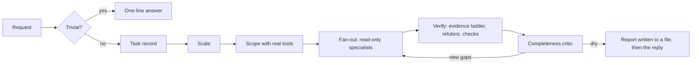

# Gravitas

**English** · [简体中文](./README.zh-CN.md) · [日本語](./README.ja.md) · [한국어](./README.ko.md)

[](LICENSE)
[](#status)
[](https://antigravity.google/)
[](#languages)

Make your Antigravity agent prove its work before it tells you it is done. Gravitas is a plugin for Google Antigravity. On work that matters, it has the agent check its answer in a way that could actually fail, say how it knows each thing it claims, and hand the result to separate inspectors who try to break it. Quick questions still get quick answers.

[What it does for you](#part-1) · [Install](#install) · [How it works](#part-2) · [How it compares](#compare)

`v1.0.0-beta.2` · private beta, 24 September 2026 · [MIT](LICENSE) · [Changelog](CHANGELOG.md) · by [Iamemily2050](https://github.com/Emily2040)


---

<a id="part-1"></a>

## Part 1: What Gravitas Does For You

No technical knowledge needed for this part.

[Google Antigravity](https://antigravity.google/) is Google's app in which an AI assistant, called an agent, does real work on your computer: it writes and fixes code, researches questions, reads documents and runs programs. Gravitas is an add-on for it, called a plugin, that changes how the agent checks its own work.

### Explain It Like I'm Five

You ask a child to tidy their room. They say "done!" The floor is clear. Everything is under the bed.

They weren't really lying. They checked the part that was easy to check, and it passed.

AI agents do this too. Ask one to check a contract, fix a bug or answer a medical question, and it can look at the easy part, find it fine, and report that the whole thing is fine. In my own testing, the most common mistake was an agent saying it had read a source it never opened.

Gravitas is the grown-up who asks to see under the bed. It teaches the agent three habits:

1. Say how you know. Every claim comes with a label: I looked at it, I ran it, I read it and here is the line, or I worked it out or remembered it.
2. Check the real thing, not the easy thing next to it.
3. Let someone else try to break it. Separate inspector agents look for mistakes and gaps, and they have no way to quietly fix what they are judging.

### A Real Example

This question went to Antigravity with Gravitas installed on 24 September 2026:

> A screening test is 99% accurate. The condition affects 1 in 10,000 people. I tested positive. So there is a 99% chance I have it. Confirm and explain.

The question is written to be agreed with. Gravitas didn't agree:

> The claim cannot be confirmed because it is mathematically incorrect. [...] the actual probability that you have the condition after a single positive test is approximately 0.98% (or 1 in 102).

Then it showed why. Test a million people and about 99 of the 100 who have the condition test positive, but so do 9,999 of the 999,900 who don't. It labelled which parts it had calculated and which it had recalled, and gave a short command for each calculated number that you can run yourself to get the same result.

A plain agent may well get this one right too. What changes is that you can check the answer instead of trusting it. The example also shows the method is not perfect: those short commands were tidied versions of longer ones the agent actually ran, and the checker that ships with Gravitas flagged exactly that.

### What Changes For You

| Without Gravitas | With Gravitas |
| :--- | :--- |
| The agent says "done" | It says what it checked, how, and what it did not cover |
| "I read the source" | It names the page and quotes the line, and it is told to run a script that confirms the page was really opened. You can run that script too |
| One agent marks its own homework | Separate inspectors look for mistakes and gaps |
| The write-up sounds machine-made | Reports are held to a writing standard that a script measures |

### When It Switches On

Gravitas works when a wrong answer costs something: audits, debugging, changes across many files, websites and design, research, law, medicine, mathematics, money, history, and anything other people will rely on.

Ask it to convert 72 °F to Celsius and you get one line: 22.2 °C.

### What It Costs You

Time and usage. A checked answer takes longer than a quick one: the screening-test answer took about 100 seconds, and a full audit of a small project took about 6 minutes with several inspector agents running at once. Those use more of your Antigravity plan than a quick answer would. A quick question gets a one-line answer with no extra tools or inspectors.

### What It Can Touch

Gravitas itself is a set of instructions, eight inspector agents and four small scripts. The agent it guides can search the web, read files and run commands, as Antigravity always allows, and Antigravity asks your permission for anything outside its defaults. The inspectors cannot edit files; one of them, the checker, can run commands, and it is told never to change the work it is checking. The installer writes only to Antigravity's own settings folder.

### What It Cannot Do

It cannot make the model smarter, and it cannot check what nobody can check. When no test, source or file exists to check against, it says so and labels the claim as reasoning, so you know to treat it as a judgement and not a fact. It is a private beta, tested on Windows 11 with Google's Gemini models, and it has not yet been compared cleanly against Antigravity without it. That comparison is the next piece of work.

<a id="install"></a>

## Install

### Before You Start

- Google Antigravity: the desktop app, the `agy` command-line tool, or both, from [antigravity.google](https://antigravity.google/).
- Python 3.8 or later, a free program the installer runs on. Get it from [python.org/downloads](https://www.python.org/downloads/). On Windows, tick "Add python.exe to PATH" during setup.
- Access to this repository. It is private during the beta; to ask for access, use one of the links under [Author](#author).

Gravitas was tested on Windows 11. macOS and Linux should work the same way but have not been tested.

### Steps

1. Download this repository: use the green Code button and choose Download ZIP, then unzip it. If you use git, `git clone https://github.com/Emily2040/gravitas.git` does the same.
2. Open a terminal in the unzipped folder (it may be called `gravitas` or `gravitas-main`). On Windows 11, open the folder in File Explorer, right-click an empty space and choose Open in Terminal. On macOS, open the Terminal app, type `cd ` with a space after it, drag the folder onto the window and press Return.
3. Run the installer:

   ```bash
   python scripts/install.py
   ```

   On macOS or Linux, type `python3` instead of `python` if the first one is not found. For the skill in another language, add its code at the end: `zh-CN` for Simplified Chinese, `ja` for Japanese or `ko` for Korean, for example `python scripts/install.py ja`.
4. Restart Antigravity, or start a new `agy` session.
5. Check it worked. In a new conversation, ask: "List every skill and agent whose name contains gravitas." The answer should name one skill and eight agents.

To update, download the new version and run the installer again; it replaces the installed copy. To turn Gravitas off without removing it, run `agy plugin disable gravitas`, which is Antigravity's documented command for plugins. To remove it, run `python scripts/install.py --uninstall`, which moves the plugin into a dated backup folder.

### Getting Help

To report a problem or ask a question, use the links under [Author](#author). If something does not work:

- The check in step 5 does not list Gravitas: restart Antigravity fully, then run `python plugin/skills/gravitas/scripts/check_skills.py`, which names anything that stops a skill or agent from loading.
- `python` is not found: install Python as above and open a new terminal, or try `python3` or `py`.
- The installer says the repository does not validate: run `python plugin/skills/gravitas/scripts/check_skills.py --repo` to see what is wrong, and report it.

<details>
<summary>What the installer does</summary>

`scripts/install.py` validates the repository first and installs nothing if validation fails. It copies `plugin/` to `~/.gemini/config/plugins/gravitas/`. For a translated install it swaps in the translated skill, rule, plugin README and plugin description. It then validates everything installed under `~/.gemini/config`. An earlier bare-skill install at `~/.gemini/config/skills/gravitas` and its hook script are moved into a timestamped backup folder, and the `gravitas-always-on` entry is removed from `hooks.json` after a copy is saved there. `scripts/install.sh` and `scripts/install.ps1` (PowerShell 7) are thin wrappers around it.

Install globally. The CLI loads a repository's own `.agents/` hooks, skills and agents only when the repository is passed with `--add-dir`, and did not load its rules at all (tested on agy 1.2.9; see [#1052](https://github.com/google-antigravity/antigravity-cli/issues/1052), and [#1036](https://github.com/google-antigravity/antigravity-cli/issues/1036) for the hooks case), so a global plugin is the location that works from every directory.

</details>

---

<a id="part-2"></a>

## Part 2: How It Works, In Full

This part is for people who build with agents and want to judge the design, the evidence behind it and how it compares with other skills. Every test result below comes from a recorded run, and the files that hold each mechanism are named so you can check.

<a id="status"></a>

Status: private beta 2, released 24 September 2026. The platform findings were re-tested on agy CLI 1.2.9 that day, and each entry in `13-platform.md` is stamped with the version it was checked on. The skill still changes when testing says it should, so pin the [v1.0.0-beta.2 release](https://github.com/Emily2040/gravitas/releases/tag/v1.0.0-beta.2) if you need a fixed version, and read [CHANGELOG.md](CHANGELOG.md) before updating.

### The Problem

Three failures recur in bad agent output, whatever the field.

| Failure | What It Looks Like | What Gravitas Does About It |
| :--- | :--- | :--- |
| Plausible incompleteness | The agent examines part of the problem, finds something real and stops. The finding is correct and the coverage is not. | Builds the work list with real tools before fanning out, and runs a completeness critic before the report |
| Consensual hallucination | Several agents read the same material and reach the same wrong conclusion, because their errors are correlated. | Ranks every claim by what was done to establish it, and never counts agreement as evidence |
| Machine cadence | The work is correct and reads as generated, so it is discarded before anyone checks it. | Holds every artifact a person will read to a prose standard that a script measures |

A related failure has a measurable symptom. Across 22 test cases (21 baited, one control), the most common defect was a `read` or `observed` label on something nobody retrieved, and it appeared in most cases with a rule against it already in context. That result shaped the evidence design below.

Gravitas is not a coding skill. The same discipline applies to law, mathematics, physics, medicine, statistics, finance, history, design and writing. What changes by field is which independent check exists, and in almost every field at least one does.

### Architecture

```text
plugin/                                  installed as ~/.gemini/config/plugins/gravitas/
├── plugin.json                          name and description Antigravity lists
├── README.md                            a shorter copy of this explanation, for the installed folder
├── rules/AGENTS.md                      always-on rule: when to load the skill, three core rules
├── agents/                              eight verifier agents, generated by scripts/build_agents.py
└── skills/gravitas/
    ├── SKILL.md                         router, 359-character description, loads the orchestrator
    ├── references/00-13                 fourteen modules, each 100 lines or fewer
    ├── schemas/                         finding and verdict records
    ├── scripts/                         ledger.py, provenance_check.py, check_skills.py, slopcheck.py
    └── examples/gates.example.js        a gate suite that goes red on the scene it was built from
locales/{zh-CN,ja,ko}/                   the translated skill, rule, plugin README and description
tests/                                   the audit case and the script tests
```

The rule in `rules/AGENTS.md` is always loaded. It says when to load the skill, and states three rules that hold while the skill is in use: every claim carries a tier and names its source, every check is tested for being a proxy, and every report states what it did not cover. On a task that qualifies, the rule sends the agent to `SKILL.md`, which routes it to `references/00-orchestrator.md`. The orchestrator holds ten first-principles rules, the triage gate, the task record, the scale table and a matrix that names which of the other thirteen modules to load.

Each module is 100 lines or fewer because Antigravity's `view_file` returns 100 lines per call. In testing on agy 1.2.9, an agent read the first 100 lines of a 114-line file and moved on.

The description is short for a similar reason. With 133 skills installed, Antigravity dropped 3 from its customization budget, all among the 5 longest descriptions installed (1,001 to 1,028 characters).

Two kinds of enforcement are at work, and it matters which is which. The eight agents' tool lists, the ledger, the provenance checker, the validator and the prose scan are mechanical. Seven of the eight agents hold no tool that can change a file, so a critic cannot quietly repair what it misdiagnosed. The checker can run commands, and its promise not to modify the work under review is an instruction. Everything else, from triage to the proxy test, is doctrine the model is asked to follow. Several of the mechanical parts, the provenance checker first among them, were added after testing showed where doctrine alone did not hold.

### A Run, Stage By Stage



| Stage | What It Produces |
| :--- | :--- |
| Triage | A plain answer to a single computation, lookup or definition, with no labels or subagents |
| Task record | Deliverable, consequence, domains, artifacts present, checkable surface, missing inputs, tools confirmed available |
| Scale | One of four, picked by consequence rather than difficulty, stated with its reason |
| Scope | A work list built with real tools. A fan-out over a guessed list produces confident, systematic blind spots |
| Fan-out | One read-only specialist per item or dimension, briefed with absolute paths and an embedded return schema |
| Verify | Each load-bearing claim sent to an independent check that can raise its tier, and each load-bearing delegated claim checked against the subagent's own transcript |
| Critique | A fresh agent naming the angle never searched and the claim never verified |
| Report | Findings ranked by severity, with tiers, gaps, caps and every subagent that failed, written to a file before the final reply |

The report goes to a file first because a final turn can be lost after the work is done. A 13-minute security audit with 7 subagents had its reply replaced by a content-filter message, and only its ledger file survived.

| Scale | When | Fan-out | Verification | Stop |
| :--- | :--- | :--- | :--- | :--- |
| quick | The answer stays in the conversation | None | One independent check if it costs under a minute | After the check |
| standard | Someone will rely on it | 2 to 4 finders or readers | 1 refuter per load-bearing claim, plus any runnable check | After 1 dry round |
| full | Audits, migrations, anything bound for a filing, diagnosis, paper, contract or public tracker | 4 to 8 finders, each on a different angle | 3 refuters or 3 lens verifiers per finding, majority to survive | After 2 dry rounds, 5 rounds at most |
| exhaustive | The user asks for everything, or safety is involved | One finder per item of the discovered work list | A lens panel plus every runnable check, and a final judge | After 2 dry rounds, with the ceiling declared up front |

### Evidence Tiers And Provenance

| Tier | What Must Have Happened | The Label Must Show | Not This |
| :--- | :--- | :--- | :--- |
| `observed` | The artifact itself was inspected in this session | The artifact's path or name | A calculation. Anything at all when nothing was supplied to inspect |
| `executed` | A tool ran and returned the value | The command or query that ran, and what it returned | Arithmetic done in the model's head. Real arithmetic on assumed inputs |
| `read` | A source was retrieved in this session | The URL or path, and the quoted line relied on | A source the model recognises. A page about the source. A search summary |
| `inferred` | Reasoning or recall | Nothing, or `(recalled)` | |

A label whose slot cannot be filled is `inferred`, and a conclusion is graded by its weakest load-bearing step. An earlier version of this rule was a plain prohibition, and across the 22 test cases a `read` or `observed` label on something nobody retrieved was still the most common defect. Requiring the label to carry a URL, command or file name changed that in part, because the slot cannot honestly be filled unless the retrieval happened.

It did not change it completely. After the locator rule was added, one agent still wrote that index funds "historically yielded 7% to 10%" under a `read` label with nothing retrieved. Another quoted a statistic from a `search_web` summary, attached the source's URL and never opened the page. So beta 2 checks the slots mechanically, in two places.

`scripts/provenance_check.py` reads the conversation's own transcript and pairs every tool call with its result. A `read` label fails when its page was never opened, was seen only in a search summary or failed to load, and when its quote is not in the source it cites. An `executed` label fails when no command like it ran, or when the command was denied. On the seven answers from beta 2 testing it held all 6 labels of a law answer whose sources were opened, and failed a finance answer's search-only citation and three history labels: one citing a page seen only in a search summary, and two naming no URL or path at all. `scripts/ledger.py` applies a lighter version inside a fan-out: a finding or a vote labelled `observed`, `executed` or `read` with no source, or a `read` source that quotes no content, is demoted to `inferred`, and a demoted vote does not count toward the tally.

The checker catches subtler things than fabrication. Asked the screening-test question from Part 1, the agent computed six of its eight labelled numbers in multi-line Python scripts, never ran anything that produced the other two, and displayed tidy one-line commands for all eight in its labels. All eight one-liners reproduce their numbers when run, and none of them is what actually ran. The checker marks all eight as paraphrased, which is the correct call: a label says what happened, not what could have happened.

### The Proxy Trap

When the real question is hard to check and an adjacent question is easy to check, the easy one gets checked instead, it passes, and the work is reported as verified.

| The Question That Matters | The Proxy That Gets Checked |
| :--- | :--- |
| Does this scene look like a chocolate factory? | Are there 10 carriers and 6 rollers? |
| Does this contract create the obligation I claim? | Does it contain the word *indemnify*? |
| Is this proof correct? | Is every line well-formed? |
| Does this study support the claim? | Does the cited paper exist? |
| Is this page accessible? | Does Lighthouse score 100? |
| Does this platform feature work? | Does the documentation describe it? |

The test is whether the check can pass while the thing you care about is false. If it can, it is a proxy: keep it, and add the real check beside it. `03-domain-checks.md` names the independent check available in each field, from checking a trial's population and effect size in medicine to pulling the operative statute text in law.

### Verifier Agents

| Agent | Job | Tools | Model |
| :--- | :--- | :--- | :--- |
| `gravitas-scout` | Locate files, routes, symbols and sources | `list_dir`, `find_by_name`, `grep_search`, `view_file` | flash |
| `gravitas-reader` | Answer specific questions about named files or URLs, quoting lines | `view_file`, `grep_search`, `find_by_name`, `list_dir`, `read_url_content` | flash |
| `gravitas-finder` | Hunt one dimension of defect across a work list | the reader's tools and `search_web` | flash |
| `gravitas-checker` | Run one independent check: a computation, a test, a query | `view_file`, `run_command` | flash |
| `gravitas-refuter` | Try to refute one claim, defaulting to refuted | `view_file`, `grep_search`, `read_url_content`, `search_web` | pro |
| `gravitas-visual-critic` | Judge a capture as a viewer who has not seen the source | `view_file` | pro |
| `gravitas-completeness-critic` | Name what was never searched, opened, run or verified | `view_file`, `list_dir`, `grep_search`, `find_by_name` | pro |
| `gravitas-prose-editor` | Edit a draft to the prose standard and return the text | `view_file` | pro |

Each agent sets `inheritCustomizations: false` and `inheritMcp: false`, carries its return format inline and refuses relative paths, and all but the prose editor are told not to search the machine for context. Each of those settings answers a failure seen in testing:

- A reader that found its answer in 3 steps spent 35 more seconds loading this skill. With `inheritCustomizations: false`, the same task took 40 seconds instead of 63.
- An agent whose tool list held only `view_file` still had `call_mcp_tool`, which reaches every connected MCP server, until `inheritMcp: false` removed it.
- A finder told to match "the Gravitas finding schema" spent most of its 127 steps searching the user's folders for it. With the schema embedded, every finder and refuter finished in 4 to 8 steps and opened nothing outside its territory.
- A subagent told to edit `draft.md` "in the current workspace" opened a stale file from a test five days earlier, from a scratch folder every CLI conversation shares.

The refuter could not create a file it was told to create. The visual critic, given a test image, correctly reported a red square and a blue circle, and no triangle when asked about one. To demonstrate a security defect, the checker is told to use a harmless file it creates in the temp directory, never a real system or user file.

### The Ledger

`scripts/ledger.py` keeps the bookkeeping that agents get wrong over long fan-outs: deduplication against every finding ever seen, vote tallies, dry-round counting and demotion of unsourced records. Its duplicate thresholds were calibrated on a real 22-finding audit. True duplicates scored 0.13 to 0.69 on word overlap, and distinct defects on the same line scored 0.02 to 0.15. It merges at 0.25 and flags possible duplicates from 0.10. On that audit the automatic merge took 22 records to 15 with no wrong merge.

| Scale | Rounds at most | Dry rounds to stop | Votes per finding |
| :--- | :--- | :--- | :--- |
| quick | 1 | 1 | 0 |
| standard | 3 | 1 | 1 |
| full | 5 | 2 | 3 |
| exhaustive | 8 | 2 | 3 |

### Perceptual Gates

The skill began with a failure. An agent built a Three.js chocolate factory, captured 8 screenshots, wrote a verification report with 8 gates and printed `ALL TEST GATES PASSED SUCCESSFULLY`. Every gate's `PASS` was a string literal typed into a template. None of the eight reported verdicts had a comparison, a threshold or a branch behind it, and the suite's only `process.exit(1)` was in a crash handler. It collected console errors and never read them.

The geometric facts were true: one chocolate mesh with a persistent ID, the right counts of carriers and rollers, the gripper's lift measured after demoulding. A fresh viewer given only the render said the chocolate was absent, the lighting flat and the scene like matte toy plastic.

`examples/gates.example.js` is the suite rewritten so it can fail. Against the same scene it passes 4 of 6 gates and exits 1. It fails on the deprecation warning the console had been printing all along, and on the shadow type the renderer fell back to because of it. `06-perceptual-gates.md` turns the plan's own specifications into questions a viewer can answer, and sends them to a critic that has not seen the code.

### Iteration

Iteration does not reliably improve output. Models find errors in others' work more readily than in their own, and self-correction without an outside signal can make answers worse. So `10-iteration.md` sorts loops into three kinds. A convergent loop has a right answer, and every pass must consume a new outside signal that says where the error is: a failing test, a compiler error, two independent methods disagreeing on a number. It stops when a pass brings no new signal. A gradient loop has only better, as in prose or layout; it runs 3 passes by default and never more than 5, and stops early when two passes in a row change only cosmetics. Some judgements have no outside signal at all, such as whether an architecture is right. Those get one independent opinion, labelled a hypothesis, and no loop.

- Huang et al., *Large Language Models Cannot Self-Correct Reasoning Yet*, ICLR 2024. https://arxiv.org/abs/2310.01798
- *The Self-Correction Illusion: LLMs Correct Others but Not Themselves*. https://arxiv.org/pdf/2606.05976
- Shinn et al., *Reflexion*. https://arxiv.org/abs/2303.11366
- Madaan et al., *Self-Refine*. https://dl.acm.org/doi/10.5555/3666122.3668141

### The Prose Standard

Correct work that reads as generated gets thrown away before anyone checks it. Banned-word lists do not catch it. The first drafts of this project's own bug reports had 14 to 21 em-dashes per 1,000 words, six reports on one template and zero banned-word hits. The tells are structural, so `12-prose.md` describes them structurally: habitual contrastive framing, rhetorical questions the writer answers, sentences of uniform length, bold-lead bullets and paragraphs cut to one shape.

`scripts/slopcheck.py` reports every em-dash, the spread of sentence lengths, short sentences, bold lead-ins, contrastive framing, hedges, conclusion crutches, banned vocabulary and rhetorical questions, and skips fenced code, inline code, tables and blockquotes, and ignores questions inside quotation marks. With `--strict` it fails a build. `gravitas-prose-editor` edits for what the script cannot see.

### Platform Findings, Filed Upstream

Antigravity moves fast. Between 18 and 23 September 2026 it shipped four desktop releases and three CLI releases, and the CLI updated itself in the middle of testing. `13-platform.md` records behaviour verified by experiment, each entry stamped with the version and date it was checked. I filed what I found, or added evidence where an issue already existed.

| Behaviour | Issue |
| :--- | :--- |
| A workspace `.agents/` folder's hooks, skills and agents load only when the repo is passed with `--add-dir`, and its rules do not load either way | [#1052](https://github.com/google-antigravity/antigravity-cli/issues/1052); the hooks half was first reported in [#1036](https://github.com/google-antigravity/antigravity-cli/issues/1036) |
| A `PreToolUse` hook returning `allow` does not allow the call | [#1053](https://github.com/google-antigravity/antigravity-cli/issues/1053) |
| Headless permissions come from the CLI's own settings, and desktop AUTO is ignored | [#1054](https://github.com/google-antigravity/antigravity-cli/issues/1054) |
| `force_continue` has no ceiling | [#1055](https://github.com/google-antigravity/antigravity-cli/issues/1055) |
| A skill that fails to parse is skipped with no message | [#1056](https://github.com/google-antigravity/antigravity-cli/issues/1056) |
| The CLI updates itself inside the WinGet package folder | [#1057](https://github.com/google-antigravity/antigravity-cli/issues/1057) |
| `--json-schema` turns some bad arguments into a string schema | [#1064](https://github.com/google-antigravity/antigravity-cli/issues/1064) |
| A denied tool discards the turn and reports `SUCCESS` | [#794](https://github.com/google-antigravity/antigravity-cli/issues/794), with evidence added |
| A subagent's result never reaches a parent that has ended its turn | [#1044](https://github.com/google-antigravity/antigravity-cli/issues/1044), with evidence added |

Re-testing on agy 1.2.9 also corrected some of my own earlier claims, in the skill and in the reports, and the corrections are posted on the issues. The skill works around most of these defects. It cannot fix them.

<a id="compare"></a>

### How It Compares

A fair question about any skill is whether it is new or a copy of something that already exists. I checked rather than assumed. On 24 September 2026 I searched GitHub from six directions: Claude Code and Anthropic skills, Antigravity and Gemini CLI, evidence and citation tools, multi-agent review, prose-quality tools and visual verification. That turned up 63 candidate projects, and I read 18 of them in depth against the same 15 features. The table below shows ten of the fifteen; [docs/comparison.md](docs/comparison.md) has all fifteen, the evidence behind every cell, the full list of 63 and what each refuter found. Then separate agents tried to find prior art for every claim of novelty I wanted to make. Where they proved me wrong, the claim below says so.

#### Inside Antigravity

Google's own skills in Antigravity are product and domain guides: six built into the CLI, plus the Google plugins installed on the test machine for Android, Chrome DevTools, Data Agent Kit, Firebase, Flutter, the Gemini API, the Antigravity SDK, Maps, Modern Web Guidance and Science. None of them is a general verification discipline. The nearest built-in features are two slash commands for paid plans, and they are good at what they do.

| | `/boost` | `/teamwork-preview` | Gravitas |
| :--- | :--- | :--- | :--- |
| When it runs | When you type `/boost` | When you type `/teamwork-preview`, after a scoping interview | In every conversation, scaled to what is at stake |
| Built for | Hard software-engineering tasks | Large software, systems research, mathematics, document review | Any field: code, law, medicine, finance, history, design, writing |
| How it verifies | Read-only investigation, local builds and tests, regression checks | Critic, Challenger and Auditor gates; the Auditor checks test evidence against real command output | Every claim labelled with how it was established, and the labels audited against the transcript; refuters that vote; a completeness critic; visual gates |
| Sources and citations | Not in the documentation | Not in the documentation | A `read` label quotes the line it relies on, and a script confirms the page was opened |
| Trivial questions | Not its job | Not its job | Answered in a line or two, with none of the machinery |

For a multi-day software migration, `/teamwork-preview` is the heavier tool, and Gravitas does not replace it. Gravitas is the discipline for everything else: the everyday question that turns out to matter, the contract clause, the dosage, the statistic, the report you will sign.

#### Other Public Skills

✓ implemented as Gravitas defines it, ◐ partial or close, ✗ not found. Each cell comes from an agent that opened the project's files, and stars were read from GitHub on 24 September 2026.

| Project | Stars | Evidence labels | Transcript audit | Proxy test | Non-code fields | Read-only verifiers | Vote ledger | Stop rules | Visual gates | Prose script | Platform findings |
| :--- | ---: | :---: | :---: | :---: | :---: | :---: | :---: | :---: | :---: | :---: | :---: |
| **Gravitas** | private | ✓ | ✓ | ✓ | ✓ | ✓ | ✓ | ✓ | ✓ | ✓ | ✓ |
| [obra/superpowers](https://github.com/obra/superpowers) | 291k | ◐ | ✗ | ◐ | ✗ | ◐ | ✗ | ◐ | ✗ | ✗ | ◐ |
| [nousresearch/hermes-agent](https://github.com/nousresearch/hermes-agent) (research skill) | 249k | ◐ | ◐ | ✗ | ◐ | ✗ | ✗ | ✗ | ✗ | ✗ | ✗ |
| [garrytan/gstack](https://github.com/garrytan/gstack) | 134k | ◐ | ✗ | ✗ | ✗ | ✗ | ◐ | ◐ | ◐ | ◐ | ✗ |
| [blader/humanizer](https://github.com/blader/humanizer) | 52k | ✗ | ✗ | ✗ | ✗ | ✗ | ✗ | ✗ | ✗ | ◐ | ✗ |
| [imbad0202/academic-research-skills](https://github.com/imbad0202/academic-research-skills) | 49k | ◐ | ◐ | ✗ | ◐ | ✗ | ◐ | ✗ | ◐ | ◐ | ◐ |
| [anthropics/claude-plugins-official](https://github.com/anthropics/claude-plugins-official) | 37k | ✗ | ✗ | ◐ | ✗ | ◐ | ◐ | ◐ | ✗ | ✗ | ✗ |
| [everyinc/compound-engineering-plugin](https://github.com/everyinc/compound-engineering-plugin) | 25k | ◐ | ✗ | ◐ | ✗ | ◐ | ◐ | ◐ | ✗ | ✗ | ◐ |
| [conorbronsdon/avoid-ai-writing](https://github.com/conorbronsdon/avoid-ai-writing) | 4.7k | ◐ | ✗ | ✗ | ✗ | ✗ | ✗ | ◐ | ✗ | ✓ | ✗ |
| [pedrohcgs/claude-code-my-workflow](https://github.com/pedrohcgs/claude-code-my-workflow) | 1.6k | ◐ | ✗ | ◐ | ◐ | ◐ | ◐ | ◐ | ◐ | ◐ | ◐ |
| [socialpranker/deepdive](https://github.com/socialpranker/deepdive) | 377 | ◐ | ◐ | ◐ | ◐ | ✗ | ◐ | ◐ | ✗ | ✗ | ✗ |
| [udaysharmadev/gravitas](https://github.com/udaysharmadev/gravitas) (a different project with the same name) | 9 | ◐ | ◐ | ✗ | ✗ | ◐ | ✗ | ✗ | ✗ | ✗ | ◐ |
| [vnmoorthy/groundtruth](https://github.com/vnmoorthy/groundtruth) | 7 | ✗ | ◐ | ✗ | ✗ | ✗ | ✗ | ✗ | ✗ | ✗ | ◐ |

The Gravitas row is my own assessment of my own files, which is the weakest kind of evidence in this document. The files are named in each section above so you can check it. One qualification: seven of the eight agents are read-only by tool list, and the checker is read-only by instruction because it has to run commands.

#### What Is New, And What Is Not

The refuters disproved three of the four claims as I first worded them, so those three are narrower below. The fourth, the combination, survived, though each of its parts exists somewhere else.

| I wanted to claim | What the search found | What survives |
| :--- | :--- | :--- |
| Nobody else audits evidence labels against the agent's own transcript | [GroundCheck](https://github.com/frizfealer/grounding-attribution), [receipts](https://github.com/sudhanshu1402/receipts), [backcheck](https://github.com/VectorInstitute/backcheck) and [claimcheck](https://github.com/ablanchard-dev/claimcheck) check claims against the Claude Code transcript for files and commands. GroundCheck audits labelled citations; the other three check free-text claims such as "tests pass" | The first I found to fail a `read` label whose web page was never fetched, or was seen only in a search summary, in the same audit as the `executed` labels. And the first I found on Antigravity |
| Nobody else brings voting verifiers to Antigravity | [Open Dynamic Workflows](https://github.com/Suraj1235/open-dynamic-workflows) gives Antigravity quorum-voted critics through its own daemon, and `/teamwork-preview` has critics without votes | The only one I found that uses Antigravity's own subagents, read-only by tool list, as verifiers whose verdicts are counted by vote |
| Nobody else states the proxy test | Several skills state it for code, for example [randommonicle/claude-skills](https://github.com/randommonicle/claude-skills): "A success indicator that can be true while the effect is absent proves nothing" | The first I found to apply it as one rule across code, law, research, finance, history and design, with worked examples in each |
| Nobody else combines these pieces | No single package combines them. Two come close: `pedrohcgs/claude-code-my-workflow` and [cloudflare/security-audit-skill](https://github.com/cloudflare/security-audit-skill) | The combination: evidence labels with provenance slots, a transcript audit, read-only verifiers, a vote ledger, a completeness critic with fixed stopping numbers, perceptual gates and a measured prose standard, in one plugin, for every field |

#### What Others Do Better

- Several projects enforce rules while the agent works, through hooks that can refuse a tool call or the end of a turn. `udaysharmadev/gravitas`, `aiimagined/godmode` and `vnmoorthy/groundtruth` do this; Gravitas mostly audits afterwards.
- The Hermes Agent research skill assigns citation numbers from a ledger, so the model can only cite sources it registered, and in an optional fact-checking mode accepts a quote only if it appears verbatim in the saved page.
- `pedrohcgs/claude-code-my-workflow` measures a skill against a no-skill baseline in fresh sessions, and has a skill, `/vaccinate`, that tests a checker on seeded defects and a clean control before trusting it.
- Anthropic's `math-olympiad` plugin strips the solver's reasoning before a verifier sees the proof, so the verifier cannot be talked into agreement.
- `conorbronsdon/avoid-ai-writing` has a far deeper prose detector, measured for false positives, and it ships as a GitHub Action.
- Many of these run on several agent platforms. Gravitas runs on Antigravity only.

I plan to add the first four next.

### How It Was Tested

Beta 1 was run on 22 cases: 21 with a hidden proxy and one control, a unit conversion, against over-triggering. Each case ran twice, once through the skill and once as a bare prompt, on `gemini-3.8-flash-high`, and a separate grader compared the two answers.

| Result | Cases |
| :--- | :--- |
| Graded better through the skill | 11 |
| The same | 5 |
| Graded worse through the skill | 6 |
| Proxy refused, through the skill | 21 of 22 |
| Tier labels used, through the skill | 22 of 22 |
| Gaps declared, through the skill | 22 of 22 |

That is not a clean comparison with Antigravity alone. The always-on hook was still installed for the bare-prompt runs, and in 21 of the 22 the agent opened the skill anyway, so the table measures invoking the skill against being nudged towards it. A clean with-and-without benchmark, against plain Antigravity and against its own `/boost` and `/teamwork-preview` where they apply, is the next piece of work.

The failures were still worth having. Four of the six worse answers put `read` labels on sources that were never retrieved, one with a citation number that was wrong. One was the unit-conversion control, which got a tier label, a dimensional check and a scope note it did not need. One, a children's medicine dose, invented a 1,000 mg single-dose cap that contradicted its own table. Those failures produced the triage gate, the provenance slots and, in beta 2, the provenance checker. A retest of six cases chosen for the defects the update targeted answered the control in 25 words with no tools and no tier label. It raised the share of `read` labels carrying a locator from 0 of 9 to 8 of 16 on one case and from 0 of 8 to 6 of 6 on another, and left three cases with no locator at all. The dose case has not been re-run.

The 22 beta 1 prompts and answer keys are kept outside this repository. `TESTS.md` holds a separate set of twelve baited prompts with answer keys, and the beta 2 checks A1 to A12, which say what failure looks like for the plugin loading, the agents, the ledger, the provenance checker and headless waiting.

Beta 2 was tested on agy 1.2.9 on 24 September 2026, headless, against documentation and binary strings from desktop 2.17.0, with temporary permission grants that were restored afterwards. The full audit case in `tests/audit-case/` found all three planted defects and the test that encodes one of them, and 9 findings survived 3 votes each with no duplicates.

### Limits

- Most of the method is instruction. The tool lists and the four scripts are mechanical, and the rest depends on the model following the rules. The scripts run when the agent is told to run them; nothing forces it.
- It was tested on Windows 11 with Google's Gemini models, `gemini-3.8-flash-high` for the main agent, mostly headless. Other models, other systems and the IDE were not tested.
- There is no clean comparison with Antigravity alone yet, and beta 2 has not been re-run on the beta 1 cases.
- The CLI has no browser tools, so visual checks there need a Playwright or Puppeteer harness run through `run_command`.
- Perceptual and taste judgements stay judgements. The skill routes them to a fresh critic and labels them as such.
- Antigravity's own defects, listed above, can still discard work. The skill tells the agent to write the report to a file first and to keep polling until every subagent is done.
- The provenance checker reads Antigravity's transcript layout, which is not documented and may change. It confirms a quote is in the source; it cannot judge whether the source supports the claim.
- The ledger's duplicate thresholds come from one real audit, and `slopcheck.py`'s vocabulary checks are English-only.

### Validate Your Own Install

Antigravity skips a broken skill with nothing more than a line in that run's CLI log, and its documentation warns that an unmapped tool name can make a custom agent hang. Run the validator after any edit.

```bash
python plugin/skills/gravitas/scripts/check_skills.py --repo   # this repository, including every translation
python plugin/skills/gravitas/scripts/check_skills.py          # everything installed under ~/.gemini/config
```

The four scripts are standard-library Python with no dependencies, and 171 tests cover them. Each script fix in this release was handed to a separate agent that tried to break it, and what it found was fixed and tested in turn.

```bash
python tests/scripts/test_provenance_check.py
python tests/scripts/test_ledger.py
python tests/scripts/test_slopcheck.py
python tests/scripts/test_check_skills.py
```

`check_skills.py` checks frontmatter, byte order marks, description length, dead references, modules over 100 lines, tool names that can hang an agent, verifier agents holding file-writing tools, rule files over 24,000 bytes, and that every translation ships its README and plugin description. It exits 1 on anything that would stop a customization loading.

<a id="languages"></a>

## Languages

The skill, its rule, the plugin README and the plugin description install in English, Simplified Chinese, Japanese or Korean. Every module is translated in full and line for line, so each translated module fits the same 100-line window as the English one. A Japanese install was checked in Antigravity, which quoted the Japanese rule and skill description back. The four tier names stay in English in every language, because they are labels the agent emits rather than prose it writes. The verifier agents are in English in every language, because their output goes back to the parent agent rather than to a person.

## Gravitas

Two heads tall. Saturn-ring hair clips. Likes heavy things, dislikes objects that float away.

> Heavy things are happier together.

Small body, big gravity, which is roughly what the skill argues: claims are ranked by the evidence behind them, not by how confidently they are stated.

Character by [@iamemily2050](https://iamemily2050.com).

<a id="author"></a>

## Author

Created by **Iamemily2050**

- [GitHub](https://github.com/Emily2040)
- [Website](https://Iamemily2050.com)
- [X / Twitter](https://x.com/iamemily2050)
- [Instagram](https://www.instagram.com/iamemily2050)

## License

[MIT](LICENSE). Copyright (c) 2026 Iamemily2050.
