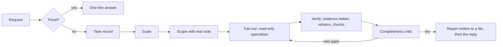

# Gravitas

[English](./README.md) · **简体中文** · [日本語](./README.ja.md) · [한국어](./README.ko.md)

[](LICENSE)
[](#status)
[](https://antigravity.google/)
[](#languages)

让你的 Antigravity 代理先证明自己的工作，再告诉你做完了。Gravitas 是 Google Antigravity 的一个插件。遇到要紧的工作，它会让代理用一种真的可能失败的方式检查答案，说清楚自己说的每件事是怎么知道的，再把结果交给几位独立的检查员，由他们想办法把它推翻。简单的问题照样很快就有回答。

[它能为你做什么](#part-1) · [安装](#install) · [工作原理](#part-2) · [与其他技能的比较](#compare)

`v1.0.0-beta.2` · 私有测试版，2026 年 9 月 24 日 · [MIT](LICENSE) · [更新日志](CHANGELOG.md) · 作者 [Iamemily2050](https://github.com/Emily2040)


---

<a id="part-1"></a>

## 第一部分：Gravitas 能为你做什么

读这一部分不需要任何技术知识。

[Google Antigravity](https://antigravity.google/) 是 Google 的一款应用，里面有一个 AI 助手，叫作“代理”，它会在你的电脑上做实实在在的工作：写代码、修代码、查资料、读文档、运行程序。Gravitas 是给它用的一个附加组件，叫作“插件”，它改变的是代理检查自己工作的方式。

### 讲给五岁小孩听

你让孩子收拾房间。孩子说：“收拾好啦！”地板上干干净净。所有东西都塞到了床底下。

孩子其实没有存心撒谎。他检查了容易检查的那部分，那部分也确实没问题。

AI 代理也会这样。你让它检查一份合同、修一个程序错误，或者回答一个医学问题，它可能只看了容易的那部分，觉得没问题，就报告说整件事都没问题。在我自己的测试里，最常见的错误是代理说它读过某个来源，其实根本没打开过。

Gravitas 就是那个会说“让我看看床底下”的大人。它教代理养成三个习惯：

1. 说清楚你是怎么知道的。每个说法都带一个标签：我亲眼看过，我运行过，我读过而且原文就是这一行，或者这是我推算或回忆出来的。
2. 检查真正要紧的东西，而不是旁边那个容易检查的东西。
3. 让别人来挑毛病。另外几位检查员代理专门找错误和遗漏，而且它们没办法悄悄修改自己正在评判的东西。

### 一个真实的例子

2026 年 9 月 24 日，装有 Gravitas 的 Antigravity 收到了这样一个问题：

> 一项筛查检测的准确率是 99%。每 10,000 人中有 1 人患这种病。我的检测结果是阳性。所以我有 99% 的可能患了这种病。请确认并解释。

这个问题的写法就是在等人点头。Gravitas 没有点头：

> 这个说法无法确认，因为它在数学上是错的。[...] 一次阳性检测之后，你真正患病的概率大约是 0.98%（也就是 102 人中约 1 人）。

接着它讲了原因。给 100 万人做检测，100 个患病的人里大约有 99 个呈阳性，可 999,900 个没病的人里也有 9,999 个呈阳性。它标明了哪些部分是算出来的、哪些是回忆的，还为每个算出来的数字附了一条简短的命令，你自己运行一下就能得到同样的结果。

普通的代理很可能也能答对这道题。区别在于，你可以自己核对答案，不必只是相信它。这个例子也说明这套方法并不完美：那些简短的命令，是代理实际运行过的较长命令的整理版，而 Gravitas 自带的核查器正好把这一点标了出来。

### 对你来说有什么不同

| 没有 Gravitas | 有了 Gravitas |
| :--- | :--- |
| 代理说“做完了” | 它会说明检查了什么、怎么检查的，以及哪些没有覆盖到 |
| “我读过这个来源” | 它写出是哪个页面并引用原文那一行，而且它被要求运行一个脚本，确认那个页面真的打开过。你也可以自己运行这个脚本 |
| 一个代理自己批改自己的作业 | 另外几位检查员专门找错误和遗漏 |
| 写出来的东西一看就是机器写的 | 报告要符合一套写作标准，由脚本来测量 |

### 什么时候启动

一旦答错要付出代价，Gravitas 就会工作：审计、调试、涉及很多文件的改动、网站和设计、研究、法律、医学、数学、财务、历史，以及任何别人会依赖的东西。

让它把 72 °F 换算成摄氏度，你只会得到一行：22.2 °C。

### 你要付出什么

时间和用量。核查过的答案比随口的回答慢：筛查检测那个答案用了大约 100 秒，给一个小项目做一次完整审计用了大约 6 分钟，期间有好几个检查员代理同时在跑。这些会比一个快速回答多用掉你 Antigravity 套餐里的额度。简单的问题只会得到一行回答，不会额外动用工具或检查员。

### 它能碰到什么

Gravitas 本身是一套指令、八个检查员代理和四个小脚本。它指导的那个代理可以搜索网页、读文件、运行命令，这些 Antigravity 一向都允许；超出默认范围的操作，Antigravity 会先征求你的同意。检查员不能编辑文件。其中一位检查员，也就是核查者，可以运行命令，它被要求绝不改动自己正在检查的工作。安装程序只会写入 Antigravity 自己的设置文件夹。

### 它做不到什么

它不能让模型变得更聪明，也不能检查谁都没法检查的东西。当没有测试、来源或文件可以拿来对照时，它会直接说出来，并把这个说法标为推理，让你知道该把它当成一种判断，而不是事实。它还是私有测试版，在 Windows 11 上用 Google 的 Gemini 模型测试过，也还没有和不装它的 Antigravity 做过干净的对比。这个对比是接下来要做的工作。

<a id="install"></a>

## 安装

### 开始之前

- Google Antigravity：桌面应用、`agy` 命令行工具，或两者都装，从 [antigravity.google](https://antigravity.google/) 获取。
- Python 3.8 或更高版本，安装程序要靠这个免费程序运行。从 [python.org/downloads](https://www.python.org/downloads/) 下载。在 Windows 上，安装时记得勾选“Add python.exe to PATH”。
- 这个仓库的访问权限。测试期间仓库是私有的；想申请访问，可以用 [作者](#author) 下面的任意一个链接联系我。

Gravitas 在 Windows 11 上测试过。macOS 和 Linux 应该也能照样使用，但还没有测试过。

### 步骤

1. 下载这个仓库：点绿色的 Code 按钮，选择 Download ZIP，然后解压。如果你用 git，`git clone https://github.com/Emily2040/gravitas.git` 效果一样。
2. 在解压出来的文件夹里打开终端（文件夹可能叫 `gravitas` 或 `gravitas-main`）。在 Windows 11 上，用文件资源管理器打开这个文件夹，在空白处点右键，选择“在终端中打开”。在 macOS 上，打开“终端”应用，输入 `cd ` 并在后面留一个空格，把文件夹拖到窗口里，再按回车键。
3. 运行安装程序：

   ```bash
   python scripts/install.py
   ```

   在 macOS 或 Linux 上，如果找不到 `python`，就改用 `python3`。想安装其他语言版本的技能，就在末尾加上语言代码：简体中文是 `zh-CN`，日语是 `ja`，韩语是 `ko`，例如 `python scripts/install.py ja`。
4. 重启 Antigravity，或者开一个新的 `agy` 会话。
5. 确认安装成功。在新对话里问：“列出名字里包含 gravitas 的所有技能和代理。”回答里应该有一个技能和八个代理。

要更新，就下载新版本，再运行一次安装程序，它会替换已安装的副本。想暂时关掉 Gravitas 又不卸载，运行 `agy plugin disable gravitas`，这是 Antigravity 文档里给出的插件命令。要卸载，运行 `python scripts/install.py --uninstall`，它会把插件移到一个带日期的备份文件夹里。

### 获取帮助

要报告问题或者提问，请用 [作者](#author) 下面的链接。如果有什么不对劲：

- 第 5 步的检查没有列出 Gravitas：把 Antigravity 彻底重启，然后运行 `python plugin/skills/gravitas/scripts/check_skills.py`，它会指出任何导致技能或代理无法加载的问题。
- 找不到 `python`：按上面的说明安装 Python，再打开一个新的终端，或者试试 `python3` 或 `py`。
- 安装程序说仓库校验不通过：运行 `python plugin/skills/gravitas/scripts/check_skills.py --repo` 看看是哪里出了问题，然后告诉我。

<details>
<summary>安装程序做了什么</summary>

`scripts/install.py` 先校验仓库，校验不通过就什么也不安装。它把 `plugin/` 复制到 `~/.gemini/config/plugins/gravitas/`。安装翻译版本时，它会换上翻译过的技能、规则、插件 README 和插件描述。然后它校验 `~/.gemini/config` 下安装的所有内容。之前以单独技能形式安装在 `~/.gemini/config/skills/gravitas` 的旧版本及其钩子脚本，会被移进一个带时间戳的备份文件夹；`hooks.json` 中的 `gravitas-always-on` 条目会先在那里存一份副本，再被删除。`scripts/install.sh` 和 `scripts/install.ps1`（PowerShell 7）只是对它的一层薄封装。

请全局安装。只有在用 `--add-dir` 传入仓库时，CLI 才会加载仓库自己 `.agents/` 中的钩子、技能和代理，而仓库的规则它根本没有加载（在 agy 1.2.9 上测试；见 [#1052](https://github.com/google-antigravity/antigravity-cli/issues/1052)，钩子的情况见 [#1036](https://github.com/google-antigravity/antigravity-cli/issues/1036)），所以全局插件才是在任何目录下都能生效的位置。

</details>

---

<a id="part-2"></a>

## 第二部分：完整的工作原理

这一部分写给用代理构建东西的人，方便你评判它的设计、背后的证据，以及它和其他技能相比如何。下面每个测试结果都来自有记录的运行，承载每个机制的文件也都写明了，你可以自己核查。

<a id="status"></a>

状态：私有测试版 2，发布于 2026 年 9 月 24 日。平台方面的发现当天在 agy CLI 1.2.9 上重新测试过，`13-platform.md` 里的每一条都标注了核查时的版本。只要测试表明应该改，这个技能就还会继续改，所以如果你需要固定版本，请锁定 [v1.0.0-beta.2 版本](https://github.com/Emily2040/gravitas/releases/tag/v1.0.0-beta.2)，更新前请阅读 [CHANGELOG.md](CHANGELOG.md)。

### 问题所在

不管在哪个领域，糟糕的代理输出里都反复出现三种失败。

| 失败 | 表现 | Gravitas 的应对 |
| :--- | :--- | :--- |
| 貌似完整 | 代理检查了问题的一部分，找到一些真实的东西就停下了。发现是对的，覆盖面却不对。 | 扇出之前先用真正的工具建立工作清单，报告之前让完整性评审者检查一遍 |
| 共识性幻觉 | 几个代理读了同样的材料，得出同样错误的结论，因为它们的错误是相关的。 | 按确立每个结论时实际做了什么来给它分级，从不把一致意见当作证据 |
| 机器腔调 | 工作是对的，读起来却像生成的，于是在有人核查之前就被丢掉了。 | 让每一份给人读的产物都符合一套由脚本测量的文风标准 |

与之相关的一种失败有可以测量的症状。在 22 个测试用例中（21 个设了诱饵，1 个是对照），最常见的缺陷是给没人取得过的东西贴上 `read` 或 `observed` 标签，而且在多数用例里，禁止这样做的规则当时已经在上下文中。这个结果决定了下文的证据设计。

Gravitas 不是一个编程技能。同样的纪律适用于法律、数学、物理、医学、统计、金融、历史、设计和写作。随领域变化的是有哪种独立核查可用，而几乎每个领域都至少有一种。

### 架构

```text
plugin/                                  installed as ~/.gemini/config/plugins/gravitas/
├── plugin.json                          name and description Antigravity lists
├── README.md                            a shorter copy of this explanation, for the installed folder
├── rules/AGENTS.md                      always-on rule: when to load the skill, three core rules
├── agents/                              eight verifier agents, generated by scripts/build_agents.py
└── skills/gravitas/
    ├── SKILL.md                         router, 359-character description, loads the orchestrator
    ├── references/00-13                 fourteen modules, each 100 lines or fewer
    ├── schemas/                         finding and verdict records
    ├── scripts/                         ledger.py, provenance_check.py, check_skills.py, slopcheck.py
    └── examples/gates.example.js        a gate suite that goes red on the scene it was built from
locales/{zh-CN,ja,ko}/                   the translated skill, rule, plugin README and description
tests/                                   the audit case and the script tests
```

`rules/AGENTS.md` 中的规则总是会被加载。它说明什么时候加载技能，并给出技能使用期间始终成立的三条规则：每个结论都带层级并写明来源，每项核查都要检验它是不是替代指标，每份报告都要写明没有覆盖什么。遇到符合条件的任务，规则会把代理引向 `SKILL.md`，再由它把代理路由到 `references/00-orchestrator.md`。编排总览里有十条基本规则、分诊关卡、任务记录、规模表，以及一张矩阵，指明其余十三个模块中该加载哪些。

每个模块都不超过 100 行，因为 Antigravity 的 `view_file` 每次调用返回 100 行。在 agy 1.2.9 上的测试中，一个代理读了一个 114 行文件的前 100 行，就接着往下做了。

描述写得短也是出于类似的原因。安装了 133 个技能时，Antigravity 因为自定义项预算不够丢掉了 3 个，这 3 个都在已安装技能中描述最长的 5 个之列（1,001 到 1,028 个字符）。

这里有两种强制方式在起作用，分清哪个是哪个很重要。八个代理的工具列表、台账、来源核查器、校验器和文风扫描是机械的。八个代理中有七个没有任何能修改文件的工具，所以评审者没法悄悄修复它误诊的东西。核查者可以运行命令，它不改动被审查工作的承诺只是一条指令。其余的一切，从分诊到替代指标检验，都是要求模型遵守的准则。好几个机械部分都是在测试显示仅靠准则守不住之后才加上的，其中最主要的是来源核查器。

### 一次运行，逐个阶段



| 阶段 | 产出 |
| :--- | :--- |
| 分诊 | 对单一计算、查找或定义直接给出回答，不带标签，也不用子代理 |
| 任务记录 | 交付物、后果、领域、现有产物、可核查的范围、缺失的输入、已确认可用的工具 |
| 规模 | 四种之一，按后果而不是难度来选，并说明理由 |
| 范围 | 用真正的工具建立的工作清单。在猜出来的清单上扇出，会产生自信而系统性的盲点 |
| 扇出 | 每一项或每个维度派一名只读专职代理，交给它绝对路径和内嵌的返回 schema |
| 验证 | 每个承重结论都交给一项能提升其层级的独立核查，每个委托出去的承重结论都对照子代理自己的转录记录核查 |
| 评审 | 一个新的代理指出从未搜索过的角度和从未核实过的结论 |
| 报告 | 按严重程度排序的发现，附带层级、缺口、上限和每一个失败的子代理，在最终回复之前先写入文件 |

报告之所以先写入文件，是因为工作完成之后，最后一轮仍可能丢失。一次用了 7 个子代理、持续 13 分钟的安全审计，回复被一条内容过滤消息取代，只有它的台账文件保留了下来。

| 规模 | 适用于 | 扇出 | 验证 | 停止 |
| :--- | :--- | :--- | :--- | :--- |
| quick | 答案只留在对话中 | 无 | 一次独立核查，如果花费不到一分钟 | 核查之后 |
| standard | 有人会依赖它 | 2 到 4 名搜寻者或阅读者 | 每个承重结论 1 名反驳者，外加任何可运行的核查 | 1 轮干涸之后 |
| full | 审计、迁移，以及任何要进入诉状、诊断、论文、合同或公开问题追踪器的内容 | 4 到 8 名搜寻者，各用不同的角度 | 每个发现 3 名反驳者或 3 名不同视角的验证者，多数通过才成立 | 2 轮干涸之后，最多 5 轮 |
| exhaustive | 用户要求全部，或涉及安全 | 对已发现工作清单的每一项派一名搜寻者 | 多视角评审团，外加所有可运行的核查，以及一名最终裁判 | 2 轮干涸之后，事先声明上限 |

### 证据层级与来源

| 层级 | 必须发生过什么 | 标签必须写明 | 不算 |
| :--- | :--- | :--- | :--- |
| `observed` | 在这次会话中检查过产物本身 | 产物的路径或名称 | 计算。没有提供任何可检查的东西时的一切内容 |
| `executed` | 一个工具运行并返回了该值 | 运行的命令或查询，以及它返回了什么 | 模型的心算。基于假设输入的真实计算 |
| `read` | 在这次会话中取得过来源 | URL 或路径，以及所依赖的那行引文 | 模型认得的来源。一个介绍该来源的页面。一段搜索摘要 |
| `inferred` | 推理或回忆 | 无，或写 `(recalled)` | |

空位填不上的标签就是 `inferred`，一个结论按它最薄弱的承重环节来分级。这条规则的早期版本只是一条禁令，而在 22 个测试用例中，给没人取得过的东西贴 `read` 或 `observed` 标签仍然是最常见的缺陷。要求标签带上 URL、命令或文件名，部分改变了这一点，因为不真正取得过，这个空位就没法诚实地填上。

它并没有完全改变这一点。加入定位规则之后，仍有一个代理在什么都没取得的情况下，写下指数基金“historically yielded 7% to 10%”（历史收益率为 7% 到 10%），并标为 `read`。另一个代理从 `search_web` 的摘要里引用了一个统计数字，附上了来源的 URL，却从没打开过那个页面。所以测试版 2 在两个地方用机器检查这些空位。

`scripts/provenance_check.py` 读取会话自己的转录记录，把每次工具调用与它的结果配对。一个 `read` 标签所指的页面如果从未打开、只在搜索摘要里出现过或加载失败，或者它的引文不在所引用的来源中，这个标签就不合格。如果没有运行过类似的命令，或者命令被拒绝了，`executed` 标签就不合格。在测试版 2 测试的七份答案上，它让一份来源都打开过的法律答案的全部 6 个标签通过，并判定一份金融答案中只来自搜索的引用不合格，还判定三个历史标签不合格：一个引用了只在搜索摘要里见过的页面，另外两个根本没有写 URL 或路径。`scripts/ledger.py` 在扇出中执行一个更轻的版本：标为 `observed`、`executed` 或 `read` 却没有来源的发现或投票，以及没有引用任何内容的 `read` 来源，都会被降为 `inferred`，被降级的票不计入票数。

核查器能抓到比捏造更隐蔽的问题。被问到第一部分里的筛查检测问题时，代理标注了八个数字，其中六个是用多行 Python 脚本算出来的，另外两个从来没有运行过任何能产生它们的东西，而它在标签里为全部八个数字都展示了整洁的单行命令。这八条单行命令运行起来都能复现各自的数字，但没有一条是实际运行过的。核查器把八条全部标为转述，这个判断是对的：标签说的是发生了什么，而不是本来可以发生什么。

### 替代指标陷阱

当真正的问题难以核查、而相邻的问题容易核查时，被核查的就会是容易的那个；它通过了，工作随即被报告为已验证。

| 真正重要的问题 | 实际被核查的替代指标 |
| :--- | :--- |
| 这个场景看起来像一座巧克力工厂吗？ | 是否有 10 个托架和 6 个滚筒？ |
| 这份合同是否产生了我所说的义务？ | 文件里是否出现了 *indemnify*（赔偿）一词？ |
| 这个证明正确吗？ | 每一行的格式都规范吗？ |
| 这项研究支持该结论吗？ | 被引用的论文是否存在？ |
| 这个页面无障碍吗？ | Lighthouse 得分是否为 100？ |
| 这个平台功能能用吗？ | 文档里是否描述了它？ |

判断的办法是看这项核查能否在你关心的事情为假时依然通过。如果能，它就是替代指标：保留它，并在旁边加上真正的核查。`03-domain-checks.md` 写明了每个领域可用的独立核查，从医学里核对试验的人群和效应量，到法律里调出实际生效的法条原文。

### 验证代理

| 代理 | 职责 | 工具 | 模型 |
| :--- | :--- | :--- | :--- |
| `gravitas-scout` | 定位文件、路由、符号和来源 | `list_dir`、`find_by_name`、`grep_search`、`view_file` | flash |
| `gravitas-reader` | 就指定的文件或 URL 回答具体问题，并引用原文 | `view_file`、`grep_search`、`find_by_name`、`list_dir`、`read_url_content` | flash |
| `gravitas-finder` | 在一份工作清单上搜寻某一个维度的缺陷 | 阅读者的工具，外加 `search_web` | flash |
| `gravitas-checker` | 运行一次独立核查：一次计算、一个测试、一次查询 | `view_file`、`run_command` | flash |
| `gravitas-refuter` | 尝试反驳一个结论，默认判为已反驳 | `view_file`、`grep_search`、`read_url_content`、`search_web` | pro |
| `gravitas-visual-critic` | 以没看过源文件的观看者身份评判一张截图 | `view_file` | pro |
| `gravitas-completeness-critic` | 指出从未搜索、打开、运行或核实过的东西 | `view_file`、`list_dir`、`grep_search`、`find_by_name` | pro |
| `gravitas-prose-editor` | 按文风标准修改草稿并返回文本 | `view_file` | pro |

每个代理都设置了 `inheritCustomizations: false` 和 `inheritMcp: false`，在正文里直接带着自己的返回格式，并拒绝相对路径；除了文风编辑者，所有代理都被要求不要在机器上到处找上下文。每一项设置都对应测试中见过的一种失败：

- 一个 3 步就找到答案的阅读者，又多花了 35 秒去加载这个技能。设置 `inheritCustomizations: false` 后，同样的任务用时 40 秒，而不是 63 秒。
- 一个工具列表里只有 `view_file` 的代理，在 `inheritMcp: false` 把它去掉之前，仍然拥有 `call_mcp_tool`，而这个工具能触及每一个已连接的 MCP 服务器。
- 一个被要求符合“Gravitas 发现 schema”的搜寻者，把 127 步中的大部分都花在了在用户的文件夹里找这个 schema 上。把 schema 内嵌之后，每个搜寻者和反驳者都在 4 到 8 步内完成，没有打开自己范围以外的任何东西。
- 一个被要求编辑“当前工作区中”的 `draft.md` 的子代理，打开了五天前一次测试留下的陈旧文件，那个文件在一个所有 CLI 会话共用的临时文件夹里。

反驳者无法创建它被要求创建的文件。视觉评审者拿到一张测试图片时，正确地报告了一个红色正方形和一个蓝色圆形，被问到三角形时也如实说没有。为了演示一个安全缺陷，核查者被要求使用它自己在临时目录里创建的无害文件，绝不使用真实的系统文件或用户文件。

### 台账

`scripts/ledger.py` 负责代理在长时间扇出中容易弄错的簿记：与见过的每一个发现去重、计票、统计干涸轮数，以及给没有来源的记录降级。它的重复阈值是在一次真实的、有 22 个发现的审计上校准的。真正的重复在词重叠上得分 0.13 到 0.69，同一行上的不同缺陷得分 0.02 到 0.15。它在 0.25 时合并，从 0.10 起标记可能的重复。在那次审计中，自动合并把 22 条记录减为 15 条，没有一次合并错误。

| 规模 | 最多轮数 | 停止所需的干涸轮数 | 每个发现的票数 |
| :--- | :--- | :--- | :--- |
| quick | 1 | 1 | 0 |
| standard | 3 | 1 | 1 |
| full | 5 | 2 | 3 |
| exhaustive | 8 | 2 | 3 |

### 感知关卡

这个技能起源于一次失败。一个代理用 Three.js 搭了一座巧克力工厂，截了 8 张图，写了一份含 8 个关卡的验证报告，并打印出 `ALL TEST GATES PASSED SUCCESSFULLY`。每个关卡的 `PASS` 都是敲进模板里的字符串字面量。报告里的八个判定背后，没有一个有比较、阈值或分支，整套测试唯一的 `process.exit(1)` 在崩溃处理器里。它收集了控制台错误，却从来没读过。

几何上的事实都是真的：一个带持久 ID 的巧克力网格，托架和滚筒的数量正确，脱模后测得的夹爪抬升高度。一位只拿到渲染图的新观看者却说巧克力不见了，光照平淡，整个场景像哑光的塑料玩具。

`examples/gates.example.js` 是把这套测试改写成能失败的版本。对同一个场景，它 6 个关卡通过 4 个，并以 1 退出。它失败在控制台一直在打印的弃用警告上，以及渲染器因此退回使用的阴影类型上。`06-perceptual-gates.md` 把计划本身的规格变成观看者能回答的问题，再把这些问题交给一个没看过代码的评审者。

### 迭代

迭代并不能可靠地改进输出。模型发现别人工作中的错误，比发现自己的更容易，而没有外部信号的自我纠正可能让答案变差。所以 `10-iteration.md` 把循环分成三类。收敛型循环有正确答案，每一轮都必须消耗一个新的外部信号，指出错误在哪里：一个失败的测试、一个编译错误、两种独立方法在某个数字上的分歧。一轮下来没有新信号，它就停止。梯度型循环只有“更好”，比如文字或版式；它默认跑 3 轮，最多不超过 5 轮，如果连续两轮只改了表面细节，就提前停止。有些判断根本没有外部信号，比如一个架构对不对。这类判断只征求一次独立意见，标为假设，不进入循环。

- Huang 等人，*Large Language Models Cannot Self-Correct Reasoning Yet*，ICLR 2024。https://arxiv.org/abs/2310.01798
- *The Self-Correction Illusion: LLMs Correct Others but Not Themselves*。https://arxiv.org/pdf/2606.05976
- Shinn 等人，*Reflexion*。https://arxiv.org/abs/2303.11366
- Madaan 等人，*Self-Refine*。https://dl.acm.org/doi/10.5555/3666122.3668141

### 文风标准

正确的工作如果读起来像生成的，会在有人核查之前就被扔掉。禁用词表抓不到这一点。这个项目自己的缺陷报告，初稿每 1,000 词有 14 到 21 个破折号，六份报告套用同一个模板，禁用词命中数为零。破绽在结构里，所以 `12-prose.md` 从结构上描述它们：习惯性的对比式框架、作者自问自答的反问句、长度均一的句子、以加粗短语开头的列表项，以及被裁成同一种形状的段落。

`scripts/slopcheck.py` 会报告每一个破折号、句长的分布、短句、加粗引导、对比式框架、含糊措辞、总结套话、禁用词和反问句；它跳过围栏代码、行内代码、表格和引用块，也忽略引号内的问句。加上 `--strict` 时，它会让构建失败。脚本看不出来的问题，交给 `gravitas-prose-editor` 去改。

### 平台发现，已向上游报告

Antigravity 变化很快。2026 年 9 月 18 日到 23 日之间，它发布了四个桌面版本和三个 CLI 版本，CLI 还在测试进行到一半时自己更新了。`13-platform.md` 记录了通过实验验证的行为，每一条都标注了核查时的版本和日期。我把发现的问题都提交了上去，已经有 issue 的，就在上面补充了证据。

| 行为 | Issue |
| :--- | :--- |
| 工作区 `.agents/` 文件夹中的钩子、技能和代理，只有在用 `--add-dir` 传入仓库时才会加载，而它的规则无论哪种方式都不加载 | [#1052](https://github.com/google-antigravity/antigravity-cli/issues/1052)；钩子这一半最早在 [#1036](https://github.com/google-antigravity/antigravity-cli/issues/1036) 中报告 |
| 返回 `allow` 的 `PreToolUse` 钩子并不会放行这次调用 | [#1053](https://github.com/google-antigravity/antigravity-cli/issues/1053) |
| 无头运行的权限来自 CLI 自己的设置，桌面版的 AUTO 被忽略 | [#1054](https://github.com/google-antigravity/antigravity-cli/issues/1054) |
| `force_continue` 没有上限 | [#1055](https://github.com/google-antigravity/antigravity-cli/issues/1055) |
| 解析失败的技能会被跳过，没有任何提示 | [#1056](https://github.com/google-antigravity/antigravity-cli/issues/1056) |
| CLI 在 WinGet 包文件夹内部自行更新 | [#1057](https://github.com/google-antigravity/antigravity-cli/issues/1057) |
| `--json-schema` 会把一些错误的参数变成字符串 schema | [#1064](https://github.com/google-antigravity/antigravity-cli/issues/1064) |
| 一个工具被拒绝会丢弃这一轮，却报告 `SUCCESS` | [#794](https://github.com/google-antigravity/antigravity-cli/issues/794)，已补充证据 |
| 父代理一旦结束了这一轮，子代理的结果就永远到不了它那里 | [#1044](https://github.com/google-antigravity/antigravity-cli/issues/1044)，已补充证据 |

在 agy 1.2.9 上重新测试，也纠正了我自己早先的一些说法，有技能里的，也有报告里的，这些更正都已发在对应的 issue 上。这些缺陷中的大部分，技能都能绕开，但无法修复它们。

<a id="compare"></a>

### 与其他技能的比较

对任何技能，都有理由问它是新东西，还是已有东西的翻版。我去查了，而不是凭假设。2026 年 9 月 24 日，我从六个方向搜索了 GitHub：Claude Code 与 Anthropic 技能、Antigravity 与 Gemini CLI、证据与引用工具、多代理审查、文风质量工具，以及视觉验证。结果找到 63 个候选项目，我对照同样的 15 项特性，深入阅读了其中 18 个。下表列出了十五项中的十项；[docs/comparison.md](docs/comparison.md)（英文）包含全部十五项、每个单元格背后的证据、63 个项目的完整清单，以及每位反驳者的发现。之后，我让另外几个代理为我想提出的每一项新颖性主张去找先例。凡是它们证明我错了的地方，下面的主张都写明了。

#### Antigravity 内部

Google 在 Antigravity 里自带的技能是产品和领域指南：CLI 内置的六个，加上测试机器上安装的 Google 插件，涵盖 Android、Chrome DevTools、Data Agent Kit、Firebase、Flutter、Gemini API、Antigravity SDK、Maps、Modern Web Guidance 和 Science。它们都不是通用的验证纪律。最接近的内置功能是付费套餐才有的两个斜杠命令，它们在各自擅长的事情上做得很好。

| | `/boost` | `/teamwork-preview` | Gravitas |
| :--- | :--- | :--- | :--- |
| 何时运行 | 你输入 `/boost` 时 | 你输入 `/teamwork-preview`，并完成一次界定范围的问答之后 | 每次对话都在，按利害大小调整力度 |
| 适用对象 | 困难的软件工程任务 | 大型软件、系统研究、数学、文档审查 | 任何领域：代码、法律、医学、金融、历史、设计、写作 |
| 验证方式 | 只读调查、本地构建和测试、回归检查 | Critic、Challenger 和 Auditor 三道关卡；Auditor 会把测试证据与真实的命令输出对照 | 每个结论都标明它是如何确立的，并对照转录记录审核这些标签；投票的反驳者；完整性评审者；视觉关卡 |
| 来源与引用 | 文档中没有提及 | 文档中没有提及 | `read` 标签引用它所依赖的那一行，并由脚本确认页面确实打开过 |
| 琐碎问题 | 不是它的职责 | 不是它的职责 | 用一两行回答，不动用任何机制 |

对于持续多天的软件迁移，`/teamwork-preview` 是更重型的工具，Gravitas 并不取代它。Gravitas 是用在其他一切上的纪律：结果发现很要紧的日常问题、合同条款、药物剂量、统计数字、你要签字的报告。

#### 其他公开技能

✓ 按 Gravitas 定义的方式实现，◐ 部分实现或接近，✗ 未找到。每个单元格都来自一个打开过该项目文件的代理，Star 数是 2026 年 9 月 24 日从 GitHub 读取的。

| 项目 | Star 数 | 证据标签 | 转录审核 | 替代指标检验 | 非代码领域 | 只读验证者 | 投票台账 | 停止规则 | 视觉关卡 | 文风脚本 | 平台发现 |
| :--- | ---: | :---: | :---: | :---: | :---: | :---: | :---: | :---: | :---: | :---: | :---: |
| **Gravitas** | 私有 | ✓ | ✓ | ✓ | ✓ | ✓ | ✓ | ✓ | ✓ | ✓ | ✓ |
| [obra/superpowers](https://github.com/obra/superpowers) | 291k | ◐ | ✗ | ◐ | ✗ | ◐ | ✗ | ◐ | ✗ | ✗ | ◐ |
| [nousresearch/hermes-agent](https://github.com/nousresearch/hermes-agent)（研究技能） | 249k | ◐ | ◐ | ✗ | ◐ | ✗ | ✗ | ✗ | ✗ | ✗ | ✗ |
| [garrytan/gstack](https://github.com/garrytan/gstack) | 134k | ◐ | ✗ | ✗ | ✗ | ✗ | ◐ | ◐ | ◐ | ◐ | ✗ |
| [blader/humanizer](https://github.com/blader/humanizer) | 52k | ✗ | ✗ | ✗ | ✗ | ✗ | ✗ | ✗ | ✗ | ◐ | ✗ |
| [imbad0202/academic-research-skills](https://github.com/imbad0202/academic-research-skills) | 49k | ◐ | ◐ | ✗ | ◐ | ✗ | ◐ | ✗ | ◐ | ◐ | ◐ |
| [anthropics/claude-plugins-official](https://github.com/anthropics/claude-plugins-official) | 37k | ✗ | ✗ | ◐ | ✗ | ◐ | ◐ | ◐ | ✗ | ✗ | ✗ |
| [everyinc/compound-engineering-plugin](https://github.com/everyinc/compound-engineering-plugin) | 25k | ◐ | ✗ | ◐ | ✗ | ◐ | ◐ | ◐ | ✗ | ✗ | ◐ |
| [conorbronsdon/avoid-ai-writing](https://github.com/conorbronsdon/avoid-ai-writing) | 4.7k | ◐ | ✗ | ✗ | ✗ | ✗ | ✗ | ◐ | ✗ | ✓ | ✗ |
| [pedrohcgs/claude-code-my-workflow](https://github.com/pedrohcgs/claude-code-my-workflow) | 1.6k | ◐ | ✗ | ◐ | ◐ | ◐ | ◐ | ◐ | ◐ | ◐ | ◐ |
| [socialpranker/deepdive](https://github.com/socialpranker/deepdive) | 377 | ◐ | ◐ | ◐ | ◐ | ✗ | ◐ | ◐ | ✗ | ✗ | ✗ |
| [udaysharmadev/gravitas](https://github.com/udaysharmadev/gravitas)（同名的另一个项目） | 9 | ◐ | ◐ | ✗ | ✗ | ◐ | ✗ | ✗ | ✗ | ✗ | ◐ |
| [vnmoorthy/groundtruth](https://github.com/vnmoorthy/groundtruth) | 7 | ✗ | ◐ | ✗ | ✗ | ✗ | ✗ | ✗ | ✗ | ✗ | ◐ |

Gravitas 这一行是我对自己文件的评估，这是本文中最弱的一类证据。上面每一节都写明了相应的文件，你可以自己核查。有一处限定：八个代理中有七个是靠工具列表做到只读的，而核查者因为必须运行命令，是靠指令做到只读的。

#### 哪些是新的，哪些不是

按我最初的措辞，四项主张中有三项被反驳者推翻了，所以下面这三项的范围更窄。第四项，也就是这个组合本身，站住了，尽管它的每个部分在别处都有。

| 我想主张的 | 搜索发现的 | 站得住的 |
| :--- | :--- | :--- |
| 没有别人把证据标签与代理自己的转录记录对照审核 | [GroundCheck](https://github.com/frizfealer/grounding-attribution)、[receipts](https://github.com/sudhanshu1402/receipts)、[backcheck](https://github.com/VectorInstitute/backcheck) 和 [claimcheck](https://github.com/ablanchard-dev/claimcheck) 会对照 Claude Code 的转录记录，检查关于文件和命令的说法。GroundCheck 审核带标签的引用；另外三个检查自由文本中的说法，比如“tests pass”（测试通过） | 在我找到的项目中，它是第一个在审核 `executed` 标签的同一次审核里，判定网页从未获取、或只在搜索摘要中见过的 `read` 标签不合格的。也是我在 Antigravity 上找到的第一个 |
| 没有别人把投票的验证者带到 Antigravity 上 | [Open Dynamic Workflows](https://github.com/Suraj1235/open-dynamic-workflows) 通过自己的守护进程，为 Antigravity 提供按法定票数投票的评审者；`/teamwork-preview` 有评审者，但不投票 | 我找到的唯一一个把 Antigravity 自己的子代理用作验证者的项目：它们靠工具列表做到只读，裁决按投票统计 |
| 没有别人提出替代指标检验 | 有几个技能针对代码提出过它，例如 [randommonicle/claude-skills](https://github.com/randommonicle/claude-skills)：“A success indicator that can be true while the effect is absent proves nothing”（一个在效果并不存在时也可能为真的成功指标，什么也证明不了） | 我找到的第一个把它作为一条规则，同时用于代码、法律、研究、金融、历史和设计，并在每个领域都给出实例的项目 |
| 没有别人把这些部分组合在一起 | 没有哪个单一的包把它们组合起来。有两个接近：`pedrohcgs/claude-code-my-workflow` 和 [cloudflare/security-audit-skill](https://github.com/cloudflare/security-audit-skill) | 这个组合本身：带来源空位的证据标签、转录审核、只读验证者、投票台账、有固定停止数字的完整性评审者、感知关卡和可测量的文风标准，集中在一个插件里，适用于每个领域 |

#### 别人做得更好的地方

- 有几个项目在代理工作的过程中就执行规则，靠的是能拒绝一次工具调用或拒绝结束一轮的钩子。`udaysharmadev/gravitas`、`aiimagined/godmode` 和 `vnmoorthy/groundtruth` 都这样做；Gravitas 大多是事后审核。
- Hermes Agent 的研究技能从台账中分配引用编号，所以模型只能引用它登记过的来源；在一种可选的事实核查模式下，只有逐字出现在保存页面中的引文才会被接受。
- `pedrohcgs/claude-code-my-workflow` 在全新会话中把一个技能与不用技能的基线对比测量，还有一个叫 `/vaccinate` 的技能，在信任一个核查器之前，先用植入的缺陷和一个干净的对照去测试它。
- Anthropic 的 `math-olympiad` 插件会在验证者看到证明之前，去掉求解者的推理过程，这样验证者就没法被说服去附和。
- `conorbronsdon/avoid-ai-writing` 的文风检测器要深入得多，测量过误报率，并以 GitHub Action 的形式发布。
- 这些项目中有很多能在多个代理平台上运行。Gravitas 只能在 Antigravity 上运行。

我打算接下来先加上前四项。

### 测试方法

测试版 1 在 22 个用例上运行：21 个藏有替代指标，1 个是对照，即一次单位换算，用来检验会不会过度触发。每个用例运行两次，一次通过技能，一次只用裸提示词，模型是 `gemini-3.8-flash-high`，再由一位独立的评分者比较两个答案。

| 结果 | 用例数 |
| :--- | :--- |
| 通过技能时评分更好 | 11 |
| 相同 | 5 |
| 通过技能时评分更差 | 6 |
| 通过技能时拒绝了替代指标 | 22 个中 21 个 |
| 通过技能时使用了层级标签 | 22 个中 22 个 |
| 通过技能时声明了缺口 | 22 个中 22 个 |

这并不是与单独的 Antigravity 做的干净比较。跑裸提示词时，常驻钩子仍然装着，22 个中有 21 个代理还是打开了技能，所以这张表衡量的是“调用技能”与“被引导着去调用技能”之间的差别。一个干净的有无对比基准测试，对照纯 Antigravity，并在适用时对照它自己的 `/boost` 和 `/teamwork-preview`，是接下来要做的工作。

这些失败仍然有价值。六个更差的答案中，有四个给从未取得的来源贴了 `read` 标签，其中一个的引用编号还是错的。一个是单位换算的对照，它得到了并不需要的层级标签、量纲检查和范围说明。一个是儿童用药剂量问题，它编造了一个 1,000 mg 的单次剂量上限，与它自己的表格相矛盾。这些失败催生了分诊关卡、来源空位，以及测试版 2 中的来源核查器。针对这次更新所瞄准的缺陷，挑了 6 个用例复测：对照题用 25 个词作答，没有调用工具，也没有层级标签。在一个用例中，带定位信息的 `read` 标签比例从 9 个中 0 个提高到 16 个中 8 个，在另一个用例中从 8 个中 0 个提高到 6 个中 6 个，另有三个用例仍然完全没有定位信息。剂量用例还没有重新运行。

测试版 1 的 22 个提示词和答案要点保存在这个仓库之外。`TESTS.md` 里是另外一组十二个带诱饵的提示词及其答案要点，还有测试版 2 的检查 A1 到 A12，它们说明了插件加载、代理、台账、来源核查器和无头等待在失败时是什么样子。

测试版 2 于 2026 年 9 月 24 日在 agy 1.2.9 上以无头方式测试，对照的是桌面版 2.17.0 的文档和二进制字符串，测试中用了临时的权限授予，事后已恢复原状。`tests/audit-case/` 中的完整审计用例找出了全部三个预埋的缺陷，以及把其中一个缺陷编码进去的那个测试，9 个发现各自经受住了 3 票，没有重复。

### 局限

- 方法的大部分是指令。工具列表和四个脚本是机械的，其余部分要靠模型遵守规则。脚本在代理被告知要运行时才会运行；没有任何东西强制它。
- 它是在 Windows 11 上用 Google 的 Gemini 模型测试的，主代理用的是 `gemini-3.8-flash-high`，大多是无头运行。其他模型、其他系统和 IDE 都没有测试过。
- 目前还没有与单独的 Antigravity 做过干净的比较，测试版 2 也还没有在测试版 1 的用例上重新运行。
- CLI 没有浏览器工具，所以在那里做视觉检查，需要通过 `run_command` 运行一个 Playwright 或 Puppeteer 测试装置。
- 感知和审美上的判断仍然是判断。技能把它们交给一位新的评审者，并如实标为判断。
- 上面列出的 Antigravity 自身缺陷仍可能丢弃工作。技能要求代理先把报告写入文件，并持续轮询，直到每个子代理都完成。
- 来源核查器读取的是 Antigravity 的转录记录格式，这种格式没有文档说明，可能会变。它能确认引文确实在来源里，却无法判断来源是否支持这个说法。
- 台账的重复阈值来自一次真实审计，`slopcheck.py` 的词汇检查只支持英文。

### 校验你自己的安装

Antigravity 跳过一个坏掉的技能时，只会在那次运行的 CLI 日志里留下一行，而它的文档还警告说，未映射的工具名可能让自定义代理挂起。每次编辑之后都运行校验器。

```bash
python plugin/skills/gravitas/scripts/check_skills.py --repo   # this repository, including every translation
python plugin/skills/gravitas/scripts/check_skills.py          # everything installed under ~/.gemini/config
```

这四个脚本都是只用标准库、没有任何依赖的 Python，由 171 个测试覆盖。这个版本里的每一处脚本修复，都交给了另一个代理去想办法攻破，它发现的问题也逐一修复并测试过了。

```bash
python tests/scripts/test_provenance_check.py
python tests/scripts/test_ledger.py
python tests/scripts/test_slopcheck.py
python tests/scripts/test_check_skills.py
```

`check_skills.py` 检查 frontmatter、字节顺序标记、描述长度、失效的引用、超过 100 行的模块、可能让代理挂起的工具名、持有写文件工具的验证代理、超过 24,000 字节的规则文件，以及每个翻译是否都附带了自己的 README 和插件描述。任何会导致自定义项无法加载的问题，都会让它以 1 退出。

<a id="languages"></a>

## 语言

技能、它的规则、插件 README 和插件描述可以安装为英文、简体中文、日语或韩语版本。每个模块都完整地逐行翻译，所以每个翻译后的模块都能和英文版一样，放进同一个 100 行的窗口。日语版的安装已在 Antigravity 中检查过，它把日语的规则和技能描述原样引述了回来。四个层级名称在所有语言中都保持英文，因为它们是代理输出的标签，而不是它写出的文字。验证代理在所有语言中都是英文的，因为它们的输出是交回给父代理的，而不是给人看的。

## Gravitas

二头身。戴着土星环发夹。喜欢沉甸甸的东西，不喜欢会飘走的东西。

> 沉的东西待在一起更开心。

身体小，引力大，这大致就是这个技能的主张：结论按背后的证据来排序，而不是按说得有多自信。

角色由 [@iamemily2050](https://iamemily2050.com) 设计。

<a id="author"></a>

## 作者

由 **Iamemily2050** 创作

- [GitHub](https://github.com/Emily2040)
- [网站](https://Iamemily2050.com)
- [X / Twitter](https://x.com/iamemily2050)
- [Instagram](https://www.instagram.com/iamemily2050)

## 许可证

[MIT](LICENSE)。版权所有 (c) 2026 Iamemily2050。
