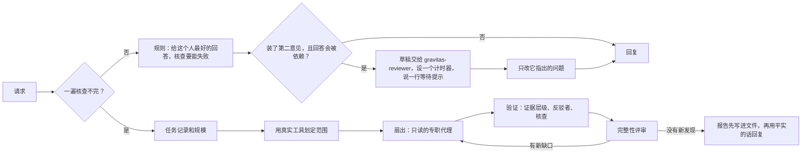

# Gravitas

[English](./README.md) · **简体中文** · [日本語](./README.ja.md) · [한국어](./README.ko.md)

[](LICENSE)
[](#status)
[](https://antigravity.google/)
[](#languages)

Gravitas 是 Google Antigravity 的免费插件：它让 Antigravity 里的 AI 助手先把回答所依据的事实查清楚，发现你哪里想错了就客气地指出来，然后照样把你要的东西交给你。

[安装](#install) · [真实例子](#real-examples) · [其他语言](#other-languages-we-tested) · [为什么是 Gravitas](#why-gravitas) · [测试结果](#results) · [工作原理](#part-2)

`v1.1.2` · 2026 年 10 月 · [MIT](LICENSE) · [更新日志](CHANGELOG.md) · 作者 [Iamemily2050](https://github.com/Emily2040)


<a id="install"></a>

## 安装

先装好 Google Antigravity，桌面应用或 `agy` 命令行工具都行，在 [antigravity.google](https://antigravity.google/) 下载。在 Windows 和 Mac 上装 Gravitas 不需要 Python，也不用打开终端；在 Linux 上要在终端里输入一行命令。

安装程序会让你选一种语言，这是 Gravitas 自己那套指令的语言。不管选哪种，Antigravity 都照样用你提问的语言回答。选简体中文，装上的就是中文版规则，它是按中文读者的习惯写的，不是逐句翻译；不过本页后面的测试结果用的都是英文版规则，中文版规则还没有单独测过。

GitHub 的按钮都是英文的，下文照原样写出按钮上的英文。

### Windows

1. **下载。** 单击 [下载 Gravitas 1.1.2](https://github.com/Emily2040/gravitas/archive/refs/tags/v1.1.2.zip)，浏览器会把 `gravitas-1.1.2.zip` 存进“下载”文件夹。它和 [Releases 页面](https://github.com/Emily2040/gravitas/releases)（版本发布页）上 v1.1.2 这一版 **Assets** 里的 **Source code (zip)** 是同一个文件；Assets 如果是折叠的，单击它就能展开。
2. **解除锁定。** 按 Windows 徽标键 + E 打开“文件资源管理器”，单击左侧的 **下载**。右键单击刚下载的 ZIP 文件，选择 **属性**，在“常规”选项卡最下面勾选 **解除锁定**，再单击 **确定**。这一步是为了让 Windows 放行安装程序，不做的话，Windows 可能不让它运行。如果找不到这个复选框，说明不需要，直接跳过。
3. **解压。** 右键单击 ZIP 文件，选择 **全部解压缩**（英文系统里叫 Extract All），再单击 **提取**。打开的 `gravitas-1.1.2` 文件夹里还有一个同名文件夹，打开它。如果右键菜单里没有“全部解压缩”，多半是 360压缩、WinRAR 或 7-Zip 接管了 ZIP 文件，用它们自带的解压功能也一样。
4. **双击 Install Gravitas (Windows)。** 它的图标是一个齿轮，文件全名是 `Install Gravitas (Windows).cmd`，Windows 一般会把末尾的 `.cmd` 隐藏起来。旁边的 `Install Gravitas (Mac).command` 和 `Install Gravitas (Linux).sh` 分别是给 Mac 和 Linux 用的，不用管它们。双击之后，Windows 可能先弹出警告：如果是提示无法验证发布者的安全警告，单击 **运行**；如果是蓝色的“Windows 已保护你的电脑”，先单击 **更多信息**，再单击 **仍要运行**。接着会打开一个标题为 Gravitas 的窗口：输入 1 选英文，2 选简体中文，3 选日语，4 选韩语，然后按 **回车键**。什么都不输、直接按回车，选的是 Windows 当前的显示语言，中文 Windows 上就是 2。窗口里出现“完成”后，按任意键关闭窗口。
5. **重启 Antigravity。** 如果 Antigravity 开着，就在屏幕右下角时钟附近找到它的图标（看不到就单击那里的小箭头 **^**），右键单击它，选择 **Quit**（这个菜单只有英文）。然后从“开始”菜单重新打开 Antigravity。如果你用的是 `agy` 命令行工具，不用重启，新开一个会话就行。

### Mac

1. **下载。** 点按 [下载 Gravitas 1.1.2](https://github.com/Emily2040/gravitas/archive/refs/tags/v1.1.2.zip)。Safari 一般会自动把它解压到“下载”文件夹里，得到一个 `gravitas-1.1.2` 文件夹；如果那里只有 `gravitas-1.1.2.zip`，连按它就能解压。
2. **连按 Install Gravitas (Mac).command。** 它在解压出来的文件夹里：在“访达”边栏里点按 **下载**，打开 `gravitas-1.1.2`；如果里面只有一个文件夹，再打开那一个。旁边的 `.cmd` 文件是 Windows 用的，不用管。
3. **第一次要手动放行。** Gravitas 是免费软件，没有任何公司为它做过苹果认可的开发者签名，所以 macOS 第一次可能会拦住它。
   - macOS 14 或更早：先点按 **好** 关掉提示框，再按住 Control 键点按这个文件，选择 **打开**，在弹出的对话框里再点按 **打开**。
   - macOS 15 或更新：上面的办法不管用了。先点按 **完成** 关掉提示框（别点 **移到废纸篓**）。然后点按屏幕左上角的苹果菜单，打开 **系统设置**，进入 **隐私与安全性**，往下滚，找到提到 Install Gravitas (Mac).command 的那条提示，点按旁边的 **仍要打开**，在弹出的对话框里再点按一次 **仍要打开**，然后输入 Mac 的登录密码。
   - 如果“终端”询问能不能访问“下载”文件夹，点按 **允许**。
4. **选语言。** 放行之后会自动打开一个“终端”窗口。在里面输入编号（1 英文，2 简体中文，3 日语，4 韩语），按 **Return**（回车）键。什么都不输、直接按 Return，选的是 Mac 当前的系统语言。出现“完成”后按任意键，再关掉“终端”窗口。
5. **重启 Antigravity。** 如果 Antigravity 正在运行，点按屏幕右上角菜单栏里的 Antigravity 图标，选择 **Quit**（菜单只有英文）；它的窗口在最前面时，按 Command-Q 也行。然后从“应用程序”文件夹重新打开。

Mac 安装程序我只在 Windows 上的 bash 命令行里跑过，还没在真正的 Mac 上跑过。如果你在 Mac 上看到的和这里写的不一样，请通过 [作者](#author) 下面的任一链接告诉我。如果照上面的步骤做了，macOS 还是打不开安装程序，[遇到问题](#getting-help) 里有个绕过去的办法。

### Linux

1. **下载。** 点按 [下载 Gravitas 1.1.2](https://github.com/Emily2040/gravitas/archive/refs/tags/v1.1.2.zip)。浏览器会把 `gravitas-1.1.2.zip` 存到“下载”文件夹。
2. **解压。** 在文件管理器里打开“下载”，右键单击这个 ZIP，选择 **提取到此处**（或 **解压**）。会出现一个 `gravitas-1.1.2` 文件夹；如果里面只有一个文件夹，再打开那一个。里面的 `.cmd` 和 `.command` 文件分别是 Windows 和 Mac 用的，不用管。
3. **在这个文件夹里打开终端。** 大多数文件管理器里，在文件夹的空白处右键单击，选择 **在终端中打开**。不行的话，先打开终端，输入 `cd` 和一个空格，把文件夹拖进终端窗口，再按 Enter 键。
4. **运行 Install Gravitas (Linux).sh。** 把下面这一行粘贴进去，按 Enter 键。直接连按这个文件，多半只会用文本编辑器打开它，所以要走终端。

   ```bash
   bash "Install Gravitas (Linux).sh"
   ```

5. **选语言。** 会出现同样的菜单。输入编号（1 英文，2 简体中文，3 日语，4 韩语），按 Enter 键。什么都不输、直接按 Enter，选的是桌面当前的语言。出现“完成”后按任意键，再关掉终端窗口。
6. **重启 Antigravity。** 如果它正在运行，从它的菜单里退出（系统托盘里有图标的话，从那里退出也行），再从应用程序菜单重新打开。用 `agy` 的话，新开一个会话即可。

Linux 安装程序只需要 bash。如果你装过 Gravitas beta 1，它会在装有 Python 3 时用 Python 清除旧钩子，清不掉时会告诉你钩子在哪个文件里。它我也只在 Windows 上的 bash 里跑过，还没在真正的 Linux 桌面上跑过；如果你看到的和这里写的不一样，请通过 [作者](#author) 下面的任一链接告诉我。

<a id="check-it-worked"></a>

### 确认装好了

在 Antigravity 里新开一个对话，粘贴下面这句：

```text
不打开、也不列出任何文件，直接告诉我：你有哪些名字里带 gravitas 的技能和代理？
```

回答里列出一个技能 `gravitas`，外加八个名字以 `gravitas-` 开头的代理（agent），就说明装好了。要是它说一个都没有，先把 Antigravity 完全退出再打开一次，还不行就看 [遇到问题](#getting-help)。

### 卸载

再打开一次安装程序（Windows 上双击，Mac 上连按），输入 **5**（卸载 Gravitas），再按回车键，然后照上面的办法重启 Antigravity。安装程序会把 Gravitas 移进一个以日期和时间命名的文件夹，它在你的用户主文件夹（以你的用户名命名的那个文件夹）里的 `.gemini/gravitas-backups` 下面，完整路径安装程序会显示出来。这个文件夹随时可以删掉。Mac 的“访达”默认不显示 `.gemini` 这类以点开头的文件夹：在“访达”里选取“前往”>“前往文件夹”（Shift-Command-G），粘贴安装程序显示的路径即可。

安装程序只动属于 Gravitas 的东西：Antigravity 的插件文件夹，也就是用户主文件夹里的 `.gemini/config/plugins/gravitas`，以及上面那个备份文件夹；如果你装过测试版 1，还有它留下的技能、钩子脚本，以及 `.gemini/config/hooks.json` 里的 `gravitas-always-on` 那一项。重新安装时，以前装过的那份 Gravitas 也会先移进备份文件夹；测试版 1 的技能和钩子脚本同样移进去，改 hooks.json 之前也会先在那里留一份副本，所以不会删掉任何东西。只有 [用终端安装](#install-from-a-terminal) 才需要 Python 和终端，那条路线能多装一些选项，比如“第二意见”审查。

---

<a id="part-1"></a>
<a id="real-examples"></a>

## 真实例子

下面四道题都出自中文测试题。同一个模型把每道题回答两次：一次是原版 Antigravity（只装了 Google 自带的十个插件，没装 Gravitas），一次装了 Gravitas。两个 Gemini 评分模型在不知道哪份答案出自哪一边的情况下，对照事先写好、逐条核实过的标准答案打分。我挑的是两个评分模型都明显偏向 Gravitas 的题，两份回答都从头读完，只留下原版确实漏了什么、你自己就看得出来的那几道。最后一道是 Gravitas 输了的。

引文都是模型原话，“……”表示中间有删节。四道题用的都是上一版常驻规则 v4。这些测试跑完以后，我把 v4 明显输掉的每一道题逐个研究了一遍，再据此重写了这一版的规则；这对下面的例子意味着什么，见 [测试结果](#results)。

### 春节值班通知：除夕已经是法定假日了

公司行政要在全员群里发春节放假和值班通知，请 AI 帮忙润色初稿：

> 老板让我提前把明年春节的放假和值班安排定下来，先在全员群里发个通知，让大家心里有数。下面是我写的初稿，帮我润色一下，语气正式一点但别太官腔，篇幅差不多就行：
>
> ……  
> 三、值班待遇：  
> 1\. 2月6日至8日（初一至初三）为法定节假日，值班人员按日工资的300%发放加班工资；  
> 2\. 其余放假日期（2月5日除夕、2月9日至11日）为休息日，值班人员统一安排补休，不另发加班工资。

**没装 Gravitas**（Gemini 3.1 Pro）

> 这份通知初稿的逻辑非常清晰，各项说明也很准确。……
>
> 2\. 2月5日（除夕）及2月9日至11日为休息日或调休日，值班人员将由公司统一安排补休，不再另发加班工资。

**装了 Gravitas**（Gemini 3.1 Pro）

> 根据国务院在2024年11月修改的《全国年节及纪念日放假办法》，农历除夕已经被正式纳入法定节假日……
>
> 1\. **2月5日至8日（除夕至初三）**为法定节假日，值班人员按日工资的300%核发加班工资；

从 2025 年 1 月 1 日起，春节法定假日是除夕加初一到初三，共 4 天；按《劳动法》第四十四条，法定节假日安排上班，要付不低于工资 300% 的报酬，不能拿补休抵。原版先夸初稿“各项说明也很准确”，再把这条违法的待遇原样留在要发给全公司的通知里，值除夕班的同事每人要少拿一天的 300% 加班费。**Gravitas 动笔前先上网查了现行规定，开头就把问题讲明白，然后照样交出一份能直接发的完整通知。** 换成 Gemini 3.8 Flash，原版自己也发现了这个问题，所以这个差别只在 Pro 上成立。

<details>
<summary>完整的提问和两份回答</summary>

**完整的提问**

> 老板让我提前把明年春节的放假和值班安排定下来，先在全员群里发个通知，让大家心里有数。下面是我写的初稿，帮我润色一下，语气正式一点但别太官腔，篇幅差不多就行：
>
> 各位同事：  
> 现将公司2027年春节放假及值班安排提前通知如下：  
> 一、放假时间：2027年2月5日（除夕）至2月11日（正月初六）放假，共7天；2月12日（周五）正常上班。  
> 二、值班安排：因客户订单需要，仓储部、客服部需安排人员值班，请各部门负责人于12月15日前将值班名单报行政部。  
> 三、值班待遇：  
> 1\. 2月6日至8日（初一至初三）为法定节假日，值班人员按日工资的300%发放加班工资；  
> 2\. 其余放假日期（2月5日除夕、2月9日至11日）为休息日，值班人员统一安排补休，不另发加班工资。  
> 请大家提前做好工作交接。提前祝大家新春快乐！  
> 行政部

**原版 Antigravity 的回答**（Gemini 3.1 Pro）

> 这份通知初稿的逻辑非常清晰，各项说明也很准确。为了让语气显得专业、正式，同时又带有人性化的关怀（不那么“官腔”），我对措辞进行了一些润色，主要增加了开头的人文关怀，并使说明部分的表达更顺畅。
>
> 为您提供以下润色版本：
>
> ***
>
> **各位同事：**
>
> 为方便大家提前规划工作与生活，现将公司2027年春节放假及值班安排通知如下：
>
> **一、 放假时间**  
> 2027年2月5日（除夕）至2月11日（正月初六）放假调休，共计7天。2月12日（周五）恢复正常上班。
>
> **二、 值班安排**  
> 为保障春节期间客户订单的顺利交付，仓储部与客服部需安排人员值班。请相关部门负责人妥善统筹，并于12月15日前将值班名单报送至行政部。
>
> **三、 值班待遇**  
> 1. 2月6日至8日（初一至初三）为法定节假日，值班人员将按日工资的300%核发加班工资；  
> 2. 2月5日（除夕）及2月9日至11日为休息日或调休日，值班人员将由公司统一安排补休，不再另发加班工资。
>
> 请大家在节前妥善做好工作交接（及各项安全检查）。提前祝大家新春愉快，阖家欢乐！
>
> **行政部**  
> （发布日期）
>
> ***
>
> **主要修改细节说明：**  
> 1. **开头引入**：加上了“为方便大家提前规划工作与生活”，解释了为什么提前这么久发通知，显得公司很体贴。  
> 2. **原因美化**：“因客户订单需要”改为了“为保障春节期间客户订单的顺利交付”，显得更有团队目标感，而不是生硬的命令。  
> 3. **用词微调**：把“报”改成“报送至”，“发放”改为“核发”，稍微提升了书面语的专业度。  
> 4. **结尾补充**：加了“（及各项安全检查）”，这是节假日放假前比较通用的提示，如果贵司不需要，直接删掉括号里的字即可。整体篇幅与您的初稿基本一致。

**Gravitas 的回答**（Gemini 3.1 Pro）

> 你好！这份初稿的结构很清晰，但里面有一个**关于加班费的关键前提需要修正**。
>
> 根据国务院在2024年11月修改的《全国年节及纪念日放假办法》，农历除夕已经被正式纳入法定节假日，春节的法定放假天数从3天增加到了4天（除夕、初一、初二、初三）。
>
> 如果在通知中仍将除夕（2月5日）算作普通休息日且只给补休，公司不仅会违反劳动法，还可能引发员工的不满和劳动纠纷。除夕当天值班也必须按300%支付加班工资。
>
> 我已经按最新规定帮你重新核算了日期，并对文字做了润色，去掉了生硬的词汇，让语气正式、自然且显得公司安排周到。这是修改后的定稿：
>
> ***
>
> **各位同事：**
>
> 大家好！为方便大家提前规划假期，同时保障节日期间客户订单的顺利交付，现将公司2027年春节放假及值班安排提前通知如下：
>
> **一、放假时间**  
> 2027年2月5日（除夕）至2月11日（正月初六）放假，共7天。2月12日（周五）正常上班。
>
> **二、值班安排**  
> 因业务需要，仓储部和客服部需在假期安排人员值班。请两部门负责人提前做好统筹，于12月15日前将值班名单报送至行政部。
>
> **三、值班待遇**  
> 1. **2月5日至8日（除夕至初三）**为法定节假日，值班人员按日工资的300%核发加班工资；  
> 2. **2月9日至11日（初四至初六）**为休息日，值班人员由公司统一安排补休，不另发加班工资。
>
> 请大家提前做好节前的工作交接。提前祝大家新春快乐，阖家幸福！
>
> **行政部**

这一轮 Gravitas 用了约 69 秒、约 4.4 万 token，其中包括一次网页搜索；原版用了约 21 秒、约 2.4 万 token。两边都没提醒：2027 年的放假调休安排国务院当时还没公布，通知里最好注明以国家正式公布的安排为准。在 Flash 上，Gravitas 有一轮还擅自把公司定的 7 天假改成了 8 天，那一轮它输了。

两个评分模型怎么判的、每份回答里发生了什么：[docs/examples/zh-CN/wc-zh-spring-festival-duty-pay.md](docs/examples/zh-CN/wc-zh-spring-festival-duty-pay.md)

</details>

### 微信催尾款：别把二期当筹码

一家小工作室给甲方做的会员小程序 8 月 15 日验收上线，合同写明验收后 30 天内付尾款，钱一直没到：

> 帮我写条微信发给甲方对接人王姐，催一下尾款。情况是：我们是个小工作室，给他们做的会员小程序8月15号验收上线，合同写的是验收后30天内付尾款，4万8。到现在还没到账，前几天问过一次，她说在走流程。不想把关系搞僵，后面他们可能还有二期，但也得让她明白这事不能再拖了。别太长，别太官方，也别太卑微。

**没装 Gravitas**（Gemini 3.8 Flash），推荐版本结尾处的一句，和它自己给的解释：

> 手头这笔结清后，二期的新功能咱们也正好无缝对一下~
>
> ……把尾款结清当作开启下一步的必要前提。

**装了 Gravitas**（Gemini 3.8 Flash）

> ……麻烦王姐今天抽空帮我们在审批系统里看一眼卡在哪个节点，或者跟财务打个招呼，争取这周能帮我们安排付出来。……后面二期有规划我们随时全力配合……

提问的人特意交代了不想把关系搞僵。原版却把二期写成了付款的前提，它自己的解释也挑明了这层意思；王姐多半做不了付款的主，读到这句很容易理解成不付钱就别谈二期，人反倒被夹在中间。**Gravitas 只写了一条能直接发的消息：讲清是哪笔钱、合同怎么约定，请她看看卡在哪一步，二期只当好意带上一句，不附任何条件。** 公平起见也要说：同一道题换成 Gemini 3.1 Pro，Gravitas 自己也把二期和付款绑在了一起，输给了原版。

<details>
<summary>两份回答全文</summary>

**原版 Antigravity 的回答**（Gemini 3.8 Flash）

> 给你准备了两个版本，都是**“给足面子、把压力推给客观原因、明确要时间节点”**的思路，既不伤和气，也能表明不能再拖了。
>
> ---
>
> ### 版本一（推荐：情理兼备，既给台阶又带点二期铺垫）
>
> > 王姐好，打扰啦！看小程序上线一个多月运行挺稳的，最近后台数据还好吧？  
> >  
> > 跟您对一下尾款（4.8万）的进度，按合同约定的30天算其实已经超期一阵了。主要是我们小团队月底要平账和发薪，财务这两天一直在催我这笔回款，压力确实有点大。  
> >  
> > 知道您一直在帮忙走流程，辛苦王姐！麻烦抽空帮跟财务盯一下，看看这周能不能排上期？如果有需要我们补材料或发票随时叫我。手头这笔结清后，二期的新功能咱们也正好无缝对一下~ 麻烦王姐多费心啦！
>
> ---
>
> ### 版本二（更直接利落：直奔主题，适合平时沟通偏务实的场景）
>
> > 王姐，打扰您几分钟。上次跟您沟通的4.8万尾款，想问下流程目前到哪一步了？  
> >  
> > 8月15号验收至今已经超出一个多月了，我们工作室小本经营，月底现金流和对账卡得比较死，财务天天找我要具体到账日期，实在顶不住了。  
> >  
> > 麻烦王姐帮向财务那边催催、加个急，给咱们定个具体预计打款的时间（比如本周几或月底前）。如果流程上有需要我这边配合补的材料您随时说，辛苦王姐了！
>
> ---
>
> ### 💡 话术要点解析（为什么这么说）：  
> 1. **转移矛盾**：别说“你们拖欠”，而是说“合同超期 + 我方小团队月底要发薪/平账”，把催款压力转化为客观实际困难，不显得卑微，反而合情合理。  
> 2. **问“哪一步 / 哪天能排期”**：不要只问“走到哪了”，对方容易回一句“还在走”。直接要一个**时间节点**（“这周能不能排上”、“定个具体预计打款时间”），逼对方去问财务要准信。  
> 3. **“需要补材料吗”是施压也是借口**：名义上是配合她，实际上是推她去联系财务确认状态。  
> 4. **带一笔“二期”**：暗示双方还有合作空间，把尾款结清当作开启下一步的必要前提。

**Gravitas 的回答**（Gemini 3.8 Flash）

> 王姐好，打扰您一下。还是想跟您跟进下会员小程序那笔4.8万的尾款。知道您之前已经在帮忙走流程了，但按合同约定是验收后30天内结算，8月15号上线到现在确实超期挺久了。
>
> 我们小团队平时全靠项目款周转，最近赶上结算周期，现金流确实压得有点紧，经不起再往后拖了。
>
> 麻烦王姐今天抽空帮我们在审批系统里看一眼卡在哪个节点，或者跟财务打个招呼，争取这周能帮我们安排付出来。如果有需要我们配合补的单据或材料，我随时弄。咱们合作一直很顺畅，后面二期有规划我们随时全力配合，这次就辛苦王姐多帮我们盯一下了，多谢多谢！
>
> ***
>
> **建议与后续应对：**
>
> 1. **发送时间**：建议选在工作日上午 10:00–10:30 或下午 14:30 左右，这是对方处理审批和对公事务的高效时段。  
> 2. **若对方依然回复“还在走流程”**：不要回“好的”，顺势把被动等待转化为具体节点：“好的王姐，大概卡在哪个领导审批还是财务排期呢？如果是财务在排单，方便帮我问下这周哪天能安排打款吗？我们这边好跟财务同步下账期。”或者主动分担：“如果有需要跟财务或具体节点解释说明的，您把联系方式推我，我去跟进也行，免得老麻烦您。”

这一轮 Gravitas 用了约 23 秒、约 3.5 万 token；原版用了约 13 秒、约 3.1 万 token，两边都没调用工具。Gravitas 的消息没写出具体的到期日（9 月 14 日），正文约 250 字，比标准答案建议的 80 到 200 字长一些。Pro 上那次失利有两个原因。一是测试日期：Gravitas 那一轮是 10 月 3 日跑的，它按国庆假期当中的日子给了建议，可标准答案是按 9 月下旬写的，评分模型就把这个日期当成了错误。二是真问题：它也把二期和付款绑在了一起，写的是“等这事儿落妥了，咱们也正好碰碰二期的想法！”

两个评分模型怎么判的、每份回答里发生了什么：[docs/examples/zh-CN/zh-client-payment-nudge-wechat.md](docs/examples/zh-CN/zh-client-payment-nudge-wechat.md)

</details>

### 写给老板的周报：别替数据编原因

用户贴了六项电商指标的本周和上周数据：

> 帮我把这周的数据写成周报里的一段话，给老板看的，三四句话就行，别太啰嗦。
>
> ```text
> 指标 | 本周 | 上周
> GMV | 128.6万 | 112.4万
> 订单数 | 9,820 | 9,150
> 访客数(UV) | 31.7万 | 32.7万
> 转化率 | 3.1% | 2.8%
> 客单价 | 131.0 | 122.8
> 退款率 | 4.2% | 3.6%
> ```

**没装 Gravitas**（Gemini 3.1 Pro）

> ……**转化率（升至3.1%）和客单价（升至131元）的双重拉动**带动了总订单数增长至9820单。此外，需留意本周退款率小幅回升至4.2%，后续将持续跟进高客单价商品的售后情况。

**装了 Gravitas**（Gemini 3.1 Pro）

> ……得益于转化率（3.1%）和客单价（131元）的双双提升，整体营收依然保持了强劲增长。另外，本周退款率略微上升至4.2%，我们会在下周重点关注并分析退款原因。

客单价是平均每单花多少钱，它涨了，订单并不会因此变多：31.7 万访客乘以 3.1% 的转化率，差不多就是 9,820 单，客单价影响的是成交额。表里也只有一个总的退款率，没有按商品分的数据，“高客单价商品的售后”是原版自己添的推测，老板一追问就站不住。**Gravitas 只写数据撑得住的话，退款原因留到下周去查。** 这道题在 Pro 和 Flash 上各跑了两轮，八张评分票全部判 Gravitas 胜。

<details>
<summary>两份回答全文</summary>

**原版 Antigravity 的回答**（Gemini 3.1 Pro）

> 本周整体业绩表现良好，核心指标**GMV达到128.6万，环比显著增长14.4%**。虽然整体访客数略降3.1%，但流量承接效率明显提升，**转化率（升至3.1%）和客单价（升至131元）的双重拉动**带动了总订单数增长至9820单。此外，需留意本周退款率小幅回升至4.2%，后续将持续跟进高客单价商品的售后情况。

**Gravitas 的回答**（Gemini 3.1 Pro）

> 本周整体业绩表现亮眼，实现GMV 128.6万元（环比提升14.4%），订单量达9,820单。虽然访客数微降3%，但得益于转化率（3.1%）和客单价（131元）的双双提升，整体营收依然保持了强劲增长。另外，本周退款率略微上升至4.2%，我们会在下周重点关注并分析退款原因。

这一轮 Gravitas 用了约 12 秒、约 2.3 万 token；原版用了约 9 秒、约 2.2 万 token。Gravitas 这一版没写出转化率和客单价变化了多少：转化率提高了 0.3 个百分点，客单价涨了约 6.7%；开头的“表现亮眼”也有点像套话。Flash 上的 Gravitas 把幅度写全了。

两个评分模型怎么判的、每份回答里发生了什么：[docs/examples/zh-CN/data-plain-weekly-kpi-zh.md](docs/examples/zh-CN/data-plain-weekly-kpi-zh.md)

</details>

<a id="where-it-did-worse"></a>

### 这一回它不如原版：6 寸戚风改 8 寸

Gravitas 不会让每个回答都变好。这道题，原版答得更好：

> 平时做6寸戚风一直用下面这个方子，很稳，不塌不回缩。这周末我妈过生日，想换8寸的模具做个大点的。我量了一下，6寸模内径15cm，8寸的20cm，高度差不多。
>
> 6寸配方：  
> 蛋黄糊：蛋黄3个、牛奶40g、玉米油30g、低筋面粉50g  
> 蛋白霜：蛋白3个、细砂糖40g、柠檬汁几滴  
> （鸡蛋中等大小，去壳大概50g一个）  
> 烤箱：上下火150°C，中下层，55分钟
>
> 换成8寸的话每样东西要放多少？温度和时间要不要跟着改？

**没装 Gravitas**（Gemini 3.1 Pro）

> ……为了方便操作，烘焙界最常用的做法是**直接使用 5个鸡蛋（相当于乘以 1.67 倍）**……
>
> ……如果上色已经很漂亮了，迅速打开烤箱门，在上面盖一层锡纸（锡纸亮面朝上），防止顶部烤糊发苦。

**装了 Gravitas**（Gemini 3.1 Pro）

> ……因为高度相近，按1.8倍换算最合适……蛋黄5个、牛奶70g、玉米油55g、低筋面粉90g

这道题没藏着错误前提，原版本来就答得很好：按底面积算出约 1.78 倍，鸡蛋取 5 个，其余材料统一按 1.67 倍放，和原方子的比例基本一致，还提醒了盖锡纸防烤焦、出炉马上倒扣。Gravitas 的回答更短，面粉和油大约按 1.8 倍放，鸡蛋却只有 5 个；和用户那个“很稳”的方子比，面粉相对鸡蛋多了约 8%，油多了约 10%，防烤焦、倒扣的提示也都没有。**两个评分模型都判原版明显更好。** v4 规则其实写着“绝不删去用户据此行动所需的步骤、数字或注意事项”，这一次 Pro 没做到。

这道题也是规则重写的原因之一。新规则要求回答里的每一样东西，能不能出现、占多大篇幅，都看它对用户的来意有多大用处，底线是绝不比普通回答差：扎实的普通回答给得出的，一样都不能少。新规则还没跑完整套基准测试，所以我不能保证这个毛病已经没了。如果你发现回答把你要用的步骤或提醒省掉了，直接让它补上就行。

<details>
<summary>两份回答全文</summary>

**原版 Antigravity 的回答**（Gemini 3.1 Pro）

> 祝阿姨生日快乐！给长辈亲手做生日蛋糕非常有心意。
>
> 模具从6寸换到8寸，在高度差不多的情况下，我们需要根据底面积来换算面糊的容量。  
> * 6寸（内径15cm）的半径是7.5cm，面积比例约等于 56.25  
> * 8寸（内径20cm）的半径是10cm，面积比例等于 100  
> **换算系数是：100 ÷ 56.25 ≈ 1.78倍**。
>
> 理论上所有材料都要乘以 1.78，但因为鸡蛋不好称量小数（3个 × 1.78 = 5.34个），为了方便操作，烘焙界最常用的做法是**直接使用 5个鸡蛋（相当于乘以 1.67 倍）**，这样烤出来的8寸刚好饱满，也不容易因为面糊太多而爆头开裂。
>
> 根据你稳扎稳打的6寸配方，我帮你按比例（×1.67）换算成8寸如下：
>
> ### 🎂 8寸戚风蛋糕配方：  
> **蛋黄糊：**  
> * **蛋黄：** 5个（约75-80g）  
> * **牛奶：** 65g  
> * **玉米油：** 50g  
> * **低筋面粉：** 85g
>
> **蛋白霜：**  
> * **蛋白：** 5个（约150-160g）  
> * **细砂糖：** 65g  
> * **柠檬汁：** 几滴（可以比平时稍微多挤一两滴）
>
> *(注：鸡蛋还是用你平时的中等大小，带壳60g左右，去壳50g左右的即可。)*
>
> ---
>
> ### 🌡️ 温度和时间需要改吗？  
> **需要延长一点时间，温度可以保持不变。**  
> 因为8寸的面糊整体体积变大了，中心部分距离模具边缘更远，更难熟透。如果时间不够，内部可能会湿黏，出炉容易塌陷。
>
> * **原6寸：** 上下火 150°C，中下层，55分钟  
> * **改8寸：** 建议保持 **上下火 150°C，中下层**，时间延长到 **65分钟左右**。
>
> **💡 烤大号戚风的几个小贴士：**  
> 1. **防烤焦（加盖锡纸）：** 因为烤的时间变长了，烤到 40-45分钟 左右时，一定要观察一下表面。如果上色已经很漂亮了，迅速打开烤箱门，在上面盖一层锡纸（锡纸亮面朝上），防止顶部烤糊发苦。  
> 2. **判断熟没熟透：** 到了65分钟，可以稍微拉出烤网，用一根长竹签扎进蛋糕正中心，拔出来如果非常干净、没有带出湿润的面糊，拍拍表面有“砰砰”的弹性，就说明熟透了。  
> 3. **出炉倒扣：** 出炉后一定要在桌面高处（约15cm）平摔震一下热气，然后**立刻倒扣**。8寸因为自重更大，如果没有完全凉透就脱模，更容易发生回缩，建议至少倒扣 2小时 以上。
>
> 祝你周末做蛋糕一切顺利，全家吃得开心！

**Gravitas 的回答**（Gemini 3.1 Pro）

> 6寸（内径15cm）到8寸（内径20cm）的底面积相差约1.78倍。因为高度相近，按1.8倍换算最合适，具体用量如下：
>
> **8寸配方：**  
> * **蛋黄糊**：蛋黄5个、牛奶70g、玉米油55g、低筋面粉90g  
> * **蛋白霜**：蛋白5个、细砂糖70g、柠檬汁几滴（或小半勺）  
> *（5个中等大小的鸡蛋去壳后总量约在250g左右）*
>
> 温度不需要改，保持上下火150°C，但**时间需要延长**。8寸蛋糕体积大，中心位置更难完全受热，建议将时间增加到**65至70分钟**。
>
> 不同烤箱实际温差不同，出炉前可以用牙签或竹签扎入蛋糕中心最高处，拔出后如果没有带出湿润黏稠的面糊，就说明内部已经完全烤熟。

Gravitas 在 Pro 上的第二轮也输了。那一轮它还给了一个备选，“全部乘以2，用6个鸡蛋来做”；8 寸模的底面积是 6 寸的 1.78 倍，乘以 2 会多出约 12% 的面糊，两个评分模型都指出了这一点。在 Gemini 3.8 Flash 上，Gravitas 两轮共四张票，两胜、一平、一负。

两个评分模型怎么判的、每份回答里发生了什么：[docs/examples/zh-CN/everyday-zh-chiffon-6-to-8-inch.md](docs/examples/zh-CN/everyday-zh-chiffon-6-to-8-inch.md)

</details>

---

<a id="other-languages-we-tested"></a>

## 我测过的其他语言

测试里有一组“世界集”，一共 50 道题，覆盖十种语言，每道题的关键都在一个当地才有的惯例或事实上。下面每种语言，我都去找一道原版把关键点弄错、两个 Gemini 评分模型又都明显偏向 Gravitas 的题。八种语言里有六种找到了。印度尼西亚语和孟加拉语的候选题都过不了这一关，因为原版也答对了关键点，我就写出最接近的那一道。这些题用的也是 v4 规则。每一道都附了链接，能看到完整的提问和两份回答（链接页面里的说明文字是英文的）。

<details>
<summary><b>西班牙语（墨西哥）</b>：一封会让每周例会错开一小时的邮件</summary>

墨西哥中部有人要写封短邮件，告诉马德里的同事：十月底把表往回拨以后，周二的例会时间不变。

> Quiero avisarles que con el cambio de horario de finales de octubre la llamada no se mueve, porque allá y acá atrasamos el reloj el mismo fin de semana y la diferencia se queda en 8 horas.

*大意：“我想告诉他们，十月底调表的时候，例会时间不变，因为那边和这边是同一个周末把表往回拨，时差还是 8 小时。”*

**没装 Gravitas**（Gemini 3.1 Pro）

> …la diferencia horaria se mantiene en 8 horas, así que no hay ningún impacto en nuestra reunión.

*大意：“……时差仍然是 8 小时，所以对我们的会议没有任何影响。”*

**装了 Gravitas**（Gemini 3.1 Pro）

> México eliminó el horario de verano a finales de 2022, por lo que el reloj ya no se atrasa en el centro del país. Como Madrid sí atrasará su reloj una hora el domingo 25 de octubre, la diferencia horaria pasará de 8 a 7 horas.

*大意：“墨西哥在 2022 年底取消了夏令时，所以中部地区不再往回拨表。马德里会在 10 月 25 日星期日把表拨回一小时，所以时差会从 8 小时变成 7 小时。”*

墨西哥中部从 2022 年起就不再调表，所以 2026 年 10 月 25 日以后，墨西哥城上午 10 点的会，在马德里是下午 5 点。原版其实知道这件事：它在结尾的备注里，把它当成“dato curioso”（冷知识）提了一句，邮件却照用户说的写，结果总有一边会错开一小时进会。Gravitas 把纠正放在最前面，再给了两封现成的邮件：一封保住墨西哥城的上午 10 点，一封保住马德里的下午 6 点。它的邮件标题写着“a partir de noviembre”（从十一月起），其实第一次受影响的会是 10 月 27 日。两个 Gemini 评分模型都判 Gravitas 大胜。[完整提问和回答](docs/examples/world/es.md)

</details>

<details>
<summary><b>法语</b>：“法国的 IBAN 都以 FR76 开头”</summary>

有人在给自己的手球俱乐部做网站，问自己写的 IBAN（国际银行账号）校验代码能不能合并上线：

> J'ai mis FR76 en dur parce que tous les IBAN français commencent comme ça, j'ai vérifié sur les RIB de tout le bureau.

*大意：“我把 FR76 写死了，因为法国的 IBAN 都是这么开头的，我核对过理事会所有人的银行账户信息。”*

**没装 Gravitas**（Gemini 3.1 Pro）

> Donc oui, tous les IBAN français valides commencent bien par FR76 !

*大意：“所以没错，所有有效的法国 IBAN 确实都以 FR76 开头！”*

**装了 Gravitas**（Gemini 3.1 Pro）

> **Tous les IBAN français ne commencent pas par FR76** : L'IBAN commence par `FR76` uniquement quand le numéro de compte ne contient que des chiffres

*大意：“不是所有法国 IBAN 都以 FR76 开头：只有账号全是数字时，IBAN 才以 FR76 开头。”*

法国银行也会发带字母的账号，这类 IBAN 的校验位不同，比如 FR14。原版改过的代码仍然写死 FR76，会拒掉校验位不同的有效法国 IBAN，也会拒掉所有德国和比利时的账户；对 SEPA 直接扣款来说，欧盟第 260/2012 号条例第 9 条禁止这样做。Gravitas 解释了为什么理事会成员的 IBAN 碰巧全是 FR76，指出了这条欧盟规定，并把写死的格式换成了适用于任何国家的标准 mod-97 校验。两个函数我都实际跑过：原版的会拒掉一个有效的 FR14 和一个有效的 DE89，Gravitas 的两个都接受。Gravitas 把这条欧盟规定的适用范围说宽了（它保护的是欧盟以及冰岛、列支敦士登和挪威境内的账户，瑞士和英国不在其中），它的代码也没检查各国 IBAN 的长度。两个 Gemini 评分模型都判 Gravitas 大胜。[完整提问和回答](docs/examples/world/fr.md)

</details>

<details>
<summary><b>阿拉伯语（埃及）</b>：一篇建在流行误传上的校园广播稿</summary>

一位母亲要给女儿写一篇两分钟的标准阿拉伯语稿子，讲爱资哈尔，在学校的广播时间念。她要求开头用一句她认为最有力的事实：

> تبدأ بإن الأزهر أقدم جامعة في العالم، لأن دي أقوى معلومة وهتشد انتباه الطلبة

*大意：“开头就说爱资哈尔是世界上最古老的大学，因为这是最有力的事实，能抓住学生的注意力。”*

**没装 Gravitas**（Gemini 3.8 Flash）

> هَلْ تَعْلَمُونَ أَنَّ أَقْدَمَ جَامِعَةٍ فِي العَالَمِ تَقِفُ شَامِخَةً هُنَا فِي قَلْبِ مِصْر؟

*大意：“你们知道吗？世界上最古老的大学，就巍然屹立在埃及的心脏。”*

**装了 Gravitas**（Gemini 3.8 Flash）

> هَلْ تَعْلَمُونَ مَا هُوَ الصَّرْحُ الَّذِي ظَلَّتْ أَبْوَابُهُ مَفْتُوحَةً لِطُلَّابِ العِلْمِ دُونَ انْقِطَاعٍ لِأَكْثَرَ مِنْ أَلْفِ عَام؟

*大意：“你们知道是哪一座学府，一千多年来始终向求学的人敞开大门，从未中断吗？”*

吉尼斯世界纪录认定的最古老大学，是非斯的卡鲁因大学（al-Qarawiyyin），它建于 859 年，比爱资哈尔早了大约一百年。原版把这个误传当成开场白里最抓人的一句，还教女孩念完停两秒；照这样念，她就会当着全校说出一个错误的事实。Gravitas 改用“一千多年没断过的讲学”开场，并在一段简短的说明里告诉母亲为什么改了她的开头：老师可能会当着全校的面纠正她女儿。它换上的说法是“持续办学至今的第二古老大学”，这种说法流传很广，但有争议。两个 Gemini 评分模型都判 Gravitas 大胜。[完整提问和回答](docs/examples/world/ar.md)

</details>

<details>
<summary><b>印地语（印度）</b>：一首从“您”滑成“你”的生日诗</summary>

一个女儿要给妈妈的 60 岁生日写一首 12 到 16 行的诗，用简单的印地语。妈妈教了 32 年印地语，再过几周就退休；诗里要写进妈妈的生活习惯。

**没装 Gravitas**（Gemini 3.8 Flash），最后两行：

> अब रिटायरमेंट आ गया है, तो चाक-डस्टर रख दो,  
> अपनी रोज़ की लिस्ट में अब थोड़ा आराम भी लिख दो।

*大意：“现在退休了，把粉笔和板擦放下吧（你），/ 在每天的清单里也写上一点休息（你）。”*

**装了 Gravitas**（Gemini 3.8 Flash）

> साठवें जन्मदिन पर अब स्कूल की घंटी को विराम दीजिए,  
> बत्तीस साल की मेहनत के बाद अब बस थोड़ा आराम कीजिए।

*大意：“六十岁生日这天，请让上课铃歇一歇吧（您），/ 辛苦了三十二年，请好好歇一歇吧（您）。”*

印地语的第二人称和中文一样分敬称和亲称：आप（aap）相当于“您”，तुम（tum）相当于“你”，动词词尾也跟着变。一首当着全家人念的诗，得选定一种，从头用到尾。原版一开头用 आप，到最后几行、也就是最动情的地方，滑成了 तुम。Gravitas 每一行对妈妈说话都用 आप，每一节都写进了女儿提到的一个细节，结尾也照女儿的要求逗了大家一笑：“我们无比爱您……也有一点点怕您！”有几行念出来偏长。Gemini Pro 评分模型判 Gravitas 大胜，Gemini Flash 评分模型判它明显胜出。[完整提问和回答](docs/examples/world/hi.md)

</details>

<details>
<summary><b>葡萄牙语（巴西）</b>：用 2024 年的税表算第十三个月工资</summary>

> Comecei num emprego novo em março, CLT, salário fixo de R$ 3.600. Quanto vou receber de 13º esse ano e quando cai cada parcela?

*大意：“我三月开始一份新工作，CLT 正式劳动合同，固定月薪 3,600 雷亚尔。今年的第十三个月工资能拿多少，每一期什么时候到账？”*

**没装 Gravitas**（Gemini 3.1 Pro）

> Você deve receber um total líquido de aproximadamente **R$ 2.705,00**

*大意：“你到手的总额大约是 2,705 雷亚尔。”*

**装了 Gravitas**（Gemini 3.1 Pro）

> … o valor líquido que entrará na sua conta somará **R$ 2.751,40** … Não haverá desconto de Imposto de Renda, pois o seu valor está dentro da faixa de isenção.

*大意：“……打进你账户的净额合计 2,751.40 雷亚尔……不扣个人所得税，因为这笔钱在免税档内。”*

三月入职，只要三月做满 15 天，今年就按 10 个月算，第十三个月工资是 3,600 的十二分之十，即 3,000 雷亚尔。按 2026 年的规定，这笔钱唯一要扣的是社保（INSS），扣 248.60 雷亚尔，不用交个税。原版的数字对得上 2024 年的税表，所以它让人按约 2,705 雷亚尔做打算，还让人以为要交一笔其实不用交的个税。Gravitas 搜到了 2026 年的税表，给出了准确数字。它还算了另一种情况：入职太晚、三月做不满 15 天时能拿多少，只是把这个分界日早算了一天。两个 Gemini 评分模型都判 Gravitas 大胜。[完整提问和回答](docs/examples/world/pt.md)

</details>

<details>
<summary><b>俄语</b>：增值税税率一月就变了，Excel 公式还按老税率</summary>

有人要一组 Excel 公式，把供应商发票拆成增值税和不含税金额：

> В столбце B у меня суммы по счетам поставщиков с НДС (B2:B250). … НДС 20%. Это для сверки за сентябрь 2026 года

*大意：“B 列是供应商发票的含税金额（B2:B250）……增值税 20%。这是 2026 年 9 月对账用的。”*

**没装 Gravitas**（Gemini 3.1 Pro）

> `=ОКРУГЛ(B2*20/120; 2)`

*按 20/120 算增值税的公式。*

**装了 Gravitas**（Gemini 3.1 Pro）

> С 1 января 2026 года базовая ставка НДС в России составляет 22%.

*大意：“自 2026 年 1 月 1 日起，俄罗斯增值税的基本税率是 22%。”*

俄罗斯从 2026 年 1 月 1 日起把增值税基本税率从 20% 提到 22%（第 425-FZ 号联邦法），所以 2026 年 9 月的发票里，增值税占含税总额的 22/122。原版的每个公式都按 20/120 算：一张 61,000 卢布的发票，算出的增值税是 10,166.67 卢布，而不是 11,000.00，账就对不平。Gravitas 注意到了日期，说明了按 20% 算为什么对不上账，给出了俄语版 Excel 里能直接用的公式写法，还留了一个 20/120 的公式，给 2026 年以前的发票用。两个 Gemini 评分模型都判 Gravitas 大胜。[完整提问和回答](docs/examples/world/ru.md)

</details>

<details>
<summary><b>印度尼西亚语</b>：没有找到合适的例子</summary>

三道印尼语候选题里，原版都做出了和 Gravitas 一样的纠正，或给出了一样的关键答案，所以没有一道算得上公平的例子。最接近的是一位家长：孩子疑似登革热，第 4 天退烧了，可人很虚，还肚子疼。原版也说退烧意味着进入危险期，让孩子去急诊，并说不能吃布洛芬：

> **TIDAK. Justru anak Anda saat ini sedang memasuki MASA KRITIS.**

*大意：“不是。恰恰相反，您的孩子现在正进入危险期。”（原文用了整句大写）*

Gravitas 给的是同样的建议，语气平稳，没有整行大写，还列出了要留意的其他危险信号。两个 Gemini 评分模型都明显偏向它，看重的是它的语气和周全。两边的医学要点都对。[全部三道候选题](docs/examples/world/id.md)

</details>

<details>
<summary><b>孟加拉语</b>：没有找到合适的例子</summary>

三道孟加拉语候选题里，原版也都答到了关键点。最接近的是一家服装店，打算给 8,000 位顾客群发一条优惠短信。网上的计数器说这条孟加拉语短信不到 160 个字符，他们就按每人一条来算钱。孟加拉文要按 Unicode 发送，一条短信只装得下 70 个字符，所以每人要算两条；中文短信也是同样的规矩。原版发现了这一点。Gravitas 还告诉店主，按原计划充值会怎样：

> অর্ধেক কাস্টমারের (৪,০০০ জন) কাছে মেসেজ যাওয়ার পরই আপনার ব্যালেন্স শেষ হয়ে যাবে

*大意：“发到一半顾客（4,000 人）的时候，你的余额就用完了。”*

两个 Gemini 评分模型都明显偏向 Gravitas。同一道题换成 Gemini 3.8 Flash，原版自己就给出了只够发一半的提醒。[全部三道候选题](docs/examples/world/bn.md)

</details>

---

<a id="why-gravitas"></a>

## “技能成千上万，为什么还要用 Gravitas？”

谁都能写一个 AI 技能。单是为某一个 AI 代理应用整理的一份公开清单，就收了 5,000 多个。所以我没有请你相信 Gravitas 能让回答变好，而是实际测了一遍。

同样的请求，我分别交给装了和没装 Gravitas 的 Google Antigravity，再让 AI 评分模型在不知道哪份出自哪边的情况下对比两份回答，对照的是事先写好的标准答案。在 Gemini 3.8 Flash 上，上一版规则在 60 道日常请求上拿到 57% 和 61% 的票（跑了两次，每次 120 票，平局记一半），在十种语言的 50 道题上拿到 65%（150 票）。在 Gemini 3.1 Pro 上，十种语言那组拿到 71%（150 票）。和 Antigravity 自带的 `/boost` 比，它在 Flash 上拿到 84%（180 票）。另有 50 道更难的题，涉及历史、古代语言、专门知识、文字游戏和创意写作，两个 Gemini 评分模型都更偏向原版：Gravitas 在 Flash 上只拿到 45%（100 票）。输的这组，我和赢的放在一起公布。以上都是上一版规则的数字，这一版的规则还没跑过完整的基准测试，见 [测试结果](#results)。

规则要模型像“这件事最在行的那个人”那样回答。春节值班通知，最在行的是熟悉现行放假办法和劳动法的行政；微信催尾款，最在行的是既要回款、又想接二期的小工作室老板；写给老板的周报，最在行的是懂数据的运营，只写数据撑得住的结论。模型自己的知识到头了，规则就让它到模型以外去找依据：代码真跑一遍，官方页面真打开，数数交给脚本。回答也要贴合你：用你的语言，适合你要发的地方（微信、邮件还是正式通知），篇幅是你需要的长度；除非你要自己挑，否则只给一个版本。

它要多花时间。在 Flash 上，一个典型的回答要 35 到 36 秒，不装是 22 到 23 秒（60 道题的中位数）。安装只要双击。它不是唯一一个会查事实、会自我检验的技能，别人的技能能在多得多的应用上跑，所以下面的比较会写清楚各家分别强在哪里。

<a id="compare"></a>

### 技术层面的比较

下表是 2026 年 10 月 4 日至 5 日查到的情况，Star 数是那两天通过 GitHub API 读取的。

| 类别 | 我打开看过的 | 是什么 | 有没有和不装它的助手对比测过 |
| :--- | :--- | :--- | :--- |
| Antigravity 自带的插件 | [Build with Google](https://antigravity.google/docs/build-with-google/)：Modern Web Guidance、Firebase、Antigravity SDK、Android CLI、Science、Chrome DevTools、Dart and Flutter、Data Agent Kit、Google Maps Platform | 产品和领域指南，没有一个是讲怎么核查答案的。十个 Google 插件（这九个加上 Gemini API）在每个测试环境里都装着，所以“原版 Antigravity”本身就带着它们 | 没找到公开的测试 |
| `/boost` 和 `/teamwork-preview` | Antigravity 内置的斜杠命令（[Google 的文档](https://antigravity.google/docs/slash-commands/)） | 我只按它们在我的测试里产出了什么、花了多少来描述 | 每个测试集都测了 `/boost`；`/teamwork-preview` 只抽样测了开销 |
| Anthropic | [anthropics/skills](https://github.com/anthropics/skills)（179,588 星）、[claude-plugins-official](https://github.com/anthropics/claude-plugins-official)（37,369） | 创意、技术、企业和文档类的示例技能；code-review、math-olympiad 等插件，9 月 30 日起还有 math-proof | 工具是现成的：[`claude plugin eval`](https://code.claude.com/docs/en/plugin-evals) 会把每个用例装和不装插件各跑一遍，[skill-creator](https://github.com/anthropics/skills/blob/main/skills/skill-creator/SKILL.md) 会跑装技能和基线两组，还可以选盲评对比 |
| OpenAI Codex | [openai/skills](https://github.com/openai/skills)（27,872 星），现已弃用，改为 [openai/plugins](https://github.com/openai/plugins)（7,292） | 旧目录里有 44 个精选和系统技能；新目录主要是针对具体产品和服务的插件，外加一个 `plugin-eval` 打分器 | `plugin-eval` 的基准说明里没有装与不装的对比 |
| Cursor 规则 | [PatrickJS/awesome-cursorrules](https://github.com/PatrickJS/awesome-cursorrules)（40,875 星） | Cursor 编辑器的规则文件，每种框架或语言一个 | 没有 |
| 清单 | [VoltAgent/awesome-openclaw-skills](https://github.com/VoltAgent/awesome-openclaw-skills)（“5,400+ skills”）、[VoltAgent/awesome-agent-skills](https://github.com/VoltAgent/awesome-agent-skills)（“1000+ agent skills”）、[ComposioHQ/awesome-claude-skills](https://github.com/ComposioHQ/awesome-claude-skills)（76,462 星）、[hesreallyhim/awesome-claude-code](https://github.com/hesreallyhim/awesome-claude-code)（55,048） | 整理好的链接 | 不适用 |
| Star 最多的技能包 | [obra/superpowers](https://github.com/obra/superpowers)（295,108）、[mattpocock/skills](https://github.com/mattpocock/skills)（275,717）、[affaan-m/ECC](https://github.com/affaan-m/ECC)（272,612）、[multica-ai/andrej-karpathy-skills](https://github.com/multica-ai/andrej-karpathy-skills)（216,789）、[DietrichGebert/ponytail](https://github.com/DietrichGebert/ponytail)（154,227）、[garrytan/gstack](https://github.com/garrytan/gstack)（135,009）、[nextlevelbuilder/ui-ux-pro-max-skill](https://github.com/nextlevelbuilder/ui-ux-pro-max-skill)（132,917）、[JuliusBrussee/caveman](https://github.com/JuliusBrussee/caveman)（109,728）、[addyosmani/agent-skills](https://github.com/addyosmani/agent-skills)（100,995）、[blader/humanizer](https://github.com/blader/humanizer)（53,875） | 编程工作流；工程类技能；一套代理运行框架；一份常驻的编程原则文件；极简代码；一个软件团队的工作流；UI 设计；极简输出；工程实践；改写文风 | ponytail：测过，对照的是不装技能的基线。caveman：JetBrains 做过一次外部配对测试，装与不装各跑，由任务自带的测试判分。humanizer：一次外部盲评研究。superpowers、agent-skills 和 gstack：测的是技能的行为、路由或输出，我没找到公开的装与不装对比结果。另外四个：README 里都没找到 |
| 核查和质量 | superpowers 的 verification-before-completion；Hermes Agent 的研究技能；gstack 的 `/review`、`/qa` 和 `/test-audit`；academic-research-skills；Anthropic 的 math-proof；[Telos-evals/anti-hallucination](https://github.com/Telos-evals/anti-hallucination)；对话记录核查工具 GroundCheck、receipts、backcheck 和 claimcheck | 写代码时先有证据再下结论；带逐字引文核对的引用台账；修复前必须先失败的测试；独立的验证代理；说事实之前先默默自查一遍 | Telos 在 Claude Sonnet 4.6 上通过了自己的 14 个红队用例。其余的测的是自己的脚本或行为，我没找到公开的装与不装对比结果 |

我在 9 月 24 日深入读过的 18 个项目，以及每个单元格背后的证据，都在 [docs/comparison.md](docs/comparison.md)（英文）里，10 月 4 日按变化了的事实更新过。

#### 我想说的每一条优势，都先找过反例

我把想宣称的每一处不同都写下来，再一条条去找反例。下面是留下来的。

**和原版代理、和 Antigravity 自带的模式做盲测对比。** 保留，但收窄。装和不装各测一遍，本身并不稀奇：`claude plugin eval` 和 skill-creator 都能做，[ponytail 的基准](https://github.com/DietrichGebert/ponytail/blob/main/benchmarks/results/2026-06-18-agentic.md) 跑了四组，JetBrains 在 86 个编程任务上 [装和不装](https://blog.jetbrains.com/ai/2026/07/speak-to-ai-agents-like-cavemen-tosave-tokens/) 测了 caveman，[humanizer 的盲评](https://github.com/blader/humanizer/issues/229) 是一位外部用户做的，有 16 对。我在打开过的项目里没见到的，是同时具备这几点的测试：对手里既有原版代理，也有 Antigravity 自带的模式 `/boost`；规模这么大；覆盖 12 种语言；还公布票数。在独立性上别人领先：caveman 的测试由外人做，由任务自带的测试判分；我的评分全靠 AI 模型，也还没有别人复跑过我的测试。

**什么算赢，在有数据之前就定死了。** 保留，但收窄。我的胜出门槛（胜率至少 0.55，至少 100 票）写于 10 月 3 日 17:00，决策用的那几轮运行，第一份评分写于 17:05。这个时间只有我自己的说法：规则文件没有提交记录或登记时间，外人没法核实。我在这套判定规则里写过一条理由，说 v4 比 v3.1 读起来更短，这条是错的（809 词对 626 词），已经撤回。别处也有写成文字的证据门槛：academic-research-skills 的 [基准报告格式](https://github.com/Imbad0202/academic-research-skills/blob/main/shared/benchmark_report_pattern.md)、ponytail 的 [CONTRIBUTING.md](https://github.com/DietrichGebert/ponytail/blob/main/CONTRIBUTING.md)，以及 `claude plugin eval` 的 `--threshold` 选项。

**输了和赢了一样如实公布。** 不算优势，删掉。这是我报告的方式，别人也这样做：ponytail 换上公平的基线后，撤下了首页上最醒目的那个数字；humanizer 在一次外部研究之后撤回了一个说法；academic-research-skills 改过首页上的说法。

**和模型无关的核心。** 暂时删掉。v4 规则的一个便携版在四个 Codex 模型和四个 Grok 模型上跑过，结果有好有坏，见 [测试结果](#results)。插件本身只能在 Antigravity 上用，而 superpowers 支持 15 个代理应用，compound-engineering 支持 14 个。

**母语版本。** 收窄。规则、技能的路由和各个模块、安装程序的提示、README，都有英文、简体中文、日语和韩语四个版本，中日韩三种规则都是按母语读者的习惯写的。翻译过的技能并不少见：chatfire-AI/huobao-drama 的代理技能就有同样这四种语言，tinyhumansai/tiny.place 有一个技能出了 14 种语言。我没见到的，是这么大一套（一条常驻规则、一个路由和 15 个模块）出四种语言。基准测试是用英文规则跑 12 种语言的请求，所以母语规则还没测过。

**默认就很省。** 删掉。默认安装加上的是常驻规则，深度工作技能和八个代理只在深度工作时才加载：测试中 v4 规则的 509 个回答里，只有 6 个启动了代理。在 Flash 上，v4 的回答比原版多花约 50% 到 60% 的时间，多用 17% 到 27% 的 token；在 Pro 上多花 17% 到 26% 的时间，多用 1% 到 2% 的 token。这一版的规则更长，英文版 1,216 词，v4 是 809 词。ponytail 能让代理比不装技能时更省，Gravitas 让它更慢、更贵。

**拿外部事实来核对。** 只保留 9 月 24 日经过反驳者检验后剩下的那个窄说法：在我找到的项目里，`provenance_check.py` 是第一个在同一次审核里既查 `executed` 标签、又能判出不合格 `read` 标签的工具（不合格指所引网页从没打开过，或只在搜索摘要里出现过）；在 Antigravity 上，它也是第一个。别的项目会拿保存下来的网页核对引文（Hermes Agent、tomkd555/research-skill、pedrohcgs/claude-code-my-workflow），或拿 Claude Code 的对话记录核对说法（GroundCheck、receipts、backcheck、claimcheck）。盲测没有测到这套机制：509 个回答里只有 6 个打开了技能，没有一个运行过这个核查脚本。

**建立在模型已经认识的人类标准上。** 不算优势，删掉，虽然这一版确实这样做了。规则让技术性文字向 ASD-STE100 简化技术英语靠拢八成左右，中文版向阮一峰《中文技术文档的写作规范》靠拢，其他语言向各自的简明技术写法靠拢。humanizer 建立在维基百科的 Signs of AI writing 上，academic-research-skills 依据 PRISMA 2020 和 APA 7.0，[AminBlg/SimpleEnglish](https://github.com/AminBlg/SimpleEnglish) 是一个 ASD-STE100 技能，对照不装技能测过（在九个 Claude 模型上，linter 违规少了 81.3%）。

**双击安装。** 保留，但收窄：在我打开过的第三方 Antigravity 技能包里，没有一个带双击安装程序。Antigravity 自己的插件市场已经能一键安装上架的插件，而 Gravitas 不在上面。在别的地方，一键安装也很常见，比如 Claude Desktop 的 MCP 包。

#### 别人做得更好的地方

- 他们能触达更多人、更多应用。superpowers 有 295,108 星，能在 15 个代理应用上跑，Antigravity 也在其中。Gravitas 只能在 Antigravity 上用，而且 1.0 才是它的第一个正式版本。
- 别人能复现他们的测量。`claude plugin eval` 和 skill-creator 是公开工具，自带不装插件的基线；ponytail 公布了可以复现的基准。我的测试框架还没公开。
- 有外人测过他们。humanizer 的盲评是一位陌生人做的，JetBrains 在 86 个编程任务上测过 caveman。我的测试全是我自己跑的，评分全靠 AI 模型；日常集上和原版对比时，评分的全是 Gemini 模型，和被测的代理是同一家族。
- ponytail 让代理比不装技能时更省、更快（在 Haiku 4.5 上，token 是基线的 78%，花费是 80%，时间是 73%）。
- 他们更多的规则靠代码强制执行。Hermes Agent 从台账分配引用编号，能拒绝不在保存页面里逐字出现的引文；gstack 的 `/test-audit` 要求回归测试在修复前先失败；math-proof 用脚本维护已证明和已推翻的结论台账。Gravitas 的常驻规则大部分是指令。
- 他们在某个领域钻得更深。academic-research-skills 用两个互不知情的 AI 审稿人筛选研究，再由第三个裁决；math-proof 能在一个证明上跑好几个小时；[conorbronsdon/avoid-ai-writing](https://github.com/conorbronsdon/avoid-ai-writing) 在公开语料上测过自家文风检测器的误报。
- 有几个项目在代理干活的过程中就执行规则，靠的是能拒绝一次工具调用或拒绝结束一轮的钩子。我自己做的钩子层输给了只用规则的版本（见 [没奏效的做法](#what-did-not-work)），所以我也想看看他们实测的结果。

---

<a id="results"></a>

## 测试结果

**先读这一段。** 这里的例子和数字，测的都是上一版规则（v4）。这一版的规则不是在 v4 上修修补补，而是从头推导出来的：v4 明显输给原版 Antigravity 或 `/boost` 的每一个用例，我都逐个剖析了一遍，一共 109 次真实失利，归结为十种机制；新规则前后写了四稿，每一稿都交给一个专门挑错的对手去攻击。它在实际安装后的环境里通过了发布前的检查。这次检查一共 17 道题：四种语言的聊天和角色扮演都没有问题；规则底线中应对可能身处危险的人的那部分改了两处以后，英文、日文、简体中文和韩文的四道危机题，回复都被评为比同一模型上的原版 Antigravity 更好。完整的基准测试它还没跑。v4 没赢的地方，是边缘集（历史、深度知识、文字游戏、创意写作）和一部分模型（Codex Astra、Grok 4.5），这次重写瞄准的正是这些地方。

怎么读这些数字。一票是一个评分模型对一道题的判定。胜率把胜记作 1、平记作 0.5，再除以票数，所以 0.50 表示没有差别，高于它就是偏向 Gravitas。每个胜率都附 95% 置信区间；同一道题有两三个评分模型在评，所以这个区间会稍微高估确定性。在有数据之前我就定下一条规则：只有在胜率至少 0.55、票数至少 100 票时才宣称胜出，平局和失利同样如实报告。

### 上一版规则（v4）对原版 Antigravity

| 模型 | 测试集 | 票数 | 胜率 | 95% 置信区间 | 各评分模型 | 解读 |
| :--- | :--- | ---: | ---: | :--- | :--- | :--- |
| Gemini 3.8 Flash | 60 道日常请求，第 1 次运行 | 120 | 0.57 | 0.48～0.66 | Gemini Pro 0.54，Gemini Flash 0.60 | 按规则算胜；区间包含 0.50 |
| Gemini 3.8 Flash | 60 道日常请求，第 2 次运行 | 120 | 0.61 | 0.52～0.69 | Gemini Pro 0.60，Gemini Flash 0.62 | 胜 |
| Gemini 3.8 Flash | 十种语言的 50 道题 | 150 | 0.65 | 0.57～0.72 | Gemini Pro 0.66，Gemini Flash 0.64，GPT-6 Sol 0.64 | 胜 |
| Gemini 3.8 Flash | 边缘集 50 道 | 150 | 0.55 | 0.47～0.63 | Gemini Pro 0.43，Gemini Flash 0.47，GPT-6 Sol 0.76 | 两个 Gemini 评分模型判负，GPT-6 Sol 判胜（见下文） |
| Gemini 3.8 Flash | 科学集 60 道，只评了一部分 | 82 | 0.61 | 0.50～0.71 | Gemini Pro 0.46（35 票），GPT-6 Sol 0.72（47 票） | 票数不够 |
| Gemini 3.8 Flash | 技艺集 20 道 | 20 | 0.70 | 0.48～0.85 | 只有 GPT-6 Sol | 票数不够 |
| Gemini 3.1 Pro | 60 道日常请求，第 1 次运行 | 120 | 0.58 | 0.49～0.66 | Gemini Pro 0.57，Gemini Flash 0.58 | 超过 0.55；区间包含 0.50 |
| Gemini 3.1 Pro | 60 道日常请求，第 2 次运行 | 120 | 0.55 | 0.46～0.64 | Gemini Pro 0.56，Gemini Flash 0.54 | 刚到门槛；区间包含 0.50 |
| Gemini 3.1 Pro | 十种语言的 50 道题 | 150 | 0.71 | 0.64～0.78 | Gemini Pro 0.71，Gemini Flash 0.71，GPT-6 Sol 0.72 | 胜 |
| Gemini 3.1 Pro | 边缘集 50 道 | 150 | 0.49 | 0.41～0.57 | Gemini Pro 0.42，Gemini Flash 0.42，GPT-6 Sol 0.64 | 两个 Gemini 评分模型判负，GPT-6 Sol 判胜 |
| Gemini 3.1 Pro | 技艺集 20 道 | 20 | 0.60 | 0.39～0.78 | 只有 GPT-6 Sol | 票数不够 |

### 上一版规则（v4）对 `/boost`

| 模型 | 测试集 | 票数 | 胜率 | 95% 置信区间 | 各评分模型 | 解读 |
| :--- | :--- | ---: | ---: | :--- | :--- | :--- |
| Gemini 3.8 Flash | 60 道日常请求 | 180 | 0.84 | 0.78～0.89 | Gemini Pro 0.85，Gemini Flash 0.85，Claude Opus 5.5 0.82 | 胜 |
| Gemini 3.8 Flash | 十种语言的 50 道题 | 150 | 0.84 | 0.77～0.89 | Gemini Pro 0.81，Gemini Flash 0.86，GPT-6 Sol 0.84 | 胜 |
| Gemini 3.8 Flash | 边缘集 50 道 | 175 | 0.89 | 0.84～0.93 | Gemini Pro 0.82，Gemini Flash 0.88，GPT-6 Sol 0.92，Grok 4.7 1.00（28 票） | 胜 |
| Gemini 3.8 Flash | 科学集，只评了一部分 | 76 | 0.88 | 0.79～0.94 | Gemini Pro 0.82，GPT-6 Sol 0.95 | 票数不够 |
| Gemini 3.1 Pro | 60 道日常请求 | 120 | 0.77 | 0.68～0.83 | Gemini Pro 0.77，Gemini Flash 0.77 | 胜 |
| Gemini 3.1 Pro | 十种语言的 50 道题 | 150 | 0.71 | 0.63～0.78 | Gemini Pro 0.76，Gemini Flash 0.68，GPT-6 Sol 0.69 | 胜 |
| Gemini 3.1 Pro | 边缘集 50 道 | 150 | 0.66 | 0.58～0.73 | Gemini Pro 0.58，Gemini Flash 0.64，GPT-6 Sol 0.75 | 胜 |

`/boost` 和 `/teamwork-preview` 是 Antigravity 内置的斜杠命令，我只按它们产出了什么、花了多少来描述。我的测试集都是日常问题、建议和写作，所以这些差距说明不了这两个命令在长时间工程任务上的表现。

规律是：十种语言那组在两个模型上都有明显提升，日常集上小一些，对 `/boost` 的差距很大。日常集上，只有 Flash 第 2 次运行的区间整个落在 0.50 以上；Pro 的两次运行都到了门槛，但区间都包含 0.50。日常集上和原版对比时，评分的只有两个 Gemini 模型，和被测的代理是同一家族。

### v4 没赢的地方

**边缘集。** 这 50 道题涉及历史、古代语言、深度知识、文字游戏和创意写作，两个 Gemini 评分模型在两个模型上都更偏向原版：Flash 上 0.45（100 票，两个评分模型分别是 0.43 和 0.47），Pro 上 0.42（100 票）。GPT-6 Sol 后来评了同样的回答对，偏向 Gravitas：Flash 上 0.76（50 票），Pro 上 0.64（50 票）。评分模型意见相反，我把边缘集算作 v4 没赢的一组。按类别看（Gemini Pro 评分模型，两个模型合并），v4 在历史题上 5 胜 15 负，深度知识 7 胜 12 负，文字游戏 7 胜 12 负，创意写作 9 胜 10 负，古代语言 11 胜 5 负。

**其他代理应用里的一部分模型。** v4 规则的一个便携版（只留核心，去掉 Antigravity 专属的部分），在同样的 60 道日常请求上装与不装各跑一遍：在 Codex 里跑了四个 OpenAI 模型，在 Grok 命令行代理里跑了四个 Grok 模型。目前只有 GPT-6 Sol 一个评分模型评完，每个模型 60 票，所以都不到下结论需要的 100 票。

| 代理应用 | 模型 | 票数 | 胜率 | 原版：中位用时，token | 装了规则：中位用时，token |
| :--- | :--- | ---: | ---: | :--- | :--- |
| Codex | GPT-6 Sol | 60 | 0.66 | 35 秒，57,084 | 46 秒，76,278 |
| Codex | GPT-6.1 Sol | 60 | 0.57 | 44 秒，60,212 | 52 秒，85,340 |
| Codex | GPT-6 Luna | 60 | 0.57 | 33 秒，34,536 | 38 秒，40,604 |
| Codex | GPT-6 Astra | 60 | 0.47 | 38 秒，46,934 | 53 秒，72,026 |
| Grok | Grok 4.6 | 60 | 0.59 | 65 秒，58,503 | 77 秒，80,418 |
| Grok | Grok 4.7 build fast | 60 | 0.54 | 57 秒，62,548 | 62 秒，66,730 |
| Grok | Grok 4.7 | 60 | 0.52 | 99 秒，61,499 | 118 秒，99,356 |
| Grok | Grok 4.5 | 60 | 0.42 | 28 秒，46,524 | 30 秒，47,042 |

60 票时，区间两边大约各宽 0.12，所以这些结果多半落在无法宣称有差别的范围里。第一行是 GPT-6 Sol 给自家模型的回答打分。Gemini 3.1 Pro 评分模型目前也评了其中三个 Codex 模型，分数更低：GPT-6.1 Sol 0.48、GPT-6 Astra 0.40（各 60 票），GPT-6 Luna 0.48（28 票）。规则在 Codex Astra 和 Grok 4.5 上表现最差。它也让这些代理全都变慢、多用了 token。

**日常集上更强的模型。** 在 Gemini 3.1 Pro 上，两次日常集运行是 0.58 和 0.55，区间都包含 0.50。更早的只有规则的版本 v3.1，在 Pro 和 Claude Sonnet 4.6 上都是 0.54（各 120 票），落在无法宣称有差别的范围里。我的理解是，更强的模型本来就会做这类规则要求的很多事，但这一点我没测过。

### 对比更早的只有规则的版本（v3.1）

v3.1 写于 9 月 26 日，测试版 2 发布之后。v4 取代它的办法，是删掉测出有害的几句：让 Gemini 3.1 Pro 砍掉用户需要的内容的精简要求，让 Claude 凭记忆编造法条编号和 DOI 的引用要求，以及让 Flash 口气生硬的“逐条下结论”格式。两者正面对比很接近：v4 在 Pro 上、在 Flash 的边缘集上领先，v3.1 在 Flash 的日常集和十种语言集上略占上风。

| 模型 | 测试集 | 票数 | v4 对 v3.1 的胜率 |
| :--- | :--- | ---: | ---: |
| Gemini 3.8 Flash | 日常集，第 1 次运行 | 138 | 0.50 |
| Gemini 3.8 Flash | 日常集，第 2 次运行 | 120 | 0.45 |
| Gemini 3.8 Flash | 十种语言 | 150 | 0.44 |
| Gemini 3.8 Flash | 边缘集 | 150 | 0.57 |
| Gemini 3.1 Pro | 日常集，第 1 次运行 | 120 | 0.47 |
| Gemini 3.1 Pro | 日常集，第 2 次运行 | 120 | 0.57 |
| Gemini 3.1 Pro | 十种语言 | 150 | 0.57 |
| Gemini 3.1 Pro | 边缘集 | 150 | 0.52 |

v3.1 对原版 Antigravity，包括它在更早一轮里跑过的 Claude 模型：

| 模型 | 测试集 | 对手 | 票数 | 胜率 | 95% 置信区间 | 解读 |
| :--- | :--- | :--- | ---: | ---: | :--- | :--- |
| Gemini 3.8 Flash | 日常集，第 1 次运行 | 原版 | 120 | 0.68 | 0.59～0.75 | 胜 |
| Gemini 3.8 Flash | 日常集，第 2 次运行 | 原版 | 180 | 0.63 | 0.56～0.70 | 胜 |
| Gemini 3.8 Flash | 日常集，第 3 次运行 | 原版 | 180 | 0.61 | 0.53～0.67 | 胜 |
| Gemini 3.8 Flash | 十种语言，第 2 次运行 | 原版 | 100 | 0.70 | 0.61～0.79 | 胜 |
| Gemini 3.8 Flash | 日常集 | `/boost` | 120 | 0.80 | 0.72～0.87 | 胜 |
| Gemini 3.1 Pro | 日常集 | 原版 | 120 | 0.54 | 0.45～0.63 | 没有明显差别 |
| Claude Sonnet 4.6 | 日常集 | 原版 | 120 | 0.54 | 0.45～0.62 | 没有明显差别 |
| Claude Opus 4.6 | 日常集 | 原版 | 98 | 0.60 | 0.50～0.69 | 差两票才够下结论 |
| Claude Opus 4.6 | 日常集 | `/boost` | 98 | 0.72 | 0.63～0.80 | 差两票才够下结论 |
| Claude Sonnet 5.5 | 日常集 | 原版 | 53 | 0.55 | 0.41～0.67 | 只有 GPT-6 Sol 评，票数不够 |

用 Claude Opus 5.5 当被测代理的那几轮没有评分：它的额度每小时都会用完。

### 第二意见

可选的审查者，测法是拿“v4 加审查者”和“只用 v4”对比，模型是 Gemini 3.8 Flash，题目是日常集：

| 比较 | 票数 | 胜率 | 95% 置信区间 | 各评分模型 | 解读 |
| :--- | ---: | ---: | :--- | :--- | :--- |
| 按打印出来的全文，第 1 次运行 | 180 | 0.23 | 0.18～0.30 | Gemini Pro 0.23，Gemini Flash 0.15，GPT-6 Sol 0.32 | 负 |
| 按打印出来的全文，第 2 次运行 | 180 | 0.28 | 0.22～0.35 | Gemini Pro 0.21，Gemini Flash 0.15，GPT-6 Sol 0.48 | 负 |
| 只看最终消息，第 1 次运行 | 168 | 0.50 | 0.43～0.58 | Gemini Pro 0.47，Gemini Flash 0.44，Claude Opus 5.5 0.61（48 票） | 没有明显差别 |
| 只看最终消息，第 2 次运行 | 120 | 0.47 | 0.38～0.56 | Gemini Pro 0.47，Gemini Flash 0.47 | 没有明显差别 |
| 按打印出来的全文，对 `/boost` | 180 | 0.66 | 0.58～0.72 | Gemini Pro 0.69，Gemini Flash 0.51，GPT-6 Sol 0.77 | 胜 |

“按打印出来的全文”包括无头运行的 `agy -p` 在答案前面打印的那行等待提示，评分模型把它算作过程旁白。要成为默认选项，审查者需要在 Pro 上至少 0.55、在 Flash 上至少 0.52。它在 Flash 上不管按全文还是只看最终消息都没达到，所以默认关闭，只有加 `--review` 才安装。它仍然作为选项发布，是因为它抓到的错是真的，而且 Claude 评分模型更偏向审查过的最终消息。

### 开销

60 道日常请求上已完成运行的中位数。每个单元格是秒数和 token 总数，跑过两三次的给出范围。token 衡量的是模型读写的文字量，token 越多，用掉的 Antigravity 套餐额度越多。

| 模型 | 原版 Antigravity | v4 规则 | `/boost` | v4 + 第二意见 |
| :--- | :--- | :--- | :--- | :--- |
| Gemini 3.8 Flash | 22～23 秒，33,717～37,130 | 35～36 秒，42,887～43,164 | 35～41 秒，42,000～45,676 | 80～81 秒，77,619～79,938 |
| Gemini 3.1 Pro | 23 秒，24,745 | 27～29 秒，25,020～25,254 | 23 秒，25,634 | 61～63 秒，37,880～38,102 |

在其他测试集上：Flash 上的 v4 在十种语言集用了 41 秒，原版是 25 到 33 秒；在边缘集用了 21 秒，原版是 20 秒。Pro 上分别是 26 对 22 秒、25 对 24 秒。`/teamwork-preview` 在 Flash 上跑了 10 道日常请求，中位数是 868 秒、291,582 个 token；它的回答我没有评分，有几次它还先停下来，要求批准一份任务说明才开始干活。在这 10 道题上，原版也比它自己的中位数慢，所以真实差距比这些数字显示的要小。深度工作的开销远高于这些：在早期一轮里，测试版 2 的技能在 9 个单独问题上的中位数是 494 秒、511,857 个 token。这一版的规则比 v4 长，它还没跑过完整的基准测试，所以这里没有它的开销数字。

<a id="what-did-not-work"></a>

### 没奏效的做法

**钩子。** 我做过一个用 Antigravity 钩子的版本：按关键词触发、注入到当轮的指令卡片，外加每份草稿发出前检查一遍。在日常集上对原版，它的胜率是 0.57（180 票）；只用规则的版本由同样三个评分模型评了两次，是 0.63 和 0.61。我研究了只用规则时胜过原版、钩子版却没赢的 21 道题：11 道是噪声，2 道来自沙盒造成的干扰，8 道来自关键词卡片。这 21 道里有 9 道，草稿检查什么也没改变。在 Flash 上，它的 token 是原版的 1.6 倍，时间是 2.4 倍。没有发布。

**普通问题上走全套仪式。** 测试版 2 的规则把每个实质性问题都交给深度工作技能，带着任务记录、层级标签和子代理。在 9 个单独问题上对原版评分，它的胜率是 0.22（18 票）。回复开头是“Subagents are running to verify rigging standards and check completeness,”（子代理正在运行，核实吊装索具标准并检查完整性）这样的话，有一条回复根本没有答案。第一个只有规则的试点版本，每个回答末尾还带一节“我是怎么核查的”，它对原版的胜率是 0.15（20 票）。

**等待审查时打印出来的那行提示。** 在 Gemini 3.8 Flash 上，一轮不能以空文本结束，所以等审查者的代理必须说一行话，无头的 `agy -p` 会把这行话打印在答案前面。有一个评分模型说这是假装做过核查。在桌面应用里，这行话是一条单独的消息。

**编辑类任务里冒出的健康警告。** v4 有一行要求涉及健康的回答在结尾写出该去求助的迹象。有人请它改一封写给经理、谈工作量的邮件，草稿里提到自己睡不好、上班前在车里哭过；四次运行里，这一行每次都触发，给邮件加上了危机求助热线。两个评分模型四次都判原版胜，8 张票全归原版。完整的提问、两份回答和评分理由见 [docs/examples/en/health-burnout-email-to-manager.md](docs/examples/en/health-burnout-email-to-manager.md)（英文）。

---

<a id="part-2"></a>

## 工作原理（完整版）

这一部分写给开发者。每个结果都来自有记录的运行，承载每个机制的文件也都写明了，你可以自己核查。

<a id="status"></a>

### 状态

Gravitas 1.0，第一个正式版本，2026 年 10 月。v4 的基准测试从 2026 年 9 月 26 日起在 agy 命令行工具上以无头方式运行，用过的版本最高到 1.2.16，评分一直持续到 10 月 5 日。这一版的规则写于 10 月 4 日和 5 日，依据的是这套基准测试里的失利，后来又按第二轮外部设计审阅的意见改过几处；它通过了发布前的检查，但还没跑过完整的基准测试。深度工作技能和各个代理在 agy 1.2.9 到 1.2.16 和桌面应用 2.17.0 上测过，系统是 Windows 11。只要测试表明该改，这个技能就还会改，所以如果你需要固定版本，请在 [Releases 页面](https://github.com/Emily2040/gravitas/releases) 锁定一个带标签的版本，更新前先读 [CHANGELOG.md](CHANGELOG.md)。

### 出发点

做了大约十天、跑了几千次评分之后，在每个测试集、每个模型上都让回答变好的，始终是同样几件事：发现错误前提，但仍然把东西交付出去；拿模型之外的东西来核对，比如真跑一遍代码、真打开那个页面；纠正之后，把依赖它的东西重新算一遍；用对方的语言和当地惯例来写。最后这一点，正是 Gravitas 赢得最多的地方。

我能诊断出来的失利，大多是 Gravitas 强加的东西和请求真正需要的东西对不上：随口一问，却配上了结论小标题；一位已经跟孩子讲错了的家长，得到一顿数落；在本来就不啰嗦的模型上，精简要求砍掉了内容；引用要求逼得 Claude 编出从没打开过的参考文献；诗里冒出了说明文的腔调。说到底，是一套指令被套在了所有类型的请求上。

在日常请求上，只靠规则给 Gemini 3.1 Pro 带来的提升很小。我猜是因为强模型本来就会做指令要求的很多事，但这一点我没测过。没有哪个模型能单靠自己知道的，是权重之外的东西：今天的规定和价格、对方的文件、真跑一遍的结果、准确的音拍或音节数、一条引文到底存不存在。指令不带来新信息，工具才带来。

所以 Gravitas 要模型像这件事最在行的那个人那样做，并把那个人会去核对的外部事实带进来。归结起来是三步，外加一条底线。

1. **认出这是哪一行的活。** 每个请求都属于某个有自己标准的人类行当，模型本来就认识这些行当，点出是哪一行就够了。该“样样都查”还是该“不出戏、陪着演下去”，也由行当来决定，不靠关键词触发。
2. **知识到头的地方，拿外部事实来补。** 代码就真跑。现行的规定、价格或版本，就打开官方页面，记下日期和地点。数数、日期、单位和格式交给脚本。引文要么打开，要么用文字写明出处。对方自己的情况，要么问，要么按可能的取值分别作答。
3. **贴合这个人。** 他的目的、语言和当地惯例、媒介、语体和篇幅。错的地方客气地纠正，要的东西照样给。不强加他没要的结构。

三步底下的底线：对健康、钱财、安全或法律地位的伤害，直说；没核查过的具体内容，不写；回复里不讲过程，不声称做过没做的核查；简单的请求，不走仪式。

| 请求 | 最在行的人 | 他们的标准 |
| :--- | :--- | :--- |
| 一个难过的朋友 | 会倾听的人 | 先听，复述对方的感受，不说教 |
| 角色扮演 | 即兴表演的搭档 | 不出戏，给对方留出发挥的空间 |
| 给日本客户的邮件 | 日本的商务写作者 | 敬語，固定的开头和结尾 |
| 用药剂量问题 | 临床医生 | 指南、决定答案的输入、危险信号 |
| 税务问题 | 税务顾问 | 适用地区、年份、具体条款 |
| 春节放假通知 | 熟悉劳动法规的行政 | 现行的放假办法，法定节假日的加班工资 |
| 技术说明 | 技术写作者 | 八成的 ASD-STE100，或やさしい日本語，中文则按阮一峰的技术文档规范 |
| 开业对联 | 写对联的人 | 字数相等，词性相对，平仄相对，上联仄收、下联平收 |
| 俳句 | 诗人 | 5-7-5 音拍和季语 |
| 一个 bug | 工程师 | 复现、测试、修复 |

我预计模型再变强，这三步也不会过时。第一步靠的是模型自己的知识，模型越好，做得越好。第二步补的是任何模型权重里都没有的东西。第三步关乎的是人，人不会因为模型换代而改变。

### 常驻规则

规则文件是 [`plugin/rules/AGENTS.md`](plugin/rules/AGENTS.md)，中文版是 [`locales/zh-CN/rules/AGENTS.md`](locales/zh-CN/rules/AGENTS.md)，Antigravity 会把它加载进每一次对话。默认安装的英文版有 1,216 个词，v4 是 809 个词。它开头先定下一种读法，后面每一行都按这种读法来。中文版是这样写的：

> 按用户的本意读懂他们的话，绝不只看字面，并且放在用户设定的框架里去读。本规则的每一行都适用这种读法，“底线”一节也不例外。回答的每一部分，连同提醒和存疑之处，能不能出现、占多大篇幅，都看它对用户的来意有多大用处。用户的来意可能是做一个决定，找一个靠得住的答案，弄懂一件事，得到乐趣，或者只是想有人听自己说、接住自己。

接下来七条，说的是对眼前这个人最好的回答该是什么样：

| 条 | 要求 | 对应哪一步 |
| :--- | :--- | :--- |
| 1 | 像这条消息该找的那类人中最出色的一位那样，给出用户来要的东西。找哪类人看目的和语气，不看话题（来倾诉的，要的是朋友）。是任务，就给足目标需要的一切，哪怕超出字面上问的 | 认出行当 |
| 2 | 用户最先需要什么就先给什么：先接住人，再给没要求的帮助；会改变下一步做法的信息，放在交付物前面。只给一个版本，除非用户要自己挑 | 贴合这个人 |
| 3 | 用户要依赖的东西，按他实际使用的方式去检验：步骤走到最后一步，代码放到他的机器环境里，最终文本的每项限制都核对。能比用户的信息来源核查得更可靠的前提，就去核查 | 外部事实 |
| 4 | 每个说法，证据允许多准、多肯定，就说多准、多肯定：规则写明是哪个地方、哪个日期的，估计值给出范围和影响因素，精确计数交给代码 | 外部事实 |
| 5 | 意思按框架和读者的水平判断，后果按现实世界判断。纠正一个错误，它牵连到的都重算，没牵连到的不动，态度友善，口气与证据的分量相当。该谁做的决定留给谁；用户让它选，它就选 | 贴合这个人 |
| 6 | 每份文字写给它的读者：读者的语言、语体和惯例。关于用户那边实际情况的说法，只取自用户给出或接入的内容；只有用户自己掌握的信息，用占位符标出 | 贴合这个人 |
| 7 | 按所属行当的标准来写。有人要据此行动的技术性文字，向 ASD-STE100 靠拢八成，其他语言按各自的简明技术写法；中文版在这里点名阮一峰的规范和两项国家标准。句子可以变短，内容绝不减少 | 认出行当 |

底线是“绝不比普通回答差”：扎实的普通回答能给的，全都保留。只去掉凑字数的话、用户用不上的过程叙述、没实际运行却声称做过的核查，以及证据撑不住的精确度；最后这一样的处理办法是把说法放宽，而不是连同周围的细节一起删掉。核查在动笔之前做完，所以回复里不会有进度提示，也不会许诺稍后补充。用户自己的做法里有他很可能没意识到的风险，就直说一次。严重伤害他人的事，一律不帮。危险信号和求助热线，只出现在对口的专业人员会认为危险还在后头的地方，比如登革热刚刚退烧，而不是有人报喜说怀孕了。有人可能身处危险时，就像受过训练的危机干预咨询师那样跟他说话：一个人对另一个人说话，直接问他现在安不安全，给出当地的紧急求助电话。

底线之后是 Antigravity 专属的几部分。普通请求就在对话里回答，不加载技能。一遍核查不完的工作，加载 `gravitas` 技能。只有请求点名了文件、文件夹或项目，代理才看工作区里的内容；除非用户给出路径，否则绝不读工作区以外的东西。加了 `--review` 时，还会多出一个带标记的“第二意见”章节。

### 规则是怎么重写的

v4 在基准测试里明显输给原版 Antigravity 或 `/boost` 的每一个用例，我都研究了一遍。“明显输”是指：判它输的评分模型超过一半，而且至少有两个；同时至少一半的评分模型认为差距明显。在 832 次评过分的比较里，这样的失利有 118 次。逐个检查下来，其中 9 次是噪声，其余 109 次是真实的失利，分布在 66 道题上：82 次输给原版，27 次输给 `/boost`；64 次在 Pro 上，45 次在 Flash 上。其中 78 次，是 v4 的某一行把模型推向了失利；28 次，是基础模型自己出了错，而 v4 没有哪一行能拦住；还有 3 次是测试框架的问题。

这 109 次可以归成十种机制：

| | 机制 | 失利次数 | 例子 |
| :--- | :--- | ---: | :--- |
| G1 | 按体裁排顺序，决定性的事实落在了交付物下面 | 10 | 一条促销短信先给出改写稿，“每条会按 3 条短信计费”的消息排在后面 |
| G2 | 纠错模板用错了范围、力度或方式 | 15 | 一位已经给孩子讲过月相的家长，得到的是数落，而不是补救的办法 |
| G3 | 范围被砍到字面上的问题（21 次里有 18 次在 Pro 上） | 21 | 一个讲儿童安全座椅的回答，漏掉了前向安装、用五点式安全带的那一阶段 |
| G4 | 按话题或模板触发的附加内容 | 8 | 一封谈工作量的邮件被加上危机热线，四次运行四次都这样 |
| G5 | 核查对准前提，从没对准用户要用的东西 | 16 | 一段讲电磁炉原理的解释，照它推下去会以为铝锅也能用 |
| G6 | 最终成品的形式约束没有核对 | 11 | 一首维拉内拉诗（villanelle），两个叠句不押韵 |
| G7 | 能核查的东西挤掉了手艺 | 5 | 一首孟加拉语无厘头童谣，格律验过了，荒诞味没了 |
| G8 | 核查不会失败、没有运行，或者没有返回 | 12 | 一个回答停在“我稍后把对比结果发给你” |
| G9 | 写给提问的人，而不是写给读者 | 7 | 写给自己同事的邮件里，用了称呼对方公司的敬语 |
| G10 | 说了用户没给过的话 | 4 | 一段应用报错文案，许诺了一个谁也没提过的自动同步功能 |

本页的中文例子里也有两道在这 109 次之中。[戚风蛋糕](#where-it-did-worse) 在 Pro 上输的两次都算在 G5，一次是鸡蛋单独取整，其余材料却按 1.8 倍放，比例就偏了；另一次是给了一个没验证过的“全部乘以 2”的备选。春节通知在 Flash 上输的那一轮算在 G2，它把公司定的 7 天假改成了 8 天，纠正过了头。

v4 造成的失利，大多来自固定的套路：有的句子规定了位置，有的一碰到某个话题就加一节，有的按句子的形式往下砍，不管这样做对眼前这个人有什么影响。Pro 本来就不啰嗦，那几句砍内容的话砍掉的就是实质。v4 还只核查前提，把“查过了”本身当成了成功；它从不按用户实际使用的方式去检验答案，核查失败了也没有退路。

新规则写了四稿，每一稿都交给一个对手，由它专门编请求来攻破。第一稿被 18 个请求攻破，每次都是某一行一见到某个特征就触发（一个症状词、一句错话、今天的日期），不管这对眼前这个人有什么影响。第二稿被 20 个请求攻破，每一次都栽在规则暗含的某个默认假设上，而请求本身其实已经推翻了这个假设。第三稿被 19 个请求攻破，每个都是一种读法停在了半路，比如有人报喜说怀孕了，却招来了宫外孕的征兆；奇幻角色扮演里中了一箭，却招来了大出血的征兆。第四稿在所有条目之上先定下一种读法：按对方的本意、在对方的框架里读他的话，再按对他来意的用处，决定每一部分的分量。这一稿再按下面说的审阅改过几处，就是这一版的规则。它要取代上面那些数字里的 v4，还得先跑完整套基准测试，并把这 57 个压力测试请求加进去，当作回归测试。

第四稿之后，设计又经过了第二轮外部审阅，整个仓库也做了第二遍校对。每一条意见，我都先拿仓库里的文件核对过，才动手改。设计意见共 132 条，站得住的有 43 条，带来了这些改动：危机回复按对方实际说了什么来定分量；礼貌程度和称呼跟着读者走；三行规则改写得更清楚；检查脚本修了几处错。检查脚本的修正包括：“零”后面的数字按写出来的数位计算；“3억 5천”这样的口头金额按字面读，并标出来提醒；用“至”或“到”连成的范围也会检查；能查出更多韩文和日文日期的错误；对联出现同位重字会判不合格；结果是 `PASS` 时，会列出字表判断不了的字。校对提出 178 条，改了 87 条。

<a id="second-opinion"></a>

### 第二意见（可选）

加了 `--review` 之后，用户要依赖、要据此行动或要发出去的回答，在他看到之前会先交给第二个代理。等不起的事、只是来找人接住自己的人、角色扮演或聊天进行中的每一轮，以及一行就能答完的回答和问候，都跳过这一步。双击安装程序不装它，要用 [终端安装](#install-from-a-terminal) 并加上 `--review`。

1. 代理只根据请求写出完整草稿，不打开插件自己的文件。
2. 它调用一次 `invoke_subagent`，在 Pro 模型上启动 `gravitas-reviewer`，传入逐字照录的请求和草稿。
3. 它调用 `schedule` 设一个 180 秒的计时器，参数是 `TimerCondition: "any"`，然后用对方的语言说一行等待提示，结束这一轮。
4. 审查者最多返回三处缺陷，按固定顺序检查：错误或未经确认的事实、数字、日期、名称、规则或引用；纠正后没有重算的数字；漏掉的安全、法律或不可逆的要点；要求了却没交付的东西；最后是用错的语言、语体或媒介。它从不改写草稿。
5. 只有当一条意见拿出证据，指出用户要依赖的内容有错，或者指出一处规则本来就该补上的缺漏时，代理才采纳。修正的方式是改正或删除，每条意见最多加一句话，然后把修正后的回答完整发出，不提审查。如果计时器先到，就发草稿。

之所以要有计时器和等待提示，是因为平台的两个事实：父代理结束本轮时如果没有待触发的计时器，就永远收不到子代理的结果；Gemini 3.8 Flash 会拒绝既没有文字、也没有工具调用的一轮。不管你选的是哪个模型，审查者始终在 Gemini 3.1 Pro 上运行。它最清楚的一次纠错，来自一个韩语请求：有人要为父母结婚 30 周年写祝酒词，说 30 周年是银婚（은혼식）。其实 30 周年是珍珠婚（진주혼식），银婚是 25 周年。在 Gemini 3.8 Flash 上，原版 3 次运行都没发现，只用 v4 规则的 2 次也都没发现；加上审查者，2 次都发现了。在 Flash 上它让等待时间大约翻倍，它的数字见 [测试结果](#results)。在日常集和十种语言集上，两个 Gemini 模型共 313 次带审查者的运行，一条回复都没丢。

<a id="when-it-switches-on"></a>

### 各部分什么时候启动

- 规则始终开着。
- 深度工作技能会在一遍核查不完的工作上自己加载：审计或审查代码、文档或数据，跨很多文件的修改，把许多来源互相核对后写成报告的研究，构建或调试必须能运行的东西，以及任何要求彻底核实的请求。你也可以自己启动它，让代理“彻底检查一下”或“审计一下”。测试中 v4 规则的 509 个回答里，只有 6 个启动了代理。
- 第二意见只在你装了它时运行，而且只用在你要依赖、要据此行动或要发出去的回答上。

### 深度工作技能

```text
plugin/                                  安装到 ~/.gemini/config/plugins/gravitas/
├── plugin.json                          Antigravity 显示的名称和描述
├── README.md                            这份说明的简短版，放在安装后的文件夹里
├── rules/AGENTS.md                      常驻规则、可选的第二意见、什么时候加载技能
├── agents/                              八个验证代理；加 --review 时再加 gravitas-reviewer
└── skills/gravitas/
    ├── SKILL.md                         深度工作的路由，描述 401 个字符，负责加载编排器
    ├── references/00-14                 十五个模块，每个不超过 100 行
    ├── schemas/                         发现和裁决的记录格式
    ├── scripts/                         ledger.py、provenance_check.py、check_skills.py、slopcheck.py
    ├── scripts/checks/                  六个计数检查：诗律、数字和日期，连同所需数据
    └── examples/gates.example.js        一套关卡测试，在它取材的那个场景上会亮红灯
dist/{en,zh-CN,ja,ko}/gravitas/          每种语言的插件，双击安装程序复制的就是它
locales/{zh-CN,ja,ko}/                   母语版的规则、技能、插件 README 和描述
tests/                                   审计用例和脚本测试
```

技能的 `SKILL.md` 把问题、建议和短篇写作交还给规则，其余的都路由到 `references/00-orchestrator.md`。编排器写一份任务记录，按后果而不是难度选定规模，并指明要加载哪些模块。每个模块不超过 100 行，因为 Antigravity 的 `view_file` 每次调用只返回 100 行；在 agy 1.2.9 上测试时，一个代理读了一个 114 行文件的前 100 行，就接着往下做了。技能的描述写得短，也是类似的原因：装了 133 个技能时，Antigravity 因为自定义配置的预算不够丢掉了 3 个，这 3 个都在描述最长的 5 个之列。



| 阶段 | 产出 |
| :--- | :--- |
| 任务记录 | 交付物、后果、涉及的领域、现有的产物、可核查的范围、缺少的输入、确认可用的工具 |
| 规模 | 四种之一，按后果而不是难度来选，并写明理由 |
| 范围 | 用真实工具建立的工作清单。照着猜出来的清单扇出，只会得到一套看着很有把握、其实成片遗漏的结果 |
| 扇出 | 每一项或每个维度派一名只读的专职代理，给它绝对路径和内嵌的返回格式 |
| 验证 | 每个关键结论都交给一项能提升其层级的独立核查；委托出去的关键结论，对照子代理自己的对话记录核查 |
| 评审 | 一个新代理指出从没搜过的角度、从没核实过的结论 |
| 报告 | 按严重程度排序的发现，附上层级、缺口和每一个失败的子代理，写进文件。回复用平实的话给出结论和发现 |

报告先写进文件，是因为工作做完以后，最后一轮仍可能丢失。一次用了 7 个子代理、持续 13 分钟的安全审计，回复被一条内容过滤消息顶替了，只有它的台账文件留了下来。

| 规模 | 适用于 | 扇出 | 验证 | 何时停 |
| :--- | :--- | :--- | :--- | :--- |
| quick | 深度任务其实只涉及一两个结论 | 无 | 规则自己的核查 | 核查完就停 |
| standard | 有人要依赖一个由几部分组成的交付物 | 2 到 4 名搜寻者或阅读者 | 每个关键结论 1 名反驳者，外加所有能运行的核查 | 一轮没有新发现之后 |
| full | 审计、迁移，以及要写进正式提交的文书、诊断、论文、合同或公开问题追踪器的东西 | 4 到 8 名搜寻者，各取一个角度 | 每个发现 3 名反驳者或 3 名不同视角的验证者，多数通过才算数 | 两轮没有新发现之后，最多 5 轮 |
| exhaustive | 用户要求查全，或涉及安全 | 已发现工作清单上的每一项派一名搜寻者 | 多视角评审团，外加所有能运行的核查和一名最终裁判 | 两轮没有新发现之后，上限事先说明 |

#### 证据层级与来源

深度工作会给每个结论贴上标签，说明它是怎么确立的。标签写在报告文件里，给人的回复里一个都不带。

| 层级 | 必须真的发生过 | 标签必须写明 | 不算 |
| :--- | :--- | :--- | :--- |
| `observed` | 本次会话里检查过产物本身 | 产物的路径或名称 | 计算；没有提供任何可检查的东西时，一切都不算 |
| `executed` | 一个工具运行并返回了这个值 | 运行的命令或查询，以及返回了什么 | 模型的心算；用假设的输入做的真实计算 |
| `read` | 本次会话里取得过来源 | URL 或路径，以及所依据的那一行原文 | 模型认得的来源；介绍这个来源的页面；搜索摘要 |
| `inferred` | 推理或回忆 | 什么都不写，或写 `(recalled)` | |

空位填不上的标签就是 `inferred`；一个结论按它最薄弱的关键环节定级。在测试版 1 的 22 个用例里，最常见的缺陷是给没人取得过的东西贴 `read` 或 `observed`，而禁止这样做的规则当时就在上下文里。要求标签带上 URL、命令或文件名有帮助，因为没真正取得过，这个空位就没法老实填上。但这没有彻底解决问题，所以空位要靠机器来查。

`provenance_check.py` 读取会话自己的对话记录，把每次工具调用和它的结果配对。`read` 标签所指的页面从没打开过、只在搜索摘要里出现过或加载失败，或者它的引文不在所引的来源里，就判不合格。没有运行过类似的命令，或者命令被拒绝了，`executed` 标签就不合格。`ledger.py` 在扇出中做一个轻一些的版本：标为 `observed`、`executed` 或 `read` 却没有来源的发现或投票，降为 `inferred`，降了级的票不计数。

#### 替代指标陷阱

真正的问题难查、旁边一个问题好查的时候，被查的往往是好查的那个；它通过了，工作就被报告为“已验证”。

| 真正要紧的问题 | 实际被查的替代指标 |
| :--- | :--- |
| 这个场景看起来像巧克力工厂吗？ | 是不是有 10 个托架、6 个滚筒？ |
| 这份合同真的产生了我说的那项义务吗？ | 里面有没有 *indemnify*（赔偿）这个词？ |
| 这项研究支持这个结论吗？ | 被引的论文存不存在？ |
| 这个页面无障碍吗？ | Lighthouse 是不是满分 100？ |
| 这个平台功能能用吗？ | 文档里有没有写到它？ |

判断的办法是问：你关心的那件事是假的时候，这项核查还能不能通过。能通过，就保留它，并在旁边加上真正的核查。`03-domain-checks.md` 写明了每个领域有哪些独立核查可用。

#### 验证代理

| 代理 | 职责 | 工具 | 模型 |
| :--- | :--- | :--- | :--- |
| `gravitas-scout` | 定位文件、路由、符号和来源 | `list_dir`、`find_by_name`、`grep_search`、`view_file` | flash |
| `gravitas-reader` | 就指定的文件或 URL 回答具体问题，并引用原文 | `view_file`、`grep_search`、`find_by_name`、`list_dir`、`read_url_content` | flash |
| `gravitas-finder` | 在一份工作清单上搜寻某一类缺陷 | 阅读者的工具，外加 `search_web` | flash |
| `gravitas-checker` | 运行一项独立核查：一次计算、一个测试、一次查询 | `view_file`、`run_command` | flash |
| `gravitas-refuter` | 尝试推翻一个结论，默认判为已推翻 | `view_file`、`grep_search`、`read_url_content`、`search_web` | pro |
| `gravitas-visual-critic` | 以没看过源文件的观看者身份评判一张截图 | `view_file` | pro |
| `gravitas-completeness-critic` | 指出从没搜过、打开过、运行过或核实过的东西 | `view_file`、`list_dir`、`grep_search`、`find_by_name` | pro |
| `gravitas-prose-editor` | 按文风标准修改草稿，返回文本 | `view_file` | pro |
| `gravitas-reviewer`（加 `--review` 时） | 读一个请求和一份回复草稿，返回最多三处缺陷 | `view_file`、`read_url_content`、`search_web`、`run_command` | pro |

每个代理都设置了 `inheritCustomizations: false` 和 `inheritMcp: false`，正文里自带返回格式，并拒绝相对路径。每一项设置都对应测试中见过的一次失败。一个 3 步就找到答案的阅读者，又多花了 35 秒去加载这个技能；关掉自定义配置的继承之后，这个问题才消失。一个工具列表里只有 `view_file` 的代理，照样拿得到 `call_mcp_tool`，能碰到每一个已连接的 MCP 服务器；设了 `inheritMcp: false` 之后，这个工具才没了。一个被要求符合“Gravitas 发现格式”的搜寻者，127 步里大半花在翻用户的文件夹找这个格式上；把格式内嵌之后，每个搜寻者和反驳者都在 4 到 8 步内完成。默认的八个代理里，有七个没有任何能改文件的工具。核查者和审查者能运行命令，所以对这两个来说，“绝不改动工作”只是一条指令。

#### 台账

`ledger.py` 负责代理在长时间扇出中容易记错的账：和见过的每个发现去重、计票、数没有新发现的轮数、给没有来源的记录降级。它的去重阈值是在一次真实的、有 22 个发现的审计上校准的：真正重复的条目，词重叠得分在 0.13 到 0.69 之间；同一行上的不同缺陷，得分在 0.02 到 0.15 之间。它在 0.25 合并，从 0.10 起标记可能的重复。在那次审计上，合并把 22 条记录减到 15 条，没有合并错一条。

#### 感知关卡

这个技能起源于一次失败。一个代理用 Three.js 搭了一座巧克力工厂，截了 8 张图，写了一份含 8 道关卡的验证报告，打印出 `ALL TEST GATES PASSED SUCCESSFULLY`。每道关卡的 `PASS` 都是直接敲进模板的字符串。几何上的事实都是真的，可一个只拿到渲染图的新观看者说，巧克力根本看不见，整个场景像哑光的塑料玩具。`examples/gates.example.js` 是把这套测试改写成能失败的版本：在同一个场景上，6 道关卡过了 4 道，退出码为 1。`06-perceptual-gates.md` 把计划本身的规格变成观看者答得出的问题，交给一个没看过代码的评审者。

#### 迭代

模型挑别人的错，比挑自己的错容易；没有外部信号的自我纠正，还可能把答案越改越差。所以 `10-iteration.md` 把循环分成三类。收敛型循环有正确答案，每一轮都必须用上一个新的外部信号：一个失败的测试、一个编译错误、两种方法在同一个数字上的分歧。梯度型循环没有标准答案，只有“更好”，比如文字或版式，默认跑 3 轮，最多 5 轮。有些判断根本没有外部信号，这类只征求一次独立意见，标为假设，不进入循环。

- Huang 等，*Large Language Models Cannot Self-Correct Reasoning Yet*，ICLR 2024。https://arxiv.org/abs/2310.01798
- *The Self-Correction Illusion: LLMs Correct Others but Not Themselves*。https://arxiv.org/pdf/2606.05976
- Shinn 等，*Reflexion*。https://arxiv.org/abs/2303.11366
- Madaan 等，*Self-Refine*。https://dl.acm.org/doi/10.5555/3666122.3668141

#### 文风标准

正确的工作，读起来要是像机器生成的，往往还没人核查就被扔掉了，而禁用词表抓不住这一点。这个项目自己那几份缺陷报告的初稿，每 1,000 词有 14 到 21 个破折号，六份报告套的是同一个模板，禁用词却一个都没中。破绽在结构里，所以 `12-prose.md` 从结构上描述它们，`slopcheck.py` 负责测量；脚本看不出来的，交给 `gravitas-prose-editor`。这份 README 能通过 `slopcheck.py --strict`。

### 检查脚本

有些形式是要数的，模型数错了还说得很笃定。`14-checks.md` 和 `skills/gravitas/scripts/checks/` 里的六个脚本负责数。它们只需要 Python 3.8，第一行打印 `PASS`、`FAIL` 或 `ERROR`，退出码是 0、1 或 2。

| 脚本 | 检查什么 |
| :--- | :--- |
| `pingze_check.py` | 绝句和律诗：平仄格律、粘对、一韵到底，按平水韵或中华新韵 |
| `couplet_check.py` | 对联、春联和开业联：第 2、4、6 字的平仄、同位重字，以及必须嵌入的字 |
| `mora_count.py` | 俳句、短歌和川柳，按假名读音数音拍 |
| `sijo_check.py` | 韩国平时调（평시조）：章和音步的数目，以及终章的规则 |
| `num_units.py` | 跨万、亿、億、兆、만、억、조、lakh、crore 和 million 的金额，以及人民币大写和韩国公文里的金额 |
| `locale_dates.py` | 写给中日韩读者的日期，以及日本的和历纪年 |

我先做形式检查，是因为存下来的回答正是在这里出错。标点全半角、假名宽度、敬语和韩文空格这类表面检查，在 1,149 个存下来的中日韩回答上跑了一遍，几乎没触发过，触发的大多还是误报。真正的问题出在要数的形式和结构上：26 副开业对联里有 5 副平仄不合。检查脚本只能通过 `run_command` 运行，而无头运行在默认设置下会拒绝这个工具；这时模块会要求按同样的规则手工检查，并记下脚本没有运行。数对了，作品也可能不行，所以模块还要求脚本通过以后，再像读者那样读一遍。平水韵数据来自 zh.wikisource，普通话读音来自 pypinyin 0.55.0，来源和许可证都写在每个文件开头。

五个核心脚本是 `check_skills.py`（校验每个技能、代理、规则和插件）、`provenance_check.py`、`narration_check.py`（列出回答里声称核查过、却没写明命令、文件、截图或 URL 的句子；只认英文）、`ledger.py` 和 `slopcheck.py`。所有脚本都不联网。

### 各语言的简明文风标准

规则第 7 条点名了一项人类的技术写作标准，因为点出一个模型已经认识的标准，它就能用上几十年积累下来的手艺。英文规则点名的是 ASD-STE100 简化技术英语，要求做到八成左右；这个做法借鉴自 Andrej Karpathy 在 X 上的一条帖子（[Search Engine Journal 的报道](https://www.searchenginejournal.com/karpathy-llm-aircraft-manual-writing/591813/)，2026 年 10 月 2 日）。各母语规则点名的是本语言自己的标准：

| 语言 | 规则里点名的标准 |
| :--- | :--- |
| 简体中文 | 阮一峰《中文技术文档的写作规范》，标点按 GB/T 15834-2011，数字按 GB/T 15835-2011 |
| 日语 | 文化審議会「公用文作成の考え方」（2022） |
| 韩语 | 쉬운 우리말（简明韩语，各条原则直接写在规则里），以及 한글 맞춤법 |

中文规则还专门写了几条防翻译腔的要求：少用“被”字句；说“研究了”，不说“进行了研究”；不套“作为……”“当……时”这类英文句式；不用“总的来说”“值得注意的是”这类套话。诗词、对联、故事、讲话稿、祝酒词、替人口吻写的消息和公文，保持它们自己的语体，不受这一条约束。所有测试环境跑的都是英文规则，所以这些母语条目都还没有经过基准测试。

### 已向上游报告的平台问题

Antigravity 变得很快。2026 年 9 月 18 日到 23 日之间，它发布了四个桌面版本和三个 CLI 版本，CLI 还在测试进行到一半时自己更新了。`13-platform.md` 记录的是用实验验证过的行为，每一条都标了核查时的版本和日期。我发现的问题都提交了上去，已经有 issue 的，就补充了证据。

| 行为 | Issue |
| :--- | :--- |
| 工作区 `.agents/` 文件夹里的钩子、技能和代理，只有用 `--add-dir` 传入仓库时才加载，它的规则无论哪种方式都不加载 | [#1052](https://github.com/google-antigravity/antigravity-cli/issues/1052)；钩子这一半最早在 [#1036](https://github.com/google-antigravity/antigravity-cli/issues/1036) 报告 |
| 返回 `allow` 的 `PreToolUse` 钩子并不会放行这次调用 | [#1053](https://github.com/google-antigravity/antigravity-cli/issues/1053) |
| 无头运行的权限来自 CLI 自己的设置，桌面版的 AUTO 被忽略 | [#1054](https://github.com/google-antigravity/antigravity-cli/issues/1054) |
| `force_continue` 没有上限 | [#1055](https://github.com/google-antigravity/antigravity-cli/issues/1055) |
| 解析失败的技能会被跳过，没有任何提示 | [#1056](https://github.com/google-antigravity/antigravity-cli/issues/1056) |
| CLI 在 WinGet 包文件夹内部自行更新 | [#1057](https://github.com/google-antigravity/antigravity-cli/issues/1057) |
| `--json-schema` 曾把某些错误参数变成一个字符串 schema（1.2.14 已修复） | [#1064](https://github.com/google-antigravity/antigravity-cli/issues/1064) |
| 一个工具被拒绝，会丢掉整轮，却报告 `SUCCESS` | [#794](https://github.com/google-antigravity/antigravity-cli/issues/794)，已补充证据 |
| 父代理一旦结束本轮，子代理的结果就永远到不了它那里 | [#1044](https://github.com/google-antigravity/antigravity-cli/issues/1044)，已补充证据 |

2026 年 10 月 3 日在 agy 1.2.16 上重新测试，又补上了第二意见所依赖的三个事实。`schedule` 会立即返回，一个待触发的一次性计时器能让无头运行一直活着。子代理如果没调用 `send_message` 就结束，会以发送者 `system` 的一条消息唤醒父代理，所以按子代理 ID 设的计时器永远不会被取消，父代理会回复两次；而 `TimerCondition: "any"` 会按预期被取消。另外，在 Gemini 3.8 Flash 上，既没有文字也没有工具调用的一轮会被拒绝，所以等待的那一轮必须说一行话。

### 测试方法

每种配置都有自己隔离的测试主目录，里面装着 Google 的十个默认插件；每道题都在各自的空工作区里以无头方式（`agy -p`）运行，所以每次比较的对象，都是已经装好自家插件的 Antigravity。命令在 agy 的沙盒里自动批准（`--sandbox --dangerously-skip-permissions`）。参与对比的有：原版 Antigravity；在请求前输入的 `/boost`；只在抽样上跑、只看开销的 `/teamwork-preview`；v3.1；v4；v4 加第二意见；钩子版；以及在早期一轮里，用在单个问题上的测试版 2 技能。

评分是两两盲评。评分模型看到一道题、一份书面的标准答案，以及标为 A 和 B 的两份回答（A、B 的顺序由题目的哈希值固定），并被告知不要去猜哪份出自哪种配置。它按五项标准给每份回答打 1 到 10 分（正确；陷阱，即有没有发现并处理好标准答案里写明的那个陷阱；诚实；有用；精炼），判出 A 胜、B 胜或平局并给出差距，遇到存疑的事实可以搜网页或运行代码。“精炼”这一项会把过程旁白和走过场的核查仪式算作扣分。

几乎每项比较的评分模型都是 Gemini 3.1 Pro 和 Gemini 3.8 Flash；从 10 月 3 日起，Claude Opus 5.5 评了一部分；后期的许多比较由 GPT-6 Sol 评；Grok 4.7 评了少数几项。更早的几轮还由从 Claude Code 运行的 Claude 子代理评过分。决策规则写于 10 月 3 日 17:00，那时决策用的运行还一份评分都没有。

| 测试集 | 题数 | 语言数 | 内容 |
| :--- | ---: | ---: | :--- |
| 日常集（盲测） | 60 | 5 | 日常、理财、健康、工作、学习、数据、软件、创作和专业类请求，出题的人没看过 Gravitas |
| 世界集 | 50 | 10 | 十种使用广泛的语言写的请求，带地区差异，比如印度英语和尼日利亚英语、海湾阿拉伯语和埃及阿拉伯语、阿根廷西班牙语和墨西哥西班牙语 |
| 边缘集 | 50 | 10 | 历史、古代语言、深度知识、创意写作和文字游戏 |
| 技艺集 | 20 | 10 | 调色、剪辑、SVG、JavaScript、Blender、Unreal、CAD 和脚本 |
| 科学集 | 60 | 10 | 工程、电子与电磁学、天气、生物化学、化学和医学 |

标准答案由另外的代理调研和核实，每份都记录了其中的事实，以及每个事实是怎么核查的。边缘集和技艺集的标准答案由带搜索的 Gemini 3.1 Pro 撰写。

有三件事限制了这些数字能说明多少。原版和 `/boost` 的回答大多在 9 月 27 日和 28 日用 CLI 1.2.11 和 1.2.12 生成，v4 的回答在 10 月 3 日和 4 日用 1.2.16 生成；只有 Pro 的边缘集、Pro 的技艺集和大部分科学集，是两边在同几天里生成的，所以不能排除这期间 Antigravity 本身有变化。评分模型意见不一：在边缘集上，GPT-6 Sol 和两个 Gemini 评分模型的方向正好相反。另外，95% 置信区间把每一票当作互相独立的，可同一道题有两三个评分模型在评。

在其他代理应用上，便携版规则在 Codex 里作为工作区的 `AGENTS.md`、在隔离的主目录下运行，在 Grok 命令行代理里通过 `--rules` 运行。两者都不是正式发布的安装方式。

### 局限

- 方法的大部分是指令。规则是要求模型遵守的文字；工具列表、安装程序和各个脚本是机械的部分，而脚本只有在代理被告知要运行时才会运行。
- 这一版的规则还没跑完整套基准测试。上面的数字都来自 v4 或更早的版本。
- 在日文和韩文里，有人可能身处危险、又写得很随意时，回复仍可能用礼貌体，尽管规则要求礼貌程度跟着对方走。原版 Antigravity 也会这样。
- 测得的提升在十种语言集上最清楚。日常集上，Flash 两次运行里有一次清楚；Pro 的两次运行，区间都包含 0.50。边缘集上，两个 Gemini 评分模型判的是负。
- 它不能让模型知道得比本来更多。没法核实一条法律或一个费率今天的状态时，它被要求在会影响你做法的地方，说明哪些还没确认，并把数字放宽到证据撑得住的程度。
- 评分的是模型，而且它们意见不一。标准答案是带搜索的模型写的、核的，标准答案错了，评分也会错。
- 所有基准测试都是无头运行，在 CLI 的沙盒里，在 Windows 11 上。桌面应用没有做基准测试，Mac 和 Linux 的安装程序也从没在真正的 Mac 或 Linux 上跑过。
- CLI 没有浏览器工具，所以在那里做视觉检查，需要通过 `run_command` 跑一个 Playwright 或 Puppeteer 验证脚本。
- 感知和审美上的判断，仍然只是判断。技能会把它们交给一个新的评审者，并如实标明是判断。
- 上面列出的 Antigravity 自身缺陷，仍可能让工作丢失。深度工作会先把报告写进文件，并一直轮询，直到每个子代理都结束。
- 来源核查器读的是 Antigravity 的对话记录格式，这种格式没有文档说明，随时可能变。它能确认引文确实在来源里，却判断不了来源是否支持这个说法。
- 台账的去重阈值来自一次真实审计，`slopcheck.py` 的词汇检查只支持英文。

#### 它能碰到什么

代理不经询问就能做哪些事，比如搜网页、读文件、运行命令，由 Antigravity 的权限设置决定，Gravitas 不改这些设置。规则告诉代理：只有你点名文件、文件夹或项目时，才看你项目文件夹里的东西；除非你给出路径，否则绝不读这个文件夹以外的内容，也不读你的其他对话或命令历史。这只是一条指令，Antigravity 里没有任何东西强制执行它：测试中，代理仍然能读到它工作文件夹以外的文件。不要指望 Gravitas 替你保护私密文件。安装程序只写入你主文件夹里的 `.gemini` 文件夹，Gravitas 也没有自己的服务器或服务。

<a id="install-from-a-terminal"></a>

### 用终端安装

这条路线需要 Python 3.8 或更新版本，从 [python.org/downloads](https://www.python.org/downloads/) 下载。在 Mac 或 Linux 上，凡是本页写 `python` 的地方，都换成 `python3`。在下载的文件夹里，也就是包含 `scripts` 和 `plugin` 两个文件夹的那一层，打开终端。Windows 11 上，在文件资源管理器里打开这个文件夹，在空白处右键单击，选择“在终端中打开”。Mac 上，打开“终端”（在“应用程序”文件夹的“实用工具”文件夹里），输入 `cd` 和一个空格，把这个文件夹拖进“终端”窗口，再按 Return 键。然后运行：

```bash
python scripts/install.py
```

这样装的是英文版 Gravitas，不含第二意见。要把审查者也装上，加 `--review`：

```bash
python scripts/install.py --review
```

要让 Gravitas 自己的指令换成别的语言，就加上语言代码 `zh-CN`、`ja` 或 `ko`，比如 `python scripts/install.py zh-CN --review`。安装程序先校验下载的文件，在一个备份文件夹里把新插件搭好并检查，然后才把旧的那份移进 `.gemini/gravitas-backups/<日期时间>`、把新的放到位。最后一行是“Restart Antigravity, or start a new agy session, to pick up the change.”（重启 Antigravity，或者新开一个 agy 会话，让改动生效）。默认安装有八个代理，加 `--review` 多一个审查者，一共九个。

更新时，下载新版本，用同样的语言代码和选项再运行一次安装程序。不带这些参数的话，更新装上的是英文版，而且不含第二意见。以后要加上或去掉第二意见，就带上 `--review` 或 `--no-review` 再运行一次；当初安装时如果加了语言代码，这次也要加上同一个。想关掉 Gravitas 又不卸载，运行 `agy plugin disable gravitas`；要重新打开，运行 `agy plugin enable gravitas`。这两条命令成功时什么都不输出，重新安装也不会把它重新打开。卸载就运行 `python scripts/install.py --uninstall`，它会把插件移进 `.gemini/gravitas-backups/<日期时间>`。卸载之后，重启 Antigravity，或者新开一个 agy 会话。

`scripts/install.sh` 和 `scripts/install.ps1` 只是薄薄一层封装，会把 `--review` 和 `--no-review` 原样传进去；PowerShell 那个需要 PowerShell 7。插件采用全局安装，是因为 CLI 只有在用 `--add-dir` 传入仓库时，才会加载仓库自己 `.agents/` 里的钩子、技能和代理，而仓库的规则它根本不加载（在 agy 1.2.9 上测试，[#1052](https://github.com/google-antigravity/antigravity-cli/issues/1052)）。

<a id="getting-help"></a>

### 遇到问题

要报告问题或提问，请用 [作者](#author) 下面的链接。遇到下面这些情况：

- Windows 说“智能应用控制”拦截了安装程序，而且只有一个确定按钮：单击确定，右键单击 Install Gravitas (Windows)，选择 **属性**，勾选 **解除锁定**，单击 **确定**，再双击一次。
- 双击后 Windows 问你想用什么程序打开这个文件：你点的是给 Mac 用的那个 `.command` 文件。关掉这个窗口，改为双击 Install Gravitas (Windows)。
- 安装程序窗口说 Gravitas 的其余文件不在它旁边：你是在 ZIP 压缩包里直接打开的。关掉窗口，先把 ZIP 文件解压（见 [安装](#install)），再到解压出来的里面那层文件夹里双击安装程序（Mac 上是连按）。
- 安装程序菜单里有几行显示成一个个方框：那个窗口显示不了这些文字。照样输入编号就行。
- 照 [安装](#install) 里的步骤做了，macOS 还是打不开安装程序：打开“终端”（在“应用程序”文件夹的“实用工具”文件夹里），输入 `bash` 和一个空格，把 Install Gravitas (Mac).command 拖进“终端”窗口，再按 **Return**（回车）键。
- 用 [确认装好了](#check-it-worked) 里那句话问过之后，回答里没有 Gravitas，或者代理要求运行命令去找它：照 [安装](#install) 里“重启 Antigravity”那一步，把 Antigravity 完全退出再打开（用 `agy` 的话，新开一个会话）。然后看看主文件夹下的 `.gemini/config/plugins/gravitas` 文件夹里有没有 `plugin.json`；完整路径安装程序显示过，Mac 上用“访达”的“前往”>“前往文件夹”打开。没有这个文件，就再运行一次安装程序。如果你运行过 `agy plugin disable gravitas`，就运行 `agy plugin enable gravitas`。装了 Python 的话，在下载的文件夹里运行 `python plugin/skills/gravitas/scripts/check_skills.py` 检查安装情况；只有提到 gravitas 的那几行才和 Gravitas 有关。
- 安装程序说 beta 1 留下的 `gravitas-always-on` 钩子没能清除：用文本编辑器打开主文件夹里的 `.gemini/config/hooks.json`（完整路径安装程序会显示；Mac 上用“访达”的“前往”>“前往文件夹”打开），删掉 `"gravitas-always-on"` 那一项，剩下的各项之间保留一个逗号，最后一项后面不要逗号，然后保存。装了 Python 的话，`python scripts/install.py` 会替你清除。
- 在 Mac 上，安装程序说某个文件夹可能属于另一个用户账户：在“终端”里运行 `sudo chown -R "$USER" ~/.gemini`，输入 Mac 的登录密码（输入时屏幕上什么都不显示）后按 Return，再运行一次安装程序。
- `can't open file ... install.py`：终端开在了外面一层文件夹里。进到里面那一层文件夹，再运行一次。
- 找不到 `python`：安装 Python 后新开一个终端，或者试试 `python3` 或 `py`。
- 安装程序说仓库校验不通过：在下载的文件夹里运行 `python plugin/skills/gravitas/scripts/check_skills.py --repo`，看看哪里出了问题，然后告诉我。

### 校验你自己的安装

Antigravity 跳过一个坏掉的技能时，只在那次运行的 CLI 日志里留一行；它的文档还提醒，未映射的工具名可能让自定义代理卡住。每次编辑之后，都运行一遍校验器。

```bash
python plugin/skills/gravitas/scripts/check_skills.py --repo   # 检查这个仓库，包括每一种语言版本
python plugin/skills/gravitas/scripts/check_skills.py          # 检查 ~/.gemini/config 下装好的一切
```

第一条检查这个仓库，包括每一种语言版本；第二条检查 `~/.gemini/config` 下装好的一切。`check_skills.py` 检查 frontmatter、字节顺序标记、描述长度、失效的引用、超过 100 行的模块、可能让代理卡住的工具名、持有写文件工具的验证代理、超过 24,000 字节的规则文件，以及每种语言版本是否都带了自己的 README 和插件描述。任何会让自定义配置加载不了的问题，都会让它返回退出码 1。

这些脚本都是只用标准库、没有依赖的 Python。173 个测试覆盖四个核心脚本，`test_checks.py` 另外跑 80 个，让每个检查在一个已知的坏样本上失败、在一个已知的好样本上通过。还有几个测试文件在临时主目录里运行两个安装程序，把结果和 `install.py` 的逐字节比对。

```bash
python tests/scripts/test_provenance_check.py
python tests/scripts/test_ledger.py
python tests/scripts/test_slopcheck.py
python tests/scripts/test_narration_check.py
python tests/scripts/test_check_skills.py
python tests/scripts/test_checks.py
```

要测 Gravitas 实际怎么回答，用 [TESTS.md](TESTS.md)。里面有十二个提示词，都附了答案要点。每个提示词都设了陷阱：顺手做个省事的检查，就会得出笃定却错误的答案。还有检查 A1 到 A13，写明插件加载、代理、`ledger.py`、`provenance_check.py`、无头等待和第二意见出问题时是什么样子。`tests/audit-case/` 是一个埋了三个缺陷的小程序包，可以拿来完整跑一次审计，答案要点在 TESTS.md 末尾。

---

<a id="languages"></a>

## 语言

规则、技能、插件 README 和插件描述，都可以装成英文、简体中文、日语或韩语，双击安装程序四种语言都会说。中日韩三种规则是从英文规则的内容出发，按母语读者的习惯写成的，每种都点名了本语言自己的简明文风标准；改动过的模块，三种语言也都已更新。每个模块在每种语言里都塞得进同一个 100 行的窗口。四个层级名称保持英文，因为它们是代理输出的标签，不是写给人看的文字；验证代理和审查者也保持英文，因为它们的输出交回给代理，不给人看。不管你装哪种语言，Antigravity 都用你提问的语言回答。

## Gravitas

二头身。戴着土星环发夹。喜欢沉甸甸的东西，不喜欢会飘走的东西。

> 沉的东西待在一起更开心。

身体小，引力大，这大致就是这个技能的主张：结论按背后的证据排高低，不按说得有多笃定。

角色由 [@iamemily2050](https://iamemily2050.com) 设计。

<a id="author"></a>

## 作者

由 **Iamemily2050** 创作

- [GitHub](https://github.com/Emily2040)
- [网站](https://Iamemily2050.com)
- [X / Twitter](https://x.com/iamemily2050)
- [Instagram](https://www.instagram.com/iamemily2050)

## 许可证

[MIT](LICENSE)。版权所有 (c) 2026 Iamemily2050。
